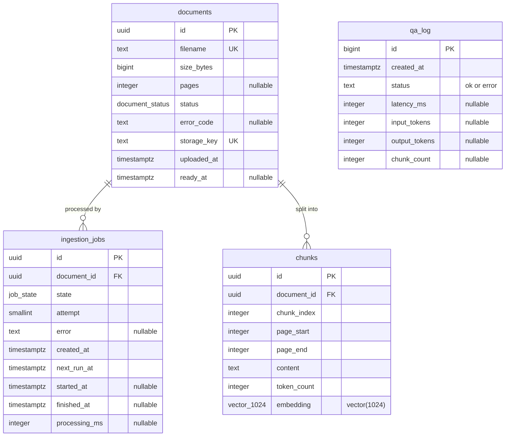

# Thiết kế CSDL — "Chat với tài liệu" (MVP v0.4)

> Version 0.1 · Trạng thái: `Draft` · 2026-11-02 · Chưa được review/duyệt
> Cấu trúc theo `sdlc/design/databaseDesign_SQL_prompt.md` và phần vector của `sdlc/design/databaseDesign_VectorDB_prompt.md`.
> **Nguồn sự thật:** `backend/app/migrations/versions/0001_init.py`, `backend/app/platform/db_schema.py`, `modules/qa/adapters/pg_retrieval.py`, `modules/documents/adapters/job_queue.py`, `modules/documents/ingestion/chunker.py`, `modules/qa/adapters/tei_embedding.py`.

> **Phạm vi:** lược đồ v0.4 chỉ có **4 bảng**: `documents`, `ingestion_jobs`, `chunks`, `qa_log`. `docs/04-design/schema.sql` (11 bảng) và SAD §3.1 mô tả **thiết kế mục tiêu, không phải v0.4**. Xem §10.

## 1. Tổng quan

| Mục | Giá trị | Nguồn |
|---|---|---|
| Nền tảng | PostgreSQL 16 + `pgvector`, `pgcrypto` | `infra/README.md` §2; `0001_init.py:16-17` |
| Phiên bản `pgvector` | SAD yêu cầu 0.7+; phiên bản thực tế trên RDS: [TBD]. Local dùng image `pgvector/pgvector:pg16` không ghim bản extension | SAD §0.3; `docker-compose.yml:18` |
| Collation, encoding | [TBD]: migration không đặt | — |
| Quy ước đặt tên | Bảng `snake_case`, số nhiều (trừ `qa_log`); chỉ mục `{bảng}_{mục đích}_idx` | `0001_init.py` |
| Quy mô | Tối đa 50 tài liệu × 300 trang; SAD ước lượng khoảng 30.000 chunk (chưa đo) | `platform/config.py:28-29`; SAD §3.1 |
| Số người dùng | [TBD: OQ-005] | — |
| Lưu giữ dữ liệu | [TBD: OQ-016] | §9 |

## 2. Sơ đồ ER



`qa_log` độc lập, không có khóa ngoại. Ứng dụng tạo đúng một `ingestion_jobs` cho mỗi `documents` (`adapters/sql_repo.py:22-30`), nhưng lược đồ không ràng buộc UNIQUE, nên quan hệ là 1–N.

| Khóa ngoại | Hành động khi xóa |
|---|---|
| `ingestion_jobs.document_id` → `documents.id` | `ON DELETE CASCADE` |
| `chunks.document_id` → `documents.id` | `ON DELETE CASCADE` |

## 3. DDL đúng như migration

Revision `0001_init` là revision duy nhất, viết bằng SQL thuần.

```sql
CREATE EXTENSION IF NOT EXISTS vector;
CREATE EXTENSION IF NOT EXISTS pgcrypto;
CREATE TYPE document_status AS ENUM ('queued','processing','ready','failed');
CREATE TYPE job_state AS ENUM ('queued','running','retrying','succeeded','failed');

CREATE TABLE documents (
  id           uuid PRIMARY KEY DEFAULT gen_random_uuid(),
  filename     text NOT NULL UNIQUE CHECK (length(filename) BETWEEN 1 AND 255),
  size_bytes   bigint NOT NULL CHECK (size_bytes > 0),
  pages        integer CHECK (pages IS NULL OR pages >= 1),
  status       document_status NOT NULL DEFAULT 'queued',
  error_code   text,
  storage_key  text NOT NULL UNIQUE,
  uploaded_at  timestamptz NOT NULL DEFAULT now(),
  ready_at     timestamptz,
  CONSTRAINT documents_failed_has_code CHECK (status <> 'failed' OR error_code IS NOT NULL)
);
CREATE INDEX documents_status_idx ON documents (status);

CREATE TABLE ingestion_jobs (
  id            uuid PRIMARY KEY DEFAULT gen_random_uuid(),
  document_id   uuid NOT NULL REFERENCES documents(id) ON DELETE CASCADE,
  state         job_state NOT NULL DEFAULT 'queued',
  attempt       smallint NOT NULL DEFAULT 0,
  error         text,
  created_at    timestamptz NOT NULL DEFAULT now(),
  next_run_at   timestamptz NOT NULL DEFAULT now(),
  started_at    timestamptz,
  finished_at   timestamptz,
  processing_ms integer
);
CREATE INDEX ingestion_jobs_pick_idx ON ingestion_jobs (next_run_at) WHERE state IN ('queued','retrying');
CREATE INDEX ingestion_jobs_running_idx ON ingestion_jobs (started_at) WHERE state = 'running';

CREATE TABLE chunks (
  id           uuid PRIMARY KEY DEFAULT gen_random_uuid(),
  document_id  uuid NOT NULL REFERENCES documents(id) ON DELETE CASCADE,
  chunk_index  integer NOT NULL CHECK (chunk_index >= 0),
  page_start   integer NOT NULL CHECK (page_start >= 1),
  page_end     integer NOT NULL,
  content      text NOT NULL,
  token_count  integer NOT NULL CHECK (token_count >= 1),
  embedding    vector(1024) NOT NULL,
  CONSTRAINT chunks_page_range CHECK (page_end >= page_start),
  CONSTRAINT chunks_document_index_uq UNIQUE (document_id, chunk_index)
);
CREATE INDEX chunks_embedding_hnsw_idx ON chunks USING hnsw (embedding vector_cosine_ops) WITH (m = 16, ef_construction = 64);

-- Usage log for the pilot. Deliberately stores NO question or answer text.
CREATE TABLE qa_log (
  id            bigint GENERATED ALWAYS AS IDENTITY PRIMARY KEY,
  created_at    timestamptz NOT NULL DEFAULT now(),
  status        text NOT NULL CHECK (status IN ('ok','error')),
  latency_ms    integer,
  input_tokens  integer,
  output_tokens integer,
  chunk_count   integer
);
CREATE INDEX qa_log_created_idx ON qa_log (created_at);
```

`downgrade()` xóa 4 bảng và 2 kiểu enum, **không** xóa extension (`0001_init.py:99-105`).

## 4. Ghi chú về cột

| Cột | Ý nghĩa, quy tắc | Nguồn |
|---|---|---|
| `documents.filename` | Đã chuẩn hóa: bỏ đường dẫn, NFC, tối đa 255 ký tự. UNIQUE là cơ sở của `duplicate_name` | `upload.py:43-46` |
| `documents.storage_key` | Định dạng `documents/{id}.pdf`; PDF nằm ở S3, không nằm trong CSDL | `upload.py:96` |
| `documents.pages` | NULL tới khi xử lý xong | `worker/ingest.py:88` |
| `documents.error_code` | `text`, không phải enum. Giá trị: `encrypted_pdf`, `no_text_layer`, `too_many_pages`, `corrupted`, `transient_exhausted`. Bắt buộc khi `status = 'failed'` | `0001_init.py:33`; `pdf_extractor.py:23` |
| `ingestion_jobs.attempt` | Tăng mỗi lần worker nhận việc, kể cả khi thu hồi job treo | `job_queue.py:17` |
| `ingestion_jobs.error` | Chi tiết lỗi, cắt còn 2000 ký tự | `job_queue.py:70` |
| `chunks.content` | **Văn bản tài liệu dạng rõ**, không có tiền tố ngữ cảnh | `chunker.py:119`, `ingest.py:79` |
| `chunks.token_count` | Đếm bằng tokenizer `bge-m3` | `chunker.py:40-41,121` |
| `qa_log.*` | Chỉ số liệu, **không lưu** câu hỏi / câu trả lời. Dòng `error` có token và `chunk_count` = 0 | `0001_init.py:82`; `qa/application/ask.py:34-36,68` |

Câu hỏi bị từ chối ở bước kiểm tra (`question_invalid`, `no_documents`) không ghi `qa_log` (`routers/ask.py:53-58`).

### Trạng thái

| Bảng | Chuyển trạng thái | Nguồn |
|---|---|---|
| `documents` | `queued` → `processing` → `ready` \| `failed`; `processing` → `queued` khi chờ thử lại | `job_queue.py:46-48,72-75,91-93`; `ingest.py:86-92` |
| `ingestion_jobs` | `queued` → `running` → `succeeded` \| `failed` \| `retrying`; `retrying` → `running`; `running` → `retrying` khi treo quá 10 phút | `job_queue.py` |

Không có trạng thái `uploading`, `removed` như lược đồ mục tiêu. Mỗi lần chạy lại, worker xóa chunk cũ rồi ghi mới trong cùng transaction (`ingest.py:69-93`).

## 5. Chỉ mục

| Chỉ mục | Định nghĩa | Lý do, dựa trên truy vấn trong code |
|---|---|---|
| `documents_pkey` | PK `id` | Join từ `chunks`; cập nhật theo `id` |
| UNIQUE `filename` | Tự sinh | Chống trùng tên; `existing_filenames` |
| UNIQUE `storage_key` | Tự sinh | Mỗi tài liệu một object |
| `documents_status_idx` | `(status)` | `ready_count` (`sql_repo.py:47-49`); lọc `status = 'ready'` khi truy xuất |
| `ingestion_jobs_pick_idx` | `(next_run_at) WHERE state IN ('queued','retrying')` | Truy vấn lấy việc `CLAIM_SQL` (`job_queue.py:14-25`) |
| `ingestion_jobs_running_idx` | `(started_at) WHERE state = 'running'` | Thu hồi job treo `RECLAIM_STALE_SQL` (`job_queue.py:27-32`) |
| `chunks_document_index_uq` | UNIQUE `(document_id, chunk_index)` | Chống trùng thứ tự; hỗ trợ xóa chunk theo tài liệu và CASCADE |
| `chunks_embedding_hnsw_idx` | HNSW cosine, `m=16`, `ef_construction=64` | Truy xuất vector (§7) |
| `qa_log_created_idx` | `(created_at)` | Dành cho số liệu theo thời gian. Truy vấn ở `infra/README.md` §6 quét toàn bảng, không lọc theo thời gian |

`ingestion_jobs.document_id` **không có chỉ mục**, nên CASCADE khi xóa tài liệu phải quét bảng này. Bảng tối đa khoảng 50 dòng trong điều kiện hiện tại vì giới hạn bộ tài liệu.

## 6. View, stored procedure, trigger

Không có. Logic nằm ở ứng dụng; dữ liệu mẫu không được nạp qua migration.

## 7. Thiết kế vector

| Mục | Giá trị | Nguồn |
|---|---|---|
| Lựa chọn công nghệ | `pgvector` trong PostgreSQL | [ADR-002](ADR-002-postgresql-pgvector.md) |
| Mô hình | `BAAI/bge-m3` qua TEI `cpu-1.7` | [ADR-004](ADR-004-self-hosted-embedding.md) |
| Vector | `vector(1024)` | `db_schema.py:26`; `0001_init.py:71` |
| Chuẩn hóa | `normalize: true`, `truncate: true`, lô 32 | `tei_embedding.py:8,23` |
| Chỉ mục | HNSW, `m=16`, `ef_construction=64` | `0001_init.py:77-80` |
| Độ đo | Cosine (`<=>`); `sim = 1 - distance` | `pg_retrieval.py:11,15` |
| Tham số truy vấn | `SET LOCAL hnsw.ef_search = 80`; `LIMIT QA_TOP_N` (mặc định 12) | `pg_retrieval.py:30-31`; `config.py:25` |
| Tìm kiếm lai | **Không có**: không có `tsv`, GIN, RRF | [ADR-003](ADR-003-retrieval-strategy.md) |
| Ngưỡng tương đồng | **Không có**: `sim` được tính nhưng không dùng để chặn | Plan v0.4 §1; [ADR-003](ADR-003-retrieval-strategy.md) |
| Nhịp cập nhật | Theo lô khi ingest từng tài liệu; không cập nhật vector tại chỗ | `worker/ingest.py:69-85` |

**Truy vấn:**

```sql
SET LOCAL hnsw.ef_search = 80;
SELECT d.filename, c.page_start, c.content,
       1 - (c.embedding <=> CAST(:qvec AS vector)) AS sim
  FROM chunks c
  JOIN documents d ON d.id = c.document_id
 WHERE d.status = 'ready'
 ORDER BY c.embedding <=> CAST(:qvec AS vector)
 LIMIT :top_n;
```

**Metadata:** lọc duy nhất là `documents.status = 'ready'`, qua JOIN. Trong luồng bình thường, chunk chỉ xuất hiện cùng transaction chuyển `ready` (`ingest.py:69-93`), nên điều kiện lọc này hiếm khi loại kết quả. `filename`, `page_start` được đưa vào ngữ cảnh gửi LLM; `page_end`, `token_count` không được đọc khi truy xuất. Không có `collection_id`.

**Chunking** ([ADR-006](ADR-006-page-bounded-chunking.md), `chunker.py`):

| Tham số | Giá trị |
|---|---|
| Mục tiêu / tối đa / chồng lấp | 500 / 800 / 75 token |
| Gộp trang ngắn | Dưới 80 token, gộp với trang kế tiếp |
| Văn bản đem embedding | `"{filename} — trang {page_start}: {content}"` |

**Dung lượng (ước lượng của SAD §3.1, chưa đo):** 30.000 chunk; vector khoảng 123 MB; HNSW thêm khoảng 2×, tổng < 500 MB; văn bản khoảng 60 MB.

**Chưa xác định:** recall@k, độ trễ truy vấn trên dữ liệu thật, cách tái embedding khi đổi mô hình: [TBD]. Đổi số chiều cần revision Alembic mới.

## 8. Migration và dữ liệu mẫu

- Chạy `alembic upgrade head`: service migrate trong `docker-compose.yml:60`; production trong `infra/deploy.sh:27`.
- Thay đổi lược đồ phải là revision mới; không sửa `0001_init.py` đã merge (`AGENTS.md`).
- Migration chạy bằng driver `psycopg`; ứng dụng dùng `asyncpg` (`migrations/env.py`).
- `db_schema.py` chỉ phục vụ truy vấn SQLAlchemy Core; `env.py` không dùng metadata này, nên không có autogenerate.
- `make seed` tải 3 PDF mẫu qua API đang chạy; fixture chỉ là dữ liệu giả lập.

## 9. Vận hành

| Mục | Giá trị | Nguồn |
|---|---|---|
| Sao lưu RDS | Backup 7 ngày | `infra/README.md` §2 |
| Sao lưu S3 | Versioning | `infra/README.md` §2 |
| RPO / RTO | 24 giờ / 1 ngày làm việc ⚑ (mục tiêu) | SAD TC-08 |
| Diễn tập khôi phục | [TBD] | SAD §4.2 đề xuất mỗi quý; chưa có bản ghi |
| Thời gian lưu tài liệu, `chunks` | [TBD: OQ-016] | `docs/01-intake/intent.md` |
| Thời gian lưu `qa_log`, `ingestion_jobs` | [TBD] | Không có job dọn dẹp ([ADR-011](ADR-011-mvp-feature-reductions.md)) |
| Lifecycle phiên bản S3 cũ | [TBD] | SAD §2.3 ghi 30 ngày; `infra/README.md` không có |
| Mã hóa | RDS KMS, `rds.force_ssl=1`; S3 SSE-KMS | `infra/README.md` §2 |
| Truy cập | `sg-db` chỉ nhận 5432 từ `sg-app`; ứng dụng dùng user `cwd` | `infra/README.md` §2, §3 |
| Row-level security, role tách quyền | Không có | `0001_init.py` |
| Số liệu pilot | SQL trên `qa_log` | `infra/README.md` §6 |
| Bảo trì HNSW, `VACUUM`, cấu hình `shared_buffers` | [TBD] | — |

**Gỡ tài liệu** (thủ công, `infra/README.md` §7): `DELETE FROM documents ... RETURNING storage_key`, rồi `aws s3 rm`. `chunks` và `ingestion_jobs` tự xóa theo CASCADE. Bucket bật versioning nên `aws s3 rm` không kèm version ID chỉ tạo delete marker; các phiên bản cũ vẫn còn. Cần xét điểm này khi đóng OQ-016. Khôi phục từ backup RDS cũng có thể đưa dữ liệu đã xóa quay lại.

**Bảo mật:** `chunks.content` chứa văn bản tài liệu dạng rõ và không có đăng nhập ở tầng ứng dụng, nên bảo vệ dựa vào giới hạn mạng và mã hóa at-rest ([ADR-007](ADR-007-session-authentication.md)).

## 10. So với thiết kế mục tiêu và tài liệu khác

`docs/04-design/schema.sql` và SAD §3.1 là lược đồ **mục tiêu**:

| Nội dung | Mục tiêu | v0.4 |
|---|---|---|
| Số bảng | 11 trong `schema.sql` (cùng các partition): `collections`, `users`, `documents`, `ingestion_jobs`, `chunks`, `conversations`, `messages`, `citations`, `feedback`, `analytics_events`, `audit_log` | 4: `documents`, `ingestion_jobs`, `chunks`, `qa_log` |
| Bảng log hỏi đáp | Không có `qa_log` | Có `qa_log` |
| `chunks` | Có `tsv`, chỉ mục GIN | Không |
| `documents` | Có `collection_id`, `sha256`; trạng thái thêm `uploading`, `removed` | Không có. `put_stream` tính sha256 nhưng kết quả không được lưu |
| Tên duy nhất | `UNIQUE (collection_id, filename) WHERE removed_at IS NULL` | `UNIQUE (filename)` |
| Khóa S3 | `collections/{collection_id}/documents/{document_id}/original.pdf` | `documents/{id}.pdf` |

**Mâu thuẫn giữa các tài liệu:**

| Tài liệu | Nội dung | Thực tế |
|---|---|---|
| SAD "Phạm vi kiến trúc cho MVP" | Migration MVP tạo 10 bảng, gồm `sessions`, `messages`, `citations`, `audit_log` | Tạo 4 bảng; Plan v0.4 có hiệu lực |
| SAD §3.1 (sơ đồ ER) | Vẽ 10 thực thể, không có `analytics_events` | `schema.sql` có 11 bảng |
| `docs/05-development/tasks/T-004-db-migration.md` | Không có CHECK, `documents_status_idx`, `ingestion_jobs_running_idx`, `qa_log_created_idx` | Migration có các đối tượng này |
| `backend/app/platform/db_schema.py` | Docstring ghi "mirroring", nhưng không khai CHECK và không khai 5 chỉ mục tạo bằng `CREATE INDEX` | Migration là chuẩn; `db_schema.py` không tạo lược đồ |
