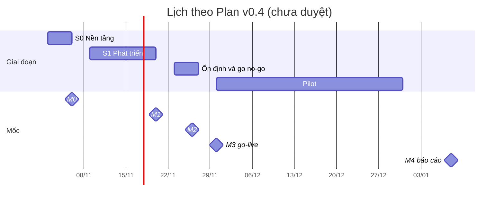

# Software Development Plan — "Chat với tài liệu" (MVP v0.4)

| Thuộc tính | Giá trị |
|---|---|
| Mã tài liệu | SDP-CWD-001 |
| Dự án / mã dự án | Chat với tài liệu (Chat with Document) / [TBD: OQ-001], tiền tố tài liệu hiện dùng là `CWD` |
| Tổ chức | [TBD: OQ-001] |
| Phiên bản / trạng thái | 0.1 / `Draft` |
| Ngày phát hành | 2026-11-02 (múi giờ: ICT, UTC+7) |
| Phân loại | Nội bộ, theo `Test_Plan.md` §1; phân loại bảo mật tài liệu dự án còn [TBD: OQ-008] |
| Chủ sở hữu | Huy Toan (PO / Tech lead) |
| Tác giả | Agent (Claude), chờ review |
| Người review, người duyệt | [TBD: OQ-001]; đề xuất ở `docs/01-intake/stakeholders.md` §4 (Quản lý + một reviewer kỹ thuật khác) |
| Mô hình triển khai | Incremental theo timebox, đề xuất (§3.1) |
| Risk tier | `intent.md` đề xuất **High**, chưa được duyệt |
| Bối cảnh pháp lý | [TBD: OQ-008] |
| Quy mô đội | 1 người đã biết (Huy Toan); BE1, BE2, FE, QA, BA, IT là [TBD] |
| Ngân sách | [TBD: OQ-007] |
| Ngày go-live mục tiêu | 2026-11-30, theo Plan v0.4; đề xuất, chờ duyệt (OQ-006) |

**Thẩm quyền:** tài liệu này diễn giải `docs/05-development/Implement_plan.md` v0.4 (IMP-CWD-001), không thay thế. Nếu hai bên khác nhau về phạm vi, lịch hoặc ước lượng thì Plan v0.4 và `docs/05-development/tasks/` có hiệu lực, theo `AGENTS.md`.

**Change log**

| Phiên bản | Ngày | Tác giả | Mô tả | Người duyệt |
|---|---|---|---|---|
| 0.1 | 2026-11-02 | Agent (Claude), chờ review | Bản đầu, lập từ Plan v0.4 và tình trạng repo tại commit `c02cc72` | |

## Mục lục

- [Mục lục](#mục-lục)
- [Tóm tắt điều hành](#tóm-tắt-điều-hành)
- [1. Giới thiệu](#1-giới-thiệu)
- [2. Tổng quan và bối cảnh dự án](#2-tổng-quan-và-bối-cảnh-dự-án)
- [3. Phương pháp phát triển](#3-phương-pháp-phát-triển)
- [4. Tổ chức và quản trị dự án](#4-tổ-chức-và-quản-trị-dự-án)
- [5. Phân rã công việc, ước lượng, lịch và nguồn lực](#5-phân-rã-công-việc-ước-lượng-lịch-và-nguồn-lực)
- [6. Theo dõi và kiểm soát](#6-theo-dõi-và-kiểm-soát)
- [7. Các quy trình hỗ trợ](#7-các-quy-trình-hỗ-trợ)
- [8. Sản phẩm bàn giao, nghiệm thu và chuyển giao](#8-sản-phẩm-bàn-giao-nghiệm-thu-và-chuyển-giao)
- [9. Tuân thủ, tailoring và ngoại lệ](#9-tuân-thủ-tailoring-và-ngoại-lệ)
- [10. Phê duyệt](#10-phê-duyệt)
- [Appendix A — Ma trận truy vết](#appendix-a--ma-trận-truy-vết)
- [Appendix B — Ma trận RACI](#appendix-b--ma-trận-raci)
- [Appendix C — Sổ rủi ro](#appendix-c--sổ-rủi-ro)
- [Appendix D — Tự đánh giá theo checklist ISO/IEC/IEEE 24748-5](#appendix-d--tự-đánh-giá-theo-checklist-isoiecieee-24748-5)
- [Appendix E — Giả định, ràng buộc, xung đột và việc mở](#appendix-e--giả-định-ràng-buộc-xung-đột-và-việc-mở)
- [Appendix F — Thuật ngữ](#appendix-f--thuật-ngữ)
- [Appendix G — Tài liệu tham chiếu](#appendix-g--tài-liệu-tham-chiếu)
- [Appendix H — Change log](#appendix-h--change-log)

## Tóm tắt điều hành

**Mục đích.** Xây ứng dụng web nội bộ để đội BD tải PDF dự án lên (F1) và hỏi đáp bằng tiếng Việt, AI chỉ trả lời từ tài liệu (F2). MVP dùng để đánh giá giá trị trước khi đầu tư thêm.

**Cách làm.** 24 task, 28 ngày công, chia S0 (02–06/11), S1 (09–20/11), tuần ổn định (23–27/11). Go-live 30/11/2026, pilot đến 31/12/2026, báo cáo đánh giá 08/01/2027.

**Tình trạng tại 02/11/2026** (commit `c02cc72`, Task README và Trace rà soát cùng ngày).

- 23/24 task `In progress`, T-023 `To do`, **chưa task nào `Done`**. Đạt 22/68 tiêu chí; tiêu chí chung (review, CI xanh, deploy AWS) đạt 0/24.
- Mã nguồn đã có trước ngày S0 bắt đầu: commit của T-001…T-022 và T-024 có ngày 26/10.
- Chưa có PR hay review. Job `backend`, `frontend` xanh; job `build` đỏ ở `configure-aws-credentials`. AWS chưa dựng.
- Chưa có phê duyệt nào cho phạm vi v0.4, OQ-008, risk tier hay tailoring.

**Mốc gần nhất.** M0 (06/11) yêu cầu local + AWS chạy và CI xanh; hiện chưa đạt phần AWS và CI.

**Rủi ro hàng đầu.**

| Rủi ro | Vì sao đáng lo |
|---|---|
| RISK-001: OQ-008 chưa có quyết định | Có thể đổi nhà cung cấp AI; phương án xấu nhất lùi go-live tới khoảng 07/12/2026 |
| RISK-016: AWS chưa dựng, đầu vào từ IT và tài khoản đã quá hạn | Chặn M0, M1, UAT, eval trên AWS |
| RISK-017: chưa có người cho BE1, BE2, FE, QA | 28 ngày công lớn hơn 20 ngày làm việc của cửa sổ 02–27/11 nếu chỉ một người làm |
| RISK-018: chưa có review độc lập | Không task nào đạt `Done`; người soạn đang đồng thời là người duyệt |

**Quyết định cần có ngay.**

1. Duyệt phạm vi v0.4 và 4 đánh đổi (Quản lý; hạn cũ 28/10 đã qua).
2. OQ-008 (Bảo mật / Quản lý; hạn 06/11).
3. OQ-001: người duyệt, reviewer độc lập, người cho các vai trò [TBD].
4. Risk tier và các mục tailoring ở §3.5.
5. OQ-007: ngân sách.

## 1. Giới thiệu

### 1.1 Mục đích

SDP nêu cách dự án được lập kế hoạch, tổ chức, theo dõi và kiểm soát. Nó hỗ trợ các quyết định: duyệt baseline lịch, phân công người, tailoring, go / no-go. SDP không có hiệu lực baseline cho đến khi người duyệt ở §10 ký.

### 1.2 Phạm vi

| Nhóm | Nội dung | Nguồn |
|---|---|---|
| Sản phẩm trong phạm vi | F1 Xử lý PDF (US-005, 006, 007 bản tối giản); F2 Hỏi đáp AI (US-008, 011, 015 bản tối giản) | Plan §1 |
| Bản phát hành | REL-001: MVP v0.4 go-live 2026-11-30 (M3) | Plan §2 |
| Công việc | T-001…T-024; pilot và báo cáo M4 | Plan §2 |
| Lược bỏ ở v0.4 | Đăng nhập, phân quyền, hội thoại riêng tư (US-001, 002, 003, 023); trích dẫn, mở PDF tại trang (US-013, 017); AnswerGuard (US-014); streaming (US-016); gỡ tài liệu, tinh chỉnh đa nguồn (US-010, 012); PoC, rà soát bảo mật riêng, a11y, runbook đầy đủ, quét bảo mật trong CI | Plan §1 |
| Ngoài phạm vi từ BRD | Định dạng khác PDF; di động native; tích hợp Drive / SharePoint; chỉnh sửa PDF; dùng kiến thức ngoài tài liệu | `intent.md` §6 |
| Hoãn | OCR cho PDF scan; xuất câu trả lời; báo cáo thống kê cho quản lý | `intent.md` §6 |
| Ranh giới tổ chức | [TBD: OQ-001] | — |

4 đánh đổi cần quản lý chấp nhận: không trích dẫn, không đăng nhập, chống bịa chỉ bằng prompt, không gỡ tài liệu trên giao diện (Plan §1). Chưa có quyết định.

### 1.3 Đối tượng đọc

| Vai trò | Đọc | Để quyết định |
|---|---|---|
| Quản lý | Tóm tắt, §3.5, §4.6, §5.5, §5.7, §9 | Duyệt phạm vi, baseline, ngân sách, tailoring; go / no-go |
| Bảo mật / IT | §2.6, §7.7, Appendix C | OQ-008; dải IP / VPN |
| PO / Tech lead | Toàn bộ | Điều hành hằng ngày |
| BE1, BE2, FE | §3.3, §5.1, §7.1, `WBS.md` | Nhận việc |
| QA | §6.3, §7.2, §7.3 | Cổng chất lượng |
| Đội BD | §4.5, §8.3 | Dữ liệu mẫu, UAT |

### 1.4 Định nghĩa và viết tắt

Thuật ngữ dự án theo `docs/01-intake/glossary.md`. Từ bổ sung ở Appendix F.

### 1.5 Tài liệu tham chiếu

Danh sách đầy đủ ở Appendix G. Tình trạng đầu vào ở Appendix E, mục E.1.

### 1.6 Quy ước

| Mục | Quy ước |
|---|---|
| ID kế thừa | Giữ nguyên `BR-`, `US-`, `NFR-`, `ADR-`, `RSK-`, `OQ-`, `T-`; mốc giữ `M0`…`M4` thay cho `MS-xxx` |
| ID mới | `WP-0NN`, `DEL-0NN` trùng số với `T-0NN`; `WP-025`…`027`, `DEL-025`…`027` là phần chưa có task |
| `RISK-` | `RISK-001`…`012` thuộc `Test_Plan.md` §15, giữ nguyên nghĩa; SDP thêm từ `RISK-013` |
| Quy phạm | `shall` / phải: bắt buộc; `should` / nên: khuyến nghị; `may` / có thể: tùy chọn |
| TBD | `[TBD: OQ-xxx]` hoặc `[TBD: OPEN-xxx]`, luôn có vai trò chủ sở hữu ở §9.4. Hạn có dấu `*` là đề xuất của người soạn, neo theo mốc Plan |
| Dấu | `†`: người soạn đề xuất, chưa ai xác nhận. `⚑`: giá trị đề xuất chờ OQ-021 |
| Ngày | `YYYY-MM-DD`, ICT; ngày dạng `dd/mm` là năm 2026 |
| Nguồn | `Plan` = `docs/05-development/Implement_plan.md`; `Task README` = `docs/05-development/tasks/README.md`; `TP` = `docs/07-verification/Test_Plan.md`; `Trace` = `docs/05-development/traceability.md`; `SDLC` = `sdlc/agentic-sdlc-process.md` |

## 2. Tổng quan và bối cảnh dự án

### 2.1 Động lực nghiệp vụ

Đội BD mất thời gian tổng hợp thông tin từ nhiều PDF (SRC-001). Quản lý yêu cầu một MVP web để tải PDF và chat với AI. Chưa có số liệu về thời gian bị mất hay tác động tài chính (OQ-002, OQ-005). Nguồn: `intent.md` §1, `sources.md` §2. Hệ quả nếu thất bại: không có căn cứ đầu tư tiếp (RSK-005).

### 2.2 Mục tiêu và chỉ số thành công

| Mục tiêu | Chỉ số | Ngưỡng | Đo được ở v0.4? |
|---|---|---|---|
| BO-001 | MET-001 / KR1.1 | Giảm ≥ 50% ⚑ so với baseline | Chưa: không có baseline (OQ-002) |
| BO-001 | KR1.2 / NFR-001 | p90 ≤ 15 s ⚑; v0.4 chấp nhận 10–20 s | Có qua `qa_log.latency_ms`; chưa đo với Claude thật |
| BO-002 | MET-002 / KR2.1 | ≥ 80% ⚑ câu positive đúng | Golden set; chưa có bộ thật và khóa API |
| BO-002 | KR2.3 | ≥ 90% ⚑ câu negative nhận "không tìm thấy" | Như trên |
| BO-002 | "Kiểm chứng được" | — | **Không còn được đáp ứng** (đánh đổi 1) |
| BO-003 | MET-003 / KR3.1 | ≥ 70% ⚑ đội BD hỏi ≥ 1 câu mỗi tuần | **Không đo đúng định nghĩa:** không có đăng nhập; đếm số câu hỏi, thêm khảo sát |
| Vận hành | NFR-003 | PDF 50 trang Sẵn sàng ≤ 60 s ⚑ | Chưa đo trên AWS |

Tiêu chí nghiệm thu mức dự án: 5 tiêu chí ở `intent.md` §8 và cổng go-live ở TP §7.2.

### 2.3 Mô tả sản phẩm

Ứng dụng web không đăng nhập, gồm 2 màn hình (Tài liệu, Hỏi đáp). Giới hạn đang cấu hình: tối đa 10 PDF mỗi lần, 20 MB mỗi tệp, 300 trang, 50 tài liệu (`.env.example`). Mỗi câu hỏi độc lập, không streaming. Không thay thế hệ thống hiện có nào được ghi nhận.

### 2.4 Bối cảnh hệ thống và giao tiếp ngoài

| Thành phần ngoài | Hướng | Dữ liệu | Trạng thái |
|---|---|---|---|
| Trình duyệt người dùng BD | Vào qua ALB | PDF, câu hỏi, câu trả lời | Chỉ trong dải IP / VPN; dải chưa có |
| Anthropic API (`claude-opus-5-5`) | Ra | Đoạn tài liệu + câu hỏi | **Chờ OQ-008**; chưa có khóa |
| TEI `bge-m3` | Nội bộ | Văn bản để embedding | Tự vận hành |
| S3, RDS PostgreSQL 16 + pgvector | Nội bộ | Tệp PDF; chunk, vector, `qa_log` | Local dùng S3Mock + Postgres; AWS chưa dựng |
| CloudWatch Logs | Ra từ EC2 | Log JSON, không chứa nội dung | Chưa dựng |
| GitHub Actions, ECR | CI | Image | ECR chưa có; secret `AWS_DEPLOY_ROLE_ARN` chưa cấu hình |

Thiết kế chi tiết: `docs/04-design/SAD.md` (mục "Phạm vi kiến trúc cho MVP", chưa theo v0.4), `docs/04-design/ADR-*.md`, `docs/04-design/openapi.md`, `docs/04-design/database-design.md`.

### 2.5 Bên liên quan

Chi tiết ở `stakeholders.md`. Tóm tắt:

| ID | Bên liên quan | Mối quan tâm | Ảnh hưởng | Người |
|---|---|---|---|---|
| STK-001 | Quản lý | Giá trị MVP, đúng phạm vi | Cao | [TBD: OQ-001] |
| STK-002 | Đội BD | Tìm nhanh, chính xác; giao dữ liệu, UAT | Cao | [TBD: OQ-001] |
| STK-003 | Nhóm BA | Phạm vi rõ | Trung bình | [TBD] |
| STK-004 | Đội phát triển | Yêu cầu rõ, kiểm chứng được | Trung bình | Huy Toan; còn lại [TBD] |
| STK-005 | Bảo mật / IT / pháp chế | Không lộ tài liệu; **có thể chặn** | Cao | [TBD: OQ-001] |

### 2.6 Giả định, ràng buộc, phụ thuộc

Danh sách đầy đủ ở Appendix E. Ràng buộc chi phối: CON-001…004 (web, PDF, chat AI, MVP); go-live 30/11 chờ OQ-006; ngân sách chờ OQ-007; không gửi tài liệu thật ra AI ngoài trước khi đóng OQ-008 (`sources.md` §6); không mở ALB ra `0.0.0.0/0` (`AGENTS.md`).

### 2.7 Chuẩn áp dụng

Chưa có yêu cầu tuân thủ bắt buộc nào được ghi nhận: bối cảnh pháp lý là [TBD: OQ-008]. Các chuẩn dưới đây được dùng làm khung tham chiếu qua `sdlc/`.

| Chuẩn | Dùng cho | Mức áp dụng |
|---|---|---|
| ISO/IEC/IEEE 24748-5:2017 | SDP này | Theo khung prompt; xem §3.6 |
| ISO/IEC/IEEE 12207:2017 | Ánh xạ quy trình §3.2 | Theo tên quy trình |
| ISO 21511:2018 | `WBS.md` | Theo nguyên tắc |
| ISO/IEC/IEEE 29148:2018 | BRD, PRD | Tài liệu `Draft`, chưa theo v0.4 |
| IEEE 1016-2009 | SAD, Blueprint | Tài liệu `Draft`, chưa theo v0.4 |
| IEEE 829-2008, ISO/IEC/IEEE 29119 | Test Plan | `Draft`, chờ review |
| IEEE 1028 | Code review | Có checklist; chưa có lần review nào |
| ISO/IEC 25010:2011 | Thuộc tính chất lượng | Tham chiếu |
| ISO/IEC 27001 | Bảo mật thông tin | Chưa rõ tổ chức có áp dụng không: [TBD: OQ-008] |

### 2.8 Risk tier

`docs/01-intake/intent.md` §8 đề xuất **High**, chưa được duyệt. Lý do nêu ở đó: tài liệu chưa rõ phân loại có thể gửi tới AI ngoài; không có đăng nhập; câu trả lời sai có thể dẫn tới quyết định sai mà không có trích dẫn để kiểm chứng.

Nếu giữ High, SDLC yêu cầu thêm inspection (L3) và demo xác nhận (L4) ngoài review của người (L2). Cả ba đều chưa có người và chưa có trong 28 ngày công (RISK-020).

### 2.9 Quan hệ với các kế hoạch khác

| Kế hoạch | Vị trí | Quan hệ | Trạng thái |
|---|---|---|---|
| Kế hoạch triển khai | `docs/05-development/Implement_plan.md` | **Có thẩm quyền** về phạm vi, lịch, ước lượng | v0.4 `Draft`, chưa duyệt |
| Đặc tả task | `docs/05-development/tasks/` | Tầng task; SDP không thay đổi | 24 card |
| WBS | `docs/05-development/WBS.md` | Chi tiết của §5.1, §5.2 | `Draft` |
| Test Plan | `docs/07-verification/Test_Plan.md` | SDP tham chiếu; không lặp lại | v0.2 `Draft`, chờ review |
| Quality, CM, Security | Không có tài liệu riêng | Nằm ở §7.1, §7.2, §7.7 | — |
| Release | `docs/09-release/` theo SDLC | Tóm tắt ở §8.4, §8.5 | **Chưa tạo** |
| Operate (runbook) | `docs/10-operations/` theo SDLC | Tóm tắt ở §7.9, §8.6; `infra/README.md` có một phần | **Chưa tạo**; runbook đầy đủ bị lược bỏ ở v0.4 |
| Decommission | `docs/11-decommissioning/` theo SDLC | §3.2 | **Chưa tạo** |

## 3. Phương pháp phát triển

### 3.1 Mô hình vòng đời

Plan v0.4 không nêu tên mô hình. Theo cấu trúc lịch, đề xuất ghi nhận là **incremental theo timebox**: S0 nền tảng (1 tuần), S1 hai tính năng song song (2 tuần), tuần ổn định, một lần go-live, pilot. Mỗi task đi theo vòng SPECIFY → GENERATE → VERIFY → REFINE của SDLC.

Lý do phù hợp: phạm vi nhỏ, hạn ngắn, chất lượng AI chỉ đo được bằng lặp eval (T-023). Trạng thái: đề xuất, chờ duyệt.

**Sai lệch ghi nhận (C-01):** Plan đặt S0 bắt đầu 02/11, nhưng `git log` cho thấy 23 commit `T-001`…`T-022`, `T-024` có timestamp từ 2026-10-26 22:11:10 đến 22:12:00 (+07:00), cùng ngày với commit rút phạm vi xuống v0.4 (21:30:44). Công thực tế đã bỏ ra không được ghi nhận. Các ngày trong Plan được giữ nguyên.

### 3.2 Quy trình và hoạt động (ánh xạ ISO/IEC/IEEE 12207)

| Quy trình | Hoạt động trong dự án | Sản phẩm | Tình trạng |
|---|---|---|---|
| Requirements | BRD, PRD, User Stories | `docs/02-requirements/` | `Draft`, chưa theo v0.4 |
| Architecture | SAD, ADR | `docs/04-design/SAD.md`, `docs/04-design/ADR-*.md` | `Draft`, chưa theo v0.4 |
| Design | Blueprint, API, DB, UI | `docs/04-design/`, `docs/04-design/` | `Draft` |
| Implementation | T-001…T-022 | `backend/`, `frontend/`, `infra/` | Có mã; chưa task nào `Done` |
| Integration | Testcontainers, Compose | `backend/tests/integration/`, `docker-compose.yml` | Trên local, CI; AWS chưa có |
| Verification | Lint, unit, integration, E2E, eval | TP, `test_reports/` | 9/77 test case có báo cáo chạy theo Trace §4 (xem E.1) |
| Transition | Deploy, go-live (T-006, T-024) | `infra/`, `UAT.md` | Chưa thực hiện |
| Validation | UAT 26/11; pilot | `UAT.md`, báo cáo M4 | Mới là mẫu |
| Operation | Pilot 30/11 → 31/12 | `qa_log`, CloudWatch | Chưa đến hạn |
| Maintenance | Sửa lỗi trong pilot | [TBD: OPEN-022] | Chưa lập kế hoạch sau pilot |
| Disposal | Thu hồi tài liệu, tài nguyên AWS | [TBD: OQ-016] | Chưa lập kế hoạch |
| Project Planning, Assessment and Control | Plan, SDP, WBS, Task README | `docs/05-development/`, `docs/05-development/` | `Draft` |
| Decision, Risk, CM, Information, Measurement, QA | §6, §7 | Tài liệu này | Đề xuất |

### 3.3 Phương pháp và quy tắc kỹ thuật

| Nội dung | Quy định | Thực tế 02/11 |
|---|---|---|
| Kiến trúc | Use case chỉ phụ thuộc port; không import FastAPI, `anthropic`, boto3 (`AGENTS.md`) | Chưa kiểm tự động |
| Coding | `ruff`, `mypy`, `eslint`, `tsc` | Sạch khi chạy lại 02/11 (Task README) |
| Test | Unit, integration; card nêu kiểm thử riêng | Backend 50, frontend 15 (Trace §4) |
| Code review | PR, 1 approver ≠ tác giả, ≤ 400 dòng, rubric 7 tiêu chí (SDLC) | **Chưa có PR, review nào** |
| Nhánh | `feat/T-xxx-*` theo từng card; `AGENTS.md`: mỗi commit thuộc một task | Mọi commit trực tiếp trên `main`; 0 merge commit |
| Prompt | Sửa `prompts.py` phải chạy `make eval`, ghi điểm vào PR | Chưa có lần chạy với Claude thật |
| CSDL | Revision Alembic mới; không sửa `0001_init.py` | Chỉ có `0001_init` |
| Definition of Ready | Task có card; mọi task phụ thuộc xong (Task README) | Có |
| Definition of Done | Đạt tiêu chí card; có bằng chứng; review, CI xanh, deploy AWS (Task README) | 0/24 đạt |
| Tài liệu trong repo | `docs/`; cập nhật `traceability.md` khi đổi test | Đang áp dụng |
| TDD, pair programming, feature flag | Không quy định trong đầu vào | Không áp dụng; feature flag không có trong v0.4 |

### 3.4 Công cụ, môi trường, công nghệ

| Nhóm | Công cụ / phiên bản | Nguồn |
|---|---|---|
| Backend | Python 3.12, FastAPI, SQLAlchemy 2, Alembic, PyMuPDF, structlog | `backend/pyproject.toml` |
| Frontend | React 18, Vite 5, TypeScript 5, TanStack Query, i18next, marked, DOMPurify | `frontend/package.json` |
| Dữ liệu, AI | PostgreSQL 16 + pgvector; TEI `bge-m3`; `anthropic` SDK, `claude-opus-5-5` | `docker-compose.yml`, `.env.example` |
| Lint, kiểu | ruff, mypy, eslint, tsc | `Makefile` |
| Test | pytest, Testcontainers, vitest, Playwright 1.64.1 | `pyproject.toml`, `package.json` |
| CI/CD | GitHub Actions; `infra/deploy.sh`, `rollback.sh`; ECR | `.github/workflows/ci.yml` |
| Version control | Git, GitHub (`nhtoan3/chat_with_document`) | Remote `origin` |
| Quét phụ thuộc, bí mật, coverage | **Không có trong CI** | Không có trong `ci.yml`, `pyproject.toml` |
| Quan sát | Log JSON → CloudWatch `/cwd/prod` (dự kiến) | `infra/README.md` |
| Theo dõi lỗi | GitHub Issues nhãn `bug` | TP §6.4 |
| IDE, công cụ quản lý công việc khác | Không quy định | — |

### 3.5 Tailoring và sai khác

**Không mục nào dưới đây đã được duyệt.** Trạng thái: chờ duyệt (OPEN-012). Sổ đầy đủ ở §9.2.

### 3.6 Ma trận tuân thủ chuẩn

Xem §9.1. Không trích số điều khoản vì chưa đối chiếu bản chuẩn.

### 3.7 Quản trị phát triển có AI / agent

| Nội dung | Quy định | Bằng chứng / thực tế |
|---|---|---|
| Mức sử dụng | — | 38/39 commit có trailer `Co-Authored-By: Claude Opus 5.5`; E2E-001…009 do tooling agent chạy (`test_reports/`) |
| Agent được làm | Soạn nháp, sinh code, chạy test, audit theo checklist (SDLC §1) | Đang áp dụng |
| Agent không được làm | Approve, merge, deploy; đổi production (SDLC §8, §9) | Chưa có cổng kỹ thuật ngăn: branch protection chưa kiểm chứng (T-003) |
| Trách nhiệm | Con người ký duyệt và chịu trách nhiệm; người tạo ≠ người duyệt | **Chưa đạt:** xem §4.2 |
| Dữ liệu | Fixture giả lập; không dùng tài liệu thật trước khi đóng OQ-008; không commit `.env`, khóa, dữ liệu khách hàng | `sources.md` §6, `AGENTS.md` |
| Truy xuất nguồn gốc | Trailer commit; tiền tố mã task trong tiêu đề | Commit đang có trailer; chưa có bản ghi prompt / phiên agent |
| Hướng dẫn agent | `AGENTS.md` | Có |

### 3.8 Tái sử dụng, nguồn mở, COTS, IP

Phụ thuộc được khai báo trong `pyproject.toml`, `package.json`; xem §7.11. Chưa rà soát giấy phép và bảo mật (OPEN-015). Backend chưa có lock file (OPEN-024). Lối thoát cho nhà cung cấp AI: thêm adapter mới sau `LLMPort` (`AGENTS.md`, Plan §4). Quyền sở hữu mã, giấy phép repo: [TBD: OQ-001]; repo không có tệp LICENSE.

## 4. Tổ chức và quản trị dự án

### 4.1 Cơ cấu tổ chức

Không có sơ đồ tổ chức trong đầu vào: [TBD: OQ-001]. Đã biết: Quản lý giao yêu cầu (STK-001); Huy Toan giữ PO và Tech lead; các vai trò thực hiện còn lại ở §4.3.

### 4.2 Vai trò và trách nhiệm

Trách nhiệm theo `stakeholders.md` §3 và TP §12. RACI ở Appendix B là đề xuất theo vai trò.

**Xung đột cần gỡ (`stakeholders.md` §5):** Huy Toan đứng tên tác giả BRD, PRD, User Stories, SAD, Plan, Test Plan, đồng thời giữ PO và Tech lead, tức cũng là người duyệt. Điều này trái luật "người tạo nội dung ≠ người phê duyệt". Ngoài ra Huy Toan là chủ sở hữu SDP này, nên không tự duyệt thay cho Quản lý và reviewer độc lập.

### 4.3 Nhân sự

| Vai trò | Người | Khối lượng theo card (ngày công) | FTE, địa điểm |
|---|---|---|---|
| PO | Huy Toan | Tham gia T-024 | [TBD: OPEN-007] |
| Tech lead (TL) | Huy Toan | T-001, 002, 003, 006 = 4,5; tham gia T-024 | [TBD: OPEN-007] |
| BE1 | [TBD] | T-004 0,5; T-009…014, 016 = 7,5; tham gia T-008, T-023 | [TBD: OPEN-007] |
| BE2 | [TBD] | T-005 1; T-017…020, 022 = 5,5; tham gia T-023 | [TBD: OPEN-007] |
| FE | [TBD] | T-007, 015, 021 = 4,5; Plan: có thể bán thời gian hoặc backend kiêm | [TBD: OPEN-007] |
| QA | [TBD]; TP §12: có thể BE1 kiêm | Tham gia T-008, T-023, T-024 | [TBD: OPEN-007] |
| BA, IT | [TBD] | Bộ câu hỏi tạm; dải IP / VPN | Ngoài 28 ngày công |
| Đội BD | [TBD: OQ-001] | ≥ 2 đại diện UAT; golden set | Ngoài 28 ngày công |

### 4.4 Năng lực và đào tạo

Nhu cầu đào tạo theo TP §13: Testcontainers và hexagonal, Playwright, chấm câu trả lời RAG, giới hạn MVP cho BD, kiểm tra cấu hình AWS. Ma trận kỹ năng theo người: [TBD: OPEN-007].

### 4.5 Tương tác và truyền thông

| Đối tượng | Nội dung | Kênh | Tần suất / mốc | Chủ trì |
|---|---|---|---|---|
| Quản lý, Bảo mật | Duyệt v0.4, OQ-008, risk tier, OQ-001, 006, 007 | Phiếu `Phe_duyet_v0.4_OQ-008.md` | Hạn 06/11 | PO |
| IT | Dải IP / VPN, tên miền | Yêu cầu riêng | Hạn cũ 30/10 đã qua | TL |
| Đội BD | PDF mẫu, golden set, baseline | Làm việc trực tiếp | 05/11 | BA |
| Đội BD | UAT | Buổi UAT | 26/11 | PO, QA |
| Quản lý, PO, TL | Go / no-go | Họp | 27/11 | PO |
| Đội BD | Hướng dẫn sử dụng 1 trang | [TBD] | Go-live 30/11 | PO |
| Người liên quan | Báo cáo tiến độ | §6.2 | Tuần†, chờ PO xác nhận | PO |

Nguồn: `stakeholders.md` §6, T-024. Đường leo thang†: thành viên → TL → PO → Quản lý.

### 4.6 Cơ quan quản trị và quyền quyết định

Chưa có ban điều hành hay CCB. Đề xuất†, chờ OQ-001:

| Quyết định | Quyền quyết định đề xuất | Nguồn |
|---|---|---|
| Phạm vi v0.4, 4 đánh đổi, go-live, ngân sách | Quản lý | Plan §5, phiếu duyệt |
| OQ-008, phân loại tài liệu | Bảo mật / Quản lý | BRD §12 |
| Duyệt tài liệu Planning | Quản lý + reviewer kỹ thuật khác | `stakeholders.md` §4 |
| Ngưỡng ⚑ | Quản lý + Tech lead | OQ-021 |
| Chấp nhận lỗi Major, ngưỡng tại go / no-go | PO, ghi lý do trong biên bản | TP §7.2, §12 |
| Go / no-go | Quản lý, PO, Tech lead | T-024 |
| Review PR | Developer khác [TBD], không phải tác giả | `stakeholders.md` §4 |

### 4.7 Nhà cung cấp, đối tác

| Bên | Trách nhiệm | Giao diện | Chấp nhận, leo thang |
|---|---|---|---|
| Anthropic | Dịch vụ Claude | API qua `LLMPort` | Chờ OQ-008; hạn mức trong Console (T-024) |
| AWS | Hạ tầng | Console, CLI | Tài khoản chưa có; Quản lý cung cấp (`infra/README.md`) |
| GitHub | Repo, Actions | Web | Đang dùng |

Không có nhà thầu phát triển nào được ghi nhận. Hợp đồng, SLA: [TBD: OQ-007].

## 5. Phân rã công việc, ước lượng, lịch và nguồn lực

### 5.1 Work Breakdown Structure

Cây, sổ phần tử và truy vết đầy đủ ở `docs/05-development/WBS.md`. Mỗi `WP-0NN` trùng một card `T-0NN`; `WP-025`…`027` là phần có trong Plan hoặc quy trình nhưng chưa có task, không nằm trong 28 ngày công.

| WP | WBS | Deliverable | Owner role | Task | Ước lượng (ngày công) | Phụ thuộc | Giai đoạn | Yêu cầu chính |
|---|---|---|---|---|---|---|---|---|
| WP-001 | 1.1.1 | Monorepo skeleton và toolchain | TL | T-001 | 1 | — | S0 | Blueprint §3.1 |
| WP-002 | 1.1.2 | Local stack Docker Compose | TL | T-002 | 1 | T-001 | S0 | Môi trường local |
| WP-003 | 1.1.3 | CI workflow | TL | T-003 | 0,5 | T-001 | S0 | CI |
| WP-004 | 1.1.4 | DB migration `0001_init` | BE1 | T-004 | 0,5 | T-002 | S0 | PRD §6.2 |
| WP-005 | 1.1.5 | Platform kernel | BE2 | T-005 | 1 | T-004 | S0 | API contract, CN-06 |
| WP-006 | 1.1.6 | Môi trường AWS và deploy kit | TL | T-006 | 2 | T-003 | S0 | NFR-010, 011, Thay cho đăng nhập, Deploy |
| WP-007 | 1.1.7 | Frontend shell và API client | FE | T-007 | 1 | T-001 | S0 | US-015 |
| WP-009 | 1.2.1 | Upload API | BE1 | T-009 | 1,5 | T-005 | S1 | US-005, AC-US-005-5, NFR-006, EC-08 |
| WP-010 | 1.2.2 | PostgreSQL job queue và worker | BE1 | T-010 | 1 | T-004 | S1 | ADR-010, NFR-021 |
| WP-011 | 1.2.3 | PDF extractor | BE1 | T-011 | 1 | T-001 | S1 | US-007 |
| WP-012 | 1.2.4 | Page-aware chunker | BE1 | T-012 | 1 | T-011 | S1 | ADR-006 |
| WP-013 | 1.2.5 | Ingestion pipeline | BE1 | T-013 | 1,5 | T-010, T-012, T-002 | S1 | US-006, NFR-021 |
| WP-014 | 1.2.6 | Documents list API | BE1 | T-014 | 0,5 | T-009 | S1 | US-006 |
| WP-015 | 1.2.7 | Màn hình Tài liệu | FE | T-015 | 2 | T-007, T-009, T-014 | S1 | US-005, US-007, US-006 |
| WP-016 | 1.2.8 | Fixture và integration test F1 | BE1 | T-016 | 1 | T-009, T-013 | S1 | US-005, US-007 |
| WP-017 | 1.3.1 | Vector retrieval adapter | BE2 | T-017 | 1 | T-004 | S1 | US-008 |
| WP-018 | 1.3.2 | System prompt | BE2 | T-018 | 0,5 | — | S1 | BRU-001, US-015 |
| WP-019 | 1.3.3 | Claude adapter | BE2 | T-019 | 1,5 | T-018 | S1 | US-011, AC-US-011-8, BRU-001, CN-06 |
| WP-020 | 1.3.4 | Ask API | BE2 | T-020 | 1,5 | T-017, T-019, T-013 | S1 | US-011, AC-US-011-3, 4, AC-US-008-4, AC-US-011-8 |
| WP-021 | 1.3.5 | Màn hình Hỏi đáp | FE | T-021 | 1,5 | T-007, T-020 | S1 | US-011, AC-US-011-3, 4, AC-US-008-4, AC-US-011-8 |
| WP-022 | 1.3.6 | Integration test F2 | BE2 | T-022 | 1 | T-020 | S1 | US-008, US-011 |
| WP-008 | 1.4.1 | Golden set và eval tooling | BE1† | T-008 | 1 | T-002 | S0 | KR2.1, KR2.3 |
| WP-023 | 1.4.2 | Kết quả eval đạt ngưỡng hoặc quyết định của PO | BE1† | T-023 | 2 | T-022, T-008 | Ổn định | KR2.1, KR2.3, NFR-001 |
| WP-024 | 1.4.3 | Hồ sơ UAT, go / no-go và bản go-live | TL† | T-024 | 1,5 | T-023, T-015, T-021, T-006 | Ổn định | Go-live |
| WP-025 | 1.5.1 | Hồ sơ quyết định dự án | Quản lý† | Chưa có | [TBD], ngoài 28 ngày | — | — | Plan §1, §5 |
| WP-026 | 1.5.2 | Số liệu pilot và báo cáo đánh giá M4 | PO† | Chưa có | [TBD], ngoài 28 ngày | — | — | Plan §2 (M4) |
| WP-027 | 1.5.3 | Tài liệu Design và Planning bổ sung | PO† | Chưa có | [TBD], ngoài 28 ngày | — | — | sdlc Phase 4–5 |

### 5.2 WBS dictionary

Xem `WBS.md` Appendix B (một mục cho mỗi work package), không lặp lại ở đây.

### 5.3 Phương pháp ước lượng

Đầu vào chỉ ghi "ước lượng lý tưởng" (Task README). **Không ghi** phương pháp, dữ liệu lịch sử, độ tin cậy, dự phòng, hay người xác nhận: [TBD: OPEN-016]. Dấu vết duy nhất là lịch sử quy mô: v0.1 96 SP → v0.3 40 SP → v0.4 28 ngày công (Plan). Dự phòng tường minh: không có, ngoài các điều chỉnh có điều kiện ở Plan §4.

### 5.4 Ước lượng

| Giai đoạn | Task | Baseline đề xuất (ngày công) | Thực tế | Độ tin cậy |
|---|---|---|---|---|
| S0 | T-001…T-008 | 8 | Không ghi nhận | [TBD: OPEN-016] |
| S1 | T-009…T-022 | 16,5 | Không ghi nhận | [TBD: OPEN-016] |
| Ổn định | T-023, T-024 | 3,5 | Không ghi nhận | [TBD: OPEN-016] |
| **Tổng** | **24** | **28** | | |

Điều chỉnh có điều kiện (Plan §4), chưa cộng vào 28: Bedrock khoảng 1 ngày; LLM tự vận hành khoảng 1 tuần; lớp xác thực thay IP khoảng 0,5–1 ngày. Test Plan đề xuất thêm khoảng 1 ngày, chờ PO xác nhận (TP §13, OPEN-021). Chi phí: [TBD: OQ-007]. Kích thước phần mềm: không có đơn vị đo được chốt.

### 5.5 Lịch và mốc

| Mốc | Ngày | Điều kiện | Tình trạng 02/11 |
|---|---|---|---|
| M0 | 2026-11-06 | Local + AWS chạy; CI xanh | Local chạy; AWS chưa dựng; job `build` đỏ |
| M1 | 2026-11-20 | Tải PDF → hỏi → nhận câu trả lời trên AWS | Chạy với LLM giả trên local; chưa có Claude thật, AWS |
| Hạn chất lượng | 2026-11-26 | Kết quả eval cuối cho PO | T-023 `To do` |
| M2 | 2026-11-26 (TP §14); go / no-go 2026-11-27 | UAT ký xác nhận | `UAT.md` là mẫu |
| M3 / REL-001 | 2026-11-30 | Go-live cho đội BD | — |
| Pilot | 2026-11-30 → 2026-12-31 | Đo số câu hỏi, độ trễ; khảo sát | — |
| M4 | 2027-01-08 | Báo cáo đánh giá | Chưa có task |

**Đường găng** (Plan §2; tính lại khớp, dài 11 ngày công với giả định đủ nguồn lực): T-001 → T-002 → T-004 → T-010 → T-013 → T-020 → T-022 → T-023 → T-024. Float từng task ở `WBS.md` Appendix C.

**Quyết định theo lịch:** 06/11 áp dụng phương án Plan §4 theo kết quả OQ-008.

### 5.6 Nguồn lực và năng lực

Cửa sổ 02/11 → 27/11 có 20 ngày làm việc (5 + 10 + 5), chưa trừ ngày nghỉ nào vì đầu vào không nêu.

| Giai đoạn | Ngày làm việc | Tải theo vai trò (Plan §2, card) | Khả dụng |
|---|---|---|---|
| S0 | 5 | TL 4,5; BE1 0,5; BE2 1; FE 1; T-008 1 (BE1 + QA) | [TBD: OPEN-007] |
| S1 | 10 | BE1 7,5; BE2 5,5; FE 3,5 | [TBD: OPEN-007] |
| Ổn định | 5 | T-023 2 (BE1 + BE2 + QA); T-024 1,5 (TL + PO + QA) | [TBD: OPEN-007] |

Điểm nghẽn: Huy Toan giữ cả TL và PO, S0 đã tải 4,5/5 ngày (90%) chưa kể việc điều phối. Card nhiều vai trò không chia công nên không tính được tải đúng cho T-008, T-023, T-024. Nếu chỉ có một người, 28 > 20 ngày làm việc (RISK-017).

### 5.7 Ngân sách

**[TBD: OQ-007].** Không có số nào trong đầu vào. Các khoản cần định giá: nhân sự; EC2 `m7i.2xlarge`, RDS `db.t4g.medium`, ALB, NAT Gateway, S3, KMS, CloudWatch, ECR (`infra/README.md`); Anthropic API; dự phòng. Kiểm soát đã dự kiến: hạn mức chi tiêu trong Anthropic Console, AWS Budgets (`infra/README.md` §5). Người duyệt: Quản lý.

### 5.8 Hạ tầng và môi trường

| Môi trường | Mục đích | Cấu hình | Tình trạng |
|---|---|---|---|
| Local | Phát triển, E2E | `make dev`: postgres, S3Mock, tei, api, worker ×2, web; Docker ≥ 8 GB | Chạy được |
| CI | Hồi quy | GitHub Actions, Postgres pgvector service | `backend`, `frontend` xanh; `build` đỏ |
| AWS (duy nhất, cũng là production) | Eval, UAT, go-live | Theo `infra/README.md`, vùng `ap-southeast-1` | **Chưa dựng** |
| Staging | — | Không có (ADR-012) | Chưa duyệt, xem §9.2 |

Truy cập: ALB chỉ từ CIDR công ty; không mở SSH, dùng SSM; secret trong Secrets Manager. Sao lưu: RDS 7 ngày, S3 versioning. DR: NFR-018 RTO 1 ngày ⚑, NFR-019 RPO 24 giờ ⚑, chờ OQ-019.

### 5.9 Mua sắm

| Hạng mục | Người cung cấp | Hạn | Tình trạng |
|---|---|---|---|
| Tài khoản AWS, quyền tạo tài nguyên | Quản lý | 2026-10-30 (quá hạn) | Chưa có |
| Khóa Anthropic API | Quản lý, sau OQ-008 | 2026-10-30 (quá hạn) | Chưa có |
| Dải IP / VPN, tên miền, DNS | IT | 2026-10-30 (quá hạn) | Chưa có |
| Secret `AWS_DEPLOY_ROLE_ARN` | TL, sau khi dựng AWS | M0 | Chưa có |

Thời gian chờ mua sắm và ngưỡng phê duyệt: [TBD: OQ-007].

### 5.10 Baseline và tái baseline

Chưa có baseline. Plan v0.4 trở thành baseline khi Quản lý duyệt phiếu và PO nâng trạng thái khỏi `Draft` (phiếu §6). Quy tắc đề xuất†: đổi ngày M0…M4, tổng ngày công, hoặc phạm vi F1 / F2 phải qua CR (§6.6) và tăng phiên bản Plan. Ngưỡng dung sai: [TBD: OPEN-023].

## 6. Theo dõi và kiểm soát

### 6.1 Khung đo lường

Mục tiêu chỉ lấy từ đầu vào; không có thì ghi [TBD]. Giá trị hiện tại: chỉ ghi khi có bằng chứng.

| Chỉ số | Công thức | Nguồn dữ liệu | Mục tiêu | Ngưỡng hành động | Owner | Hiện tại |
|---|---|---|---|---|---|---|
| Task đạt `Done` | Số task `Done` / 24 | Task README | 24/24 tại M3 | [TBD: OPEN-023] | PO | 0/24 |
| Tiêu chí đạt | Số tiêu chí đạt / tổng | Card | 100% tại M3 | [TBD: OPEN-023] | TL | 22/68 |
| Đạt mốc | Mốc đúng hạn / mốc đã đến hạn | §5.5 | 100% | Bất kỳ mốc trễ | PO | Chưa có mốc đến hạn |
| SV, SPI | EV − PV; EV / PV | Cần giá trị ngân sách theo task | [TBD: OQ-007] | [TBD] | PO | **Không tính được** |
| CV, CPI | EV − AC; EV / AC | Cần chi phí thực tế | [TBD: OQ-007] | [TBD] | PO | **Không tính được** |
| Mật độ lỗi | Lỗi / KLOC | GitHub Issues | [TBD] | [TBD] | QA | Chưa đo |
| Lỗi mở | Đếm theo mức độ | GitHub Issues | 0 Blocker, 0 Critical (TP §7.2) | > 0 | QA | Chưa xác minh được |
| Coverage | Dòng được test / tổng | Chưa có công cụ | SDLC: ≥ 70% cho L0; v0.4 chưa chốt | [TBD: OPEN-015] | TL | **Không đo trong CI** |
| CI | Lần chạy thành công / tổng | GitHub Actions | Xanh trên `main` | Đỏ | TL | 0/27 (Task README) |
| Test case có báo cáo | Số có báo cáo / 77 | `test_reports/` | Theo TP §7.2 | [TBD] | QA | 9/77 theo Trace §4 (xem E.1) |
| KR2.1, KR2.3 | Theo `score.py` | Golden eval | ≥ 80% ⚑, ≥ 90% ⚑ | < 80% ngày 26/11 | QA | Chưa đo |
| p90 trả lời | p90 `qa_log.latency_ms` | `qa_log` | ≤ 15 s ⚑ (chấp nhận 10–20 s) | > 20 s | TL | Chưa đo |
| Cycle, lead time, deploy frequency, change failure, MTTR | Định nghĩa DORA | GitHub, CloudWatch | [TBD] | [TBD] | TL | Chưa có deploy; không có dữ liệu |

### 6.2 Theo dõi và báo cáo

Dữ liệu chính: bảng trạng thái Task README (quy tắc: chỉ tích tiêu chí có bằng chứng), `traceability.md`, GitHub Actions. Đề xuất†: PO cập nhật báo cáo tuần gửi Quản lý, gồm tình trạng mốc, OQ quá hạn, rủi ro đổi mức, chỉ số §6.1. Leo thang ngay khi: mốc trễ; có truy cập từ mạng ngoài (S-1 của TP §8); chưa có quyết định OQ-008 sau 06/11. Dashboard: không có.

### 6.3 Review, audit và cổng chất lượng

| Cổng | Ngày | Điều kiện vào | Điều kiện ra | Người quyết định | Tình trạng |
|---|---|---|---|---|---|
| G0 Duyệt kế hoạch | Sớm nhất; hạn phiếu 06/11 | Phiếu, intent, SDP, WBS đầy đủ | Phiếu đã ký | Quản lý, Bảo mật | Phiếu chưa ghi ngày gửi; chưa có quyết định |
| G1 Review code (L2) | Mỗi PR | L0 xanh | 1 approver ≠ tác giả; rubric ≥ 10/14 | Reviewer [TBD] | Chưa có PR |
| G2 M0 | 06/11 | T-001…T-008 | Local + AWS chạy; CI xanh | TL | Chưa đạt |
| G3 M1 | 20/11 | T-009…T-022 | Luồng chạy trên AWS | TL, PO | Chưa đạt |
| G4 Test readiness | 25/11 | AWS có dữ liệu test; TP đã duyệt | Đủ đầu vào cho UAT | QA | Chưa đạt |
| G5 UAT | 26/11 | Eval cuối | Biên bản ký: ≥ 8/10, 3/3, không truy cập được từ ngoài | PO, BD | Chưa đạt |
| G6 Go / no-go | 27/11 | UAT; báo cáo tổng kết | 11 tiêu chí TP §7.2 | Quản lý, PO, TL | Chưa đến hạn |
| G7 Go-live | 30/11 | Quyết định go | Smoke đạt; SEC-001 | TL | Chưa đến hạn |
| Inspection L3, demo L4 | [TBD] | Nếu tier High được duyệt | Theo SDLC §8 | [TBD: OPEN-004] | Chưa lập kế hoạch |

Audit định kỳ: chưa có [TBD: OPEN-012].

### 6.4 Quản lý rủi ro

Cách chấm: Khả năng (1–5) × Ảnh hưởng (1–5), như TP §0.7. Sổ đầy đủ ở Appendix C. Xem lại tại mỗi cổng ở §6.3 và trong báo cáo tuần†. Rủi ro nghiệp vụ gốc: BRD §10 (`RSK-`).

### 6.5 Quản lý issue

Quy trình ghi và phân mức theo TP §6.4 (Blocker, Critical, Major, Minor; GitHub Issues). Đóng khi có bản sửa kèm test hồi quy khi có thể. Issue đang biết:

| ID | Issue | Mức† | Owner | Bằng chứng |
|---|---|---|---|---|
| ISS-001 | Job `build` đỏ ở `configure-aws-credentials`; 27 lần chạy đều `failure` | Major | TL | Task README |
| ISS-002 | Chưa có PR, review; chưa thử PR chặn merge | Major | TL | Task README, T-003 |
| ISS-003 | Việc tuần 26–30/10 ở Plan §5 không có bằng chứng hoàn thành | Major | PO | `intent.md` §7, phiếu duyệt |
| ISS-004 | Backend chưa có lock file | Minor | TL | T-001 |
| ISS-005 | 68/77 test case chưa có báo cáo chạy tại lần rà soát Trace; đang có đợt chạy thêm (E.1) | Major | QA | Trace §4 |
| ISS-006 | Thông báo vượt 2000 ký tự chỉ nằm trong tooltip; ô nhập dùng được trong lúc `GET /documents` chưa trả về | Minor | FE | `test_reports/E2E-summary.md` |

### 6.6 Kiểm soát thay đổi

Chưa có quy trình, CCB, hay CR nào; các lần đổi phạm vi v0.1 → v0.4 chỉ có trong lịch sử phiên bản Plan. Đề xuất†:

1. Người đề nghị tạo `CR-xxx` gồm thay đổi, lý do, tác động phạm vi, lịch, chi phí, rủi ro.
2. PO + TL phân tích tác động, cập nhật WBS và truy vết.
3. Quyền duyệt theo §4.6; CR đổi baseline do Quản lý duyệt.
4. Khẩn cấp: TL được đóng ALB ngay khi nghi lộ dữ liệu (TP S-1), báo PO, lập CR sau.

Phiếu `Phe_duyet_v0.4_OQ-008.md` đề xuất được ghi là `CR-001`†.

### 6.7 Quản lý quyết định

| ID | Quyết định | Người | Ngày | Trạng thái |
|---|---|---|---|---|
| DEC-001 | Phát triển MVP web tải PDF và chat với AI | Quản lý | 2026-10-20 | Đã ghi nhận (BRD §12) |
| DEC-002 | Cho phép BA đề xuất thêm tính năng | Quản lý | 2026-10-20 | Đã ghi nhận (BRD §12) |
| DEC-003 | Phạm vi v0.4 và 4 đánh đổi | Quản lý | — | Chờ |
| DEC-004 | OQ-008, ADR-005 | Bảo mật / Quản lý | — | Chờ, hạn 06/11 |
| DEC-005 | Risk tier | Quản lý | — | Chờ |
| DEC-006 | Tailoring §9.2 | Quản lý, Bảo mật | — | Chờ |
| DEC-007 | Go / no-go | Quản lý, PO, TL | 2026-11-27 | Chưa đến hạn |

Quyết định kỹ thuật ghi thành ADR (`docs/04-design/SAD.md` §5, `docs/04-design/ADR-*.md`). ADR-010…012 ghi `Accepted (v0.2)`, không có bản ghi người duyệt.

### 6.8 Khắc phục và phòng ngừa

Lỗi: TP §6.4. Sai khác quy trình: ghi vào §9.3 với hành động và owner. Sau pilot: bài học đưa vào test, tài liệu (SDLC §9). Chưa có chu kỳ retrospective: [TBD†: đề xuất cuối S0, S1 và tại M4].

### 6.9 Giám sát nhà cung cấp

Anthropic: theo dõi lỗi qua `qa_log.status`, chi phí qua hạn mức. AWS: CloudWatch, AWS Budgets. Không có review hiệu năng nhà cung cấp định kỳ; không áp dụng ở quy mô MVP cho tới khi có hợp đồng (OQ-007).

## 7. Các quy trình hỗ trợ

### 7.1 Quản lý cấu hình (SCM)

| Mục | Quy định | Thực tế 02/11 |
|---|---|---|
| Repo | Monorepo GitHub `nhtoan3/chat_with_document` | Có |
| Nhánh | `feat/T-xxx-*` theo card; merge qua PR | Chỉ có `main`; 0 merge commit |
| Commit | Một task mỗi commit, tiêu đề bắt đầu bằng mã task | Đa số theo; các commit tài liệu đầu kỳ và `Add AGENTS.md…` không có mã |
| Trước commit | `make lint`, `make test` xanh | Không có bằng chứng từng commit |
| Tag, phiên bản image | `sha-<commit>` cho image (`ci.yml`); `.last_tag` khi deploy | Chưa có image; 0 git tag |
| Baseline | Commit được duyệt + tag (đề xuất†) | Chưa có |
| Lock file | Đã commit (T-001) | Frontend có; backend chưa |
| Quyền truy cập | Branch protection `backend`, `frontend` (T-003) | Chưa kiểm chứng |
| Sao lưu | GitHub là bản từ xa | Không có chính sách riêng |

### 7.2 Đảm bảo chất lượng (SQA)

Tháp theo SDLC §8: L0 CI, L1 agent review, L2 người review, L3–L4 rủi ro cao. Hiện chỉ có L0 một phần (lint, test; thiếu coverage, secret scan, dependency scan, build xanh). Không có L1, L2 được ghi nhận. QA độc lập: chưa có, TP §12 cho phép BE1 kiêm (RISK-011). Không phù hợp xử lý theo §6.8.

### 7.3 Xác minh và xác nhận (V&V)

Chi tiết tại `Test_Plan.md` (TP-CWD-001 v0.2, `Draft`); không lặp lại ở đây.

| Mức | Số lượng / công cụ | Kết quả đã có |
|---|---|---|
| Unit | Backend 31, vitest 15 | Pass khi chạy lại 02/11 (Task README) |
| Integration | Testcontainers, tổng backend 50 (Trace §4) | Xanh trên CI; không chạy lại local 02/11 vì Docker tắt |
| E2E | Playwright E2E-001…009, chưa vào CI | 9/9 đạt 31/10; E2E-005…009 giả lập `/ask` |
| Golden eval | `make eval` | Chỉ có 6 câu mẫu, chưa chạy với Claude thật |
| Hiệu năng, bảo mật, vận hành | PERF-*, SEC-*, OPS-* | Phần lớn chờ AWS |
| UAT | 5 kịch bản | Mới là mẫu |

Dữ liệu test: chỉ fixture giả lập; tài liệu thật chỉ khi OQ-008 cho phép. Truy vết: `traceability.md`. Tiêu chí phát hành: TP §7.2.

### 7.4 Tài liệu

| Tài liệu | Vị trí | Owner | Trạng thái |
|---|---|---|---|
| Intake | `docs/01-intake/` | PO | v0.1 `Draft` |
| BRD, PRD, User Stories | `docs/02-requirements/` | PO | `Draft`, chưa theo v0.4 |
| SAD, Blueprint | `docs/04-design/` | Kiến trúc sư (Huy Toan) | `Draft`, chưa theo v0.4 |
| ADR, OpenAPI, Database design | `docs/04-design/` | Kiến trúc sư | Đang được tạo |
| Plan, task, truy vết | `docs/05-development/` | TL / PO | `Draft` |
| SDP, WBS | `docs/05-development/` | PO | `Draft` |
| Test Plan, test case | `docs/07-verification/` | QA | `Draft` |
| Bằng chứng | `test_reports/`, `docs/05-development/evidence/` | QA | Một phần |
| Hướng dẫn sử dụng | `docs/05-development/Huong_dan_su_dung.md` | PO | Có bản soạn |
| Vận hành | `infra/README.md` | TL | Có; chưa kiểm chứng trên AWS |

Tất cả là Markdown trong Git; phiên bản theo bảng trong tài liệu. Thời gian lưu giữ: [TBD: OQ-016].

### 7.5 Đào tạo

Xem §4.4. Bằng chứng hoàn thành: chưa có; ghi trong báo cáo tuần†. Người dùng: hướng dẫn 1 trang và giới thiệu 15 phút đầu UAT (TP §13).

### 7.6 Đo lường và phân tích

Dữ liệu lấy từ các nguồn ở §6.1, không nhập tay nếu có nguồn tự động. Truy vấn pilot ở `infra/README.md` §6. PO đọc số liệu trong báo cáo tuần†; TL kiểm tra tính đúng. `qa_log` chỉ chứa số liệu.

### 7.7 Bảo mật và quyền riêng tư

| Hoạt động | Quy định | Tình trạng |
|---|---|---|
| Kiểm soát truy cập | Chỉ IP / VPN ở ALB; không đăng nhập. Không có dải IP thì **bắt buộc** thêm ALB OIDC hoặc Basic Auth (Plan §4) | Chưa dựng |
| Mã hóa | TLS, SSE-KMS, RDS KMS (NFR-010, 011) | Chưa kiểm chứng |
| Bí mật | Secrets Manager; không commit `.env`, khóa | Không có quét tự động |
| Log | Không log nội dung (CN-06) | Rà soát thủ công |
| XSS | Render qua `markdown.ts` | Có test |
| Prompt injection | Prompt coi tài liệu là dữ liệu (T-018) | Chưa kiểm với Claude thật |
| Threat model, rà soát bảo mật riêng, quét phụ thuộc | Lược bỏ ở v0.4 | Chờ duyệt; RISK-020, RISK-022 |
| Dữ liệu gửi AI | Chỉ đoạn liên quan (top-N); chờ OQ-008 | Chờ |
| Ứng phó sự cố | TL đóng ALB (TP S-1); báo PO | Chưa có quy trình đầy đủ |

### 7.8 An toàn

Không áp dụng: phần mềm hỏi đáp nội bộ, không điều khiển thiết bị hay quy trình có thể gây tổn hại vật lý. Người xác nhận: [TBD: OPEN-003].

### 7.9 Bảo trì và chuyển giao hỗ trợ

Runbook đầy đủ, giám sát bị lược bỏ ở v0.4. Có sẵn: lệnh deploy / rollback, gỡ tài liệu, truy vấn số liệu trong `infra/README.md`; T-024 yêu cầu ghi lệnh vào README. TL theo dõi log 2 giờ đầu và `qa_log` trong pilot (TP TT-19, TT-20). Tiêu chí bàn giao, owner sau pilot: [TBD: OPEN-022]. Kế hoạch Operate: chưa tạo.

### 7.10 Quản lý dữ liệu

Dữ liệu chính: PDF (S3), chunk và vector (RDS), `qa_log`. Không có migration từ hệ thống cũ. Gỡ tài liệu: TL thao tác SQL + S3 (`infra/README.md` §7). Dữ liệu test trên AWS phải dọn trước go-live (TP TT-18). Thời gian lưu, cách xóa, chủ dữ liệu: [TBD: OQ-016]; NFR-016 (30 ngày ⚑) chưa có truy vết (OPEN-020).

### 7.11 Nguồn mở và IP

Xem §3.8. Chưa có danh mục giấy phép, chưa quét lỗ hổng, chưa phân công chủ bảo trì phụ thuộc: OPEN-015.

## 8. Sản phẩm bàn giao, nghiệm thu và chuyển giao

### 8.1 Danh mục deliverable

| DEL | Tên | Phase | Định dạng | Owner role | Tiêu chí chấp nhận | Hạn | Trạng thái (rà soát 02/11) |
|---|---|---|---|---|---|---|---|
| DEL-001 | Monorepo skeleton và toolchain | S0 | Mã nguồn | TL | `T-001-repo-skeleton.md` mục Tiêu chí hoàn thành | 2026-11-06 | `In progress`, 2/4 tiêu chí |
| DEL-002 | Local stack Docker Compose | S0 | Cấu hình | TL | `T-002-docker-compose.md` mục Tiêu chí hoàn thành | 2026-11-06 | `In progress`, 2/4 tiêu chí |
| DEL-003 | CI workflow | S0 | Workflow | TL | `T-003-ci.md` mục Tiêu chí hoàn thành | 2026-11-06 | `In progress`, 0/2 tiêu chí |
| DEL-004 | DB migration `0001_init` | S0 | Migration | BE1 | `T-004-db-migration.md` mục Tiêu chí hoàn thành | 2026-11-06 | `In progress`, 1/3 tiêu chí |
| DEL-005 | Platform kernel | S0 | Mã nguồn | BE2 | `T-005-platform-kernel.md` mục Tiêu chí hoàn thành | 2026-11-06 | `In progress`, 2/4 tiêu chí |
| DEL-006 | Môi trường AWS và deploy kit | S0 | Script, hạ tầng | TL | `T-006-aws-environment.md` mục Tiêu chí hoàn thành | 2026-11-06 | `In progress`, 0/4 tiêu chí |
| DEL-007 | Frontend shell và API client | S0 | Mã nguồn | FE | `T-007-frontend-shell.md` mục Tiêu chí hoàn thành | 2026-11-06 | `In progress`, 1/3 tiêu chí |
| DEL-009 | Upload API | S1 | Mã nguồn | BE1 | `T-009-upload-api.md` mục Tiêu chí hoàn thành | 2026-11-20 | `In progress`, 0/2 tiêu chí |
| DEL-010 | PostgreSQL job queue và worker | S1 | Mã nguồn | BE1 | `T-010-worker-loop.md` mục Tiêu chí hoàn thành | 2026-11-20 | `In progress`, 1/3 tiêu chí |
| DEL-011 | PDF extractor | S1 | Mã nguồn | BE1 | `T-011-pdf-extractor.md` mục Tiêu chí hoàn thành | 2026-11-20 | `In progress`, 1/2 tiêu chí |
| DEL-012 | Page-aware chunker | S1 | Mã nguồn | BE1 | `T-012-chunker.md` mục Tiêu chí hoàn thành | 2026-11-20 | `In progress`, 0/2 tiêu chí |
| DEL-013 | Ingestion pipeline | S1 | Mã nguồn | BE1 | `T-013-ingest-pipeline.md` mục Tiêu chí hoàn thành | 2026-11-20 | `In progress`, 1/4 tiêu chí |
| DEL-014 | Documents list API | S1 | Mã nguồn | BE1 | `T-014-documents-list-api.md` mục Tiêu chí hoàn thành | 2026-11-20 | `In progress`, 1/2 tiêu chí |
| DEL-015 | Màn hình Tài liệu | S1 | Mã nguồn | FE | `T-015-documents-ui.md` mục Tiêu chí hoàn thành | 2026-11-20 | `In progress`, 2/3 tiêu chí |
| DEL-016 | Fixture và integration test F1 | S1 | Test | BE1 | `T-016-pdf-tests.md` mục Tiêu chí hoàn thành | 2026-11-20 | `In progress`, 1/2 tiêu chí |
| DEL-017 | Vector retrieval adapter | S1 | Mã nguồn | BE2 | `T-017-vector-retrieval.md` mục Tiêu chí hoàn thành | 2026-11-20 | `In progress`, 1/3 tiêu chí |
| DEL-018 | System prompt | S1 | Mã nguồn | BE2 | `T-018-system-prompt.md` mục Tiêu chí hoàn thành | 2026-11-20 | `In progress`, 0/2 tiêu chí |
| DEL-019 | Claude adapter | S1 | Mã nguồn | BE2 | `T-019-anthropic-adapter.md` mục Tiêu chí hoàn thành | 2026-11-20 | `In progress`, 0/3 tiêu chí |
| DEL-020 | Ask API | S1 | Mã nguồn | BE2 | `T-020-ask-api.md` mục Tiêu chí hoàn thành | 2026-11-20 | `In progress`, 3/4 tiêu chí |
| DEL-021 | Màn hình Hỏi đáp | S1 | Mã nguồn | FE | `T-021-ask-ui.md` mục Tiêu chí hoàn thành | 2026-11-20 | `In progress`, 2/3 tiêu chí |
| DEL-022 | Integration test F2 | S1 | Test | BE2 | `T-022-ask-tests.md` mục Tiêu chí hoàn thành | 2026-11-20 | `In progress`, 1/2 tiêu chí |
| DEL-008 | Golden set và eval tooling | S0 | YAML, script | BE1† | `T-008-golden-eval.md` mục Tiêu chí hoàn thành | 2026-11-06 | `In progress`, 0/2 tiêu chí |
| DEL-023 | Kết quả eval đạt ngưỡng hoặc quyết định của PO | Ổn định | CSV eval, PR | BE1† | `T-023-quality-tuning.md` mục Tiêu chí hoàn thành | 2026-11-26 | `To do`, 0/2 tiêu chí |
| DEL-024 | Hồ sơ UAT, go / no-go và bản go-live | Ổn định | Biên bản, Markdown, bản deploy | TL† | `T-024-uat-go-live.md` mục Tiêu chí hoàn thành | 2026-11-30 | `In progress`, 0/3 tiêu chí |
| DEL-025 | Hồ sơ quyết định dự án | Planning | Phiếu đã ký | Quản lý† | Mọi ô quyết định trong `Phe_duyet_v0.4_OQ-008.md` được điền và ký | 2026-11-06 | Phiếu trống, chưa có quyết định |
| DEL-026 | Báo cáo đánh giá pilot (M4) | Pilot | [TBD] | PO† | [TBD: OPEN-019] | 2027-01-08 | Chưa tạo, chưa có task |
| DEL-027 | Tài liệu Design và Planning bổ sung | Design, Planning | Markdown | PO† | Người duyệt ở `stakeholders.md` §4 ký | [TBD: OPEN-003] | `Draft`, chưa duyệt |

### 8.2 Sản phẩm công việc và hồ sơ chất lượng

| Loại | Vị trí | Tình trạng |
|---|---|---|
| Kế hoạch, đặc tả | `docs/` | `Draft` |
| Bằng chứng test | `test_reports/<ID>/`, CI, `backend/tests/eval/results/` | E2E có; eval chưa |
| Bản ghi review | PR, `review-record.md` (SDLC) | Chưa có |
| Phê duyệt | Phiếu, bảng phê duyệt trong tài liệu, `UAT.md` | Đều trống |
| Cấu hình | Git, tag image | Chưa có tag |
| Báo cáo tổng kết kiểm thử | `docs/07-verification/Test_Summary_Report.md` (TP §9) | Chưa tạo; hạn 27/11 |

### 8.3 Nghiệm thu

Tiêu chí: `intent.md` §8; biên bản `UAT.md`; cổng TP §7.2. Người tham gia: ≥ 2 đại diện BD, PO, QA. Người ký go / no-go: Quản lý, PO, Tech lead. Từ chối: ghi lỗi theo mức, sửa, chạy lại; hoặc Đạt có điều kiện do PO ghi lý do (TP §7.2).

### 8.4 Phát hành và chuyển giao

Kế hoạch Release riêng: chưa tạo. Tóm tắt theo T-024: deploy tag đã qua UAT bằng `infra/deploy.sh <tag>` (gồm `alembic upgrade head`, smoke `/healthz`) → xác nhận giới hạn IP → đặt hạn mức Anthropic → gửi hướng dẫn → smoke, theo dõi log 2 giờ. Không có canary, feature flag: một lần go-live trên một môi trường. Trước mỗi deploy khi đã có người dùng pilot: `make eval`, deploy ngoài giờ (`infra/README.md` §4).

### 8.5 Rollback

| Mục | Nội dung |
|---|---|
| Kích hoạt | Smoke `/healthz` lỗi; lỗi Blocker sau deploy; truy cập được từ mạng ngoài (đóng ALB) |
| Cách làm | `infra/rollback.sh` quay về tag trước; mục tiêu < 10 phút (T-006), **chưa kiểm chứng** |
| Quyền quyết định | TL†, báo PO |
| Dữ liệu | RDS backup 7 ngày; S3 versioning. `downgrade base` chưa có bằng chứng (T-004) |

### 8.6 Hỗ trợ sau bàn giao

Pilot 30/11 → 31/12/2026: TL theo dõi số liệu, nhận lỗi từ người dùng. Lỗi Minor xử lý trong pilot (TP §6.4). Không có SLA hay thời hạn bảo hành: [TBD: OPEN-022]. NFR-017…019 chờ OQ-019.

### 8.7 Đóng dự án

Tiêu chí: có báo cáo M4 (2027-01-08), Quản lý quyết định đầu tư tiếp hoặc dừng, xử lý tài liệu và tài nguyên AWS theo OQ-016, bài học được ghi lại. Báo cáo M4 chưa có task, owner hay ước lượng (OPEN-019).

## 9. Tuân thủ, tailoring và ngoại lệ

### 9.1 Ma trận tuân thủ ISO/IEC/IEEE 24748-5

Ánh xạ theo tên phần tử trong prompt, chưa đối chiếu bản chuẩn đang có hiệu lực; không dùng số điều khoản.

| Phần tử | Mục SDP | Bằng chứng | Trạng thái |
|---|---|---|---|
| Trách nhiệm lập kế hoạch | 4.2, 4.6, 10 | Owner có; người duyệt [TBD] | Partial |
| Phạm vi dự án | 1.2, 2.3, 2.6 | Plan §1 | Partial |
| WBS | 5.1, 5.2 | `WBS.md` | Partial |
| Ước lượng | 5.3, 5.4 | 28 ngày công; không có phương pháp | Gap |
| Quan hệ các bên | 2.5, 4.5, 4.7 | `stakeholders.md` | Partial |
| Rủi ro | 6.4, Appendix C | Sổ rủi ro | Partial |
| Quản lý cấu hình | 7.1 | Quy ước; thực tế lệch | Partial |
| Quản lý thông tin | 7.4, 7.10 | Danh mục; thời gian lưu [TBD] | Partial |
| Đảm bảo chất lượng | 7.2 | Chưa có L1, L2 | Partial |
| Đo lường | 6.1, 6.2, 7.6 | Chỉ số; thiếu dữ liệu EVM | Partial |
| Đánh giá và kiểm soát | 6.2, 6.3, 6.8 | Cổng; chưa vận hành | Partial |
| Quản lý quyết định | 6.7 | Sổ DEC; đa số chờ | Partial |
| Nội dung SDP | Toàn bộ | Đủ mục §4 của prompt | Pass |
| Quy trình vòng đời (12207) | 3.2, 3.5, 3.6, 9.1 | Ánh xạ theo tên | Partial |

### 9.2 Tailoring

Không mục nào đã được duyệt. "Rủi ro" lấy từ TP §5.1 khi có.

| ID | Nội dung | Lý do theo nguồn | Rủi ro | Bù đắp | Duyệt |
|---|---|---|---|---|---|
| TLR-01 | Bỏ PoC | Việc nền tảng tùy chọn (Plan §1) | TP không chấm; ADR-003, 004 ghi "Proposed — PoC" | Eval, đo NFR-003 | **Chờ duyệt** |
| TLR-02 | Bỏ rà soát bảo mật riêng | Như trên | Trung bình | Kiểm tiêu chí bảo mật trong task (TP §6.3.8) | **Chờ duyệt** |
| TLR-03 | Bỏ a11y | Như trên | Thấp (TP); trái NFR-023 | Không có | **Chờ duyệt** |
| TLR-04 | Bỏ runbook đầy đủ | Như trên | Thấp | Lệnh trong README, `infra/README.md` | **Chờ duyệt** |
| TLR-05 | Bỏ quét bảo mật trong CI (`pip-audit`, gitleaks, Semgrep) | Như trên; T-003 | Trung bình. SAD MVP vẫn ghi `pip-audit`, gitleaks (C-02) | Không có tự động | **Chờ duyệt** |
| TLR-06 | Một môi trường AWS, không staging, Terraform, stack giám sát | ADR-012; T-006 | RISK-007 | Dọn dữ liệu (TT-18) | ADR ghi `Accepted`, không có người duyệt; **chờ duyệt** |
| TLR-07 | Dùng 24 card `T-xxx` thay `TASK-xxx`; không tạo `INDEX.md`, không chuyển thư mục | Yêu cầu khi lập tài liệu này; `AGENTS.md` | Card thiếu trường (`WBS.md` §5.9) | Ánh xạ trong `WBS.md` | **Chờ duyệt** |
| TLR-08 | Giữ `Implement_plan.md` làm thẩm quyền; SDP chỉ diễn giải | `AGENTS.md` | Hai tài liệu có thể lệch | Quy tắc ưu tiên ở đầu SDP | **Chờ duyệt** |

### 9.3 Ngoại lệ

Đây là các điểm đang lệch quy trình mà chưa có quyết định tailoring. Người duyệt và ngày hết hạn đều trống.

| ID | Yêu cầu | Tình trạng | Rủi ro | Người duyệt | Hết hạn | Khắc phục đề xuất |
|---|---|---|---|---|---|---|
| EXC-001 | PR, 1 approver ≠ tác giả (SDLC §8; Task README) | Chưa có PR, review | RISK-018 | | | Có reviewer, review phần mã đã có (OPEN-013) |
| EXC-002 | Người tạo ≠ người duyệt (SDLC §10) | Xung đột `stakeholders.md` §5 | RISK-018 | | | Đóng OQ-001 |
| EXC-003 | L0: coverage ≥ 70%, secret scan, dependency scan (SDLC §7, §8) | Không có trong CI; riêng scan nằm trong TLR-05, coverage không có quyết định | RISK-022 | | | Quyết định ở OPEN-015 |
| EXC-004 | Trình tự Intake → Planning → Build có duyệt (SDLC §1) | Mã có từ 26/10; `intent.md` lập 02/11 là hồ sơ bổ sung; chưa tài liệu nào được duyệt | RISK-015 | | | Duyệt hồi tố, ghi rõ ngày |

### 9.4 Việc mở

Hạn có dấu `*` là đề xuất, neo theo mốc Plan.

| ID | Nội dung | Owner | Hạn | Tác động | Trạng thái |
|---|---|---|---|---|---|
| OPEN-001 | Duyệt phạm vi v0.4, 4 đánh đổi | Quản lý | 2026-10-28 (quá hạn); phiếu 2026-11-06 | Toàn bộ phạm vi | Mở |
| OPEN-002 | OQ-008 | Bảo mật / Quản lý | 2026-11-06 | Nhà cung cấp AI, go-live | Mở |
| OPEN-003 | OQ-001: tổ chức, nhà tài trợ, người duyệt, reviewer | Quản lý | 2026-10-27 (quá hạn) | Không ai ký được | Mở |
| OPEN-004 | Xác nhận risk tier | Quản lý | 2026-11-06 | L3, L4, tailoring | Mở |
| OPEN-005 | OQ-006: hạn bàn giao chính thức | Quản lý | 2026-10-27 (quá hạn) | CON-005 | Mở |
| OPEN-006 | OQ-007: ngân sách | Quản lý | 2026-10-27 (quá hạn) | §5.7 | Mở |
| OPEN-007 | Người, FTE cho BE1, BE2, FE, QA, BA, IT | Quản lý, PO | 2026-11-06* | Khả thi của lịch | Mở |
| OPEN-008 | Dải IP / VPN, tên miền | IT, TL | 2026-10-30 (quá hạn) | T-006; có thể phải thêm xác thực | Mở |
| OPEN-009 | Tài khoản AWS, khóa API | TL, Quản lý | 2026-10-30 (quá hạn) | M0, M1 | Mở |
| OPEN-010 | PDF mẫu, ≥ 30 positive, ≥ 10 negative | Đội BD, BA | 2026-11-05 | T-023, UAT | Mở |
| OPEN-011 | OQ-002, 003, 004, 005, 016, 021 | Theo BRD §12, PRD §11 | 2026-11-03 | Chỉ số, tuân thủ | Mở |
| OPEN-012 | Duyệt tailoring §9.2, ngoại lệ §9.3, lịch audit | Quản lý, Bảo mật | 2026-11-06* | Tuân thủ quy trình | Mở |
| OPEN-013 | Reviewer độc lập; cách review mã đã có trên `main` | TL, Quản lý | 2026-11-06* | Mọi task chưa thể `Done` | Mở |
| OPEN-014 | Sửa job `build` (cần AWS) | TL | 2026-11-06 | M0 | Mở |
| OPEN-015 | Quyết định coverage, secret scan, dependency scan, rà giấy phép | TL, PO | 2026-11-06* | RISK-022 | Mở |
| OPEN-016 | Phương pháp ước lượng, độ tin cậy, ghi công thực tế | TL | 2026-11-06* | §5.3, EVM | Mở |
| OPEN-017 | Cập nhật BRD, PRD, User Stories, SAD theo v0.4 | PO, Kiến trúc sư | [TBD] | RISK-012 | Mở |
| OPEN-018 | Xử lý gap card (`WBS.md` §5.9) | TL | [TBD] | Thực thi bởi agent | Mở |
| OPEN-019 | Task, owner, ước lượng, tiêu chí cho pilot và báo cáo M4 | PO | 2026-11-27* | M4 | Mở |
| OPEN-020 | Quyết định xử lý NFR chưa có truy vết (E.3, C-06); OQ-019 | PO, Quản lý | 2026-11-03 (OQ-019) | 100% rule | Mở |
| OPEN-021 | Khoảng 1 ngày kiểm thử đề xuất thêm (TP §13) | PO | 2026-11-06* | Vượt 28 ngày | Mở |
| OPEN-022 | Kế hoạch Release, Operate; owner sau pilot | TL, PO | 2026-11-27* | §7.9, §8.6 | Mở |
| OPEN-023 | Ngưỡng dung sai, giới hạn kích thước task | PO, TL | 2026-11-06* | §5.10 | Mở |
| OPEN-024 | Lock file backend | TL | 2026-11-06 | T-001 | Mở |
| OPEN-025 | Đồng bộ card với repo (C-05) | TL | 2026-11-06* | Card sai đường dẫn, công cụ | Mở |

## 10. Phê duyệt

Chưa có phê duyệt. Bảng để trống cho người duyệt; agent và người soạn không tự ký.

| Vai trò | Họ tên | Chữ ký | Ngày | Phiên bản duyệt |
|---|---|---|---|---|
| Project Manager / SDP Owner | | | | |
| Technical Lead / Architect | | | | |
| QA Lead | | | | |
| Security / Compliance | | | | |
| Product Owner / Business Owner | | | | |

## Appendix A — Ma trận truy vết

Mức tính năng; mức từng yêu cầu ở `WBS.md` Appendix A.

| Yêu cầu | WP | Deliverable | Kiểm chứng | Trạng thái |
|---|---|---|---|---|
| US-005, BR-001 | WP-009, 015, 016 | DEL-009, 015, 016 | Integration, vitest | ✅ |
| US-006 | WP-013, 014, 015 | DEL-013, 014, 015 | E2E-001; NFR-003 đo trên AWS | ✅ · ⏳ NFR-003 |
| US-007, BR-005 | WP-009, 011, 015, 016 | DEL-009, 011, 015, 016 | Unit, integration | ✅ |
| US-008, BR-002 | WP-017, 020, 021, 022 | DEL-017, 020, 021, 022 | Integration; thủ công với `bge-m3` | ✅ · 🖐 |
| US-011, BR-006 | WP-019, 020, 021, 022 | DEL-019, 020, 021, 022 | LLM giả; chờ Claude thật | ✅ · ⏳ |
| US-015 | WP-007, 018 | DEL-007, 018 | vitest; chờ Claude thật | ✅ · ⏳ |
| BRU-001 | WP-018, 019, 023 | DEL-018, 019, 023 | Golden eval | ✅ cấu hình · ⏳ hành vi |
| KR2.1, KR2.3, NFR-001 | WP-008, 020, 023 | DEL-008, 020, 023 | Golden eval, `qa_log` | ⏳ |
| NFR-010, 011; giới hạn IP | WP-006, 024 | DEL-006, 024 | SEC-*, UAT | ⏳ |
| CI, deploy | WP-003, 006 | DEL-003, 006 | OPS-* | ✅ một phần · ⏳ |
| Nghiệm thu | WP-024 | DEL-024 | UAT, go / no-go | ⏳ |
| SAD MVP, ADR-006, ADR-010 | WP-010, 012 | DEL-010, 012 | Unit, integration | ✅ |

Ký hiệu theo Trace: ✅ kiểm chứng tự động; 🖐 thủ công; ⏳ chưa kiểm chứng.

## Appendix B — Ma trận RACI

Đề xuất†, dẫn xuất từ `stakeholders.md` §3–§4, TP §12 và card; theo vai trò, không gán người. TL và PO hiện cùng một người, nên chỗ TL = R, PO = A chưa có độc lập thực sự. Chi tiết theo WBS ở `WBS.md` Appendix F.

| Hoạt động | QL | PO | TL | BE1 | BE2 | FE | QA | BA | BD | Bảo mật / IT |
|---|---|---|---|---|---|---|---|---|---|---|
| Duyệt phạm vi, đánh đổi | A | R | C | | | | | C | I | C |
| OQ-008 | A | R | C | | | | | | | R |
| Duy trì SDP, WBS | I | A | R | C | C | C | C | | | |
| Duyệt SDP, WBS | A | C | C | | | | C | | | C |
| Nền tảng, AWS, CI | I | I | A/R | C | C | C | | | | C |
| F1 backend | | I | C | A/R | | | C | | | |
| F2 backend | | I | C | | A/R | | C | | | |
| Giao diện | | I | C | | | A/R | C | | | |
| Review PR | | | R | R | R | R | | | | |
| Golden set | | I | C | A/R | | | R | R | R | |
| Tinh chỉnh chất lượng | | C | C | A/R | R | | R | | C | |
| UAT | I | A | R | | | | R | | R | |
| Go / no-go | A | R | R | | | | C | | C | C |
| Deploy, rollback | I | C | A/R | | | | I | | | C |
| Pilot, báo cáo M4 | I | A | R | | | | C | C | C | |

Review PR: R áp dụng khi người đó không phải tác giả.

## Appendix C — Sổ rủi ro

Điểm: Khả năng × Ảnh hưởng. `RISK-001`…`012` lấy điểm từ TP §15. Các rủi ro mới có điểm là đề xuất† của người soạn, chờ review. `RISK-004`, `006`, `011` vẫn nằm ở TP §15, không lặp lại.

| ID | Rủi ro | Nguồn | K | A | Điểm | Đối sách | Owner | Dấu hiệu | Dự phòng |
|---|---|---|---|---|---|---|---|---|---|
| RISK-002 | Chất lượng trả lời thấp, không có trích dẫn | Plan §3, RSK-001, PR-01 | 4 | 5 | 20 | Golden set, T-023, nhãn cảnh báo | PO | < 80% ngày 26/11 | Go có điều kiện hoặc lùi go-live |
| RISK-016 | AWS không kịp M0, M1 | Task README; Plan §5 | 4† | 5† | 20† | Đẩy OPEN-008, 009 | TL | Chưa có tài khoản tại 06/11 | Báo Quản lý; đánh giá lùi M1 |
| RISK-017 | Không đủ người | Plan §2; `stakeholders.md` §3 | 4† | 5† | 20† | Đóng OPEN-007 | Quản lý | Chưa có người tại 09/11 | Giảm phạm vi hoặc lùi lịch qua CR |
| RISK-018 | Không có review độc lập; nợ review trên mã đã có | Task README; `stakeholders.md` §5 | 5† | 4† | 20† | OPEN-013 | TL | Không có PR tại 09/11 | Quản lý chỉ định reviewer ngoài đội |
| RISK-001 | OQ-008 không cho dùng Anthropic API với dữ liệu thật | Plan §3, TP §15 | 3 | 5 | 15 | `LLMPort`; quyết định trước 06/11 | Bảo mật / Quản lý | Chưa có quyết định 06/11 | Plan §4: Bedrock khoảng 1 ngày; tự vận hành khoảng 1 tuần |
| RISK-013 | Truy cập trái phép do không đăng nhập | Plan §3, PR-02 | 3 | 5 | 15 | SG ALB (T-006); kiểm từ mạng ngoài | TL | Truy cập được từ ngoài | Đóng ALB (TP S-1) |
| RISK-020 | Tier High được duyệt nhưng L3, L4, rà soát bảo mật không có trong 28 ngày | `intent.md` §8; Plan §1 | 3† | 5† | 15† | Duyệt tier và tailoring cùng lúc | Quản lý | Tier High kèm TLR-02 chưa quyết | Thêm công qua CR |
| RISK-022 | Lọt bí mật hoặc phụ thuộc có lỗ hổng; build không tái lập | `ci.yml`; T-001 | 3† | 4† | 12† | OPEN-015, 024 | TL | Có secret trong diff | Thu hồi khóa, xoay secret |
| RISK-015 | Duyệt muộn hoặc đổi phạm vi gây làm lại | `intent.md` §7 | 3† | 4† | 12† | Gửi phiếu | PO | Chưa ký sau 06/11 | CR, cập nhật WBS |
| RISK-003 | BD giao golden set trễ | Plan §3, TP §15 | 3 | 4 | 12 | Nhắc; hạn 05/11 | BA | Chưa có ngày 05/11 | Bộ tạm 20 câu, ghi "chưa đại diện" |
| RISK-005 | CI chưa bảo vệ được `main` (TP mô tả cũ: "chưa từng chạy") | TP §15; Task README | 3 | 4 | 12 | T-003, OPEN-014 | TL | Job đỏ | `make lint` + `make test` làm cổng tạm |
| RISK-007 | Một môi trường AWS, dữ liệu test lẫn thật | TP §15 | 4 | 3 | 12 | Tiền tố `TEST_`; TT-18 | TL | Tài liệu test còn sau 27/11 | Xóa thủ công |
| RISK-008 | Timeout LLM vượt NFR-020; 504 từ Nginx | TP §15; `config.py` `llm_timeout_s` = 60 | 4 | 3 | 12 | PERF-004 | TL | PERF-004 > 30 s | PO chấp nhận lệch và cập nhật NFR-020 |
| RISK-019 | Không chứng minh được BO-001, MET-003 | RSK-005; Plan §1 | 4† | 3† | 12† | OQ-002; khảo sát pilot | Quản lý | Chưa có baseline 03/11 | Báo cáo M4 nêu rõ giới hạn |
| RISK-009 | IT không cấp dải IP | TP §15 | 2 | 5 | 10 | OPEN-008 | TL | Chưa có tại 06/11* | Bắt buộc ALB OIDC hoặc Basic Auth |
| RISK-014 | Độ trễ > 20 s làm người dùng bỏ dùng | Plan §3, PR-07 | 3 | 3 | 9 | Giảm `QA_TOP_N`, `max_tokens`; spinner | TL | p90 > 20 s | PO quyết định ở go / no-go |
| RISK-021 | Không gỡ tài liệu trên UI, chưa có chính sách lưu | Plan §1; OQ-016 | 3† | 3† | 9† | `infra/README.md` §7 | TL | Yêu cầu gỡ tài liệu | Xóa thủ công |
| RISK-012 | Tài liệu chưa theo v0.4 làm áp nhầm tiêu chí | TP §15 | 3 | 2 | 6 | OPEN-017 | PO | Có mâu thuẫn mới | Plan v0.4 có hiệu lực |
| RISK-010 | Chi phí Claude khi eval | TP §15 | 2 | 2 | 4 | Hạn mức Console | PO | Vượt hạn mức | Giảm tần suất eval |

## Appendix D — Tự đánh giá theo checklist ISO/IEC/IEEE 24748-5

Đọc từ `sdlc/development/DevPlan_ISO_24748_5_Checklist.xlsx`, không sửa tệp. **Kết quả: Pass 2/22, Partial 18/22, Gap 2/22.** Do người soạn tự đánh giá, chưa có review độc lập. Quy tắc của prompt: thiếu phê duyệt hoặc owner là Partial.

| # | Category | Checklist item | SDP section / evidence | Status | Gap / action | Owner | Due date |
|---|---|---|---|---|---|---|---|
| 1 | Project Overview & Context | Project Purpose & Scope | 1.1, 1.2, 2.3 | Partial | Phạm vi rõ nhưng v0.4 và 4 đánh đổi chưa được duyệt (OPEN-001) | Quản lý | 2026-11-06 |
| 2 | Project Overview & Context | Business Drivers & Objectives | 2.1, 2.2 | Partial | BO-001 chưa có baseline (OQ-002); BO-002 không còn được đáp ứng; ngưỡng ⚑ chờ duyệt (OQ-021) | Quản lý | 2026-11-03 |
| 3 | Project Overview & Context | System & Software Context | 2.3, 2.4 | Pass | SAD chưa theo v0.4; §2.4 dựa trên Plan, card và mã nguồn | — | — |
| 4 | Project Overview & Context | Applicable Standards & Compliance | 2.7, 3.6, 9.1 | Partial | Chỉ ánh xạ theo tên chuẩn, chưa đối chiếu bản chuẩn; ISO 27001 chưa xác định (OQ-008) | Quản lý, TL | [TBD] |
| 5 | Lifecycle & Process Definition | Software Lifecycle Model | 3.1 | Partial | Plan không nêu tên mô hình; mô tả ở §3.1 là đề xuất, chờ duyệt | PO | 2026-11-06* |
| 6 | Lifecycle & Process Definition | Development Processes & Activities | 3.2, 3.3 | Partial | Có quy định, nhưng thực tế chưa theo: chưa có PR, review; maintenance, disposal chưa lập kế hoạch | TL | 2026-11-06* |
| 7 | Lifecycle & Process Definition | Process Tailoring & Adaptation | 3.5, 9.2, 9.3 | Partial | Đã ghi nhận; mọi mục đều chờ duyệt (OPEN-012) | Quản lý, Bảo mật | 2026-11-06* |
| 8 | Lifecycle & Process Definition | Deliverables & Work Products | 8.1, 8.2 | Pass | Danh mục đủ; tình trạng từng mục ghi trong bảng. Tài liệu Release, Operate ghi là chưa tạo | — | — |
| 9 | Project Organization & Governance | Roles & Responsibilities | 4.2, Appendix B | Partial | RACI theo vai trò, là đề xuất; BE1, BE2, FE, QA, BA, IT chưa có người; xung đột vai trò chưa gỡ | Quản lý | 2026-10-27 (quá hạn) |
| 10 | Project Organization & Governance | Governance & Oversight Structure | 4.6, 6.2 | Partial | Chưa có ban điều hành; quyền quyết định ở §4.6 là đề xuất | Quản lý | 2026-11-06* |
| 11 | Project Organization & Governance | Stakeholder Management | 2.5, 4.5 | Partial | Có kế hoạch tương tác; chưa có tên người ở hầu hết bên liên quan (OQ-001) | Quản lý | 2026-10-27 (quá hạn) |
| 12 | Resource & Estimation Management | Estimation Methods & Metrics | 5.3, 5.4 | Gap | Có số ngày công nhưng không có phương pháp, dữ liệu lịch sử, độ tin cậy hay người xác nhận; không ghi công thực tế (OPEN-016) | TL | 2026-11-06* |
| 13 | Resource & Estimation Management | Human Resources & Competencies | 4.3, 4.4, 5.6 | Partial | Có nhu cầu theo vai trò; chưa xác nhận người, FTE (OPEN-007) | Quản lý, PO | 2026-11-06* |
| 14 | Resource & Estimation Management | Infrastructure & Tooling | 3.4, 5.8, 5.9 | Partial | Local và CI lint/test dùng được; AWS chưa dựng; job `build` đỏ; chưa có quét bảo mật, coverage | TL | 2026-11-06 |
| 15 | Resource & Estimation Management | Budget & Financial Plan | 5.7 | Gap | Không có số ngân sách (OQ-007, quá hạn) | Quản lý | 2026-10-27 (quá hạn) |
| 16 | Project Monitoring & Control | Schedule & Milestone Baseline | 5.5, 5.10 | Partial | Có lịch, mốc; chưa duyệt nên chưa là baseline; có sai lệch S0 (C-01) | Quản lý, PO | 2026-11-06 |
| 17 | Project Monitoring & Control | Progress Tracking & Reporting | 6.1, 6.2, 7.6 | Partial | Có chỉ số, công thức; EVM không tính được vì thiếu chi phí và công thực tế; tần suất báo cáo là đề xuất | PO | 2026-11-06* |
| 18 | Project Monitoring & Control | Risk & Issue Management | 6.4, 6.5, Appendix C | Partial | Có sổ rủi ro, sổ issue; chủ sở hữu mới ở mức vai trò; điểm rủi ro mới là đề xuất | PO | 2026-11-06* |
| 19 | Project Monitoring & Control | Change Control Management | 6.6 | Partial | Có quy trình đề xuất; chưa thiết lập CCB; các lần đổi phạm vi v0.1→v0.4 không có CR | Quản lý | 2026-11-06* |
| 20 | Technical Support Processes | Software Configuration Management (SCM) | 7.1 | Partial | Có quy ước; thực tế chưa theo nhánh task; chưa có tag, baseline; backend chưa có lock file | TL | 2026-11-06 |
| 21 | Technical Support Processes | Quality Assurance & Verification/Validation | 7.2, 7.3 | Partial | Test Plan `Draft`; có test tự động; chưa có review, QA độc lập, đo coverage | QA, TL | 2026-11-27* |
| 22 | Technical Support Processes | Documentation & Maintenance Plan | 7.4, 7.9, 8.6 | Partial | Có danh mục tài liệu; runbook đầy đủ, bàn giao, bảo trì sau pilot chưa có | TL, PO | 2026-11-27* |

## Appendix E — Giả định, ràng buộc, xung đột và việc mở

### E.1 Tình trạng đầu vào

| Tài liệu | Đường dẫn | Tình trạng |
|---|---|---|
| Intent, stakeholders, sources, glossary | `docs/01-intake/` | Available, `Draft`, chưa commit |
| BRD | `docs/02-requirements/BRD.md` | Outdated: v0.1 |
| PRD | `docs/02-requirements/PRD.md` | Outdated: v0.1 |
| User Stories | `docs/02-requirements/User_Stories.md` | Outdated: v0.2 |
| Traceability | `docs/05-development/traceability.md` | Available, cập nhật 02/11 |
| SAD, Blueprint | `docs/04-design/` | Outdated: chưa theo v0.4 |
| ADR, OpenAPI, Database design, diagrams | `docs/04-design/` | Agent khác tạo trong lúc soạn SDP; chỉ tham chiếu đường dẫn, chưa dùng nội dung, chưa duyệt |
| Interviews | `docs/02-requirements/interviews/` | Xuất hiện trong lúc soạn SDP; chưa đọc, chưa dùng |
| Plan, task | `docs/05-development/` | Available, `Draft`, có thẩm quyền |
| Test Plan | `docs/07-verification/Test_Plan.md` | Available, `Draft`; một số chỗ cũ (C-04) |
| CI, infra, Makefile | Gốc repo | Available |

**Số liệu đang thay đổi:** lúc soạn (2026-11-02, khoảng 21:48) có đợt chạy test case khác đang ghi thêm vào `test_reports/` (UT-*, INT-*, OPS-*, SEC-*, UI-*), chưa commit và chưa tổng hợp vào `traceability.md`. Mọi số "9/77" và "68/77" trong SDP lấy theo Trace §4, sẽ cần cập nhật khi đợt đó xong.

Cấu trúc thư mục prompt và SDLC giả định (`docs/02-requirements/`, `docs/03-analysis/`) khác repo; đã dùng đường dẫn thực.

### E.2 Giả định

| ID | Giả định | Cơ sở | Nếu sai | Owner |
|---|---|---|---|---|
| ASM-001…005 | Xem BRD §10 (PDF văn bản, một bộ tài liệu, ngôn ngữ, được dùng AI ngoài, quy mô nhỏ) | BRD | Theo BRD | Theo BRD |
| A-01 | Tuần làm việc thứ Hai–thứ Sáu, không có ngày nghỉ trong 02–27/11 | Lịch Plan; NFR-017 | Giảm năng lực | PO |
| A-02 | Quan hệ phụ thuộc trên card là Finish-to-Start | "phải xong trước" | Đổi float | TL |
| A-03 | Ước lượng card nhiều vai trò là tổng công một lần, không nhân số người | Tổng 28 khớp cộng đơn | Công thực tế lớn hơn | TL |

### E.3 Ràng buộc và phụ thuộc

CON-001…006 (`intent.md` §4); DEP-001 dịch vụ AI, DEP-002 bộ dữ liệu nghiệm thu (BRD §10). Giá trị ⚑ chờ OQ-021. NFR không xuất hiện theo mã trong cả `traceability.md` và `Test_Plan.md`: NFR-002, 004, 005, 007, 009, 012, 013, 014, 015, 016, 017, 018, 019, 022, 023. Một số có thể đã lược bỏ theo Plan §1 hoặc đang được cấu hình (NFR-004, 005), nhưng chưa có quyết định ghi lại (OPEN-020).

### E.4 Xung đột

| ID | Xung đột | Mục ảnh hưởng | Xử lý đề xuất | Owner |
|---|---|---|---|---|
| C-01 | Plan: S0 bắt đầu 02/11; `git log`: mã của 23 task có timestamp 26/10 | 3.1, 5.4, 5.5 | Ghi nhận; giữ ngày Plan; PO quyết định có đổi Plan không | PO |
| C-02 | SAD MVP còn go-live 14/12, Citations, streaming, `sessions`, `pip-audit`, gitleaks; Plan v0.4 đã bỏ | 2.4, 3.3, 9.2 | Plan có hiệu lực; OPEN-017 | Kiến trúc sư |
| C-03 | PRD, BRD còn BR-008, KR2.2, KR3.2, BO-002 kiểm chứng được | 2.2 | Plan có hiệu lực; quyết định qua phiếu | PO, Quản lý |
| C-04 | TP §15 RISK-005 "CI chưa từng chạy", §11.2 "Playwright cần thêm"; thực tế đã chạy 27 lần, `package.json` có `playwright` 1.64.1 | 6.4, 7.3 | Cập nhật TP | QA |
| C-05 | Card khác repo: T-002, T-005 ghi MinIO, `AGENTS.md` và compose dùng S3Mock; T-006 ghi `infra/nginx.conf`, tệp thực ở `frontend/nginx.conf`; T-019 ghi `fake_llm.py`, thực là `fakes.py`; T-001 ghi `.pre-commit-config.yaml`, repo không có | `WBS.md` | OPEN-025 | TL |
| C-06 | Ngưỡng NFR-020 ≤ 30 s, SAD timeout 30 s; `llm_timeout_s` = 60 s, `max_retries` = 2 | 6.4 | PERF-004, RISK-008 | TL |
| C-07 | Tác giả cũng là người duyệt | 4.2, 9.3 | OQ-001 | Quản lý |
| C-08 | TP đề xuất thêm khoảng 1 ngày; Plan cố định 28 | 5.4 | OPEN-021; giữ 28 đến khi PO quyết | PO |
| C-09 | CON-005 ghi [TBD: OQ-006]; Plan ghi 30/11 | 1.2, 5.5 | Dùng 30/11, ghi là chờ duyệt | Quản lý |

### E.5 TBD và việc mở

Mọi `[TBD: OPEN-xxx]` nằm ở §9.4 kèm owner và hạn. `[TBD: OQ-xxx]` theo owner và hạn ở BRD §12, PRD §11. Hai mục có hạn [TBD]: OPEN-017, OPEN-018, vì không có mốc Plan nào để neo; PO cần đặt hạn.

## Appendix F — Thuật ngữ

Thuật ngữ dự án: `docs/01-intake/glossary.md`. Bổ sung:

| Thuật ngữ | Nghĩa |
|---|---|
| SDP | Software Development Plan |
| WBS, WP | Work Breakdown Structure, work package |
| RACI | Responsible, Accountable, Consulted, Informed |
| EVM, SV, CV, SPI, CPI | Earned Value Management và các chỉ số lệch lịch, lệch chi phí |
| CCB, CR | Change Control Board, Change Request |
| L0…L4 | Các tầng đảm bảo chất lượng trong SDLC §8 |
| Float | Số ngày một task có thể trễ mà không đổi ngày kết thúc |
| DORA | Nhóm chỉ số giao phần mềm: deploy frequency, lead time, change failure rate, MTTR |

## Appendix G — Tài liệu tham chiếu

| ID / chuẩn | Tên | Phiên bản | Ngày | Vị trí |
|---|---|---|---|---|
| INT-CWD-001 | Intent | 0.1 `Draft` | 2026-11-02 | `docs/01-intake/intent.md` |
| STK-CWD-001 | Stakeholders | 0.1 `Draft` | 2026-11-02 | `docs/01-intake/stakeholders.md` |
| SRC-CWD-001 | Sources | 0.1 `Draft` | 2026-11-02 | `docs/01-intake/sources.md` |
| GLO-CWD-001 | Glossary | 0.1 `Draft` | 2026-11-02 | `docs/01-intake/glossary.md` |
| BRD-CWD-001 | BRD | 0.1 | 2026-10-20 | `docs/02-requirements/BRD.md` |
| PRD-CWD-001 | PRD | 0.1 | — | `docs/02-requirements/PRD.md` |
| — | User Stories | 0.2 | — | `docs/02-requirements/User_Stories.md` |
| SAD-CWD-001 | SAD | 0.2 | 2026-10-26 | `docs/04-design/SAD.md` |
| — | Blueprint | — | — | `docs/04-design/Blueprint_Design.md` |
| — | ADR, OpenAPI, Database design | Đang tạo | — | `docs/04-design/` |
| IMP-CWD-001 | Implement Plan | 0.4 `Draft` | 2026-10-26 | `docs/05-development/Implement_plan.md` |
| — | Task README, T-001…T-024 | Rà soát 02/11 | 2026-11-02 | `docs/05-development/tasks/` |
| — | Traceability | — | 2026-11-02 | `docs/05-development/traceability.md` |
| TP-CWD-001 | Test Plan | 0.2 `Draft` | 2026-10-31 | `docs/07-verification/Test_Plan.md` |
| — | Phiếu xin quyết định | Trống | — | `docs/05-development/evidence/Phe_duyet_v0.4_OQ-008.md` |
| — | Biên bản UAT | Mẫu | — | `docs/05-development/evidence/UAT.md` |
| — | Kết quả E2E | — | 2026-10-31 | `test_reports/E2E-summary.md` |
| — | Quy trình Agentic SDLC | — | — | `sdlc/agentic-sdlc-process.md` |
| — | Prompt, checklist SDP | — | — | `sdlc/development/DevPlan_ISO_24748_5_Prompt.md`, `DevPlan_ISO_24748_5_Checklist.xlsx` |
| — | Repo | commit `c02cc72` | 2026-10-31 | `AGENTS.md`, `.github/workflows/ci.yml`, `Makefile`, `infra/` |
| ISO/IEC/IEEE 24748-5:2017 | Software development planning | 2017 | — | Chuẩn quốc tế, chưa đối chiếu |
| ISO/IEC/IEEE 12207:2017 | Software life cycle processes | 2017 | — | Chuẩn quốc tế, chưa đối chiếu |
| ISO 21511:2018 | Work breakdown structures | 2018 | — | Chuẩn quốc tế, chưa đối chiếu |
| ISO/IEC/IEEE 29148:2018 | Requirements engineering | 2018 | — | Chuẩn quốc tế, chưa đối chiếu |
| ISO/IEC 25010:2011 | Product quality | 2011 | — | Chuẩn quốc tế, chưa đối chiếu |
| ISO/IEC/IEEE 29119 | Software testing | — | — | Chuẩn quốc tế, chưa đối chiếu |
| ISO/IEC 27001 | Information security management | — | — | Chuẩn quốc tế, chưa đối chiếu |

## Appendix H — Change log

Xem bảng Change log ở đầu tài liệu. Hiện chỉ có phiên bản 0.1 (2026-11-02), chưa có người duyệt.
