# Work Breakdown Structure and Task Breakdown — "Chat với tài liệu" (MVP v0.4)

| Trường | Giá trị |
|---|---|
| Mã tài liệu | WBS-CWD-001 |
| Phiên bản / ngày / trạng thái | 0.1 / 2026-11-02 / `Draft` |
| Kế hoạch nguồn | `docs/05-development/Software_Development_Plan.md` v0.1 (`Draft`), diễn giải `docs/05-development/Implement_plan.md` v0.4 |
| Owner / người duyệt | Huy Toan (PO / Tech lead) / [TBD: OQ-001] |
| Tác giả | Agent (Claude), chờ review |
| Tuyên bố baseline | **Chưa phải baseline.** Là phần tinh chỉnh của SDP §5.1, chờ duyệt phạm vi v0.4 |
| Tham số | Độ sâu WBS: 3 cấp · Giới hạn task: [TBD: OPEN-023], lớn nhất hiện là 2 ngày · Giới hạn agent: [TBD: OPEN-023] · Đợt: S0 1 tuần, S1 2 tuần, Ổn định 1 tuần · Tiền tố task: `T-` · Pháp lý: [TBD: OQ-008] |

**Thích nghi so với prompt, chờ duyệt (SDP TLR-07):** không tạo `TASK-xxx.md`, `INDEX.md`. 24 card `docs/05-development/tasks/T-001…T-024` là tầng task; leaf WBS ánh xạ tới `T-xxx`. Các trường card còn thiếu ở §5.9.

**Change log**

| Phiên bản | Ngày | Tác giả | Thay đổi | Lý do |
|---|---|---|---|---|
| 0.1 | 2026-11-02 | Agent (Claude), chờ review | Bản đầu | SDLC Phase 5 chưa có WBS |

## Mục lục

- [Mục lục](#mục-lục)
- [1. Giới thiệu](#1-giới-thiệu)
- [2. Cách phân rã](#2-cách-phân-rã)
- [3. Cây WBS](#3-cây-wbs)
- [4. WBS dictionary](#4-wbs-dictionary)
- [5. Task và trình tự](#5-task-và-trình-tự)
- [6. Công việc xuyên suốt](#6-công-việc-xuyên-suốt)
- [7. Quản trị WBS](#7-quản-trị-wbs)
- [8. Phê duyệt](#8-phê-duyệt)
- [Appendix A — Ma trận truy vết](#appendix-a--ma-trận-truy-vết)
- [Appendix B — WBS dictionary đầy đủ](#appendix-b--wbs-dictionary-đầy-đủ)
- [Appendix C — Ma trận phụ thuộc và trình tự](#appendix-c--ma-trận-phụ-thuộc-và-trình-tự)
- [Appendix D — Tự đánh giá theo ISO 21511:2018](#appendix-d--tự-đánh-giá-theo-iso-215112018)
- [Appendix E — Giả định, ràng buộc, xung đột, việc mở](#appendix-e--giả-định-ràng-buộc-xung-đột-việc-mở)
- [Appendix F — Ma trận RACI](#appendix-f--ma-trận-raci)
- [Appendix G — Tổng hợp ước lượng](#appendix-g--tổng-hợp-ước-lượng)
- [Appendix H — Thuật ngữ](#appendix-h--thuật-ngữ)
- [Appendix I — Ảnh chụp danh sách task](#appendix-i--ảnh-chụp-danh-sách-task)
- [Appendix J — Change log](#appendix-j--change-log)

## 1. Giới thiệu

### 1.1 Mục đích

Chứng minh 24 task của Plan v0.4 phủ đủ phạm vi đã nêu, nói rõ phần chưa phủ, cung cấp từ điển, trình tự và truy vết để giao việc, theo dõi tiến độ.

### 1.2 Phạm vi

**Trong phạm vi:** F1 Xử lý PDF, F2 Hỏi đáp AI, nền tảng, chất lượng, nghiệm thu, go-live 2026-11-30 (REL-001), pilot và báo cáo M4 (Plan §1, §2).

**Ngoài phạm vi:** đăng nhập, phân quyền, hội thoại riêng tư; trích dẫn, mở PDF tại trang; AnswerGuard; streaming; gỡ tài liệu, tinh chỉnh đa nguồn; PoC, rà soát bảo mật riêng, a11y, runbook đầy đủ, quét bảo mật trong CI (Plan §1); định dạng khác PDF, di động native, tích hợp Drive / SharePoint, chỉnh sửa PDF; OCR, xuất câu trả lời, báo cáo thống kê (`intent.md` §6).

**Tuyên bố 100%:** WBS nhằm phủ 100% công việc trong phạm vi và không gì khác. Hiện **chưa chứng minh được đủ 100%**: xem §2.5.

### 1.3 Quan hệ với kế hoạch

| Kế thừa | Giá trị | Sai khác |
|---|---|---|
| Phạm vi | Plan v0.4 §1 | Không |
| Ước lượng | 24 task, 28 ngày công | Không; 3 leaf ngoài task không có ước lượng |
| Mốc | M0…M4, go-live 2026-11-30 | Không |
| Phân công | Card | T-008, T-023, T-024: chọn một vai trò A theo đề xuất† |

Khác nhau thì Plan v0.4 và `tasks/` có hiệu lực (`AGENTS.md`).

### 1.4 Đối tượng

| Vai trò | Dùng để |
|---|---|
| BE1, BE2, FE, QA, TL | Thực thi leaf theo card; xem Appendix B, C |
| PO, TL | Giao việc, theo dõi §7.4, Appendix I |
| Quản lý, reviewer | Duyệt §1.2, §2.5, §5.9, Appendix E |

### 1.5 Quy ước

| Mục | Quy ước |
|---|---|
| Số WBS | `1.x.y`: phân cấp |
| ID WBS | `WBS-100` gốc; `WBS-101`…`105` nhánh; `WBS-0NN` leaf, trùng số với `T-0NN`; `WBS-025`…`027` leaf chưa có task |
| ID khác | `WP-0NN`, `DEL-0NN` cùng số với leaf. `OPEN-`, `RISK-`, `TLR-`, `C-` định nghĩa ở SDP. `G-025`…`027` là tên tạm của leaf chưa có task, không phải task đã duyệt |
| Work package / task | Xem §2.4 |
| Phụ thuộc | FS, SS, FF, SF; hiện chỉ dùng FS |
| Dấu | `†` đề xuất của người soạn; `*` hạn đề xuất, neo theo mốc Plan; `⚑` chờ OQ-021 |
| Ngày | `YYYY-MM-DD`, ICT |

### 1.6 Tham chiếu

SDP Appendix G. Riêng tài liệu này: `sdlc/development/TaskBreakdown_ISO_21511_Prompt.md`; ISO 21511:2018 (chưa đối chiếu bản chuẩn, không trích số điều khoản); `docs/04-design/ADR-*.md`, `openapi.md`, `database-design.md` (agent khác tạo trong lúc soạn; chỉ tham chiếu đường dẫn, không dùng nội dung).

## 2. Cách phân rã

### 2.1 Cơ sở phân rã

Hướng deliverable, theo nguyên tắc ISO 21511: nhánh cấp 2 là khối sản phẩm, không phải giai đoạn. Lý do: card vốn đặt tên theo đầu ra và F1, F2 chạy song song; giai đoạn được giữ riêng dưới dạng đợt (§5.3).

### 2.2 Phân rã sản phẩm

| Khối | Đầu ra kiểm chứng được |
|---|---|
| Nền tảng kỹ thuật | Repo chạy được, stack local, CI, lược đồ, kernel, môi trường AWS, shell |
| F1 | Upload, hàng đợi, trích xuất, chunk, ingestion, danh sách, màn hình, bộ test |
| F2 | Truy xuất, prompt, adapter, API, màn hình, bộ test |
| Chất lượng, nghiệm thu | Golden set, kết quả eval, biên bản UAT, bản go-live |
| Quản trị, đánh giá | Phiếu quyết định, báo cáo pilot, tài liệu Design / Planning bổ sung |

### 2.3 Cấp và điểm dừng

| Cấp | Nghĩa |
|---|---|
| 1 | Dự án |
| 2 | Khối sản phẩm |
| 3 | Work package (leaf) |

Dừng khi một leaf có một vai trò chịu trách nhiệm, một đầu ra kiểm chứng được và tương ứng một card.

### 2.4 Work package và task

Ở đây **quan hệ là 1:1**: mỗi leaf cấp 3 là một card `T-xxx`, nên work package trùng với task. Không chia nhỏ hơn vì card đang là đơn vị của Plan và không được sửa ở đợt này.

### 2.5 Quy tắc đã áp dụng

| Nguyên tắc | Bằng chứng | Kết quả |
|---|---|---|
| 100% | Appendix A: 33/33 dòng của `traceability.md` có leaf. Plan §1 F1, F2 có leaf. Thêm G-025…027 cho phần Plan có nêu mà không có task | **Một phần.** 15 NFR không có mã trong `traceability.md` lẫn `Test_Plan.md` (NFR-002, 004, 005, 007, 009, 012…019, 022, 023), chưa có quyết định xử lý (OPEN-020) |
| Loại trừ lẫn nhau | Script kiểm: 24 task ↔ 24 leaf, không trùng. Tệp có hai card cùng sửa: `Makefile` (T-001, T-002), `api/routers/documents.py` (T-009 POST, T-014 GET), `qa/ports.py` (T-013 embedding, T-017 retrieval) | Đạt; phần chung tách theo giao diện |
| Hướng đầu ra | Tên leaf ở §3.1 | Đạt |
| Kích thước quản lý được | Lớn nhất 2 ngày; 0,5 ngày: 4 task; 1 ngày: 11; 1,5 ngày: 6; 2 ngày: 3 | Chưa có giới hạn được duyệt |
| Một vai trò chịu trách nhiệm | §3.1 | 21/24 theo card; 3 card nhiều vai trò dùng đề xuất† |
| Đánh số ổn định | §1.5, §7.1 | Quy tắc đề xuất |
| Có từ điển | Appendix B đủ 27 leaf | Đạt về số lượng; thiếu trường ở §5.9 |
| Truy vết tới phạm vi | Appendix A | Mọi leaf có ít nhất một liên kết |
| Tiến hóa có kiểm soát | §7.1 | Đề xuất |
| Phù hợp mục đích | Phạm vi, lịch, trách nhiệm, tiến độ, rủi ro: dùng được. **Chi phí: không** vì không có ngân sách (OQ-007). **Ước lượng:** không có độ tin cậy | Một phần |

T-024 gộp UAT, go / no-go và go-live (quy tắc R9 của prompt). Giữ nguyên theo Plan; ghi là gap.

### 2.6 Quan hệ với các cấu trúc khác

OBS, RACI: Appendix F, theo vai trò. Tài khoản chi phí: không có (OQ-007). Lịch: leaf → đợt nhiều-một (§5.3); nhánh 1.1 và T-008 thuộc S0; 1.2, 1.3 thuộc S1; T-023, T-024 thuộc Ổn định. Chương trình cấp trên: không có trong đầu vào.

## 3. Cây WBS

### 3.1 Cây

| Số WBS | ID | Tên | Cấp | Cha | Loại | Owner role | Task | Liên kết thiết kế / yêu cầu |
|---|---|---|---|---|---|---|---|---|
| 1 | WBS-100 | MVP "Chat với tài liệu" v0.4 | 1 | — | deliverable | PO | — | Plan §1 |
| 1.1 | WBS-101 | Nền tảng kỹ thuật | 2 | 1 | deliverable | TL† | — | Plan §1, §2 |
| 1.1.1 | WBS-001 | Monorepo skeleton và toolchain | 3 | 1.1 | work_package | TL | T-001 | Blueprint_Design.md §3.1 |
| 1.1.2 | WBS-002 | Local stack Docker Compose | 3 | 1.1 | work_package | TL | T-002 | SAD.md 'Phạm vi kiến trúc cho MVP' |
| 1.1.3 | WBS-003 | CI workflow | 3 | 1.1 | work_package | TL | T-003 | SAD.md ADR-012 |
| 1.1.4 | WBS-004 | DB migration `0001_init` | 3 | 1.1 | work_package | BE1 | T-004 | docs/04-design/schema.sql (bản mục tiêu) |
| 1.1.5 | WBS-005 | Platform kernel | 3 | 1.1 | work_package | BE2 | T-005 | SAD.md §2.4 |
| 1.1.6 | WBS-006 | Môi trường AWS và deploy kit | 3 | 1.1 | work_package | TL | T-006 | SAD.md §4.4, ADR-012 |
| 1.1.7 | WBS-007 | Frontend shell và API client | 3 | 1.1 | work_package | FE | T-007 | docs/04-design/html_design/04-chat.html; docs/04-design/html_design/03-documents.html |
| 1.2 | WBS-102 | F1 — Xử lý PDF | 2 | 1 | deliverable | TL† | — | Plan §1, §2 |
| 1.2.1 | WBS-009 | Upload API | 3 | 1.2 | work_package | BE1 | T-009 | User_Stories.md US-005 (bản tối giản) |
| 1.2.2 | WBS-010 | PostgreSQL job queue và worker | 3 | 1.2 | work_package | BE1 | T-010 | SAD.md ADR-010 |
| 1.2.3 | WBS-011 | PDF extractor | 3 | 1.2 | work_package | BE1 | T-011 | SAD.md §3.2.2 |
| 1.2.4 | WBS-012 | Page-aware chunker | 3 | 1.2 | work_package | BE1 | T-012 | SAD.md §3.4 |
| 1.2.5 | WBS-013 | Ingestion pipeline | 3 | 1.2 | work_package | BE1 | T-013 | SAD.md §3.2.2 |
| 1.2.6 | WBS-014 | Documents list API | 3 | 1.2 | work_package | BE1 | T-014 | User_Stories.md US-006 |
| 1.2.7 | WBS-015 | Màn hình Tài liệu | 3 | 1.2 | work_package | FE | T-015 | docs/04-design/html_design/03-documents.html; User_Stories.md US-005, US-006, US-007 |
| 1.2.8 | WBS-016 | Fixture và integration test F1 | 3 | 1.2 | work_package | BE1 | T-016 | User_Stories.md US-005, US-007 |
| 1.3 | WBS-103 | F2 — Hỏi đáp AI | 2 | 1 | deliverable | TL† | — | Plan §1, §2 |
| 1.3.1 | WBS-017 | Vector retrieval adapter | 3 | 1.3 | work_package | BE2 | T-017 | SAD.md ADR-003 |
| 1.3.2 | WBS-018 | System prompt | 3 | 1.3 | work_package | BE2 | T-018 | SAD.md §3.2.1 |
| 1.3.3 | WBS-019 | Claude adapter | 3 | 1.3 | work_package | BE2 | T-019 | SAD.md ADR-005 |
| 1.3.4 | WBS-020 | Ask API | 3 | 1.3 | work_package | BE2 | T-020 | User_Stories.md US-011 (bản tối giản) |
| 1.3.5 | WBS-021 | Màn hình Hỏi đáp | 3 | 1.3 | work_package | FE | T-021 | docs/04-design/html_design/04-chat.html; User_Stories.md US-011 |
| 1.3.6 | WBS-022 | Integration test F2 | 3 | 1.3 | work_package | BE2 | T-022 | User_Stories.md US-008, US-011 |
| 1.4 | WBS-104 | Chất lượng và nghiệm thu | 2 | 1 | deliverable | PO† | — | Plan §1, §2 |
| 1.4.1 | WBS-008 | Golden set và eval tooling | 3 | 1.4 | work_package | BE1† | T-008 | PRD.md §2.2 |
| 1.4.2 | WBS-023 | Kết quả eval đạt ngưỡng hoặc quyết định của PO | 3 | 1.4 | work_package | BE1† | T-023 | PRD.md §2.2 |
| 1.4.3 | WBS-024 | Hồ sơ UAT, go / no-go và bản go-live | 3 | 1.4 | work_package | TL† | T-024 | Implement_plan.md §2 |
| 1.5 | WBS-105 | Quản trị và đánh giá (ngoài 24 task) | 2 | 1 | deliverable | PO† | — | Plan §2, §5; SDLC Phase 4–5 |
| 1.5.1 | WBS-025 | Hồ sơ quyết định dự án | 3 | 1.5 | work_package | Quản lý† | Chưa có | Plan §1, §5 |
| 1.5.2 | WBS-026 | Số liệu pilot và báo cáo đánh giá M4 | 3 | 1.5 | work_package | PO† | Chưa có | Plan §2 |
| 1.5.3 | WBS-027 | Tài liệu Design và Planning bổ sung | 3 | 1.5 | work_package | PO† | Chưa có | SDLC §5, §6 |

```mermaid
graph TD
  R["1 MVP v0.4"]
  R --> G1_1["1.1 Nền tảng kỹ thuật"]
  G1_1 --> L001["1.1.1 Monorepo skeleton và toolchain (T-001)"]
  G1_1 --> L002["1.1.2 Local stack Docker Compose (T-002)"]
  G1_1 --> L003["1.1.3 CI workflow (T-003)"]
  G1_1 --> L004["1.1.4 DB migration 0001_init (T-004)"]
  G1_1 --> L005["1.1.5 Platform kernel (T-005)"]
  G1_1 --> L006["1.1.6 Môi trường AWS và deploy kit (T-006)"]
  G1_1 --> L007["1.1.7 Frontend shell và API client (T-007)"]
  R --> G1_2["1.2 F1 — Xử lý PDF"]
  G1_2 --> L009["1.2.1 Upload API (T-009)"]
  G1_2 --> L010["1.2.2 PostgreSQL job queue và worker (T-010)"]
  G1_2 --> L011["1.2.3 PDF extractor (T-011)"]
  G1_2 --> L012["1.2.4 Page-aware chunker (T-012)"]
  G1_2 --> L013["1.2.5 Ingestion pipeline (T-013)"]
  G1_2 --> L014["1.2.6 Documents list API (T-014)"]
  G1_2 --> L015["1.2.7 Màn hình Tài liệu (T-015)"]
  G1_2 --> L016["1.2.8 Fixture và integration test F1 (T-016)"]
  R --> G1_3["1.3 F2 — Hỏi đáp AI"]
  G1_3 --> L017["1.3.1 Vector retrieval adapter (T-017)"]
  G1_3 --> L018["1.3.2 System prompt (T-018)"]
  G1_3 --> L019["1.3.3 Claude adapter (T-019)"]
  G1_3 --> L020["1.3.4 Ask API (T-020)"]
  G1_3 --> L021["1.3.5 Màn hình Hỏi đáp (T-021)"]
  G1_3 --> L022["1.3.6 Integration test F2 (T-022)"]
  R --> G1_4["1.4 Chất lượng và nghiệm thu"]
  G1_4 --> L008["1.4.1 Golden set và eval tooling (T-008)"]
  G1_4 --> L023["1.4.2 Kết quả eval đạt ngưỡng hoặc quyết định của PO (T-023)"]
  G1_4 --> L024["1.4.3 Hồ sơ UAT, go / no-go và bản go-live (T-024)"]
  R --> G1_5["1.5 Quản trị và đánh giá (ngoài 24 task)"]
  G1_5 --> L025["1.5.1 Hồ sơ quyết định dự án (chưa có task)"]
  G1_5 --> L026["1.5.2 Số liệu pilot và báo cáo đánh giá M4 (chưa có task)"]
  G1_5 --> L027["1.5.3 Tài liệu Design và Planning bổ sung (chưa có task)"]
```

### 3.2 Sổ phần tử

| ID | Số WBS | Cha | Số con | Leaf |
|---|---|---|---|---|
| WBS-100 | 1 | — | 5 | Không |
| WBS-101 | 1.1 | WBS-100 | 7 | Không |
| WBS-102 | 1.2 | WBS-100 | 8 | Không |
| WBS-103 | 1.3 | WBS-100 | 6 | Không |
| WBS-104 | 1.4 | WBS-100 | 3 | Không |
| WBS-105 | 1.5 | WBS-100 | 3 | Không |
| WBS-001 | 1.1.1 | WBS-101 | 0 | Có |
| WBS-002 | 1.1.2 | WBS-101 | 0 | Có |
| WBS-003 | 1.1.3 | WBS-101 | 0 | Có |
| WBS-004 | 1.1.4 | WBS-101 | 0 | Có |
| WBS-005 | 1.1.5 | WBS-101 | 0 | Có |
| WBS-006 | 1.1.6 | WBS-101 | 0 | Có |
| WBS-007 | 1.1.7 | WBS-101 | 0 | Có |
| WBS-009 | 1.2.1 | WBS-102 | 0 | Có |
| WBS-010 | 1.2.2 | WBS-102 | 0 | Có |
| WBS-011 | 1.2.3 | WBS-102 | 0 | Có |
| WBS-012 | 1.2.4 | WBS-102 | 0 | Có |
| WBS-013 | 1.2.5 | WBS-102 | 0 | Có |
| WBS-014 | 1.2.6 | WBS-102 | 0 | Có |
| WBS-015 | 1.2.7 | WBS-102 | 0 | Có |
| WBS-016 | 1.2.8 | WBS-102 | 0 | Có |
| WBS-017 | 1.3.1 | WBS-103 | 0 | Có |
| WBS-018 | 1.3.2 | WBS-103 | 0 | Có |
| WBS-019 | 1.3.3 | WBS-103 | 0 | Có |
| WBS-020 | 1.3.4 | WBS-103 | 0 | Có |
| WBS-021 | 1.3.5 | WBS-103 | 0 | Có |
| WBS-022 | 1.3.6 | WBS-103 | 0 | Có |
| WBS-008 | 1.4.1 | WBS-104 | 0 | Có |
| WBS-023 | 1.4.2 | WBS-104 | 0 | Có |
| WBS-024 | 1.4.3 | WBS-104 | 0 | Có |
| WBS-025 | 1.5.1 | WBS-105 | 0 | Có |
| WBS-026 | 1.5.2 | WBS-105 | 0 | Có |
| WBS-027 | 1.5.3 | WBS-105 | 0 | Có |

### 3.3 Danh mục leaf

27 leaf: 24 có task, 3 chưa có task.

| Số WBS | Leaf | Task | WP | Deliverable | Ước lượng | Thẻ |
|---|---|---|---|---|---|---|
| 1.1.1 | WBS-001 | T-001 | WP-001 | DEL-001 | 1 | [`T-001-repo-skeleton.md`](../05-development/tasks/T-001-repo-skeleton.md) |
| 1.1.2 | WBS-002 | T-002 | WP-002 | DEL-002 | 1 | [`T-002-docker-compose.md`](../05-development/tasks/T-002-docker-compose.md) |
| 1.1.3 | WBS-003 | T-003 | WP-003 | DEL-003 | 0,5 | [`T-003-ci.md`](../05-development/tasks/T-003-ci.md) |
| 1.1.4 | WBS-004 | T-004 | WP-004 | DEL-004 | 0,5 | [`T-004-db-migration.md`](../05-development/tasks/T-004-db-migration.md) |
| 1.1.5 | WBS-005 | T-005 | WP-005 | DEL-005 | 1 | [`T-005-platform-kernel.md`](../05-development/tasks/T-005-platform-kernel.md) |
| 1.1.6 | WBS-006 | T-006 | WP-006 | DEL-006 | 2 | [`T-006-aws-environment.md`](../05-development/tasks/T-006-aws-environment.md) |
| 1.1.7 | WBS-007 | T-007 | WP-007 | DEL-007 | 1 | [`T-007-frontend-shell.md`](../05-development/tasks/T-007-frontend-shell.md) |
| 1.2.1 | WBS-009 | T-009 | WP-009 | DEL-009 | 1,5 | [`T-009-upload-api.md`](../05-development/tasks/T-009-upload-api.md) |
| 1.2.2 | WBS-010 | T-010 | WP-010 | DEL-010 | 1 | [`T-010-worker-loop.md`](../05-development/tasks/T-010-worker-loop.md) |
| 1.2.3 | WBS-011 | T-011 | WP-011 | DEL-011 | 1 | [`T-011-pdf-extractor.md`](../05-development/tasks/T-011-pdf-extractor.md) |
| 1.2.4 | WBS-012 | T-012 | WP-012 | DEL-012 | 1 | [`T-012-chunker.md`](../05-development/tasks/T-012-chunker.md) |
| 1.2.5 | WBS-013 | T-013 | WP-013 | DEL-013 | 1,5 | [`T-013-ingest-pipeline.md`](../05-development/tasks/T-013-ingest-pipeline.md) |
| 1.2.6 | WBS-014 | T-014 | WP-014 | DEL-014 | 0,5 | [`T-014-documents-list-api.md`](../05-development/tasks/T-014-documents-list-api.md) |
| 1.2.7 | WBS-015 | T-015 | WP-015 | DEL-015 | 2 | [`T-015-documents-ui.md`](../05-development/tasks/T-015-documents-ui.md) |
| 1.2.8 | WBS-016 | T-016 | WP-016 | DEL-016 | 1 | [`T-016-pdf-tests.md`](../05-development/tasks/T-016-pdf-tests.md) |
| 1.3.1 | WBS-017 | T-017 | WP-017 | DEL-017 | 1 | [`T-017-vector-retrieval.md`](../05-development/tasks/T-017-vector-retrieval.md) |
| 1.3.2 | WBS-018 | T-018 | WP-018 | DEL-018 | 0,5 | [`T-018-system-prompt.md`](../05-development/tasks/T-018-system-prompt.md) |
| 1.3.3 | WBS-019 | T-019 | WP-019 | DEL-019 | 1,5 | [`T-019-anthropic-adapter.md`](../05-development/tasks/T-019-anthropic-adapter.md) |
| 1.3.4 | WBS-020 | T-020 | WP-020 | DEL-020 | 1,5 | [`T-020-ask-api.md`](../05-development/tasks/T-020-ask-api.md) |
| 1.3.5 | WBS-021 | T-021 | WP-021 | DEL-021 | 1,5 | [`T-021-ask-ui.md`](../05-development/tasks/T-021-ask-ui.md) |
| 1.3.6 | WBS-022 | T-022 | WP-022 | DEL-022 | 1 | [`T-022-ask-tests.md`](../05-development/tasks/T-022-ask-tests.md) |
| 1.4.1 | WBS-008 | T-008 | WP-008 | DEL-008 | 1 | [`T-008-golden-eval.md`](../05-development/tasks/T-008-golden-eval.md) |
| 1.4.2 | WBS-023 | T-023 | WP-023 | DEL-023 | 2 | [`T-023-quality-tuning.md`](../05-development/tasks/T-023-quality-tuning.md) |
| 1.4.3 | WBS-024 | T-024 | WP-024 | DEL-024 | 1,5 | [`T-024-uat-go-live.md`](../05-development/tasks/T-024-uat-go-live.md) |
| 1.5.1 | WBS-025 | Chưa có | WP-025 | DEL-025 | [TBD] | Không có (OPEN) |
| 1.5.2 | WBS-026 | Chưa có | WP-026 | DEL-026 | [TBD] | Không có (OPEN) |
| 1.5.3 | WBS-027 | Chưa có | WP-027 | DEL-027 | [TBD] | Không có (OPEN) |

## 4. WBS dictionary

Toàn bộ ở Appendix B, một mục cho mỗi leaf, lấy tự động từ card: mục tiêu, tệp, tiêu chí (kèm dấu đạt / chưa đạt tại rà soát 02/11), kiểm thử, loại trừ, tham chiếu. Giả định chung cho mọi leaf: A-01…A-03 ở SDP Appendix E.

## 5. Task và trình tự

### 5.1 Quy tắc tạo task

Task không được tạo mới. 24 card có sẵn được ánh xạ nguyên trạng. Nhận xét theo quy tắc của prompt:

| Quy tắc | Tình trạng |
|---|---|
| Vertical trước | Card chia theo lớp (API, worker, UI), không theo lát dọc; trường `slice` không có |
| Một thay đổi có thể review | Chưa kiểm được: mọi task đã commit trực tiếp, không có PR |
| Có kiểm chứng thực thi được | Xem §5.9 |
| Giới hạn kích thước, giới hạn agent | Chưa đặt (OPEN-023) |

### 5.2 Mô hình phụ thuộc

34 quan hệ, đều FS, nội bộ, lý do kỹ thuật (Appendix C); không có chu trình (kiểm bằng script). Phụ thuộc hai chiều giữa "Phụ thuộc" và "Mở khóa cho" trong card khớp nhau.

Phụ thuộc ngoài:

| Phụ thuộc | Ảnh hưởng | Hạn | Tình trạng |
|---|---|---|---|
| OQ-008 | T-019, T-022 `live`, T-023, T-024 | 2026-11-06 | Mở |
| Dải IP / VPN, tên miền (IT) | T-006 | 2026-10-30 | Quá hạn |
| Tài khoản AWS | T-003 `build`, T-006 | 2026-10-30 | Quá hạn |
| Khóa Anthropic | T-019, T-022, T-023 | 2026-10-30, sau OQ-008 | Quá hạn |
| Golden set, PDF mẫu (BD) | T-008, T-023, T-024 | 2026-11-05 | Mở |
| Reviewer độc lập | Tiêu chí chung của 24 task | [TBD: OPEN-013] | Chưa có |

### 5.3 Các đợt

| Đợt | Thời gian | Task | Điều kiện vào | Điều kiện ra | Tình trạng 02/11 |
|---|---|---|---|---|---|
| S0 | 2026-11-02 → 11-06 | T-001…T-008 | Có tài khoản, dải IP (Plan §5) | M0: local + AWS chạy; CI xanh | Vào chưa đủ; ra chưa đạt |
| S1 | 2026-11-09 → 11-20 | T-009…T-022 | M0; OQ-008 đã quyết | M1: tải PDF → hỏi → nhận câu trả lời trên AWS; integration và E2E P0 đạt (TP §14) | Có mã, chưa đạt |
| Ổn định | 2026-11-23 → 11-27 | T-023, T-024 | M1; golden set | M2: UAT ký; có quyết định go / no-go | Chưa bắt đầu |
| Go-live | 2026-11-30 | Một phần T-024 | Quyết định go | M3: đội BD hỏi được câu đầu tiên | — |
| Pilot | 2026-11-30 → 12-31 | G-026 | M3 | M4: báo cáo 2027-01-08 | — |

**Sai lệch:** mã đã có trước khi đợt bắt đầu (SDP C-01). Đợt ở đây là lịch Plan, không phải trình tự commit thực tế: 23 commit task có timestamp 2026-10-26 22:11:10 → 22:12:00 (+07:00).

### 5.4 Đường găng

T-001 → T-002 → T-004 → T-010 → T-013 → T-020 → T-022 → T-023 → T-024

Dài **11 ngày công** với giả định đủ nguồn lực và ước lượng card; khớp chuỗi ở Plan §2. Cửa sổ lịch 02–27/11 có 20 ngày làm việc, nên dư 9 ngày nếu đủ người. Float tính từ ES, LS ở Appendix C. Ít float nhất ngoài đường găng: T-011, T-012 (0,5); T-017, T-021 (1,5). Trễ T-001, 002, 004, 010, 013, 020, 022, 023, 024 làm trễ kết thúc. Về nguồn lực thật, xem §5.7.

Lưu ý: phép tính dùng ước lượng ban đầu, không phải công còn lại, và không tính phụ thuộc ngoài (§5.2). Tính lại khi có ước lượng còn lại (OPEN-016).

### 5.5 Mốc và phát hành

| Mốc | Ngày | Leaf quyết định |
|---|---|---|
| M0 | 2026-11-06 | 1.1.1…1.1.7, 1.4.1 |
| M1 | 2026-11-20 | 1.2.1…1.2.8, 1.3.1…1.3.6, 1.1.6 |
| M2 | 2026-11-26…27 | 1.4.2, 1.4.3 (phần UAT, go / no-go) |
| M3 / REL-001 | 2026-11-30 | 1.4.3 (phần go-live) |
| M4 | 2027-01-08 | 1.5.2 |

### 5.6 Đối chiếu ước lượng

Theo nhánh ở Appendix G. Theo đợt: S0 8 + S1 16,5 + Ổn định 3,5 = 28, trùng Plan §2. **Lệch: 0.** Chưa tính: khoảng 1 ngày TP đề xuất; điều chỉnh có điều kiện Plan §4; G-025…027.

### 5.7 Kiểm tra năng lực

**Không kiểm được**: khả dụng từng vai trò chưa được công bố (OPEN-007).

| Đợt | Ngày làm việc | Tải theo card | Ghi chú |
|---|---|---|---|
| S0 | 5 | TL 4,5; BE1 0,5; BE2 1; FE 1; T-008 1 (BE1 + QA) | TL đồng thời là PO; 90% nếu chỉ tính task |
| S1 | 10 | BE1 7,5; BE2 5,5; FE 3,5 | Khớp Plan §2 |
| Ổn định | 5 | T-023 2 (BE1 + BE2 + QA); T-024 1,5 (TL + PO + QA) | Card không chia công |

Nghẽn: TL / PO. Nếu không có thêm người: 28 > 20 ngày làm việc (RISK-017).

### 5.8 Definition of Ready, Definition of Done

**DoR (Task README):** có card; mọi task phụ thuộc đã xong.

**DoD (Task README, Plan):** đạt các tiêu chí riêng của card có bằng chứng; đạt tiêu chí chung "Code đã được review, CI xanh, đã deploy lên môi trường AWS". Chỉ tích khi có bằng chứng; có commit chưa đủ để coi là xong.

Bổ sung từ `AGENTS.md`: `make lint`, `make test` xanh trước commit; cập nhật `traceability.md`; đổi prompt phải có điểm eval trước / sau. Không có DoD riêng theo loại task.

Áp dụng đối chiếu: T-018 cần PO duyệt nội dung; T-024 cần biên bản ký.

### 5.9 Gap của card so với hợp đồng prompt §3.4

Đo trên 24 card tại 02/11. **Không card nào đủ mọi trường.** Card không được sửa ở đợt này; WBS bù phần ánh xạ được. Xử lý: OPEN-018.

**Trường đầu tệp**

| Trường prompt | Trong card | Tình trạng | Bù ở |
|---|---|---|---|
| `task_id` | `T-xxx` trong tiêu đề | Khác dạng | — |
| `wbs_element_id`, `wbs_element_number`, `wbs_element_name` | Không có | **Thiếu 24/24** | §3.3 |
| `title` | Tiêu đề | Có | — |
| `type` | `Loại`, từ vựng khác (Backend, Kiểm thử) | Khác dạng | — |
| `slice` | Không có | **Thiếu 24/24** | — |
| `priority` | Không có | **Thiếu 24/24** | — |
| `milestone` | Không có theo card, chỉ có `Giai đoạn` | **Thiếu 24/24** | §5.5 |
| `wave` | `Giai đoạn` | Có | §5.3 |
| `owner_role` | `Phụ trách đề xuất` | Có; 3 card nhiều vai trò | §3.1 |
| `estimate_hours` | Đơn vị ngày | Khác đơn vị | — |
| `estimate_confidence` | Không có | **Thiếu 24/24** | — |
| `depends_on` | `Phụ thuộc`, không có loại | Thiếu loại | Appendix C |
| `blocks` | `Mở khóa cho` | Có | — |
| `requirement_links` | Trong `Tham chiếu` | **Chỉ 7/24** có mã US / FR / NFR | Appendix A |
| `design_links` | Trong `Tham chiếu` | 16/24 | §3.1 |
| `deliverable` | Không có `DEL-xxx` | **Thiếu 24/24** | §3.3 |
| `risk` | Không có | **Thiếu 24/24** | Appendix B |
| `status` | `Trạng thái`, từ vựng khác | Khác dạng | — |

**14 mục nội dung**

| Mục | Trong card | Tình trạng |
|---|---|---|
| 1. Objective | `Mục tiêu` | Có |
| 2. Context | Không có mục riêng | **Thiếu 24/24** |
| 3. Scope | `Phạm vi & đặc tả`; `Ngoài phạm vi` | Có; loại trừ chỉ 19/24 (thiếu T-012, 013, 016, 022, 023) |
| 4. Inputs | Chỉ có `Tham chiếu` | Một phần |
| 5. Files touched | `File cần tạo / sửa` | Một phần: không ghi `existing` / `planned`; có đường dẫn sai (SDP C-05) |
| 6. Implementation guidance | `Phạm vi & đặc tả`, `Các bước thực hiện` | Có |
| 7. Acceptance criteria | `Tiêu chí hoàn thành` | Có; không gắn mã AC |
| 8. Verification | `Kiểm thử` | Một phần: mô tả, thường không có lệnh và kết quả mong đợi |
| 9. DoD | Tiêu chí chung | Một phần: không có mục test, tài liệu, truy vết |
| 10. Risks | Không có | **Thiếu 24/24** |
| 11. Rollback | Không có mục riêng | **Thiếu 24/24**; T-006, T-024 chỉ nhắc lệnh rollback |
| 12. Dependencies notes | Bảng đầu card | Một phần |
| 13. Execution guardrails | Không có; quy tắc chung ở `AGENTS.md` | **Thiếu 24/24** |
| 14. Open questions | Không có | **Thiếu 24/24** |

## 6. Công việc xuyên suốt

### 6.1 Phi chức năng

Không có leaf riêng; nằm trong card chức năng, nên chưa đạt yêu cầu "first-class element" của prompt.

| Thuộc tính | Nằm ở | Trạng thái |
|---|---|---|
| Hiệu năng (NFR-001, NFR-003) | T-012, T-013, T-017, T-020, T-023; TP PERF-* | Chưa đo trên AWS |
| Bảo mật | §6.6 | — |
| a11y | Lược bỏ | Chờ duyệt (TLR-03) |
| Quan sát | T-005, T-006 | Log JSON; giám sát lược bỏ |
| i18n | T-007, T-015, T-021 | Chỉ `vi.json` |

### 6.2 Chất lượng và kiểm thử

T-008, T-016, T-022, T-023, phần E2E của T-015, T-021. TP §13 ước khoảng 7 ngày công nằm trong 24 task. Công review: **không có leaf, không có ước lượng** (OPEN-013).

### 6.3 Hạ tầng, CI/CD

T-002, T-003, T-006. Trạng thái: `build` đỏ, AWS chưa dựng.

### 6.4 Di trú dữ liệu và cutover

Không có dữ liệu cũ cần di trú. Lược đồ: T-004. Dọn dữ liệu test (TT-18) và cutover nằm trong T-024.

### 6.5 Tài liệu và đào tạo

Hướng dẫn sử dụng, lệnh vận hành: T-024. Đào tạo (TP §13): không có leaf. Tài liệu Design / Planning: 1.5.3.

### 6.6 Bảo mật, quyền riêng tư

| Việc | Nằm ở | Trạng thái |
|---|---|---|
| Giới hạn IP, TLS, mã hóa | T-006 | Chưa dựng |
| XSS | T-021 | Có test |
| Không log nội dung | T-005, T-019, T-020 | Rà soát, test tập cột `qa_log` |
| Prompt injection | T-018 | Chưa kiểm với Claude thật |
| Threat model, quét phụ thuộc, quét bí mật | Không có | Lược bỏ, chờ duyệt (TLR-02, TLR-05) |

### 6.7 Spike

Không có. PoC đã lược bỏ (TLR-01), dù ADR-003, ADR-004 ghi "Proposed — PoC".

## 7. Quản trị WBS

### 7.1 Sở hữu và kiểm soát thay đổi

Đề xuất†, chờ OQ-001. PO giữ tài liệu; TL được chỉnh từ điển không đổi phạm vi; thêm, tách, gộp, bỏ leaf phải qua CR (SDP §6.6). Số WBS và ID của leaf đang sống không đổi; leaf bỏ được đánh dấu `superseded`. Mọi thay đổi vào Appendix J.

### 7.2 Baseline

Chưa có. Thành baseline khi SDP và phiếu `Phe_duyet_v0.4_OQ-008.md` được ký. Kích hoạt tái baseline: OQ-008 chọn phương án 2 hoặc 3 (Plan §4); IT không cấp dải IP; đổi ngày M0…M4 hoặc tổng ngày công.

### 7.3 Tinh chỉnh dần

Chi tiết đến leaf cho 24 task. Giữ ở mức cao có chủ đích: G-025…027. Rà lại tại G0 (khi có phiếu) và trước go / no-go 2026-11-27*.

### 7.4 Báo cáo tình trạng

Tiến độ theo **deliverable đã được chấp nhận**, không theo công đã bỏ ra.

| Thước đo | Giá trị 02/11 |
|---|---|
| Leaf có deliverable được chấp nhận | **0/27** |
| Task `Done` | 0/24 |
| Tiêu chí riêng của card đạt | 22/44 |
| Tiêu chí chung đạt | 0/24 |

Tỷ lệ tiêu chí chỉ để tham khảo; không quy đổi thành % hoàn thành hay earned value.

### 7.5 Duy trì truy vết

Theo `AGENTS.md`, cập nhật `docs/05-development/traceability.md` khi thêm hoặc đổi test của một yêu cầu. Appendix A cần sinh lại khi tệp đó đổi.

## 8. Phê duyệt

Chưa có phê duyệt. Agent và người soạn không tự ký.

| Vai trò | Họ tên | Chữ ký | Ngày | Phiên bản duyệt |
|---|---|---|---|---|
| Delivery Lead / WBS Owner | | | | |
| Technical Lead / Architect | | | | |
| Product Owner / Business Owner | | | | |
| QA Lead | | | | |
| Security / Compliance | | | | |

## Appendix A — Ma trận truy vết

33 dòng đầu sao từ `traceability.md` §1–§3 (02/11), giữ nguyên nội dung, trạng thái. Các dòng còn lại bổ sung từ card và Plan. Ký hiệu: ✅ tự động; 🖐 thủ công; ⏳ chưa kiểm chứng.

| Yêu cầu | Nội dung | Số WBS | Task | Deliverable | Kiểm chứng | Trạng thái |
|---|---|---|---|---|---|---|
| US-005 / BR-001 | Tải lên 1–10 PDF, mỗi tệp ≤ 20 MB | 1.2.1, 1.2.7 | T-009, T-015 | DEL-009, DEL-015 | Test tự động | ✅ |
| AC-US-005-5 | Một tệp lỗi không chặn các tệp hợp lệ | 1.2.1 | T-009 | DEL-009 | Test tự động | ✅ |
| NFR-006 | Tối đa 50 tài liệu | 1.2.1 | T-009 | DEL-009 | Test tự động | ✅ |
| EC-08 (rút gọn) | Trùng tên → `duplicate_name` | 1.2.1 | T-009 | DEL-009 | Test tự động | ✅ |
| US-007 / BR-005 | Báo rõ lý do tệp lỗi: `not_pdf`, `file_too_large`, `encrypted_pdf`, `no_text_layer`, `too_many_pages`, `corrupted` | 1.2.1, 1.2.3, 1.2.7 | T-009, T-011, T-015 | DEL-009, DEL-011, DEL-015 | Test tự động | ✅ |
| US-006 / FR-006 | Trạng thái xử lý tự cập nhật; toast khi Sẵn sàng | 1.2.6, 1.2.7 | T-014, T-015 | DEL-014, DEL-015 | Test tự động | ✅ |
| US-006 / NFR-003 | PDF 50 trang Sẵn sàng ≤ 60 s | 1.2.5 | T-013 | DEL-013 | Theo TP, chưa chạy | ⏳ |
| ADR-006 | Chunk theo trang, ~500 token, chồng lấp | 1.2.4 | T-012 | DEL-012 | Test tự động | ✅ |
| ADR-010 | Hàng đợi PostgreSQL: không lấy trùng việc, thu hồi việc treo | 1.2.2 | T-010 | DEL-010 | Test tự động | ✅ |
| NFR-021 | Lỗi tạm thời thử lại 3 lần (10 s / 40 s / 160 s) rồi `transient_exhausted` | 1.2.2, 1.2.5 | T-010, T-013 | DEL-010, DEL-013 | Test tự động | ✅ |
| — | Văn bản tiếng Việt giữ đúng dấu (NFC) | 1.2.3 | T-011 | DEL-011 | Test tự động | ✅ |
| — | Tên tệp an toàn (bỏ đường dẫn, ≤ 255 ký tự) | 1.2.1 | T-009 | DEL-009 | Test tự động | ✅ |
| US-008 / BR-002 | Chỉ dùng tài liệu Sẵn sàng làm nguồn | 1.3.1 | T-017 | DEL-017 | Test tự động | ✅ |
| US-008 | Truy xuất đúng đoạn với embedding thật (bge-m3) | 1.3.1 | T-017 | DEL-017 | Thủ công | 🖐 |
| US-011 / BR-006 | Hỏi bằng ngôn ngữ tự nhiên, nhận câu trả lời | 1.3.3, 1.3.4, 1.3.5 | T-019, T-020, T-021 | DEL-019, DEL-020, DEL-021 | Test tự động | ✅ (logic) · ⏳ (Claude thật) |
| AC-US-011-3, 4 | Câu hỏi 1–2000 ký tự | 1.3.4, 1.3.5 | T-020, T-021 | DEL-020, DEL-021 | Test tự động | ✅ |
| AC-US-008-4 | Chưa có tài liệu Sẵn sàng → khóa ô hỏi / 409 `no_documents` | 1.3.4, 1.3.5 | T-020, T-021 | DEL-020, DEL-021 | Test tự động | ✅ |
| AC-US-011-8 | AI lỗi → 503 `ai_unavailable`, có nút Hỏi lại | 1.3.3, 1.3.4, 1.3.5 | T-019, T-020, T-021 | DEL-019, DEL-020, DEL-021 | Test tự động | ✅ |
| BRU-001 / US-014 (rút gọn) | Chỉ trả lời từ tài liệu; không có thông tin → câu "không tìm thấy" (**chỉ bằng prompt**) | 1.3.2, 1.3.3 | T-018, T-019 | DEL-018, DEL-019 | Test tự động | ✅ (cấu hình) · ⏳ (hành vi thật) |
| US-015 | Trả lời tiếng Việt; giao diện tiếng Việt | 1.1.7, 1.3.2 | T-007, T-018 | DEL-007, DEL-018 | Test tự động | ✅ (giao diện) · ⏳ (câu trả lời) |
| UXC-09 | Câu trả lời render an toàn (chống XSS) | 1.3.5 | T-021 | DEL-021 | Test tự động | ✅ |
| PRD §6.2 | Đo sử dụng không lưu nội dung (`qa_log`) | 1.1.4, 1.3.4 | T-004, T-020 | DEL-004, DEL-020 | Test tự động | ✅ |
| KR2.1 | ≥ 80% câu có đáp án được trả lời đúng | 1.4.1, 1.4.2 | T-008, T-023 | DEL-008, DEL-023 | Theo TP, chưa chạy | ⏳ |
| KR2.3 | ≥ 90% câu không có đáp án → "không tìm thấy" | 1.4.1, 1.4.2 | T-008, T-023 | DEL-008, DEL-023 | Theo TP, chưa chạy | ⏳ |
| NFR-001 | p90 thời gian trả lời ≤ 15 s (MVP chấp nhận 10–20 s, không streaming) | 1.3.4, 1.4.2 | T-020, T-023 | DEL-020, DEL-023 | Theo TP, chưa chạy | ⏳ |
| API contract | Lỗi dạng problem+json có `code` | 1.1.5 | T-005 | DEL-005 | Test tự động | ✅ |
| CN-06 | Không log nội dung tài liệu / câu hỏi | 1.1.5, 1.3.3 | T-005, T-019 | DEL-005, DEL-019 | Thủ công | 🖐 |
| NFR-010, 011 | TLS, SSE-KMS cho S3, RDS mã hóa | 1.1.6 | T-006 | DEL-006 | Theo TP, chưa chạy | ⏳ |
| Thay cho đăng nhập | Chỉ truy cập từ IP / VPN công ty | 1.1.6 | T-006 | DEL-006 | Theo TP, chưa chạy | ⏳ |
| Môi trường local | `make dev` chạy đủ stack | 1.1.2 | T-002 | DEL-002 | Thủ công | 🖐 |
| CI | Lint + test mỗi PR; build image trên `main` | 1.1.3 | T-003 | DEL-003 | Test tự động | ✅ (lint + test) · ⏳ (build, chặn merge) |
| Deploy | Deploy / rollback ≤ 10 phút | 1.1.6 | T-006 | DEL-006 | Theo TP, chưa chạy | ⏳ |
| Go-live | UAT, hướng dẫn sử dụng | 1.4.3 | T-024 | DEL-024 | Theo TP, chưa chạy | ⏳ |
| T-001 (card) | Khung repo, `make lint`, `make test` | 1.1.1 | T-001 | DEL-001 | Test, thủ công | Không có dòng trong `traceability.md` |
| US-005, US-007 (card) | Test tích hợp F1 | 1.2.8 | T-016 | DEL-016 | Test tự động | Không có dòng riêng; job `backend` xanh |
| US-008, US-011 (card) | Test tích hợp F2 | 1.3.6 | T-022 | DEL-022 | Test tự động | Không có dòng riêng; job `backend` xanh |
| Plan §1, §5 | Quyết định dự án | 1.5.1 | Chưa có | DEL-025 | Inspection | Chưa có |
| Plan §2 (M4) | Pilot, báo cáo | 1.5.2 | Chưa có | DEL-026 | Analysis | Chưa có |
| SDLC Phase 4–5 | Tài liệu bổ sung | 1.5.3 | Chưa có | DEL-027 | Inspection | `Draft` |

## Appendix B — WBS dictionary đầy đủ

Dấu `[x]`, `[ ]` là tình trạng tiêu chí trong card tại rà soát 02/11. `inherited`: ước lượng lấy nguyên từ card.

### 1.1 Nền tảng kỹ thuật

#### WBS-001 / 1.1.1 — Monorepo skeleton và toolchain

| Trường | Nội dung |
|---|---|
| Mô tả | Có monorepo với khung backend (Python 3.12 / FastAPI) và frontend (Vite + React 18 + TypeScript); lệnh `make lint` và `make test` chạy được. |
| Cha / deliverable | 1.1 / DEL-001; card `T-001-repo-skeleton.md` |
| Bao gồm | Khung backend, khung frontend, `Makefile` (`dev`, `seed`, `lint`, `test`, `eval`), README |
| Loại trừ | Docker Compose (T-002), CI (T-003). |
| Owner role | TL |
| Ước lượng | 1 ngày công, `inherited`; độ tin cậy [TBD: OPEN-016] |
| Phụ thuộc | Trước: —. Sau: T-002, T-003, T-007, T-011 |
| Đầu vào / đầu ra | Đầu vào: đầu ra của task trước; Blueprint_Design.md §3.1. Đầu ra: `backend/pyproject.toml`, `frontend/package.json`, `Makefile`, `README.md` |
| Tiêu chí chấp nhận | [x] `make lint` và `make test` chạy thành công trên repo trống. [x] `GET /healthz` trả `{"status":"ok"}`. [ ] Lock file đã được commit. [ ] Tiêu chí chung: review, CI xanh, deploy AWS |
| Kiểm chứng | Test, Demonstration. Card: Một developer khác clone repo và chạy được `make lint`, `make test`. |
| Rủi ro | RISK-022 |
| Truy vết | Blueprint §3.1 |
| Trạng thái | `In progress`, 2/4 tiêu chí (rà soát 02/11) |

#### WBS-002 / 1.1.2 — Local stack Docker Compose

| Trường | Nội dung |
|---|---|
| Mô tả | Một lệnh `make dev` dựng đủ các dịch vụ để phát triển. |
| Cha / deliverable | 1.1 / DEL-002; card `T-002-docker-compose.md` |
| Bao gồm | Compose các dịch vụ postgres, S3 local, tei, api, worker, web; `.env.example`; `backend/Dockerfile` |
| Loại trừ | Môi trường AWS (T-006). |
| Owner role | TL |
| Ước lượng | 1 ngày công, `inherited`; độ tin cậy [TBD: OPEN-016] |
| Phụ thuộc | Trước: T-001 (FS). Sau: T-004, T-008, T-013 |
| Đầu vào / đầu ra | Đầu vào: đầu ra của task trước; SAD.md 'Phạm vi kiến trúc cho MVP'. Đầu ra: `docker-compose.yml`, `backend/Dockerfile`, `.env.example`, `Makefile` |
| Tiêu chí chấp nhận | [x] `make dev` → mọi container healthy. [ ] `curl localhost:8080/embed -d '{"inputs":["xin chào"]}'` trả vector 1024 chiều. [x] `localhost:5173` hiển thị SPA. [ ] Tiêu chí chung: review, CI xanh, deploy AWS |
| Kiểm chứng | Demonstration. Card: Developer thứ hai làm theo README và chạy được trong < 30 phút. |
| Rủi ro | RISK-006 (TP §15) |
| Truy vết | Môi trường local |
| Trạng thái | `In progress`, 2/4 tiêu chí (rà soát 02/11) |

#### WBS-003 / 1.1.3 — CI workflow

| Trường | Nội dung |
|---|---|
| Mô tả | Mỗi pull request được lint và test tự động; build image khi merge vào `main`. |
| Cha / deliverable | 1.1 / DEL-003; card `T-003-ci.md` |
| Bao gồm | Job `backend`, `frontend`, `build`; branch protection; PR thử |
| Loại trừ | Quét bảo mật (`pip-audit`, gitleaks, Semgrep) — đã lược bỏ. |
| Owner role | TL |
| Ước lượng | 0,5 ngày công, `inherited`; độ tin cậy [TBD: OPEN-016] |
| Phụ thuộc | Trước: T-001 (FS). Sau: T-006 |
| Đầu vào / đầu ra | Đầu vào: đầu ra của task trước; SAD.md ADR-012. Đầu ra: `.github/workflows/ci.yml` |
| Tiêu chí chấp nhận | [ ] PR mẫu chạy xanh; PR có lỗi lint bị chặn merge. [ ] Tiêu chí chung: review, CI xanh, deploy AWS |
| Kiểm chứng | Demonstration. Card: PR thử. |
| Rủi ro | RISK-005, RISK-022 |
| Truy vết | CI |
| Trạng thái | `In progress`, 0/2 tiêu chí (rà soát 02/11) |

#### WBS-004 / 1.1.4 — DB migration `0001_init`

| Trường | Nội dung |
|---|---|
| Mô tả | Alembic revision `0001_init` tạo các bảng cần cho Xử lý PDF và Hỏi đáp AI. |
| Cha / deliverable | 1.1 / DEL-004; card `T-004-db-migration.md` |
| Bao gồm | Revision Alembic tạo 4 bảng `documents`, `ingestion_jobs`, `chunks`, `qa_log`; chỉ mục HNSW |
| Loại trừ | Các bảng người dùng, hội thoại, trích dẫn (đã lược bỏ). |
| Owner role | BE1 |
| Ước lượng | 0,5 ngày công, `inherited`; độ tin cậy [TBD: OPEN-016] |
| Phụ thuộc | Trước: T-002 (FS). Sau: T-005, T-010, T-017 |
| Đầu vào / đầu ra | Đầu vào: đầu ra của task trước; docs/04-design/schema.sql (bản mục tiêu). Đầu ra: `backend/app/migrations/versions/0001_init.py`, `backend/app/platform/db_schema.py` |
| Tiêu chí chấp nhận | [ ] `alembic upgrade head` và `downgrade base` chạy được trên DB trống. [x] Có chỉ mục HNSW trên `chunks.embedding`. [ ] Tiêu chí chung: review, CI xanh, deploy AWS |
| Kiểm chứng | Test. Card: Integration (Testcontainers): upgrade → insert mẫu → downgrade. |
| Rủi ro | Chưa gắn |
| Truy vết | PRD §6.2 |
| Trạng thái | `In progress`, 1/3 tiêu chí (rà soát 02/11) |

#### WBS-005 / 1.1.5 — Platform kernel

| Trường | Nội dung |
|---|---|
| Mô tả | Các tiện ích dùng chung cho cả hai tính năng. |
| Cha / deliverable | 1.1 / DEL-005; card `T-005-platform-kernel.md` |
| Bao gồm | `config`, `db`, `errors`, `logging`, `storage` |
| Loại trừ | Phiên đăng nhập, CSRF, audit (đã lược bỏ). |
| Owner role | BE2 |
| Ước lượng | 1 ngày công, `inherited`; độ tin cậy [TBD: OPEN-016] |
| Phụ thuộc | Trước: T-004 (FS). Sau: T-009 |
| Đầu vào / đầu ra | Đầu vào: đầu ra của task trước; SAD.md §2.4. Đầu ra: `backend/app/platform/*.py`, `backend/app/api/main.py` |
| Tiêu chí chấp nhận | [x] Ném `AppError('not_pdf')` → 422 problem+json. [x] Log mỗi request là một dòng JSON. [ ] Test `S3Storage` với MinIO pass. [ ] Tiêu chí chung: review, CI xanh, deploy AWS |
| Kiểm chứng | Test. Card: Unit: errors. Integration: storage (MinIO). |
| Rủi ro | Chưa gắn |
| Truy vết | API contract, CN-06 |
| Trạng thái | `In progress`, 2/4 tiêu chí (rà soát 02/11) |

#### WBS-006 / 1.1.6 — Môi trường AWS và deploy kit

| Trường | Nội dung |
|---|---|
| Mô tả | Một môi trường AWS chạy ứng dụng qua HTTPS, **chỉ truy cập được từ mạng công ty**, deploy bằng một lệnh. |
| Cha / deliverable | 1.1 / DEL-006; card `T-006-aws-environment.md` |
| Bao gồm | EC2, RDS, S3, ALB giới hạn IP / VPN, Secrets Manager, CloudWatch; `deploy.sh`, `rollback.sh`; cấu hình Nginx |
| Loại trừ | Terraform, staging riêng, giám sát (đã lược bỏ). |
| Owner role | TL |
| Ước lượng | 2 ngày công, `inherited`; độ tin cậy [TBD: OPEN-016] |
| Phụ thuộc | Trước: T-003 (FS). Sau: T-024 |
| Đầu vào / đầu ra | Đầu vào: đầu ra của task trước; SAD.md §4.4, ADR-012. Đầu ra: `infra/README.md`, `infra/docker-compose.prod.yml`, `infra/nginx.conf`, `infra/deploy.sh`, `infra/rollback.sh` |
| Tiêu chí chấp nhận | [ ] Từ mạng công ty: `https://<domain>/healthz` trả 200. [ ] Từ mạng ngoài (ví dụ 4G điện thoại): không kết nối được. [ ] `rollback.sh` quay về tag trước trong < 10 phút. [ ] Tiêu chí chung: review, CI xanh, deploy AWS |
| Kiểm chứng | Demonstration. Card: Kiểm tra truy cập từ trong và ngoài mạng công ty. |
| Rủi ro | RISK-009, RISK-013, RISK-016 |
| Truy vết | NFR-010, 011, Thay cho đăng nhập, Deploy |
| Trạng thái | `In progress`, 0/4 tiêu chí (rà soát 02/11) |

#### WBS-007 / 1.1.7 — Frontend shell và API client

| Trường | Nội dung |
|---|---|
| Mô tả | Khung SPA với 2 trang (Tài liệu, Hỏi đáp), dùng lại giao diện từ `html_design`. |
| Cha / deliverable | 1.1 / DEL-007; card `T-007-frontend-shell.md` |
| Bao gồm | Router, layout, `tokens.css`, `apiFetch`, `vi.json` |
| Loại trừ | Trang đăng nhập, trang lỗi riêng (đã lược bỏ). |
| Owner role | FE |
| Ước lượng | 1 ngày công, `inherited`; độ tin cậy [TBD: OPEN-016] |
| Phụ thuộc | Trước: T-001 (FS). Sau: T-015, T-021 |
| Đầu vào / đầu ra | Đầu vào: đầu ra của task trước; docs/04-design/html_design/04-chat.html; docs/04-design/html_design/03-documents.html. Đầu ra: `frontend/src/app/*`, `frontend/src/shared/*` |
| Tiêu chí chấp nhận | [ ] Hai trang trống hiển thị đúng layout ở 1440 px và 1024 px. [x] Không có chuỗi giao diện viết cứng. [ ] Tiêu chí chung: review, CI xanh, deploy AWS |
| Kiểm chứng | Test, Inspection. Card: Vitest cho `apiFetch`. |
| Rủi ro | Chưa gắn |
| Truy vết | US-015 |
| Trạng thái | `In progress`, 1/3 tiêu chí (rà soát 02/11) |

### 1.2 F1 — Xử lý PDF

#### WBS-009 / 1.2.1 — Upload API

| Trường | Nội dung |
|---|---|
| Mô tả | Nhận 1–10 tệp PDF, kiểm tra cơ bản, lưu S3 và xếp hàng xử lý. |
| Cha / deliverable | 1.2 / DEL-009; card `T-009-upload-api.md` |
| Bao gồm | `POST /api/v1/documents`; kiểm tra lô và từng tệp; lưu S3; xếp hàng |
| Loại trừ | Kéo-thả, tiến trình theo tệp, hộp thoại trùng tên, audit log. |
| Owner role | BE1 |
| Ước lượng | 1,5 ngày công, `inherited`; độ tin cậy [TBD: OPEN-016] |
| Phụ thuộc | Trước: T-005 (FS). Sau: T-014, T-015, T-016 |
| Đầu vào / đầu ra | Đầu vào: đầu ra của task trước; User_Stories.md US-005 (bản tối giản). Đầu ra: `backend/app/modules/documents/**`, `backend/app/api/routers/documents.py` |
| Tiêu chí chấp nhận | [ ] Các ca trong 2 bảng trả đúng mã; tải 10 × 20 MB không làm RAM `api` tăng quá 100 MB. [ ] Tiêu chí chung: review, CI xanh, deploy AWS |
| Kiểm chứng | Test, Analysis. Card: Xem T-016. |
| Rủi ro | RISK-007 |
| Truy vết | US-005 / BR-001, AC-US-005-5, NFR-006, EC-08 (rút gọn), US-007 / BR-005 |
| Trạng thái | `In progress`, 0/2 tiêu chí (rà soát 02/11) |

#### WBS-010 / 1.2.2 — PostgreSQL job queue và worker

| Trường | Nội dung |
|---|---|
| Mô tả | Tiến trình worker lấy việc an toàn từ `ingestion_jobs`; 2 worker chạy song song không lấy trùng việc. |
| Cha / deliverable | 1.2 / DEL-010; card `T-010-worker-loop.md` |
| Bao gồm | Vòng lặp worker, `SKIP LOCKED`, thu hồi job treo, dừng an toàn |
| Loại trừ | Redis / Celery. |
| Owner role | BE1 |
| Ước lượng | 1 ngày công, `inherited`; độ tin cậy [TBD: OPEN-016] |
| Phụ thuộc | Trước: T-004 (FS). Sau: T-013 |
| Đầu vào / đầu ra | Đầu vào: đầu ra của task trước; SAD.md ADR-010. Đầu ra: `backend/app/worker/main.py`, `backend/app/modules/documents/adapters/job_queue.py` |
| Tiêu chí chấp nhận | [x] 2 worker + 10 job → mỗi job xử lý đúng 1 lần. [ ] Kill worker giữa chừng → job được lấy lại sau 10 phút. [ ] Tiêu chí chung: review, CI xanh, deploy AWS |
| Kiểm chứng | Test. Card: Integration: 2 coroutine song song trên 10 job. |
| Rủi ro | PR-06 (TP §0.7) |
| Truy vết | ADR-010, NFR-021 |
| Trạng thái | `In progress`, 1/3 tiêu chí (rà soát 02/11) |

#### WBS-011 / 1.2.3 — PDF extractor

| Trường | Nội dung |
|---|---|
| Mô tả | Lấy văn bản theo từng trang và phân loại các tệp không xử lý được. |
| Cha / deliverable | 1.2 / DEL-011; card `T-011-pdf-extractor.md` |
| Bao gồm | `extract()`, 4 mã lỗi, chuẩn hóa NFC |
| Loại trừ | OCR cho PDF scan. |
| Owner role | BE1 |
| Ước lượng | 1 ngày công, `inherited`; độ tin cậy [TBD: OPEN-016] |
| Phụ thuộc | Trước: T-001 (FS). Sau: T-012 |
| Đầu vào / đầu ra | Đầu vào: đầu ra của task trước; SAD.md §3.2.2. Đầu ra: `backend/app/modules/documents/ingestion/pdf_extractor.py` |
| Tiêu chí chấp nhận | [x] Đúng mã lỗi cho từng fixture; PDF văn bản giữ đúng tiếng Việt có dấu. [ ] Tiêu chí chung: review, CI xanh, deploy AWS |
| Kiểm chứng | Test. Card: Unit. |
| Rủi ro | RSK-003 |
| Truy vết | US-007 / BR-005 |
| Trạng thái | `In progress`, 1/2 tiêu chí (rà soát 02/11) |

#### WBS-012 / 1.2.4 — Page-aware chunker

| Trường | Nội dung |
|---|---|
| Mô tả | Chia văn bản thành đoạn khoảng 500 token để truy xuất. |
| Cha / deliverable | 1.2 / DEL-012; card `T-012-chunker.md` |
| Bao gồm | `chunk_pages()`, đếm token, tách trang dài, chồng lấp |
| Loại trừ | Card không ghi (gap); áp dụng danh mục lược bỏ ở Plan §1 |
| Owner role | BE1 |
| Ước lượng | 1 ngày công, `inherited`; độ tin cậy [TBD: OPEN-016] |
| Phụ thuộc | Trước: T-011 (FS). Sau: T-013 |
| Đầu vào / đầu ra | Đầu vào: đầu ra của task trước; SAD.md §3.4. Đầu ra: `backend/app/modules/documents/ingestion/chunker.py` |
| Tiêu chí chấp nhận | [ ] Không chunk nào > 800 token; PDF 50 trang chunk trong < 2 s. [ ] Tiêu chí chung: review, CI xanh, deploy AWS |
| Kiểm chứng | Test, Analysis. Card: Unit: trang dài, trang ngắn, trang trống. |
| Rủi ro | Chưa gắn |
| Truy vết | ADR-006 |
| Trạng thái | `In progress`, 0/2 tiêu chí (rà soát 02/11) |

#### WBS-013 / 1.2.5 — Ingestion pipeline

| Trường | Nội dung |
|---|---|
| Mô tả | Từ tệp trên S3 tới các chunk có vector trong DB, có retry cho lỗi tạm thời. |
| Cha / deliverable | 1.2 / DEL-013; card `T-013-ingest-pipeline.md` |
| Bao gồm | `run_ingest()`, `TEIEmbedding`, retry lỗi tạm thời |
| Loại trừ | Card không ghi (gap); áp dụng danh mục lược bỏ ở Plan §1 |
| Owner role | BE1 |
| Ước lượng | 1,5 ngày công, `inherited`; độ tin cậy [TBD: OPEN-016] |
| Phụ thuộc | Trước: T-010 (FS), T-012 (FS), T-002 (FS). Sau: T-016, T-020 |
| Đầu vào / đầu ra | Đầu vào: đầu ra của task trước; SAD.md §3.2.2. Đầu ra: `backend/app/worker/ingest.py`, `backend/app/modules/qa/adapters/tei_embedding.py`, `backend/app/modules/qa/ports.py` |
| Tiêu chí chấp nhận | [ ] PDF văn bản 50 trang → `ready` trong ≤ 60 s trên AWS. [ ] Tắt TEI → retry 3 lần rồi `failed`. [x] Một tệp lỗi không ảnh hưởng tệp khác. [ ] Tiêu chí chung: review, CI xanh, deploy AWS |
| Kiểm chứng | Test, Analysis. Card: Integration với TEI trong compose. |
| Rủi ro | PR-06 (TP §0.7) |
| Truy vết | US-006 / NFR-003, NFR-021 |
| Trạng thái | `In progress`, 1/4 tiêu chí (rà soát 02/11) |

#### WBS-014 / 1.2.6 — Documents list API

| Trường | Nội dung |
|---|---|
| Mô tả | Frontend lấy được danh sách tài liệu, trạng thái và số đếm. |
| Cha / deliverable | 1.2 / DEL-014; card `T-014-documents-list-api.md` |
| Bao gồm | `GET /api/v1/documents`, `counts` |
| Loại trừ | Lọc, tìm kiếm, gỡ tài liệu. |
| Owner role | BE1 |
| Ước lượng | 0,5 ngày công, `inherited`; độ tin cậy [TBD: OPEN-016] |
| Phụ thuộc | Trước: T-009 (FS). Sau: T-015 |
| Đầu vào / đầu ra | Đầu vào: đầu ra của task trước; User_Stories.md US-006. Đầu ra: `backend/app/api/routers/documents.py` |
| Tiêu chí chấp nhận | [x] Trả đúng N tài liệu và `counts` đúng. [ ] Tiêu chí chung: review, CI xanh, deploy AWS |
| Kiểm chứng | Test. Card: Integration. |
| Rủi ro | Chưa gắn |
| Truy vết | US-006 / FR-006 |
| Trạng thái | `In progress`, 1/2 tiêu chí (rà soát 02/11) |

#### WBS-015 / 1.2.7 — Màn hình Tài liệu

| Trường | Nội dung |
|---|---|
| Mô tả | Người dùng chọn PDF để tải lên và thấy trạng thái xử lý từng tài liệu tự cập nhật. |
| Cha / deliverable | 1.2 / DEL-015; card `T-015-documents-ui.md` |
| Bao gồm | Nút chọn tệp, kiểm tra client, bảng trạng thái, thông điệp lỗi |
| Loại trừ | Kéo-thả, tiến trình, gỡ tài liệu. |
| Owner role | FE |
| Ước lượng | 2 ngày công, `inherited`; độ tin cậy [TBD: OPEN-016] |
| Phụ thuộc | Trước: T-007 (FS), T-009 (FS), T-014 (FS). Sau: T-024 |
| Đầu vào / đầu ra | Đầu vào: đầu ra của task trước; docs/04-design/html_design/03-documents.html; User_Stories.md US-005, US-006, US-007. Đầu ra: `frontend/src/features/documents/*`, `frontend/src/shared/i18n/vi.json` |
| Tiêu chí chấp nhận | [x] Tải 3 PDF → thấy chuyển từ Đang chờ → Sẵn sàng mà không cần tải lại trang. [x] Tệp lỗi hiển thị đúng lý do. [ ] Tiêu chí chung: review, CI xanh, deploy AWS |
| Kiểm chứng | Test. Card: Playwright: tải 3 tệp hợp lệ + 1 tệp lỗi. |
| Rủi ro | Chưa gắn |
| Truy vết | US-005 / BR-001, US-007 / BR-005, US-006 / FR-006 |
| Trạng thái | `In progress`, 2/3 tiêu chí (rà soát 02/11) |

#### WBS-016 / 1.2.8 — Fixture và integration test F1

| Trường | Nội dung |
|---|---|
| Mô tả | Test tích hợp cho tải lên và ingestion, với bộ tệp lỗi mẫu. |
| Cha / deliverable | 1.2 / DEL-016; card `T-016-pdf-tests.md` |
| Bao gồm | `make_pdfs.py`, các ca của `test_documents.py` |
| Loại trừ | Card không ghi (gap); áp dụng danh mục lược bỏ ở Plan §1 |
| Owner role | BE1 |
| Ước lượng | 1 ngày công, `inherited`; độ tin cậy [TBD: OPEN-016] |
| Phụ thuộc | Trước: T-009 (FS), T-013 (FS). Sau: — |
| Đầu vào / đầu ra | Đầu vào: đầu ra của task trước; User_Stories.md US-005, US-007. Đầu ra: `backend/tests/fixtures/*`, `backend/tests/integration/test_documents.py` |
| Tiêu chí chấp nhận | [x] Mọi ca pass trong CI. [ ] Tiêu chí chung: review, CI xanh, deploy AWS |
| Kiểm chứng | Test. Card: (Chính là task kiểm thử.) |
| Rủi ro | Chưa gắn |
| Truy vết | US-005, US-007 |
| Trạng thái | `In progress`, 1/2 tiêu chí (rà soát 02/11) |

### 1.3 F2 — Hỏi đáp AI

#### WBS-017 / 1.3.1 — Vector retrieval adapter

| Trường | Nội dung |
|---|---|
| Mô tả | Tìm các đoạn liên quan nhất tới câu hỏi trong các tài liệu Sẵn sàng. |
| Cha / deliverable | 1.3 / DEL-017; card `T-017-vector-retrieval.md` |
| Bao gồm | `RetrievalPort`, `pg_retrieval.py` |
| Loại trừ | Full-text search. |
| Owner role | BE2 |
| Ước lượng | 1 ngày công, `inherited`; độ tin cậy [TBD: OPEN-016] |
| Phụ thuộc | Trước: T-004 (FS). Sau: T-020 |
| Đầu vào / đầu ra | Đầu vào: đầu ra của task trước; SAD.md ADR-003. Đầu ra: `backend/app/modules/qa/ports.py`, `backend/app/modules/qa/adapters/pg_retrieval.py` |
| Tiêu chí chấp nhận | [x] Tài liệu không `ready` không xuất hiện trong kết quả. [ ] < 100 ms với 30.000 chunk. [ ] Tiêu chí chung: review, CI xanh, deploy AWS |
| Kiểm chứng | Test, Analysis. Card: Integration (Testcontainers + vector giả lập). |
| Rủi ro | PR-03 (TP §0.7) |
| Truy vết | US-008 / BR-002, US-008 |
| Trạng thái | `In progress`, 1/3 tiêu chí (rà soát 02/11) |

#### WBS-018 / 1.3.2 — System prompt

| Trường | Nội dung |
|---|---|
| Mô tả | Prompt cố định để mô hình chỉ trả lời dựa trên tài liệu, bằng tiếng Việt. |
| Cha / deliverable | 1.3 / DEL-018; card `T-018-system-prompt.md` |
| Bao gồm | `SYSTEM_PROMPT`, `PROMPT_VERSION`, định dạng ngữ cảnh |
| Loại trừ | Trích dẫn, AnswerGuard (đã lược bỏ). |
| Owner role | BE2 |
| Ước lượng | 0,5 ngày công, `inherited`; độ tin cậy [TBD: OPEN-016] |
| Phụ thuộc | Trước: —. Sau: T-019 |
| Đầu vào / đầu ra | Đầu vào: đầu ra của task trước; SAD.md §3.2.1. Đầu ra: `backend/app/modules/qa/prompts.py` |
| Tiêu chí chấp nhận | [ ] PO duyệt nội dung. [ ] Tiêu chí chung: review, CI xanh, deploy AWS |
| Kiểm chứng | Inspection, Test. Card: Golden eval (T-023). |
| Rủi ro | RISK-002 |
| Truy vết | BRU-001 / US-014 (rút gọn), US-015 |
| Trạng thái | `In progress`, 0/2 tiêu chí (rà soát 02/11) |

#### WBS-019 / 1.3.3 — Claude adapter

| Trường | Nội dung |
|---|---|
| Mô tả | Gọi Claude và nhận câu trả lời hoàn chỉnh (không streaming). |
| Cha / deliverable | 1.3 / DEL-019; card `T-019-anthropic-adapter.md` |
| Bao gồm | `LLMPort`, `anthropic_llm.py`, ánh xạ lỗi, `FakeLLM` |
| Loại trừ | Streaming, Citations, fallback (đã lược bỏ). |
| Owner role | BE2 |
| Ước lượng | 1,5 ngày công, `inherited`; độ tin cậy [TBD: OPEN-016] |
| Phụ thuộc | Trước: T-018 (FS). Sau: T-020 |
| Đầu vào / đầu ra | Đầu vào: đầu ra của task trước; SAD.md ADR-005. Đầu ra: `backend/app/modules/qa/adapters/anthropic_llm.py`, `backend/tests/fakes/fake_llm.py` |
| Tiêu chí chấp nhận | [ ] Lỗi 500 / 529 giả lập → `LLMUnavailable`. [ ] Log có model, token, latency — không có nội dung. [ ] Tiêu chí chung: review, CI xanh, deploy AWS |
| Kiểm chứng | Test. Card: Unit với client giả lập; gọi thật thủ công. |
| Rủi ro | RISK-001, RISK-008 |
| Truy vết | US-011 / BR-006, AC-US-011-8, BRU-001 / US-014 (rút gọn), CN-06 |
| Trạng thái | `In progress`, 0/3 tiêu chí (rà soát 02/11) |

#### WBS-020 / 1.3.4 — Ask API

| Trường | Nội dung |
|---|---|
| Mô tả | Endpoint nhận câu hỏi và trả câu trả lời dựa trên các tài liệu đang Sẵn sàng. |
| Cha / deliverable | 1.3 / DEL-020; card `T-020-ask-api.md` |
| Bao gồm | `POST /api/v1/ask`, use case, ghi `qa_log` |
| Loại trừ | Lưu hội thoại, câu hỏi nối tiếp, streaming. |
| Owner role | BE2 |
| Ước lượng | 1,5 ngày công, `inherited`; độ tin cậy [TBD: OPEN-016] |
| Phụ thuộc | Trước: T-017 (FS), T-019 (FS), T-013 (FS). Sau: T-021, T-022 |
| Đầu vào / đầu ra | Đầu vào: đầu ra của task trước; User_Stories.md US-011 (bản tối giản). Đầu ra: `backend/app/modules/qa/application/ask.py`, `backend/app/api/routers/ask.py` |
| Tiêu chí chấp nhận | [x] Câu hỏi hợp lệ → 200 có câu trả lời. [x] Chưa có tài liệu → 409. [x] Lỗi LLM → 503 và có dòng `qa_log` lỗi. [ ] Tiêu chí chung: review, CI xanh, deploy AWS |
| Kiểm chứng | Test. Card: Unit (fake port) + integration (`FakeLLM`). |
| Rủi ro | RISK-008, RISK-014 |
| Truy vết | US-011 / BR-006, AC-US-011-3, 4, AC-US-008-4, AC-US-011-8, PRD §6.2, NFR-001 |
| Trạng thái | `In progress`, 3/4 tiêu chí (rà soát 02/11) |

#### WBS-021 / 1.3.5 — Màn hình Hỏi đáp

| Trường | Nội dung |
|---|---|
| Mô tả | Người dùng nhập câu hỏi và đọc câu trả lời trên một trang. |
| Cha / deliverable | 1.3 / DEL-021; card `T-021-ask-ui.md` |
| Bao gồm | Ô nhập, spinner, Markdown an toàn, Hỏi lại, khóa khi chưa có tài liệu |
| Loại trừ | Streaming, trích dẫn, lịch sử hội thoại. |
| Owner role | FE |
| Ước lượng | 1,5 ngày công, `inherited`; độ tin cậy [TBD: OPEN-016] |
| Phụ thuộc | Trước: T-007 (FS), T-020 (FS). Sau: T-024 |
| Đầu vào / đầu ra | Đầu vào: đầu ra của task trước; docs/04-design/html_design/04-chat.html; User_Stories.md US-011. Đầu ra: `frontend/src/features/ask/*` |
| Tiêu chí chấp nhận | [x] Hỏi → nhận câu trả lời; lỗi → Hỏi lại được; chưa có tài liệu → ô nhập bị khóa. [x] Payload `` trong câu trả lời không được thực thi. [ ] Tiêu chí chung: review, CI xanh, deploy AWS |
| Kiểm chứng | Test. Card: Playwright với API giả lập. |
| Rủi ro | PR-05 (TP §0.7) |
| Truy vết | US-011 / BR-006, AC-US-011-3, 4, AC-US-008-4, AC-US-011-8, UXC-09 |
| Trạng thái | `In progress`, 2/3 tiêu chí (rà soát 02/11) |

#### WBS-022 / 1.3.6 — Integration test F2

| Trường | Nội dung |
|---|---|
| Mô tả | Test tích hợp end-to-end cho luồng hỏi đáp. |
| Cha / deliverable | 1.3 / DEL-022; card `T-022-ask-tests.md` |
| Bao gồm | Các ca của `test_ask.py`, test `live` chạy thủ công |
| Loại trừ | Card không ghi (gap); áp dụng danh mục lược bỏ ở Plan §1 |
| Owner role | BE2 |
| Ước lượng | 1 ngày công, `inherited`; độ tin cậy [TBD: OPEN-016] |
| Phụ thuộc | Trước: T-020 (FS). Sau: T-023 |
| Đầu vào / đầu ra | Đầu vào: đầu ra của task trước; User_Stories.md US-008, US-011. Đầu ra: `backend/tests/integration/test_ask.py` |
| Tiêu chí chấp nhận | [x] Mọi ca (trừ `live`) pass trong CI. [ ] Tiêu chí chung: review, CI xanh, deploy AWS |
| Kiểm chứng | Test. Card: (Chính là task kiểm thử.) |
| Rủi ro | RISK-001 |
| Truy vết | US-008, US-011 |
| Trạng thái | `In progress`, 1/2 tiêu chí (rà soát 02/11) |

### 1.4 Chất lượng và nghiệm thu

#### WBS-008 / 1.4.1 — Golden set và eval tooling

| Trường | Nội dung |
|---|---|
| Mô tả | Có bộ câu hỏi chuẩn và script đo độ đúng của câu trả lời trước mỗi lần deploy. |
| Cha / deliverable | 1.4 / DEL-008; card `T-008-golden-eval.md` |
| Bao gồm | `golden.yaml`, `run_eval.py`, `score.py`; template gửi BD |
| Loại trừ | Đo trích dẫn KR2.2 (đã bỏ tính năng trích dẫn). |
| Owner role | BE1† (card: BE1 + QA) |
| Ước lượng | 1 ngày công, `inherited`; độ tin cậy [TBD: OPEN-016] |
| Phụ thuộc | Trước: T-002 (FS). Sau: T-023 |
| Đầu vào / đầu ra | Đầu vào: đầu ra của task trước; PRD.md §2.2. Đầu ra: `backend/tests/eval/{golden.yaml,run_eval.py,score.py}` |
| Tiêu chí chấp nhận | [ ] Script chạy được với 5 câu mẫu; đã gửi template cho BD kèm hạn bàn giao. [ ] Tiêu chí chung: review, CI xanh, deploy AWS |
| Kiểm chứng | Test, Demonstration. Card: Unit cho phần tính điểm. |
| Rủi ro | RISK-003 |
| Truy vết | KR2.1, KR2.3 |
| Trạng thái | `In progress`, 0/2 tiêu chí (rà soát 02/11) |

#### WBS-023 / 1.4.2 — Kết quả eval đạt ngưỡng hoặc quyết định của PO

| Trường | Nội dung |
|---|---|
| Mô tả | Đạt ≥ 80% ⚑ câu positive trả lời đúng và ≥ 90% ⚑ câu negative trả lời "không tìm thấy". |
| Cha / deliverable | 1.4 / DEL-023; card `T-023-quality-tuning.md` |
| Bao gồm | `make eval` hằng ngày, phân loại lỗi, sửa theo nhóm, báo PO |
| Loại trừ | Card không ghi (gap); áp dụng danh mục lược bỏ ở Plan §1 |
| Owner role | BE1† (card: BE1 + BE2 + QA) |
| Ước lượng | 2 ngày công, `inherited`; độ tin cậy [TBD: OPEN-016] |
| Phụ thuộc | Trước: T-022 (FS), T-008 (FS). Sau: T-024 |
| Đầu vào / đầu ra | Đầu vào: đầu ra của task trước; PRD.md §2.2. Đầu ra: `backend/tests/eval/results/*` |
| Tiêu chí chấp nhận | [ ] Đạt ngưỡng hoặc PO đã có quyết định go / no-go. [ ] Tiêu chí chung: review, CI xanh, deploy AWS |
| Kiểm chứng | Analysis. Card: Golden eval. |
| Rủi ro | RISK-002, RISK-003, RISK-014 |
| Truy vết | KR2.1, KR2.3, NFR-001 |
| Trạng thái | `To do`, 0/2 tiêu chí (rà soát 02/11) |

#### WBS-024 / 1.4.3 — Hồ sơ UAT, go / no-go và bản go-live

| Trường | Nội dung |
|---|---|
| Mô tả | Đội BD xác nhận dùng được và hệ thống mở cho đội BD vào **30/11/2026**. |
| Cha / deliverable | 1.4 / DEL-024; card `T-024-uat-go-live.md` |
| Bao gồm | UAT 26/11, go / no-go 27/11, go-live 30/11, hướng dẫn sử dụng, lệnh vận hành trong README |
| Loại trừ | Rà soát bảo mật riêng, a11y, runbook đầy đủ (đã lược bỏ). |
| Owner role | TL† (card: TL + PO + QA) |
| Ước lượng | 1,5 ngày công, `inherited`; độ tin cậy [TBD: OPEN-016] |
| Phụ thuộc | Trước: T-023 (FS), T-015 (FS), T-021 (FS), T-006 (FS). Sau: — |
| Đầu vào / đầu ra | Đầu vào: đầu ra của task trước; Implement_plan.md §2. Đầu ra: `docs/05-development/evidence/UAT.md`, `docs/05-development/Huong_dan_su_dung.md` |
| Tiêu chí chấp nhận | [ ] Biên bản UAT đã ký. [ ] Đội BD truy cập được từ mạng công ty và hỏi được câu đầu tiên. [ ] Tiêu chí chung: review, CI xanh, deploy AWS |
| Kiểm chứng | Demonstration. Card: Smoke test sau deploy. |
| Rủi ro | RISK-007, RISK-013, RISK-015 |
| Truy vết | Go-live |
| Trạng thái | `In progress`, 0/3 tiêu chí (rà soát 02/11) |

### 1.5 Quản trị và đánh giá (ngoài 24 task)

#### WBS-025 / 1.5.1 — Hồ sơ quyết định dự án

| Trường | Nội dung |
|---|---|
| Mô tả | Các quyết định đã ký mà mọi task phụ thuộc gián tiếp: phạm vi, đánh đổi, OQ-008, người duyệt, risk tier, tailoring. |
| Cha / deliverable | 1.5 / DEL-025; **chưa có card** |
| Bao gồm | Phiếu `Phe_duyet_v0.4_OQ-008.md`; quyết định phạm vi, 4 đánh đổi, OQ-008, OQ-001, OQ-006, OQ-007, risk tier, tailoring |
| Loại trừ | Việc thực hiện điều chỉnh sau quyết định (thuộc T-019, T-006 hoặc CR mới) |
| Owner role | Quản lý† |
| Ước lượng | [TBD]; ngoài 28 ngày công |
| Phụ thuộc | Trước: —. Sau: mọi baseline |
| Đầu vào / đầu ra | Đầu vào: `Implement_plan.md`, `intent.md`, `stakeholders.md`. Đầu ra: Phiếu đã ký |
| Tiêu chí chấp nhận | Mọi ô trong phiếu được điền và ký; PO cập nhật BRD §12, `intent.md` §7–§8 (phiếu §6) |
| Kiểm chứng | Inspection. Kiểm tra chữ ký trong phiếu |
| Rủi ro | RISK-001, RISK-015, RISK-020 |
| Truy vết | Plan §1, §5 |
| Trạng thái | Phiếu trống |

#### WBS-026 / 1.5.2 — Số liệu pilot và báo cáo đánh giá M4

| Trường | Nội dung |
|---|---|
| Mô tả | Số liệu sử dụng, độ trễ, khảo sát trong pilot 30/11 → 31/12/2026 và báo cáo đánh giá ngày 08/01/2027. |
| Cha / deliverable | 1.5 / DEL-026; **chưa có card** |
| Bao gồm | Đo số câu hỏi và độ trễ từ `qa_log`, khảo sát người dùng, báo cáo đánh giá |
| Loại trừ | Sửa lỗi trong pilot; quyết định đầu tư giai đoạn 2 |
| Owner role | PO† |
| Ước lượng | [TBD: OPEN-019]; ngoài 28 ngày công |
| Phụ thuộc | Trước: T-024 (FS). Sau: — |
| Đầu vào / đầu ra | Đầu vào: `qa_log`, truy vấn `infra/README.md` §6, khảo sát. Đầu ra: Báo cáo đánh giá; đường dẫn [TBD] |
| Tiêu chí chấp nhận | [TBD: OPEN-019]; Plan chỉ nêu đo số câu hỏi, độ trễ, khảo sát, báo cáo 08/01/2027 |
| Kiểm chứng | Analysis. Đọc lại báo cáo, đối chiếu `qa_log` |
| Rủi ro | RISK-019 |
| Truy vết | Plan §2; TP TT-20 |
| Trạng thái | Chưa bắt đầu |

#### WBS-027 / 1.5.3 — Tài liệu Design và Planning bổ sung

| Trường | Nội dung |
|---|---|
| Mô tả | Tài liệu Design bổ sung và tài liệu Planning do SDLC yêu cầu, chưa có trong 24 task. |
| Cha / deliverable | 1.5 / DEL-027; **chưa có card** |
| Bao gồm | `docs/04-design/` (ADR-*, `openapi.md`, `database-design.md`), `Software_Development_Plan.md`, `WBS.md` |
| Loại trừ | Cập nhật BRD, PRD, User Stories, SAD theo v0.4 (OPEN-017); sửa card (OPEN-018) |
| Owner role | PO† |
| Ước lượng | [TBD]; ngoài 28 ngày công |
| Phụ thuộc | Trước: Intake, SAD. Sau: G-025 (cùng đợt duyệt) |
| Đầu vào / đầu ra | Đầu vào: Plan, card, Intake, SAD. Đầu ra: `docs/04-design/*`, `docs/05-development/*` |
| Tiêu chí chấp nhận | Người duyệt ở `stakeholders.md` §4 ký; tự đánh giá đính kèm |
| Kiểm chứng | Inspection. Review theo checklist `sdlc/` |
| Rủi ro | RISK-012 |
| Truy vết | SDLC Phase 4–5 |
| Trạng thái | `Draft` |

## Appendix C — Ma trận phụ thuộc và trình tự

Đơn vị: ngày công, tính từ mốc 0; giả định đủ nguồn lực, không phải ngày lịch.

| Task | Trước (FS) | Lý do | Sau | ES | EF | LS | LF | Float | Găng | Đợt |
|---|---|---|---|---|---|---|---|---|---|---|
| T-001 | — | Không có phụ thuộc | T-002, T-003, T-007, T-011 | 0 | 1 | 0 | 1 | 0 | Có | S0 |
| T-002 | T-001 | T-001: Compose build từ khung repo | T-004, T-008, T-013 | 1 | 2 | 1 | 2 | 0 | Có | S0 |
| T-003 | T-001 | T-001: CI chạy lint / test của repo | T-006 | 1 | 1,5 | 7 | 7,5 | 6 |  | S0 |
| T-004 | T-002 | T-002: Cần PostgreSQL + pgvector local | T-005, T-010, T-017 | 2 | 2,5 | 2 | 2,5 | 0 | Có | S0 |
| T-005 | T-004 | T-004: Kernel DB làm việc trên lược đồ đã có | T-009 | 2,5 | 3,5 | 4,5 | 5,5 | 2 |  | S0 |
| T-006 | T-003 | T-003: Deploy dùng image do CI build | T-024 | 1,5 | 3,5 | 7,5 | 9,5 | 6 |  | S0 |
| T-007 | T-001 | T-001: Cần khung frontend | T-015, T-021 | 1 | 2 | 6,5 | 7,5 | 5,5 |  | S0 |
| T-008 | T-002 | T-002: Eval gọi API trên stack đang chạy | T-023 | 2 | 3 | 6,5 | 7,5 | 4,5 |  | S0 |
| T-009 | T-005 | T-005: Dùng `errors`, `storage`, `config` | T-014, T-015, T-016 | 3,5 | 5 | 5,5 | 7 | 2 |  | S1 |
| T-010 | T-004 | T-004: Cần bảng `ingestion_jobs` | T-013 | 2,5 | 3,5 | 2,5 | 3,5 | 0 | Có | S1 |
| T-011 | T-001 | T-001: Cần khung backend | T-012 | 1 | 2 | 1,5 | 2,5 | 0,5 |  | S1 |
| T-012 | T-011 | T-011: Nhận danh sách trang từ extractor | T-013 | 2 | 3 | 2,5 | 3,5 | 0,5 |  | S1 |
| T-013 | T-010, T-012, T-002 | T-010: Chạy trong vòng lặp worker; T-012: Nhận chunk để embedding; T-002: Cần TEI trong compose | T-016, T-020 | 3,5 | 5 | 3,5 | 5 | 0 | Có | S1 |
| T-014 | T-009 | T-009: Đọc dữ liệu do upload tạo; cùng router | T-015 | 5 | 5,5 | 7 | 7,5 | 2 |  | S1 |
| T-015 | T-007, T-009, T-014 | T-007: Dùng shell, `apiFetch`, `vi.json`; T-009: Gọi upload API; T-014: Gọi list API | T-024 | 5,5 | 7,5 | 7,5 | 9,5 | 2 |  | S1 |
| T-016 | T-009, T-013 | T-009: Kiểm thử upload; T-013: Kiểm thử ingestion | — | 5 | 6 | 10 | 11 | 5 |  | S1 |
| T-017 | T-004 | T-004: Cần bảng `chunks`, chỉ mục HNSW | T-020 | 2,5 | 3,5 | 4 | 5 | 1,5 |  | S1 |
| T-018 | — | Không có phụ thuộc | T-019 | 0 | 0,5 | 3 | 3,5 | 3 |  | S1 |
| T-019 | T-018 | T-018: Adapter gửi `SYSTEM_PROMPT` | T-020 | 0,5 | 2 | 3,5 | 5 | 3 |  | S1 |
| T-020 | T-017, T-019, T-013 | T-017: Use case gọi `RetrievalPort`; T-019: Use case gọi `LLMPort`; T-013: Cần chunk có vector và `TEIEmbedding` | T-021, T-022 | 5 | 6,5 | 5 | 6,5 | 0 | Có | S1 |
| T-021 | T-007, T-020 | T-007: Dùng shell, `apiFetch`, `vi.json`; T-020: Gọi ask API | T-024 | 6,5 | 8 | 8 | 9,5 | 1,5 |  | S1 |
| T-022 | T-020 | T-020: Kiểm thử ask API | T-023 | 6,5 | 7,5 | 6,5 | 7,5 | 0 | Có | S1 |
| T-023 | T-022, T-008 | T-022: Tinh chỉnh sau khi luồng đã có test; T-008: Cần golden set và script | T-024 | 7,5 | 9,5 | 7,5 | 9,5 | 0 | Có | Ổn định |
| T-024 | T-023, T-015, T-021, T-006 | T-023: Go / no-go dựa trên kết quả eval; T-015: UAT cần màn hình Tài liệu; T-021: UAT cần màn hình Hỏi đáp; T-006: UAT và go-live chạy trên AWS | — | 9,5 | 11 | 9,5 | 11 | 0 | Có | Ổn định |

## Appendix D — Tự đánh giá theo ISO 21511:2018

24 mục trong prompt §5.4. `sdlc/development/TaskBreakdown_ISO_21511_Checklist.xlsx` không tồn tại, nên không có mục bổ sung. **Kết quả: Pass 11/24, Partial 11/24, Gap 2/24.** Người soạn tự đánh giá, chưa có review độc lập. Quy tắc của prompt §5.4: Partial là thiếu nội dung, số liệu hoặc owner; phê duyệt thiếu được ghi chú riêng.

Đánh giá 10 nguyên tắc phân rã ở §2.5.

| # | Category | Audit item | Evidence location | Status | Gap / action | Owner | Due |
|---|---|---|---|---|---|---|---|
| 1 | Scope | Scope baseline stated with in-scope and out-of-scope lists | 1.2 | Pass | Phạm vi nêu rõ; v0.4 chưa được duyệt nên chưa phải baseline (OPEN-001) | Quản lý | 2026-11-06 |
| 2 | Scope | 100% rule verified; no uncovered requirement | 2.5, Appendix A | Partial | 33 dòng truy vết đều có leaf; 15 NFR chưa có quyết định xử lý; 3 leaf chưa có task | PO | 2026-11-03 |
| 3 | Scope | No orphan tasks and no scope duplicated across branches | 2.5, 3.3, Appendix A | Pass | 24 task, mỗi task đúng 1 leaf (kiểm bằng script); không trùng phạm vi theo danh sách tệp, trừ `Makefile`, `documents.py`, `ports.py` có hai card sửa ở phần khác nhau | — | — |
| 4 | Approach | Deliverable-oriented decomposition stated and justified | 2.1, 2.2 | Pass | — | — | — |
| 5 | Approach | Level definitions and stopping rule documented | 2.3, 2.4 | Pass | — | — | — |
| 6 | Hierarchy | WBS tree renders and matches the element register | 3.1, 3.2 | Pass | Cây và sổ sinh từ cùng dữ liệu; sơ đồ Mermaid đã parse hợp lệ | — | — |
| 7 | Hierarchy | Numbering is hierarchical, unique, and stable | 1.5, 3.1 | Pass | Ổn định mới là quy tắc đề xuất; chưa baseline | — | — |
| 8 | Hierarchy | Every element is named for an output, not an activity | 3.1 | Pass | — | — | — |
| 9 | Dictionary | Every leaf has a complete WBS dictionary entry | Appendix B | Partial | Đủ 27 mục; độ tin cậy, phần lớn giả định còn trống; G-025…027 thiếu ước lượng | TL | 2026-11-06* |
| 10 | Dictionary | Every entry has exclusions, acceptance criteria, and verification method | Appendix B | Partial | 5 card không ghi loại trừ; G-026 chưa có tiêu chí; kiểm chứng card phần lớn không có lệnh | TL | 2026-11-06* |
| 11 | Ownership | Exactly one accountable role per leaf | 3.1, Appendix F | Partial | T-008, T-023, T-024 nhiều vai trò, chọn một theo đề xuất†; G-025…027 chưa ai xác nhận; đa số vai trò chưa có người | Quản lý | 2026-11-06* |
| 12 | Ownership | RACI covers all WBS elements and roles | Appendix F | Partial | Phủ mọi leaf và vai trò nhưng là đề xuất; chưa gán người | Quản lý | 2026-11-06* |
| 13 | Tasks | Every leaf has at least one task card | 3.3 | Partial | 24/27; G-025, G-026, G-027 chưa có card | PO | 2026-11-27* |
| 14 | Tasks | Every task card contains all mandatory fields | 5.9 | Gap | Không card nào đủ; xem §5.9 (đã thỏa thuận không sửa card ở đợt này) | TL | [TBD] |
| 15 | Tasks | No task exceeds the size limit | 5.1 | Partial | Chưa có giới hạn được duyệt; lớn nhất 2 ngày (T-006, T-015, T-023) | PO, TL | 2026-11-06* |
| 16 | Tasks | Every task has executable verification and a DoD | 4, 5.8, 5.9 | Partial | Có tiêu chí và DoD chung; card thiếu lệnh kiểm chứng chính xác | TL | [TBD] |
| 17 | Sequencing | Dependency types and justifications recorded | 5.2, Appendix C | Pass | Loại FS suy từ "phải xong trước" (A-02); lý do do người soạn dẫn từ đặc tả card | — | — |
| 18 | Sequencing | Critical path and float identified | 5.4, Appendix C | Pass | Giả định đủ nguồn lực; khớp chuỗi trong Plan §2 | — | — |
| 19 | Sequencing | Waves have entry and exit criteria and respect dependencies | 5.3 | Pass | Phụ thuộc không đi ngược đợt; điều kiện vào, ra lấy từ Plan, TP | — | — |
| 20 | Estimates | Task estimates roll up and reconcile with the SDP baseline | 5.6, Appendix G | Pass | 28 = 28, lệch 0; 1 ngày TP đề xuất và 3 leaf ngoài task chưa tính | — | — |
| 21 | Estimates | Capacity per wave does not exceed stated availability | 5.7 | Gap | Không có khả dụng được công bố nên không kiểm được | Quản lý, PO | 2026-11-06* |
| 22 | Cross-cutting | NFR, security, data migration, documentation, and spike work are explicit | 6.1–6.7 | Partial | Có liệt kê; NFR, bảo mật nằm trong card chức năng; rà soát bảo mật, a11y, quét CI bị lược bỏ, chờ duyệt; không có spike | TL | 2026-11-06* |
| 23 | Control | Change control, baseline, and rolling-wave rules defined | 7.1–7.3 | Partial | Đề xuất†, chưa có người có thẩm quyền xác nhận (OQ-001) | Quản lý | 2026-11-06* |
| 24 | Control | All `TBD`, assumptions, and conflicts have owner and due date | Appendix E | Partial | Có owner; một số hạn còn [TBD] do không có mốc để neo | PO | [TBD] |

## Appendix E — Giả định, ràng buộc, xung đột, việc mở

Dùng chung sổ của SDP để tránh lệch: giả định, ràng buộc, xung đột ở SDP Appendix E; việc mở ở SDP §9.4. Riêng WBS:

| ID | Nội dung | Loại | Owner | Hạn |
|---|---|---|---|---|
| OPEN-018 | Bổ sung hay miễn các trường card ở §5.9 | Gap | TL | [TBD] |
| OPEN-019 | Tạo task, ước lượng, tiêu chí cho G-026 | Gap | PO | 2026-11-27* |
| OPEN-020 | Quyết định xử lý 15 NFR ở §2.5 | Gap 100% | PO, Quản lý | 2026-11-03 (OQ-019); phần còn lại [TBD] |
| OPEN-013 | Công và người review | Gap | TL, Quản lý | 2026-11-06* |
| OPEN-023 | Giới hạn kích thước task, giới hạn agent | Tham số | PO, TL | 2026-11-06* |
| OPEN-025 | Sửa sai khác card và repo (SDP C-05) | Xung đột | TL | 2026-11-06* |
| — | Tách T-024 thành UAT, go / no-go, go-live? | Ngoại lệ R9 | PO | [TBD] |
| — | Thêm leaf riêng cho NFR, review (R10) | Ngoại lệ | TL | [TBD] |
| A-01…A-03 | Tuần làm việc; FS; card nhiều vai trò cộng một lần | Giả định | Xem SDP E.2 | — |

## Appendix F — Ma trận RACI

Đề xuất†, chờ OQ-001. Theo vai trò, không gán người. QL = Quản lý; IT/BM = IT, Bảo mật. TL và PO hiện cùng một người. Review PR: developer khác tác giả, chưa có người (không có cột riêng).

| Số WBS | Leaf | QL | PO | TL | BE1 | BE2 | FE | QA | BA | BD | IT/BM |
|---|---|---|---|---|---|---|---|---|---|---|---|
| 1.1.1 | WBS-001 |  | I | A/R |  |  |  |  |  |  |  |
| 1.1.2 | WBS-002 |  | I | A/R |  |  |  |  |  |  |  |
| 1.1.3 | WBS-003 |  | I | A/R |  |  |  |  |  |  |  |
| 1.1.4 | WBS-004 |  | I | C | A/R |  |  |  |  |  |  |
| 1.1.5 | WBS-005 |  | I | C |  | A/R |  |  |  |  |  |
| 1.1.6 | WBS-006 | C | I | A/R |  |  |  |  |  |  | C |
| 1.1.7 | WBS-007 |  | I | C |  |  | A/R |  |  |  |  |
| 1.2.1 | WBS-009 |  | I | C | A/R |  |  |  |  |  |  |
| 1.2.2 | WBS-010 |  | I | C | A/R |  |  |  |  |  |  |
| 1.2.3 | WBS-011 |  | I | C | A/R |  |  |  |  |  |  |
| 1.2.4 | WBS-012 |  | I | C | A/R |  |  |  |  |  |  |
| 1.2.5 | WBS-013 |  | I | C | A/R |  |  |  |  |  |  |
| 1.2.6 | WBS-014 |  | I | C | A/R |  |  |  |  |  |  |
| 1.2.7 | WBS-015 |  | I | C |  |  | A/R |  |  |  |  |
| 1.2.8 | WBS-016 |  | I | C | A/R |  |  |  |  |  |  |
| 1.3.1 | WBS-017 |  | I | C |  | A/R |  |  |  |  |  |
| 1.3.2 | WBS-018 |  | C | C |  | A/R |  |  |  |  |  |
| 1.3.3 | WBS-019 |  | I | C |  | A/R |  |  |  |  | I |
| 1.3.4 | WBS-020 |  | I | C |  | A/R |  |  |  |  |  |
| 1.3.5 | WBS-021 |  | I | C |  |  | A/R |  |  |  |  |
| 1.3.6 | WBS-022 |  | I | C |  | A/R |  |  |  |  |  |
| 1.4.1 | WBS-008 |  | I | C | A/R |  |  | R | C | C |  |
| 1.4.2 | WBS-023 |  | C | C | A/R | R |  | R |  | C |  |
| 1.4.3 | WBS-024 | C | R | A/R |  |  |  | R |  | R | C |
| 1.5.1 | WBS-025 | A | R | C |  |  |  |  |  |  | R |
| 1.5.2 | WBS-026 | I | A | R |  |  |  | C | C | C |  |
| 1.5.3 | WBS-027 | I | A | R |  |  |  | C |  |  |  |

## Appendix G — Tổng hợp ước lượng

| Số WBS | Nhánh | Task | Ước lượng (ngày công) |
|---|---|---|---|
| 1.1 | Nền tảng kỹ thuật | T-001 1 + T-002 1 + T-003 0,5 + T-004 0,5 + T-005 1 + T-006 2 + T-007 1 | 7 |
| 1.2 | F1 — Xử lý PDF | T-009 1,5 + T-010 1 + T-011 1 + T-012 1 + T-013 1,5 + T-014 0,5 + T-015 2 + T-016 1 | 9,5 |
| 1.3 | F2 — Hỏi đáp AI | T-017 1 + T-018 0,5 + T-019 1,5 + T-020 1,5 + T-021 1,5 + T-022 1 | 7 |
| 1.4 | Chất lượng và nghiệm thu | T-008 1 + T-023 2 + T-024 1,5 | 4,5 |
| 1.5 | Quản trị và đánh giá (ngoài 24 task) | Chưa có task | [TBD], không cộng |
| **1** | **Tổng** | **24 task** | **28** |

Đối chiếu baseline đề xuất (Plan §2): 28. Lệch 0, 0%.

## Appendix H — Thuật ngữ

Dùng `docs/01-intake/glossary.md` và SDP Appendix F. Bổ sung:

| Thuật ngữ | Nghĩa |
|---|---|
| Leaf | Phần tử không có con; ở đây là work package |
| PBS | Product Breakdown Structure |
| OBS | Organizational Breakdown Structure |
| ES, EF, LS, LF | Bắt đầu / kết thúc sớm nhất, muộn nhất |
| 100% rule | Tổng con bằng phạm vi của cha; WBS bằng toàn bộ phạm vi |

## Appendix I — Ảnh chụp danh sách task

Không có `INDEX.md`; nguồn gốc là `docs/05-development/tasks/README.md` (rà soát 02/11/2026, commit `c02cc72`). Số tiêu chí đối chiếu từ checkbox trong card: khớp, tổng 22/68.

| Task | Tiêu đề leaf | Số WBS | Đợt | Owner role | Ước lượng | Phụ thuộc | Trạng thái | Tiêu chí |
|---|---|---|---|---|---|---|---|---|
| T-001 | Monorepo skeleton và toolchain | 1.1.1 | S0 | TL | 1 | — | `In progress` | 2/4 |
| T-002 | Local stack Docker Compose | 1.1.2 | S0 | TL | 1 | T-001 | `In progress` | 2/4 |
| T-003 | CI workflow | 1.1.3 | S0 | TL | 0,5 | T-001 | `In progress` | 0/2 |
| T-004 | DB migration `0001_init` | 1.1.4 | S0 | BE1 | 0,5 | T-002 | `In progress` | 1/3 |
| T-005 | Platform kernel | 1.1.5 | S0 | BE2 | 1 | T-004 | `In progress` | 2/4 |
| T-006 | Môi trường AWS và deploy kit | 1.1.6 | S0 | TL | 2 | T-003 | `In progress` | 0/4 |
| T-007 | Frontend shell và API client | 1.1.7 | S0 | FE | 1 | T-001 | `In progress` | 1/3 |
| T-008 | Golden set và eval tooling | 1.4.1 | S0 | BE1 + QA | 1 | T-002 | `In progress` | 0/2 |
| T-009 | Upload API | 1.2.1 | S1 | BE1 | 1,5 | T-005 | `In progress` | 0/2 |
| T-010 | PostgreSQL job queue và worker | 1.2.2 | S1 | BE1 | 1 | T-004 | `In progress` | 1/3 |
| T-011 | PDF extractor | 1.2.3 | S1 | BE1 | 1 | T-001 | `In progress` | 1/2 |
| T-012 | Page-aware chunker | 1.2.4 | S1 | BE1 | 1 | T-011 | `In progress` | 0/2 |
| T-013 | Ingestion pipeline | 1.2.5 | S1 | BE1 | 1,5 | T-010, T-012, T-002 | `In progress` | 1/4 |
| T-014 | Documents list API | 1.2.6 | S1 | BE1 | 0,5 | T-009 | `In progress` | 1/2 |
| T-015 | Màn hình Tài liệu | 1.2.7 | S1 | FE | 2 | T-007, T-009, T-014 | `In progress` | 2/3 |
| T-016 | Fixture và integration test F1 | 1.2.8 | S1 | BE1 | 1 | T-009, T-013 | `In progress` | 1/2 |
| T-017 | Vector retrieval adapter | 1.3.1 | S1 | BE2 | 1 | T-004 | `In progress` | 1/3 |
| T-018 | System prompt | 1.3.2 | S1 | BE2 | 0,5 | — | `In progress` | 0/2 |
| T-019 | Claude adapter | 1.3.3 | S1 | BE2 | 1,5 | T-018 | `In progress` | 0/3 |
| T-020 | Ask API | 1.3.4 | S1 | BE2 | 1,5 | T-017, T-019, T-013 | `In progress` | 3/4 |
| T-021 | Màn hình Hỏi đáp | 1.3.5 | S1 | FE | 1,5 | T-007, T-020 | `In progress` | 2/3 |
| T-022 | Integration test F2 | 1.3.6 | S1 | BE2 | 1 | T-020 | `In progress` | 1/2 |
| T-023 | Kết quả eval đạt ngưỡng hoặc quyết định của PO | 1.4.2 | Ổn định | BE1 + BE2 + QA | 2 | T-022, T-008 | `To do` | 0/2 |
| T-024 | Hồ sơ UAT, go / no-go và bản go-live | 1.4.3 | Ổn định | TL + PO + QA | 1,5 | T-023, T-015, T-021, T-006 | `In progress` | 0/3 |

## Appendix J — Change log

| Phiên bản | Ngày | Tác giả | Thay đổi |
|---|---|---|---|
| 0.1 | 2026-11-02 | Agent (Claude), chờ review | Bản đầu: 27 leaf, 24 ánh xạ `T-xxx` |
