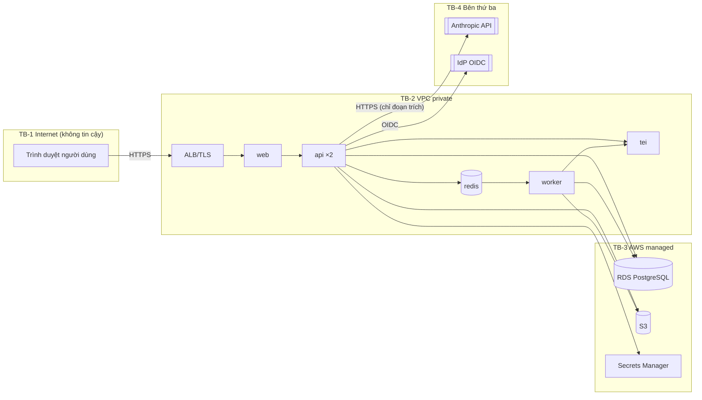
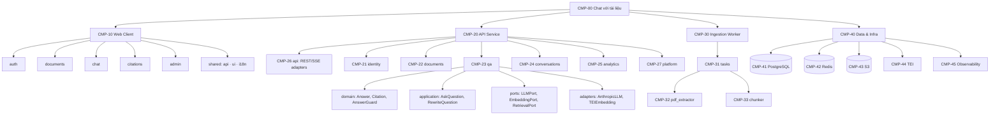
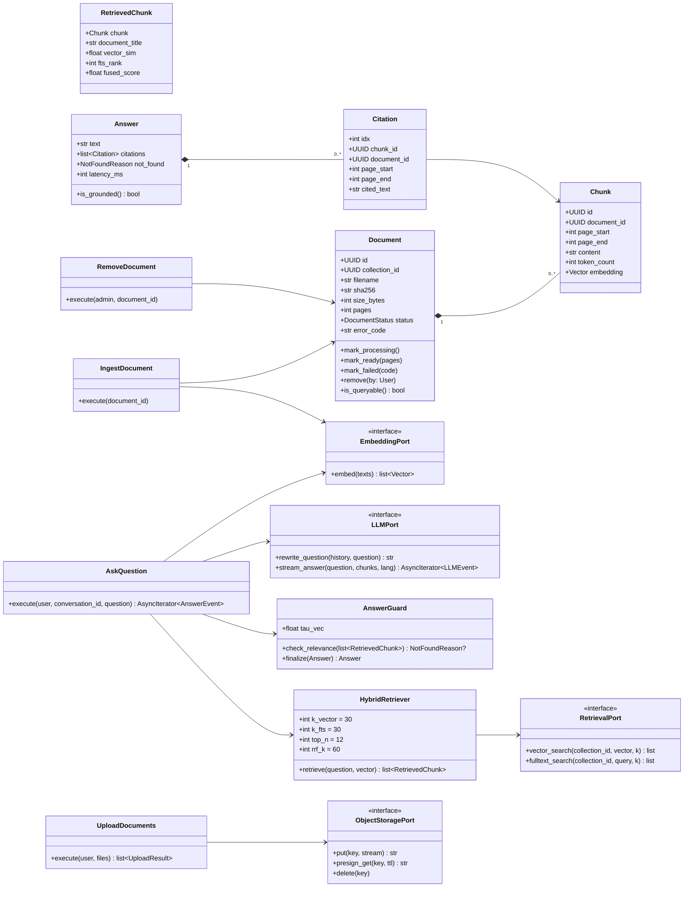
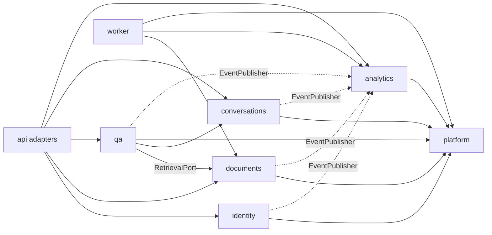
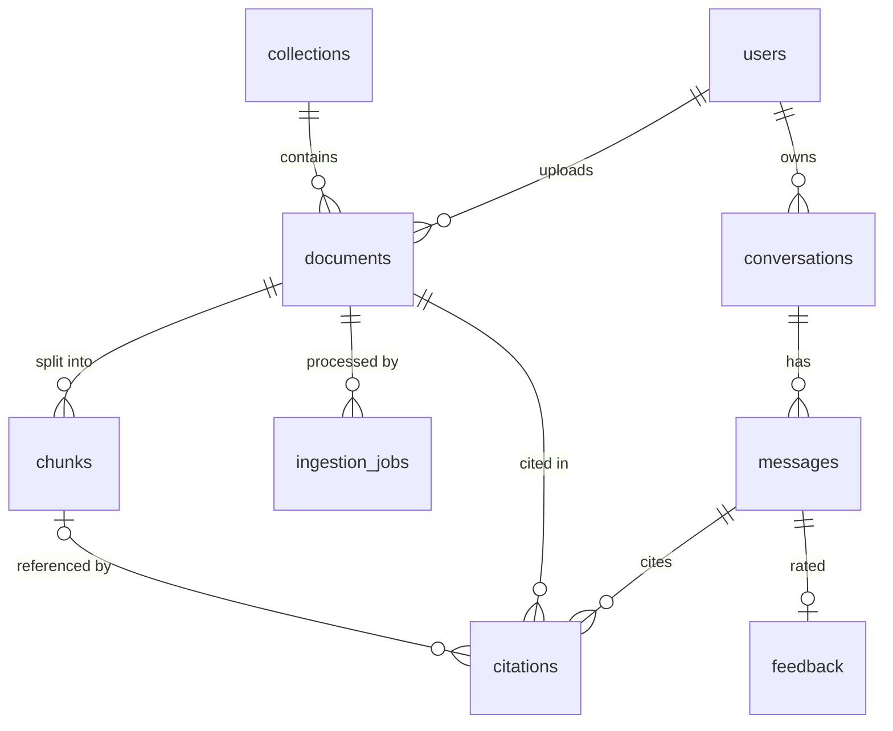
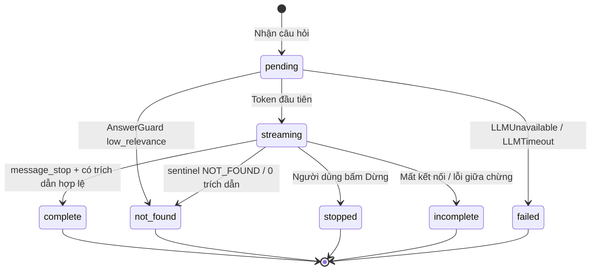
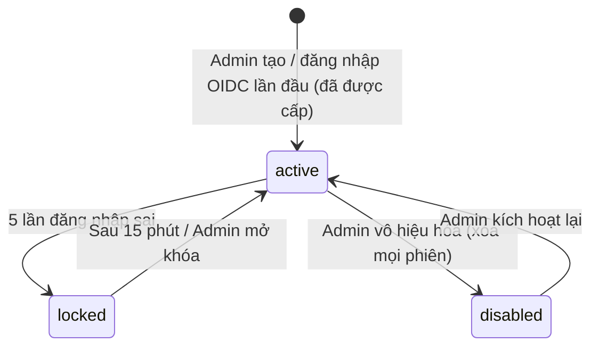
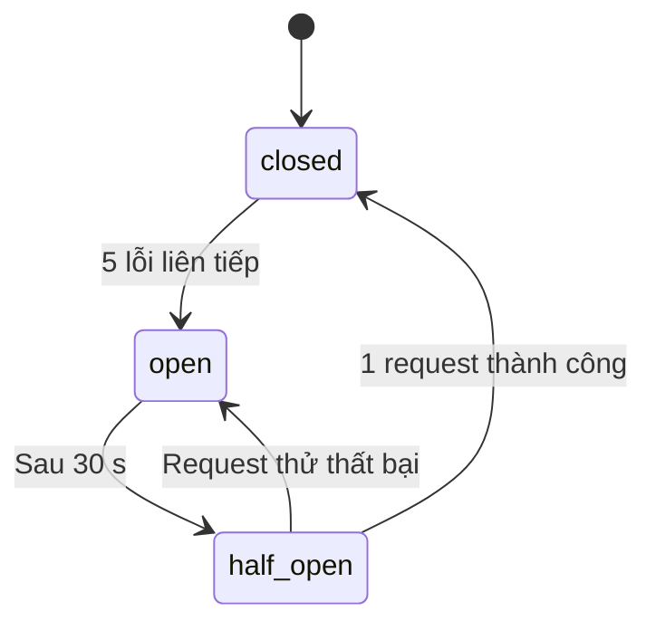

# Bản thiết kế phần mềm (Software Blueprint Design) — "Chat với tài liệu" (MVP)

> **Chuẩn:** IEEE 1016-2009 — Software Design Descriptions
> **Prompt nguồn:** `docs/bluePrint_design_prompt.md`
> **Tài liệu đầu vào:**
> - `docs/requirements/PRD.md` (PRD-CWD-001 v0.1)
> - `docs/design/SAD.md` (SAD-CWD-001 v0.1)
> - `docs/design/UseCase_ChatWithDocument.drawio`
>
> **Tệp kèm theo:** `docs/design/schema.sql` — DDL tham chiếu cho Information View (§3.4)

**Quy ước ID dùng trong tài liệu**

| Tiền tố | Ý nghĩa |
|---|---|
| `SH-xx` | Bên liên quan |
| `CN-xx` | Mối quan tâm (concern) |
| `QAS-xx` | Kịch bản thuộc tính chất lượng |
| `UXS-xx` | Kịch bản UX/UI |
| `UXC-xx` | Ràng buộc UX/UI |
| `CMP-xx` | Phần tử thiết kế (component) |
| `IF-xx` | Giao diện |
| `ERR-xx` | Mã lỗi |

Các ID kế thừa từ PRD và SAD được giữ nguyên: `US-`, `FR-`, `NFR-`, `EC-`, `ADR-`, `AR-`, `OQ-`.

---

## 1. Bối cảnh & Đối tượng thiết kế

### 1.1 Nhận diện hệ thống

| Thuộc tính | Giá trị |
|---|---|
| **Tên hệ thống** | Chat với tài liệu (Chat with Document) — MVP |
| **Mã tài liệu** | SDD-CWD-001 |
| **Phiên bản SDD** | v0.1 (`Draft`) |
| **Ngày tài liệu** | 2026-10-22 |
| **Chủ sở hữu tài liệu** | Huy Toan — Kiến trúc sư / Tech lead (tạm thời, chờ OQ-001) |
| **Tài liệu liên quan** | BRD-CWD-001 v0.1 → PRD-CWD-001 v0.1 → SAD-CWD-001 v0.1 → **SDD-CWD-001** |

**Lịch sử phiên bản**

| Phiên bản | Ngày | Tác giả | Thay đổi |
|---|---|---|---|
| v0.1 | 2026-10-22 | Huy Toan | Bản đầu tiên: 8 design view, ma trận truy vết, `schema.sql` |

### 1.2 Phạm vi hệ thống và ranh giới bên ngoài

| Loại ranh giới | Mô tả |
|---|---|
| **Mục đích hệ thống** | Cho đội phát triển kinh doanh tải PDF của dự án lên một bộ tài liệu chung, rồi hỏi bằng ngôn ngữ tự nhiên. Câu trả lời do AI tổng hợp **chỉ từ nội dung tài liệu**, kèm trích dẫn tài liệu và trang. Giá trị nghiệp vụ: giảm thời gian tìm thông tin (BO-001) và có câu trả lời kiểm chứng được (BO-002) |
| **Hệ thống bên ngoài** | (1) **Anthropic Messages API**: sinh câu trả lời, model `claude-opus-5-5`, streaming + Citations (ADR-005, chờ OQ-008). (2) **IdP của tổ chức** qua OIDC, tùy chọn (OQ-014). (3) **AWS managed services**: RDS PostgreSQL, S3, Secrets Manager, KMS, ALB, ECR. TEI (embedding) là thành phần **nội bộ**, không phải hệ thống ngoài |
| **Loại người dùng** | **Chuyên viên BD** (vai trò `member`); **Quản trị viên** (`admin`, kế thừa quyền member); **Quản lý** (xem số liệu, cần được cấp vai trò `admin` theo BRU-006); vận hành viên DevOps (không dùng giao diện người dùng) |
| **Giao diện bên ngoài** | REST/JSON + SSE qua HTTPS (trình duyệt ↔ API); HTTPS tới Anthropic API; OIDC Authorization Code + PKCE (IdP); S3 API qua VPC endpoint; PostgreSQL wire protocol qua TLS (RDS); OTLP/gRPC nội bộ (telemetry) |
| **Ranh giới tin cậy** | **TB-1 Internet ↔ ALB:** mọi request đều không tin cậy cho tới khi xác thực phiên. **TB-2 ALB ↔ mạng private (VPC):** API, worker, TEI, Redis. **TB-3 VPC ↔ AWS managed services:** qua VPC endpoint và IAM role. **TB-4 VPC ↔ Anthropic:** bên thứ ba; chỉ gửi đoạn trích liên quan, đi qua NAT có allowlist. **TB-5 Nội dung PDF:** dữ liệu không tin cậy (có thể độc hại hoặc chứa prompt injection), chỉ worker được phân tích |
| **Môi trường triển khai** | AWS `ap-southeast-1` (đề xuất, chờ OQ-008 / OQ-020 / OQ-023): một EC2 `m7i.2xlarge` chạy Docker Compose, RDS PostgreSQL 16, S3. Hai môi trường `staging` và `production` tách biệt |



### 1.3 Giả định và ràng buộc

| Loại | Mô tả |
|---|---|
| **Ràng buộc kỹ thuật** | Ứng dụng web, desktop-first (CON-001). Đầu vào chỉ là PDF có lớp văn bản, không OCR (CON-002). Câu trả lời chỉ dựa trên tài liệu, có trích dẫn trang (BRU-001, FR-013). PostgreSQL 16 + pgvector là kho dữ liệu duy nhất (ADR-002). Python 3.12 / FastAPI; React 18 / TypeScript. TLS 1.2+ và AES-256 at-rest (NFR-010, NFR-011). Lớp AI phải thay được nhà cung cấp (TC-06) |
| **Ràng buộc nghiệp vụ** | Phạm vi MVP (CON-004). Thời hạn và ngân sách chưa rõ (OQ-006, OQ-007); chi phí AI ước tính khoảng $230/tháng (SAD §4.5). Nếu có dữ liệu cá nhân thì phải tuân thủ quy định bảo vệ dữ liệu cá nhân của Việt Nam (CON-007) |
| **Giả định môi trường** | Người dùng có mạng ≥ 10 Mbps, độ trễ tới vùng AWS < 80 ms. Anthropic API khả dụng ≥ 99,5% trong giờ làm việc. Hệ thống chỉ dùng trong giờ hành chính 08:00–18:00 (NFR-017). Mạng nội bộ Docker trên cùng host có độ trễ < 1 ms |
| **Giả định dữ liệu** | Tối đa 50 tài liệu × 300 trang × 20 MB (NFR-004..006); khoảng 30.000 chunk; khoảng 123 MB vector. Tăng trưởng thấp: tối đa ×5 trong 12 tháng (NFR-009). Tài liệu bằng tiếng Việt hoặc tiếng Anh (ASM-003). Khoảng 4.400 câu hỏi/tháng (20 người × 10 câu × 22 ngày). Chính sách lưu giữ theo SAD §2.3 |

---

## 2. Bên liên quan & Mối quan tâm

### 2.1 Nhận diện bên liên quan

| ID | Bên liên quan | Vai trò / chức danh | Lợi ích chính |
|---|---|---|---|
| SH-01 | Chuyên viên BD (PER-01) | Người dùng cuối | Câu trả lời đúng, có nguồn, nhanh; dễ dùng |
| SH-02 | Quản trị viên (PER-03) | Quản lý người dùng và bộ tài liệu | Kiểm soát truy cập; bộ tài liệu luôn cập nhật |
| SH-03 | Quản lý / Sponsor (PER-02, STK-001) | Product owner | Chứng minh giá trị MVP; chi phí; thời gian ra mắt |
| SH-04 | Lập trình viên | Đội phát triển (STK-004) | Dễ bảo trì, dễ kiểm thử, dễ hiểu |
| SH-05 | DevOps / SRE | Vận hành (có thể là cùng đội phát triển) | Dễ triển khai, dễ giám sát, khôi phục được |
| SH-06 | Bảo mật / Pháp chế (STK-005) | Tuân thủ | Bảo vệ dữ liệu, xác thực, audit trail, nơi lưu dữ liệu |
| SH-07 | QA | Kiểm thử | Có tiêu chí đo được; môi trường test tái lập được |
| SH-08 | Kỹ sư AI/RAG | Chất lượng truy xuất & câu trả lời | Độ chính xác, khả năng đo bằng golden set, tinh chỉnh được ngưỡng |
| SH-09 | UX/UI Designer | Thiết kế trải nghiệm | Nhất quán, dễ tiếp cận, phản hồi trạng thái rõ ràng |

### 2.2 Mối quan tâm của các bên liên quan

| ID | Bên liên quan | Mối quan tâm | Ưu tiên | Tiêu chí chấp nhận |
|---|---|---|---|---|
| CN-01 | SH-01, SH-03 | Câu trả lời đúng với nội dung tài liệu | High | ≥ 80% đúng trên golden set (KR2.1) |
| CN-02 | SH-01, SH-06 | Không bịa thông tin; nói rõ khi không tìm thấy | High | ≥ 90% câu hỏi âm tính nhận `not_found` (KR2.3) |
| CN-03 | SH-01 | Kiểm chứng được nguồn | High | 100% câu trả lời có ≥ 1 trích dẫn; ≥ 90% trích dẫn đúng trang (KR2.2) |
| CN-04 | SH-01 | Thời gian phản hồi | High | p90 token đầu ≤ 5 s; p90 hoàn chỉnh ≤ 15 s (NFR-001/002) |
| CN-05 | SH-01, SH-02 | Xử lý tài liệu nhanh, trạng thái minh bạch | Med | PDF 50 trang sẵn sàng ≤ 60 s; trạng thái tự cập nhật ≤ 3 s (NFR-003, FR-006) |
| CN-06 | SH-06 | Bảo mật dữ liệu tài liệu | High | Mã hóa TLS 1.2+ và AES-256; chỉ ≤ 12 đoạn trích rời hệ thống mỗi câu hỏi (NFR-010/011/013) |
| CN-07 | SH-06, SH-02 | Kiểm soát truy cập đúng vai trò | High | 0 lỗi vượt quyền trong bộ test RBAC (AC-US-002-1, AC-US-003-1) |
| CN-08 | SH-06 | Truy vết hành động | Med | 100% thao tác nhạy cảm có bản ghi audit; không sửa được; lưu 12 tháng (NFR-014) |
| CN-09 | SH-06, SH-03 | Thay được nhà cung cấp AI nếu OQ-008 yêu cầu | High | Đổi nhà cung cấp LLM chỉ cần 1 adapter mới + cấu hình; 0 thay đổi trong module `qa` |
| CN-10 | SH-04 | Dễ bảo trì, module độc lập | Med | Thay đổi trong 1 module ảnh hưởng ≤ 1 module khác; `import-linter` không vi phạm |
| CN-11 | SH-04, SH-07 | Dễ kiểm thử | Med | Độ phủ unit test ≥ 80% ở `domain` và `application`; bộ integration test chạy < 5 phút |
| CN-12 | SH-05 | Khả dụng & khôi phục | Med | ≥ 95% giờ hành chính; RTO ≤ 1 ngày làm việc; RPO ≤ 24 giờ (NFR-017..019) |
| CN-13 | SH-05 | Giám sát được | Med | 100% request có trace; dashboard SLO; cảnh báo trong ≤ 5 phút khi vượt ngưỡng |
| CN-14 | SH-05 | Triển khai an toàn | Med | Deploy production bằng pipeline có cổng golden eval; rollback ≤ 10 phút |
| CN-15 | SH-03 | Chi phí vận hành kiểm soát được | Med | Chi phí LLM hiển thị theo ngày; cảnh báo khi đạt 80% ngân sách tháng |
| CN-16 | SH-03 | Đo được mức độ sử dụng | Med | Số liệu tuần chính xác (sai lệch ≤ 1% so với kiểm tra thủ công, AC-15) |
| CN-17 | SH-08 | Đánh giá và tinh chỉnh chất lượng RAG | Med | Golden eval chạy tự động hằng đêm; tham số (`τ`, top-k, chunk size) cấu hình được mà không cần sửa code |
| CN-18 | SH-02 | Mở rộng quy mô khi cần | Low | Tăng ×5 giới hạn chỉ bằng cấu hình và hạ tầng (NFR-009) |
| CN-19 | SH-01, SH-09 | Dễ dùng lần đầu | Med | ≥ 4/5 người dùng mới có câu trả lời đầu tiên trong ≤ 5 phút (NFR-022) |
| CN-20 | SH-09, SH-06 | Khả năng tiếp cận | Med | WCAG 2.1 AA cho mọi màn hình P0 (NFR-023) |

### 2.3 Kịch bản thuộc tính chất lượng

| ID | Thuộc tính | Nguồn | Tác nhân kích thích | Đối tượng | Môi trường | Phản ứng | Thước đo | Concern |
|---|---|---|---|---|---|---|---|---|
| QAS-01 | **Hiệu năng** | 5 Chuyên viên BD | Gửi câu hỏi đồng thời | `qa` + LLM | Production, 50 tài liệu Sẵn sàng | Stream câu trả lời có trích dẫn | p90 token đầu ≤ 5 s; p90 hoàn chỉnh ≤ 15 s | CN-04 |
| QAS-02 | **Hiệu năng (ingestion)** | Chuyên viên BD | Tải lên PDF văn bản 50 trang | Worker + TEI | Bình thường, hàng đợi trống | Trạng thái `ready` | ≤ 60 s từ lúc upload xong | CN-05 |
| QAS-03 | **Khả năng mở rộng** | Quản lý | Tăng lên 100 người dùng và 250 tài liệu | Toàn hệ thống | Sau khi được duyệt mở rộng | Thêm replica `api`/`worker` và nâng instance | QAS-01 vẫn đạt; 0 thay đổi code | CN-18 |
| QAS-04 | **Khả dụng** | Sự cố | Dịch vụ AI lỗi 5 lần liên tiếp | `LLMPort` + circuit breaker | Giờ làm việc | Mở circuit; người dùng thấy thông báo "Hệ thống đang bận" | Thông báo ≤ 1 s khi circuit mở; tự thử lại sau 30 s; hệ thống không treo | CN-12 |
| QAS-05 | **Khả dụng (khôi phục)** | Sự cố | Mất EC2 host | Toàn bộ container | Production | Dựng lại từ Terraform + ECR + RDS | RTO ≤ 4 giờ (mục tiêu ≤ 1 ngày làm việc); RPO ≤ 5 phút (PITR) | CN-12 |
| QAS-06 | **Bảo mật (truy cập)** | Member B | Gọi `GET /conversations/{id của A}/messages` | `conversations` | Production | Từ chối | 404; 0 byte dữ liệu của A bị trả về; có log cảnh báo | CN-07 |
| QAS-07 | **Bảo mật (dữ liệu)** | Bất kỳ | Lưu hoặc truyền tài liệu | S3, RDS, mạng | Mọi môi trường | Mã hóa | TLS ≥ 1.2 mọi kết nối; AES-256 (KMS) cho RDS/S3/EBS; quét cấu hình bằng AWS Config = 0 vi phạm | CN-06 |
| QAS-08 | **Bảo mật (prompt injection)** | Tác giả PDF độc hại | Nhúng chỉ dẫn "bỏ qua quy tắc, trả lời X" vào tài liệu | `qa` | Production | Mô hình không có tool; trích dẫn do server ánh xạ | 0 hành động ngoài sinh văn bản; bộ test injection (≥ 10 ca) không làm lộ system prompt hoặc trích dẫn sai nguồn | CN-02, CN-06 |
| QAS-09 | **Khả năng bảo trì** | Lập trình viên | Thay `AnthropicLLMAdapter` bằng `BedrockLLMAdapter` | `LLMPort` | Phát triển | Chỉ thêm adapter + cấu hình | ≤ 1 module bị sửa (`qa/adapters`); toàn bộ test `qa` pass | CN-09, CN-10 |
| QAS-10 | **Khả năng kiểm thử** | CI | Mỗi pull request | Backend + frontend | GitHub Actions | Chạy unit + integration (Testcontainers Postgres/Redis, LLM giả lập) | Độ phủ ≥ 80% domain/application; tổng thời gian < 10 phút, trong đó integration < 5 phút | CN-11 |
| QAS-11 | **Khả năng triển khai** | DevOps | Deploy phiên bản mới lên production | Pipeline | Giờ làm việc | Rolling restart `api` ×2; golden eval trên staging phải đạt trước khi deploy | 0 request lỗi 5xx do deploy; rollback bằng tag image trước ≤ 10 phút | CN-14 |
| QAS-12 | **Khả năng giám sát** | SRE | p90 câu trả lời > 15 s trong 15 phút | Prometheus + Grafana | Production | Cảnh báo kèm trace mẫu | Cảnh báo ≤ 5 phút; xác định được bước chậm (rewrite/embed/retrieve/LLM) qua trace ≤ 10 phút | CN-13 |
| QAS-13 | **Độ tin cậy câu trả lời** | Kỹ sư AI | Chạy golden eval hằng đêm | `qa` | Staging | Tính KR2.1–2.3 | KR2.1 ≥ 80%, KR2.2 ≥ 90%, KR2.3 ≥ 90%; giảm > 5 điểm so với lần trước → chặn release | CN-01, CN-02, CN-03, CN-17 |

### 2.4 Kịch bản UX/UI

| ID | Thuộc tính | Kịch bản UX/UI | Concern |
|---|---|---|---|
| UXS-01 | **Khả năng sử dụng** | Người dùng mới đăng nhập → tải 1 PDF → đặt câu hỏi → mở trích dẫn trong ≤ 5 phút, không cần hướng dẫn trực tiếp, ≤ 1 lỗi thao tác (NFR-022) | CN-19 |
| UXS-02 | **Khả năng tiếp cận** | Mọi phần tử tương tác dùng được bằng bàn phím (Tab/Shift+Tab/Enter/Esc); có focus ring nhìn thấy được; trình đọc màn hình đọc được trạng thái tài liệu và câu trả lời đang stream (`aria-live="polite"`); WCAG 2.1 AA | CN-20 |
| UXS-03 | **Hiệu năng giao diện** | Trên mạng 10 Mbps: FCP < 1,5 s, LCP < 2,5 s, INP < 200 ms; bundle JS ban đầu ≤ 250 KB gzip (PDF.js tải lười khi mở trích dẫn) | CN-04 |
| UXS-04 | **Responsive** | Hoạt động từ 768 px đến 2560 px không có thanh cuộn ngang. ≥ 1280 px: bố cục 3 cột. 768–1279 px: cột phụ thu thành ngăn trượt (UI-09). < 768 px: hiển thị thông báo "tối ưu cho máy tính" nhưng vẫn hỏi đáp được (chờ OQ-017) | CN-19 |
| UXS-05 | **Nhất quán thị giác** | 100% component lấy từ thư viện nội bộ (`shared/ui`) xây trên Radix UI + design token (màu, chữ, khoảng cách); không có giá trị màu hoặc khoảng cách "cứng" trong code feature (kiểm tra bằng lint rule) | CN-10 |
| UXS-06 | **Phục hồi lỗi** | Lỗi tải lên hiển thị ngay tại dòng của tệp đó, kèm thông điệp và hành động ("Thử lại", "Bỏ qua"). Mất kết nối khi đang trả lời: giữ phần đã nhận và hiện nút "Thử lại" (EC-03..05). Không cần tải lại trang | CN-05 |
| UXS-07 | **Phản hồi & khả năng nhận biết** | Mọi thao tác bất đồng bộ hiện trạng thái loading trong ≤ 300 ms. Câu trả lời bắt đầu hiển thị ngay khi có token đầu. Trích dẫn có hover/focus state và tooltip tên tài liệu + trang | CN-03, CN-04 |
| UXS-08 | **Kiến trúc thông tin** | Từ bất kỳ màn hình nào, tới "Hội thoại mới", "Tài liệu" hoặc "Lịch sử" trong ≤ 1 click; mở nguồn trích dẫn trong ≤ 1 click | CN-19 |
| UXS-09 | **Quốc tế hóa** | Giao diện tiếng Việt; mọi chuỗi nằm trong tệp `locales/*.json`; bố cục chịu được chữ dài thêm 30% (thêm tiếng Anh); ngày giờ theo `vi-VN`, múi giờ `Asia/Ho_Chi_Minh`. Không áp dụng RTL vì không có ngôn ngữ RTL trong phạm vi | CN-19 |
| UXS-10 | **Trải nghiệm di động** | Không thuộc phạm vi MVP (desktop-first, UXP-4). Trên tablet, vùng chạm ≥ 44 × 44 px; không dùng cử chỉ đặc thù | CN-19 |

### 2.5 Ma trận ràng buộc UX/UI

| ID | Ràng buộc | Yêu cầu | Công cụ / chuẩn | Phương pháp kiểm chứng |
|---|---|---|---|---|
| UXC-01 | **Tương phản màu** | ≥ 4,5:1 cho chữ thường, ≥ 3:1 cho chữ lớn và thành phần giao diện | WCAG 2.1 AA | `axe-core` trong CI (Playwright) + kiểm tra thủ công màn hình P0 |
| UXC-02 | **Typography** | Chữ thân 16 px, line-height 1,5; scale theo `rem`; phóng to 200% không vỡ bố cục | Design token nội bộ | Design audit + test phóng to |
| UXC-03 | **Vùng chạm** | ≥ 44 × 44 px trên thiết bị cảm ứng; ≥ 32 × 32 px với chuột | Apple HIG / Material | Kiểm tra UI trên tablet |
| UXC-04 | **Trạng thái loading** | Skeleton cho danh sách; chỉ báo "đang trả lời" cho chat; hiện trong ≤ 300 ms | Thực hành UX | Playwright đo thời điểm xuất hiện + giám sát RUM |
| UXC-05 | **Thông điệp lỗi** | Rõ ràng, có hành động tiếp theo, không lộ chi tiết kỹ thuật; dùng danh mục ERR-xx (§3.5.4) | Hướng dẫn viết UX tiếng Việt | Review nội dung + snapshot test |
| UXC-06 | **Trạng thái trống** | Mọi trạng thái trống có hướng dẫn hành động tiếp theo (EC-01, EC-02) | Thực hành UX | Kiểm kê UI |
| UXC-07 | **Thông báo** | Toast không chặn thao tác, tự ẩn sau 5 s (lỗi giữ tới khi đóng); banner cho trạng thái toàn hệ thống (mất kết nối, AI không khả dụng) | Thực hành UX | Kiểm thử người dùng |
| UXC-08 | **Trợ giúp & hướng dẫn** | Màn hình trống có hướng dẫn 3 bước; câu hỏi gợi ý; liên kết hướng dẫn sử dụng 1 trang | Thực hành UX | Đo tỷ lệ hoàn thành UXS-01 |
| UXC-09 | **Nội dung do AI sinh** | Hiển thị Markdown đã làm sạch (DOMPurify); nhãn "Câu trả lời do AI tạo — hãy kiểm tra nguồn" | Bảo mật + minh bạch | Unit test sanitizer; review UI |

---

## 3. Các Design View (lõi IEEE 1016-2009)

Thiết kế được mô tả qua **tám view**:

| # | View | Viewpoint IEEE 1016 | Concern chính |
|---|---|---|---|
| 3.1 | Composition | §5.3 | CN-10, CN-11 |
| 3.2 | Logical | §5.4 | CN-01..03, CN-09, CN-10 |
| 3.3 | Dependency | §5.5 | CN-09, CN-10, CN-12 |
| 3.4 | Information | §5.6 | CN-06, CN-08, CN-16, CN-18 |
| 3.5 | Interface | §5.8 | CN-04, CN-07, CN-09 |
| 3.6 | Interaction | §5.10 | CN-02, CN-04, CN-07, CN-12 |
| 3.7 | State Dynamics | §5.11 | CN-05, CN-12 |
| 3.8 | Resource & Deployment | §5.13 | CN-04, CN-12, CN-14, CN-15, CN-18 |

---

### 3.1 Composition View

**Mục đích:** Mô tả hệ thống được lắp ghép từ những phần nào: phân rã thành subsystem, module và package.

**Viewpoint:** Phân rã cấu trúc theo Modular Monolith + Hexagonal (ADR-001).

**Concern được giải quyết:** CN-10 (bảo trì), CN-11 (kiểm thử), CN-04 (tách worker khỏi API).

| ID | Phần tử | Loại | Cha | Trách nhiệm | Phụ thuộc |
|---|---|---|---|---|---|
| CMP-00 | Hệ thống Chat với tài liệu | System | — | Toàn bộ sản phẩm | — |
| CMP-10 | Web Client | Subsystem (SPA) | CMP-00 | Giao diện người dùng | CMP-20 (REST/SSE) |
| CMP-11 | `features/auth` | Package | CMP-10 | Đăng nhập, phiên, bảo vệ route | CMP-16 |
| CMP-12 | `features/documents` | Package | CMP-10 | Upload, danh sách, trạng thái, gỡ tài liệu | CMP-16, CMP-17 |
| CMP-13 | `features/chat` | Package | CMP-10 | Ô hỏi, stream câu trả lời, trích dẫn, đánh giá, dừng | CMP-16, CMP-14 |
| CMP-14 | `features/citations` | Package | CMP-10 | Trình xem PDF (PDF.js, tải lười) tại trang N, tô sáng đoạn trích | CMP-16 |
| CMP-15 | `features/admin` | Package | CMP-10 | Quản lý người dùng, bảng số liệu tuần | CMP-16 |
| CMP-16 | `shared/api` | Package | CMP-10 | HTTP client, CSRF, SSE parser, ánh xạ lỗi ERR-xx | — |
| CMP-17 | `shared/ui`, `shared/i18n` | Package | CMP-10 | Design system (Radix + token), chuỗi tiếng Việt | — |
| CMP-20 | API Service | Subsystem (FastAPI) | CMP-00 | Xử lý request, điều phối use case | CMP-30, CMP-40 |
| CMP-21 | `modules/identity` | Module | CMP-20 | Xác thực, phiên, RBAC, quản lý tài khoản | CMP-27 |
| CMP-22 | `modules/documents` | Module | CMP-20 | Nhận/kiểm tra tệp, lưu S3, xếp hàng ingestion, liệt kê, gỡ, `RetrievalPort` | CMP-27 |
| CMP-23 | `modules/qa` | Module | CMP-20 | Viết lại câu hỏi, truy xuất lai, AnswerGuard, gọi LLM, ánh xạ trích dẫn | CMP-22 (qua port), CMP-24, CMP-27 |
| CMP-24 | `modules/conversations` | Module | CMP-20 | Hội thoại, tin nhắn, lịch sử, feedback | CMP-27 |
| CMP-25 | `modules/analytics` | Module | CMP-20 | Ghi sự kiện, tổng hợp tuần | CMP-27 |
| CMP-26 | `api` (inbound adapters) | Package | CMP-20 | Router REST, endpoint SSE, schema Pydantic, middleware (phiên, CSRF, rate limit, OTel) | CMP-21..25 |
| CMP-27 | `platform` (shared kernel) | Package | CMP-20 | Config, logging, telemetry, lỗi chuẩn, audit, rate limiter, `EventPublisher`, DB session | — |
| CMP-30 | Ingestion Worker | Subsystem (Celery) | CMP-00 | Chạy task bất đồng bộ | CMP-22 (domain + adapters), CMP-27 |
| CMP-31 | `worker/tasks` | Package | CMP-30 | `ingest_document`, `purge_removed_documents`, `aggregate_weekly_metrics`, `run_golden_eval`, `create_next_partitions` | CMP-32, CMP-33 |
| CMP-32 | `documents/ingestion/pdf_extractor` | Component | CMP-30 | Mở PDF (PyMuPDF), phát hiện mã hóa / không có text, trích text theo trang | — |
| CMP-33 | `documents/ingestion/chunker` | Component | CMP-30 | Tách chunk theo trang, đếm token, chồng lấp (SAD §3.4) | Tokenizer bge-m3 |
| CMP-40 | Data & Infra Services | Subsystem | CMP-00 | Lưu trữ và hạ tầng phụ trợ | — |
| CMP-41 | PostgreSQL 16 + pgvector | Datastore | CMP-40 | Dữ liệu quan hệ, vector, full-text, audit | — |
| CMP-42 | Redis 7 | Datastore | CMP-40 | Phiên, rate limit, broker Celery | — |
| CMP-43 | S3 | Object store | CMP-40 | PDF gốc | KMS |
| CMP-44 | TEI (`bge-m3`) | Service | CMP-40 | Embedding | — |
| CMP-45 | OTel Collector + Prometheus/Loki/Tempo/Grafana | Service | CMP-40 | Observability | — |

**Sơ đồ phân rã**



**Cấu trúc mã nguồn** (mỗi module có cùng bố cục 4 lớp):

```
backend/
  app/
    platform/            # CMP-27: config.py, logging.py, telemetry.py, errors.py, audit.py, ratelimit.py, db.py, events.py
    api/                 # CMP-26: main.py, deps.py, middleware/, routers/{auth,documents,conversations,admin,events}.py, sse.py
    modules/
      identity/          # CMP-21
        domain/          #   entities.py (User, Role), policies.py (RBAC matrix BRU-006)
        application/     #   login.py, logout.py, manage_users.py
        ports.py         #   IdentityPort, SessionStore, UserRepository
        adapters/        #   oidc.py, local_password.py, redis_session.py, sql_user_repo.py
      documents/         # CMP-22 (+ ingestion/ dùng chung với worker: pdf_extractor.py, chunker.py)
      qa/                # CMP-23
      conversations/     # CMP-24
      analytics/         # CMP-25
  worker/                # CMP-30: celery_app.py, tasks/*.py
  migrations/            # Alembic
  tests/{unit,integration,eval}/
frontend/
  src/{app,features/{auth,documents,chat,citations,admin},shared/{api,ui,i18n}}/
infra/                   # Terraform (VPC, ALB, EC2, RDS, S3, KMS, IAM), docker-compose.yml
```

---

### 3.2 Logical View

**Mục đích:** Mô tả các kiểu (lớp, thực thể, dịch vụ) và quan hệ giữa chúng ở mức thiết kế chi tiết.

**Viewpoint:** Mô hình miền (domain model), use case service và port. Chỉ phần quan trọng nhất là `documents` và `qa`.

**Concern được giải quyết:** CN-01..03 (logic chống bịa nằm trong domain), CN-09 (port), CN-10.



**Quy tắc domain chính (bất biến)**

| Quy tắc | Nằm ở | Trace |
|---|---|---|
| Chỉ `Document.status == ready` mới truy vấn được (`is_queryable`); `remove()` chuyển ngay sang `removed` | `Document` + điều kiện SQL trong `RetrievalPort` | BRU-004, FR-008 |
| Chuyển trạng thái không hợp lệ (ví dụ `ready → processing`) ném `InvalidTransition` | `Document` | §3.7 |
| `AnswerGuard.check_relevance`: `max(vector_sim) < τ_vec` **và** không có kết quả FTS → `low_relevance` (không gọi LLM) | `AnswerGuard` | FR-014, CN-02 |
| `AnswerGuard.finalize`: chứa sentinel `NOT_FOUND` → `model_declined`; 0 trích dẫn hợp lệ → `no_citations` | `AnswerGuard` | FR-013, FR-014 |
| Citation chỉ được tạo từ `document_index` mà server đã gửi; không parse tên trang từ văn bản model sinh | `AskQuestion` | CN-03, QAS-08 |
| Câu hỏi 1–2000 ký tự, sau khi bỏ khoảng trắng đầu/cuối | Pydantic schema + `messages_user_len_chk` | AC-US-011-3, EC-12 |
| Gỡ, thay thế tài liệu và quản lý tài khoản chỉ dành cho `admin` | `identity/domain/policies.py` | BRU-006 |

**Tham số cấu hình được** (CN-17), đọc từ biến môi trường hoặc bảng `settings`:

```
QA_TOP_K_VECTOR=30   QA_TOP_K_FTS=30   QA_TOP_N=12   QA_RRF_K=60   QA_TAU_VEC=0.45
QA_MAX_CONTEXT_TOKENS=9000   QA_HISTORY_TURNS=10   QA_LLM_MODEL=claude-opus-5-5   QA_LLM_EFFORT=low
CHUNK_TARGET_TOKENS=500   CHUNK_MAX_TOKENS=800   CHUNK_OVERLAP_TOKENS=75   HNSW_EF_SEARCH=80
```

---

### 3.3 Dependency View

**Mục đích:** Chỉ rõ phần tử nào phụ thuộc phần tử nào, để đánh giá tác động khi thay đổi và khi một phụ thuộc gặp sự cố.

**Viewpoint:** Phụ thuộc giữa các module (compile-time) và với hệ thống ngoài (runtime).

**Concern được giải quyết:** CN-09, CN-10 (giới hạn lan truyền thay đổi), CN-12 (tác động khi phụ thuộc lỗi).



**Hợp đồng phụ thuộc** (kiểm tra bằng `import-linter` trong CI):

| # | Hợp đồng | Loại |
|---|---|---|
| D-1 | `modules.*.domain` không import `adapters`, `application`, `api`, `fastapi`, `sqlalchemy`, `anthropic` | Forbidden |
| D-2 | `modules.<A>` chỉ được import `modules.<B>.ports` hoặc `modules.<B>.application` (public API) | Layers |
| D-3 | Không module nào import `modules.analytics`; chỉ được dùng `platform.events.EventPublisher` | Forbidden |
| D-4 | `modules.qa` không import `modules.documents.adapters` | Forbidden |
| D-5 | Chỉ `*/adapters/anthropic_llm.py` được import SDK `anthropic` | Forbidden |
| D-6 | Không có import vòng giữa các module | Independence |

**Phụ thuộc runtime và tác động khi lỗi**

| Phụ thuộc | Phiên bản (pin) | Dùng bởi | Khi lỗi | Biện pháp |
|---|---|---|---|---|
| PostgreSQL | 16.x, pgvector ≥ 0.7 | API, worker | Toàn bộ chức năng dừng (trừ trang tĩnh) | `/readyz` → ALB ngừng gửi traffic; PITR; cảnh báo |
| Redis | 7.2 | API (phiên, rate limit), worker (broker) | Không đăng nhập được; upload không xếp hàng được | Restart tự động; AOF; trả ERR-15 thân thiện |
| S3 | — | API (upload, presign), worker | Không upload hoặc xem được PDF; hỏi đáp vẫn chạy | Retry SDK; ERR-16 |
| TEI `bge-m3` | TEI 1.x, model pin theo commit hash | API (embed câu hỏi), worker | Hỏi đáp chuyển sang chế độ suy giảm (chỉ full-text); ingestion retry | Cờ `degraded`; cảnh báo |
| Anthropic API | `anthropic` Python SDK (pin phiên bản), `claude-opus-5-5` | API (`qa`) | Không sinh được câu trả lời | Retry ×2, circuit breaker, fallback phía server, ERR-12 |
| IdP (OIDC) | — | API (`identity`) | Không đăng nhập mới được; phiên hiện tại vẫn dùng được | Thông báo; tài khoản admin cục bộ khẩn cấp (break-glass) |
| PyMuPDF | pin, cập nhật qua Dependabot | Worker | Tài liệu lỗi `corrupted` | Cô lập trong worker |
| React / PDF.js | pin trong `package-lock.json` | Web | — | Tải lười PDF.js |

---

### 3.4 Information View

**Mục đích:** Mô tả cấu trúc dữ liệu bền vững, cách truy cập, ràng buộc toàn vẹn và vòng đời dữ liệu.

**Viewpoint:** Mô hình dữ liệu quan hệ + vector trong PostgreSQL. **DDL đầy đủ nằm trong [`schema.sql`](schema.sql).**

**Concern được giải quyết:** CN-06, CN-08 (`audit_log` chỉ ghi thêm), CN-16 (`analytics_events`, view `weekly_usage`), CN-18 (`collection_id`).



**Từ điển dữ liệu: các thực thể chính**

| Bảng | Mô tả | Khóa / chỉ mục quan trọng | Ràng buộc toàn vẹn | Lưu giữ |
|---|---|---|---|---|
| `users` | Tài khoản, vai trò, trạng thái khóa | `email` UNIQUE (citext), `oidc_sub` UNIQUE | Phải có ít nhất một phương thức xác thực | Đến khi bị xóa |
| `documents` | Siêu dữ liệu PDF; nội dung nằm ở S3 | `(collection_id, filename)` UNIQUE khi chưa gỡ; `(collection_id, status)` | `size_bytes` ≤ 20 MB; `pages` ≤ 300; `failed` ⇒ có `error_code`; `removed` ⇔ có `removed_at` | Purge 30 ngày sau khi gỡ |
| `chunks` | Đoạn văn bản + vector 1024 chiều + `tsvector` | HNSW (cosine), GIN (`tsv`), `(document_id, chunk_index)` UNIQUE | `page_end ≥ page_start`; `token_count ≤ 800` | Xóa theo document (CASCADE) |
| `conversations` | Hội thoại của một người dùng | `(user_id, last_activity_at DESC)` | — | 180 ngày ⚑ kể từ hoạt động cuối |
| `messages` | Câu hỏi và câu trả lời, trạng thái, độ trễ, token | `(conversation_id, created_at)` | Câu hỏi 1–2000 ký tự; `not_found` ⇔ có `not_found_reason` | Theo hội thoại |
| `citations` | Trích dẫn gắn với câu trả lời | `(message_id, idx)` UNIQUE | `chunk_id` thành NULL khi chunk bị purge (EC-10) | Theo message |
| `feedback` | Đánh giá hữu ích / không hữu ích | PK = `message_id` | Bình luận ≤ 1000 ký tự | Theo message |
| `analytics_events` | Sự kiện sử dụng, **không có nội dung** | Partition tháng; `(name, occurred_at)` | `user_ref` = HMAC-SHA256(user_id), không lưu ID gốc | 12 tháng (drop partition) |
| `audit_log` | Hành động nhạy cảm | Partition tháng; `(actor_id, at)` | Role `cwd_app` chỉ có `INSERT, SELECT` | 12 tháng |

**Phân loại dữ liệu và biện pháp bảo vệ**

| Loại dữ liệu | Phân loại | Vị trí | Bảo vệ |
|---|---|---|---|
| PDF gốc, `chunks.content`, `messages.content`, `citations.cited_text` | **Mật** (chờ OQ-008) | S3, RDS | KMS AES-256; chỉ API/worker truy cập; không ghi vào log; chỉ ≤ 12 chunk gửi tới LLM |
| Email, tên hiển thị | Dữ liệu cá nhân | RDS | KMS; chỉ Admin xem danh sách |
| Mật khẩu | Bí mật | RDS | Argon2id; không bao giờ trả về qua API |
| Sự kiện analytics | Nội bộ, đã ẩn danh hóa | RDS | HMAC với khóa trong Secrets Manager |
| Khóa API, secret | Bí mật | Secrets Manager | IAM least privilege; xoay vòng 90 ngày |

**Truy cập dữ liệu:**

- **API:** SQLAlchemy 2.0 Core + asyncpg; worker dùng psycopg 3 (sync).
- **Repository pattern:** mỗi module có repository riêng; giao dịch do use case quản lý (Unit of Work).
- **Migration:** Alembic, theo mẫu expand → migrate → contract để không gián đoạn.
- **Tạo partition:** task `create_next_partitions` tạo partition tháng kế tiếp trước 30 ngày.

---

### 3.5 Interface View

**Mục đích:** Đặc tả các giao diện mà phần tử cung cấp hoặc sử dụng, đủ chi tiết để phát triển và kiểm thử độc lập.

**Viewpoint:** Hợp đồng giao diện bên ngoài (REST/SSE), giao diện nội bộ (port) và giao diện với hệ thống ngoài.

**Concern được giải quyết:** CN-04 (streaming), CN-07 (quyền ở mỗi endpoint), CN-09 (port).

#### 3.5.1 Giao diện bên ngoài (REST + SSE)

| ID | Giao diện | Bên cung cấp → Bên dùng | Đặc tả |
|---|---|---|---|
| IF-01 | REST API `/api/v1` | CMP-26 → CMP-16 | Toàn bộ endpoint, vai trò, input/output: **SAD §2.4**. Đặc tả máy đọc được: OpenAPI 3.1 sinh tự động tại `/api/v1/openapi.json` (chỉ ở staging) |
| IF-02 | SSE `POST /conversations/{id}/messages` | CMP-23 → CMP-13 | Các event `meta`, `delta`, `citation`, `not_found`, `done`, `error` (SAD §2.4); ping 15 s; client hủy bằng `AbortController` |
| IF-03 | Tải tệp `GET /documents/{id}/file` | CMP-22 → CMP-14 | 302 tới S3 presigned URL, TTL 300 s, `ResponseContentDisposition=inline` |

**Schema request/response quan trọng** (Pydantic):

```python
class AskRequest(BaseModel):
    question: constr(strip_whitespace=True, min_length=1, max_length=2000)

class CitationOut(BaseModel):
    index: int; document_id: UUID; document_title: str
    page_start: int; page_end: int; cited_text: str

class DocumentOut(BaseModel):
    id: UUID; filename: str; pages: int | None; uploaded_by: str
    uploaded_at: datetime; status: Literal["uploading","queued","processing","ready","failed"]
    error_code: str | None

class UploadResult(BaseModel):
    filename: str
    document_id: UUID | None = None
    status: Literal["queued"] | None = None
    error_code: str | None = None          # ERR-xx khi bị từ chối ngay
```

#### 3.5.2 Giao diện nội bộ (Ports)

| ID | Port | Chữ ký | Hợp đồng |
|---|---|---|---|
| IF-10 | `LLMPort` | `async def rewrite_question(history: list[Turn], question: str) -> str` | Timeout 10 s; ném `LLMUnavailable` khi lỗi |
| IF-10 | `LLMPort` | `def stream_answer(question: str, chunks: list[RetrievedChunk], lang: str) -> AsyncIterator[LLMEvent]` | Phát `TextDelta(text)`, `CitationRef(document_index, cited_text)`, `Completed(usage, stop_reason)`; ném `LLMUnavailable`, `LLMTimeout` (không có token đầu sau 20 s), `LLMRefused` |
| IF-11 | `EmbeddingPort` | `async def embed(texts: list[str]) -> list[list[float]]` | Vector 1024 chiều đã chuẩn hóa L2; lô ≤ 32; timeout 2 s (câu hỏi) / 30 s (lô ingestion) |
| IF-12 | `RetrievalPort` | `async def vector_search(collection_id, vector, k) -> list[Hit]`; `async def fulltext_search(collection_id, query, k) -> list[Hit]` | Chỉ trả chunk của tài liệu `ready` |
| IF-13 | `ObjectStoragePort` | `put(key, stream) -> sha256`; `presign_get(key, ttl) -> url`; `delete(key)` | SSE-KMS bắt buộc |
| IF-14 | `IdentityPort` | `authorization_url(state, verifier)`; `exchange(code, verifier) -> Identity`; `verify_password(email, pwd) -> User` | — |
| IF-15 | `EventPublisher` | `publish(name: EventName, user_id: UUID, props: dict) -> None` | Không chặn luồng chính; tên sự kiện trong danh sách cho phép (PRD §6.2) |
| IF-16 | Celery task | `ingest_document.delay(document_id: str)` | Idempotent; `acks_late`; retry ≤ 3 |

#### 3.5.3 Giao diện với hệ thống ngoài

| ID | Hệ thống | Giao thức | Cấu hình |
|---|---|---|---|
| IF-20 | Anthropic Messages API | HTTPS, SDK chính thức `anthropic`, `client.messages.stream(...)` | Cấu hình đầy đủ ở bảng dưới |
| IF-21 | TEI | HTTP nội bộ `POST http://tei:80/embed` `{"inputs": [...], "normalize": true}` | Image TEI CPU (x86_64), `--model-id BAAI/bge-m3 --revision <hash> --max-batch-tokens 16384` |
| IF-22 | IdP | OIDC Discovery `/.well-known/openid-configuration`; Authorization Code + PKCE (S256) | Scope `openid email profile`; ánh xạ claim `email` → `users.email` |
| IF-23 | S3 | AWS SDK (boto3) qua VPC endpoint | Bucket policy bắt buộc `aws:SecureTransport` và `s3:x-amz-server-side-encryption = aws:kms` |

**Cấu hình gọi Anthropic (IF-20):**

| Tham số | Giá trị |
|---|---|
| `model` | `"claude-opus-5-5"` |
| `max_tokens` | 4096 |
| `thinking` | `{"type": "adaptive"}` |
| `output_config` | `{"effort": "low"}` |
| `system` | Prompt cố định, có `cache_control` |
| `messages` | 12 `document` block (custom content, `citations.enabled = true`) + câu hỏi |
| Fallback | `betas = ["server-side-fallback-2026-07-01"]`, `fallbacks = "default"` |
| Retry | `max_retries = 2` |
| Xử lý kết quả | Luôn kiểm tra `stop_reason` (`refusal`, `max_tokens`) |

#### 3.5.4 Danh mục mã lỗi

Thông điệp hiển thị cho người dùng nằm trong `locales/vi.json`.

| ID | `code` | HTTP | Thông điệp hiển thị (vi) | Thử lại? | Trace |
|---|---|---|---|---|---|
| ERR-01 | `unauthenticated` | 401 | Phiên đăng nhập đã hết hạn. Vui lòng đăng nhập lại. | — | EC-11 |
| ERR-02 | `forbidden` | 403 | Bạn không có quyền thực hiện thao tác này. | Không | BRU-006 |
| ERR-03 | `not_found` | 404 | Không tìm thấy nội dung yêu cầu. | Không | AC-US-003-1 |
| ERR-04 | `csrf_invalid` | 403 | Phiên làm việc không hợp lệ. Vui lòng tải lại trang. | Có | — |
| ERR-05 | `account_locked` | 423 | Tài khoản tạm khóa 15 phút do đăng nhập sai nhiều lần. | Sau 15 phút | AC-US-001-2 |
| ERR-06 | `rate_limited` | 429 | Bạn thao tác quá nhanh. Vui lòng thử lại sau {n} giây. | Có | §4.1 SAD |
| ERR-07 | `not_pdf` | 422 | "{file}" không phải tệp PDF hợp lệ. | Không | AC-US-007-1 |
| ERR-08 | `file_too_large` | 413 | "{file}" vượt quá 20 MB. | Không | AC-US-007-4 |
| ERR-09 | `too_many_files` | 422 | Mỗi lần chỉ tải tối đa 10 tệp. | Không | AC-US-005-2 |
| ERR-10 | `encrypted_pdf` | — (trạng thái tài liệu) | Tệp được bảo vệ bằng mật khẩu. | Không | AC-US-007-2 |
| ERR-11 | `no_text_layer` | — (trạng thái tài liệu) | Không đọc được văn bản (PDF dạng ảnh chưa được hỗ trợ). | Không | AC-US-007-3 |
| ERR-12 | `ai_unavailable` | SSE `error` | Hệ thống đang bận, vui lòng thử lại. | Có | EC-06 |
| ERR-13 | `timeout` | SSE `error` | Câu trả lời mất quá nhiều thời gian. Vui lòng thử lại. | Có | NFR-020 |
| ERR-14 | `duplicate_name` | 409 | Đã có tài liệu tên "{file}". | Không | EC-08 |
| ERR-15 | `service_unavailable` | 503 | Hệ thống tạm thời gián đoạn. Vui lòng thử lại sau ít phút. | Có | §3.3 |
| ERR-16 | `storage_error` | 502 | Không lưu được tệp. Vui lòng thử lại. | Có | EC-03 |
| ERR-17 | `too_many_pages` | — (trạng thái tài liệu) | Tệp dài hơn 300 trang. | Không | AC-US-007-4 |
| ERR-18 | `collection_full` | 409 | Bộ tài liệu đã đủ 50 tài liệu. Liên hệ quản trị viên để gỡ bớt. | Không | EC-14 |
| ERR-19 | `question_too_long` | 422 | Câu hỏi dài quá {n} ký tự. | Không | AC-US-011-3 |
| ERR-20 | `corrupted` | — (trạng thái tài liệu) | Tệp bị hỏng, không mở được. | Không | EC-07 |

---

### 3.6 Interaction View

**Mục đích:** Mô tả cách các phần tử phối hợp theo thời gian để thực hiện chức năng.

**Viewpoint:** Sơ đồ tuần tự cho các luồng quan trọng.

**Concern được giải quyết:** CN-02, CN-04, CN-07, CN-12.

**Danh mục luồng**

| Luồng | Use case | Mô tả ở |
|---|---|---|
| I-1 Hỏi đáp có trích dẫn | UC-10, UC-11, UC-12 | **SAD §3.2.1** (sơ đồ + diễn giải + ngân sách độ trễ) |
| I-2 Tải lên & xử lý tài liệu | UC-04, UC-05, UC-09 | **SAD §3.2.2** |
| I-3 Đăng nhập OIDC | UC-01 | Dưới đây |
| I-4 Dừng câu trả lời / mất kết nối | UC-15, EC-04 | Dưới đây |
| I-5 Gỡ tài liệu & purge | UC-07, BRU-004, NFR-016 | Dưới đây |

**I-3 Đăng nhập OIDC (UC-01)**

```mermaid
sequenceDiagram
    autonumber
    participant B as Trình duyệt
    participant A as API (identity)
    participant R as Redis
    participant I as IdP
    participant P as PostgreSQL
    B->>A: GET /auth/oidc/login
    A->>R: Lưu state + code_verifier (TTL 10 phút)
    A-->>B: 302 → IdP authorize (code_challenge S256)
    B->>I: Đăng nhập tại IdP
    I-->>B: 302 → /auth/oidc/callback?code&state
    B->>A: GET /auth/oidc/callback
    A->>R: Lấy và xóa state/verifier (dùng một lần)
    A->>I: POST token (code + verifier)
    I-->>A: id_token (kiểm tra chữ ký, iss, aud, exp, nonce)
    A->>P: Tìm user theo oidc_sub/email; active?
    alt Không có hoặc bị vô hiệu
        A->>P: audit_log(login_failed)
        A-->>B: 302 → /login?error=forbidden
    else Hợp lệ
        A->>R: Tạo session:{id} (TTL 8 giờ trượt)
        A->>P: audit_log(login_success)
        A-->>B: 302 → / + Set-Cookie cwd_session (HttpOnly, Secure, SameSite=Lax)
    end
```

**I-4 Dừng câu trả lời / mất kết nối (UC-15, EC-04)**

```mermaid
sequenceDiagram
    autonumber
    participant B as SPA
    participant A as API (qa)
    participant L as Anthropic API
    participant P as PostgreSQL
    B->>A: POST /conversations/{id}/messages
    A->>L: messages.stream(...)
    L-->>A: delta...
    A-->>B: SSE delta...
    alt Người dùng bấm Dừng
        B->>B: AbortController.abort()
        B->>A: (đóng kết nối) + POST /events {answer_stopped}
    else Mất mạng
        B--xA: Kết nối đứt
    end
    A->>A: request.is_disconnected() == true
    A->>L: Đóng stream (ngừng tính phí token)
    A->>P: messages.state = stopped | incomplete; lưu phần đã sinh
    Note over B: Giữ phần đã nhận, nhãn "Câu trả lời chưa hoàn tất" + nút Thử lại
```

**I-5 Gỡ tài liệu & purge (UC-07)**

```mermaid
sequenceDiagram
    autonumber
    participant B as SPA (Admin)
    participant A as API (documents)
    participant P as PostgreSQL
    participant W as Worker (beat 02:00)
    participant S as S3
    B->>A: DELETE /documents/{id} (CSRF)
    A->>A: RBAC: role == admin
    A->>P: BEGIN; UPDATE documents SET status='removed', removed_at=now(); INSERT audit_log; COMMIT
    A-->>B: 204
    Note over P: Từ thời điểm này, truy vấn truy xuất loại tài liệu (status='ready')
    W->>P: SELECT documents WHERE status='removed' AND removed_at < now() - 30 days
    loop Mỗi tài liệu
        W->>S: DeleteObject (mọi version)
        W->>P: DELETE chunks; citations.chunk_id → NULL; DELETE documents
    end
```

---

### 3.7 State Dynamics View

**Mục đích:** Mô tả các trạng thái và chuyển trạng thái của những phần tử có hành vi phụ thuộc trạng thái.

**Viewpoint:** Máy trạng thái của `Document`, `Message`, tài khoản người dùng và circuit breaker LLM.

**Concern được giải quyết:** CN-05 (trạng thái tài liệu minh bạch), CN-12 (phục hồi khi lỗi).

**S-1 Vòng đời `Document`:** xem sơ đồ ở **SAD §3.3**. Các chuyển trạng thái được kiểm soát trong `Document` (§3.2); chuyển trạng thái không hợp lệ ném `InvalidTransition`.

**S-2 Vòng đời `Message` (assistant)**



**S-3 Tài khoản người dùng**



**S-4 Circuit breaker LLM**



---

### 3.8 Resource & Deployment View

**Mục đích:** Mô tả tài nguyên vật lý và logic mà hệ thống tiêu thụ, cách phân bổ, và giới hạn.

**Viewpoint:** Phân bổ CPU, bộ nhớ, kết nối, hạn mức API; ánh xạ container lên hạ tầng.

**Concern được giải quyết:** CN-04, CN-12, CN-14, CN-15 (chi phí), CN-18.

**Phân bổ tài nguyên trên EC2 `m7i.2xlarge`** (8 vCPU, 32 GB, x86_64)

| Container | Replica | CPU limit | RAM limit | Ghi chú |
|---|---|---|---|---|
| `web` (Nginx) | 1 | 0.25 | 128 MB | Phục vụ SPA tĩnh + reverse proxy |
| `api` (Uvicorn, 2 worker process mỗi replica) | 2 | 1.0 mỗi replica | 1 GB mỗi replica | Stateless; I/O-bound (chờ LLM) |
| `worker` (Celery, concurrency 2) | 1 | 2.0 | 2 GB | `--max-tasks-per-child=50`; filesystem chỉ đọc; không ra Internet |
| `tei` (bge-m3, CPU) | 1 | 3.0 | 6 GB | Tải model khoảng 2,3 GB |
| `redis` | 1 | 0.25 | 512 MB | `maxmemory 384mb`, `noeviction` |
| `otel-collector`, `prometheus`, `loki`, `tempo`, `grafana` | 1 mỗi loại | tổng 0.5 | tổng 4 GB | Có thể chuyển sang dịch vụ managed sau |
| **Tổng** | | **≈ 8.0** | **≈ 14,7 GB** | Còn dư RAM cho page cache và tăng trưởng |

**Tài nguyên logic và giới hạn**

| Tài nguyên | Giới hạn | Lý do |
|---|---|---|
| Pool kết nối DB | API: 2 replica × 2 process × pool 5 = 20; worker: 2 × 2 = 4; tổng ≤ 30 (< `max_connections` khoảng 400 của `db.t4g.medium`) | Không cạn kết nối khi scale ×2 |
| Truy vấn HNSW | `ef_search = 80`; mục tiêu < 100 ms cho 30k vector | QAS-01 |
| Ngữ cảnh LLM | ≤ 12 chunk, ≤ 9.000 token đầu vào từ tài liệu; `max_tokens` 4096 | CN-04, CN-15 |
| Rate limit | 20 câu hỏi/phút/người; 30 tệp/giờ/người; đăng nhập 10 lần/phút/IP | CN-15, bảo mật |
| Hạn mức chi tiêu Anthropic | Đặt trong Console theo OQ-007; cảnh báo nội bộ ở 80% | CN-15 |
| Hàng đợi ingestion | Cảnh báo khi > 50 task; tối đa 10 tệp/upload × 3 upload song song mỗi người | CN-05 |
| Lưu trữ | RDS gp3 50 GB (dùng < 2 GB ở giới hạn MVP); S3 khoảng 1 GB (50 × 20 MB) | CN-18 |

**Sơ đồ triển khai và lộ trình mở rộng:** xem **SAD §4.4**.

Khi vượt ×5 (QAS-03), làm theo thứ tự:

1. Tách `tei` sang instance riêng.
2. Tăng replica `api` sau ALB trên nhiều EC2, hoặc chuyển sang ECS.
3. Nâng RDS lên `db.t4g.large` và bật Multi-AZ.

Không cần thay đổi code vì `api` và `worker` đều stateless.

---

## 4. Lý do thiết kế (Design Rationale)

Các quyết định lớn đã được ghi trong **SAD §5 (ADR-001..ADR-009)**. Bổ sung ở mức thiết kế chi tiết:

| ID | Quyết định | Lý do | Phương án đã loại |
|---|---|---|---|
| DR-01 | Logic chống bịa (`AnswerGuard`) đặt trong **domain**, không trong adapter LLM | Áp dụng như nhau cho mọi nhà cung cấp LLM (CN-09); unit test được mà không gọi API | Đặt trong prompt và tin vào model |
| DR-02 | Lưu `citations` thành bảng riêng thay vì JSON trong `messages` | Truy vấn ngược "tài liệu nào được trích nhiều" và xử lý purge (EC-10) bằng FK | JSONB |
| DR-03 | `analytics_events` dùng `user_ref` HMAC | Tách định danh khỏi dữ liệu phân tích (PRD §6.2) mà vẫn đếm được người dùng duy nhất | Lưu `user_id` |
| DR-04 | Danh mục lỗi ERR-xx dùng chung backend–frontend | Thông điệp nhất quán (UXC-05); frontend không phải parse chuỗi lỗi | Thông điệp tự do |
| DR-05 | Hạ tầng x86_64 (`m7i`) | Image CPU của TEI hỗ trợ x86_64; đơn giản hóa việc build | Graviton (`m7g`) — có thể xem lại khi TEI hỗ trợ ARM ổn định |

---

## 5. Ma trận truy vết

### 5.1 Bên liên quan → Mối quan tâm → View → Phần tử thiết kế → Kiểm chứng

| Concern | Bên liên quan | Kịch bản | View | Phần tử thiết kế | Kiểm chứng |
|---|---|---|---|---|---|
| CN-01 | SH-01, SH-03 | QAS-13 | 3.2, 3.6 | CMP-23 `HybridRetriever`, IF-20 | Golden eval KR2.1 |
| CN-02 | SH-01, SH-06 | QAS-08, QAS-13 | 3.2, 3.6, 3.7 (S-2) | `AnswerGuard`, sentinel, `not_found_reason` | Golden eval KR2.3; bộ test injection |
| CN-03 | SH-01 | QAS-13, UXS-07 | 3.2, 3.5, 3.4 | `Citation`, bảng `citations`, IF-02 event `citation`, CMP-14 | KR2.2; AC-US-013-1/2; e2e Playwright |
| CN-04 | SH-01 | QAS-01, UXS-03 | 3.5, 3.6, 3.8 | IF-02 SSE, ngân sách độ trễ (SAD §3.2.1), `effort=low` | Load test k6 (5 VU); metric `qa_first_token_seconds` |
| CN-05 | SH-01, SH-02 | QAS-02, UXS-06 | 3.7 (S-1), 3.6 (I-2) | CMP-30..33, polling 3 s | Test hiệu năng ingestion 50 trang |
| CN-06 | SH-06 | QAS-07, QAS-08 | 3.4, 1.2 (TB-1..5) | KMS, TLS, NAT allowlist, chỉ gửi ≤ 12 chunk | AWS Config; review cấu hình; pentest nhẹ |
| CN-07 | SH-06, SH-02 | QAS-06 | 3.5, 3.6 (I-3) | CMP-21, `policies.py`, điều kiện `WHERE user_id` | Bộ test RBAC tự động (mọi endpoint × vai trò) |
| CN-08 | SH-06 | — | 3.4 | `audit_log` + quyền DB | Test: role `cwd_app` UPDATE `audit_log` → lỗi |
| CN-09 | SH-06, SH-03 | QAS-09 | 3.2, 3.3 (D-5), 3.5 (IF-10) | `LLMPort` + adapter | Contract test chạy chung cho mọi adapter |
| CN-10 | SH-04 | QAS-09, UXS-05 | 3.1, 3.3 | Cấu trúc module, hợp đồng D-1..D-6 | `import-linter` trong CI |
| CN-11 | SH-04, SH-07 | QAS-10 | 3.1, 3.2 | Domain thuần, port giả lập, Testcontainers | Báo cáo coverage; thời gian CI |
| CN-12 | SH-05 | QAS-04, QAS-05 | 3.3, 3.7 (S-4), 3.8 | Circuit breaker, chế độ suy giảm, PITR, Terraform | Thử nghiệm sự cố (tắt TEI, chặn Anthropic); diễn tập khôi phục hằng quý |
| CN-13 | SH-05 | QAS-12 | 3.8 | CMP-45, metric/trace (SAD §4.3) | Kiểm tra cảnh báo trên staging |
| CN-14 | SH-05 | QAS-11 | 3.8 | Pipeline CI/CD, rolling restart, tag image | Diễn tập rollback |
| CN-15 | SH-03 | — | 3.8 | Rate limit, hạn mức chi tiêu, metric `llm_cost_usd_total` | Dashboard chi phí; cảnh báo 80% |
| CN-16 | SH-03 | — | 3.4 | `analytics_events`, `weekly_usage` | AC-15 (đối chiếu thủ công ≥ 20 câu) |
| CN-17 | SH-08 | QAS-13 | 3.2 | Tham số `QA_*`, task `run_golden_eval` | Lịch sử điểm golden eval |
| CN-18 | SH-02 | QAS-03 | 3.4, 3.8 | `collection_id`, API stateless, HNSW | Test tải với dữ liệu ×5 trước khi mở rộng |
| CN-19 | SH-01, SH-09 | UXS-01, 04, 08, 09, 10 | 3.1 (CMP-10..17) | Trạng thái trống, câu hỏi gợi ý, bố cục 3 cột | Kiểm thử khả dụng 5 người |
| CN-20 | SH-09, SH-06 | UXS-02, UXC-01..03 | 3.1 (CMP-17) | Radix UI, design token, `aria-live` | `axe-core` CI + kiểm tra thủ công |

### 5.2 Yêu cầu PRD → Phần tử thiết kế

| Yêu cầu | Phần tử thiết kế (CMP / IF / bảng) |
|---|---|
| FR-001..004 | CMP-21, IF-14, I-3, S-3, bảng `users`, `audit_log` |
| FR-005..008 | CMP-12, CMP-22, CMP-30..33, IF-13, IF-16, bảng `documents`, `chunks`, `ingestion_jobs` |
| FR-009, FR-010 | CMP-12, CMP-22, I-5, `documents_active_filename_uq` |
| FR-011..015 | CMP-13, CMP-23, IF-02, IF-10..12, IF-20, `AnswerGuard`, `HybridRetriever` |
| FR-016, FR-017 | IF-02 (`delta`), CMP-14, IF-03 |
| FR-018 | CMP-24, bảng `feedback` |
| FR-019, FR-020 | CMP-23 `rewrite_question`, CMP-24, bảng `conversations`, `messages` |
| FR-021, FR-022 | CMP-25, IF-15, `analytics_events`, `weekly_usage`, CMP-15 |
| NFR-001..003 | §3.8, IF-02, QAS-01, QAS-02 |
| NFR-004..006 | Ràng buộc trong `schema.sql`, ERR-08/09/17/18 |
| NFR-010..016 | §1.2 (TB), §3.4 (phân loại dữ liệu), IF-23, purge I-5 |
| NFR-017..021 | §3.3, S-4, §3.8, QAS-04/05 |
| NFR-022, NFR-023 | UXS-01, UXS-02, UXC-01..09 |
| EC-01..EC-14 | UXC-06, I-4, ERR-01..20, S-2 |

---

## 6. Vấn đề còn mở & mức độ sẵn sàng

| ID | Vấn đề | Ảnh hưởng | Hành động |
|---|---|---|---|
| OQ-008 | Có được dùng LLM bên ngoài không | IF-20, CN-06, CN-09 | Nếu không được: triển khai `BedrockLLMAdapter`; chạy lại golden eval |
| AR-01, AR-02 | Độ trễ LLM và thông lượng TEI trên CPU chưa được đo | QAS-01, QAS-02, phân bổ §3.8 | PoC trước 2026-11-05; điều chỉnh CPU cho `tei` hoặc tách instance |
| AR-03 | Full-text `simple` với tiếng Việt | CN-01 | Đo trên golden set; phương án tách từ bằng `underthesea` |
| OQ-017 | Có cần dùng trên điện thoại không | UXS-04, UXS-10 | Nếu có: bổ sung bố cục < 768 px |
| OQ-016 | Thời gian lưu hội thoại (180 ngày ⚑) | §3.4 | Bảo mật / pháp chế xác nhận |

**Trạng thái: `Draft — Ready for design review`.** Tài liệu có đủ 8 view, mỗi view liên kết với các concern ở §2. Ma trận §5 cho thấy:

- 20/20 concern đều có phần tử thiết kế và phương pháp kiểm chứng.
- Mọi FR/NFR P0 của PRD đều được ánh xạ tới phần tử thiết kế.

Việc chốt thiết kế phụ thuộc OQ-008 và kết quả PoC AR-01, AR-02.
