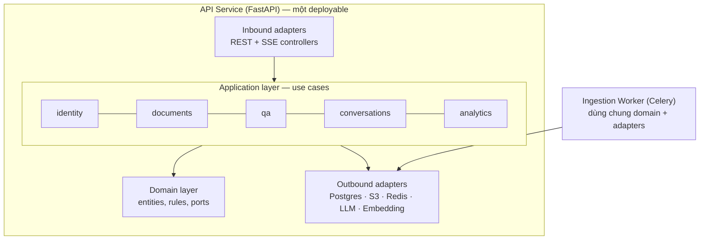
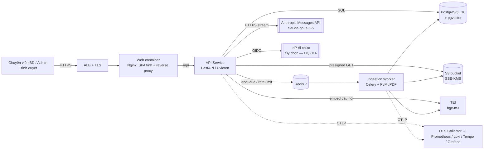
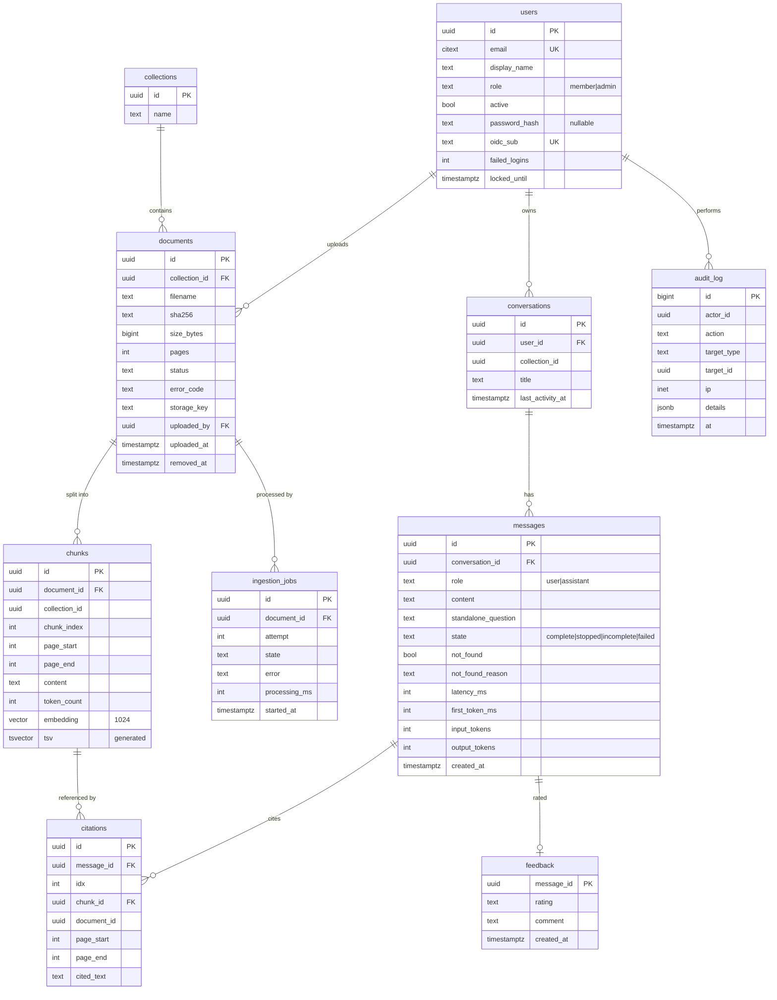
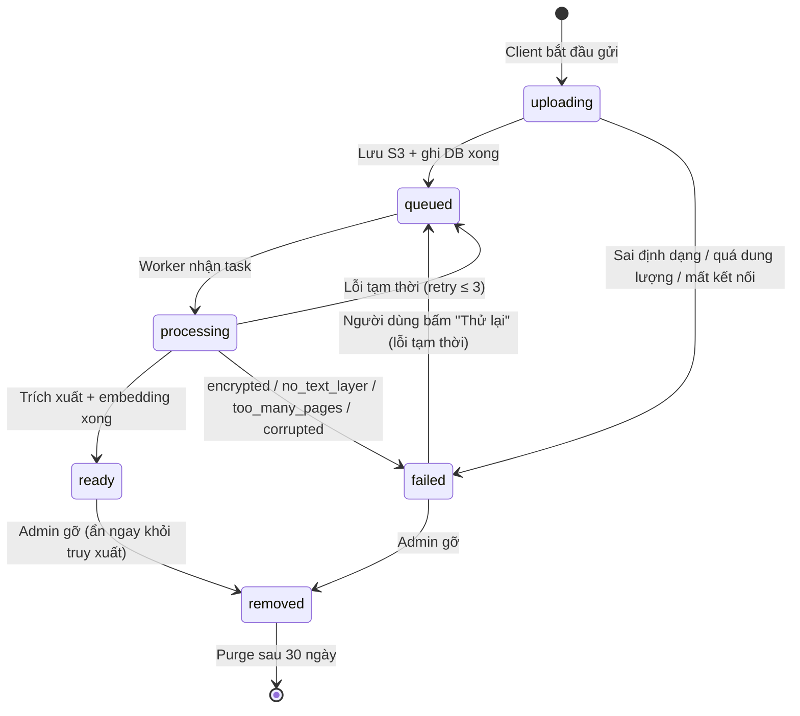
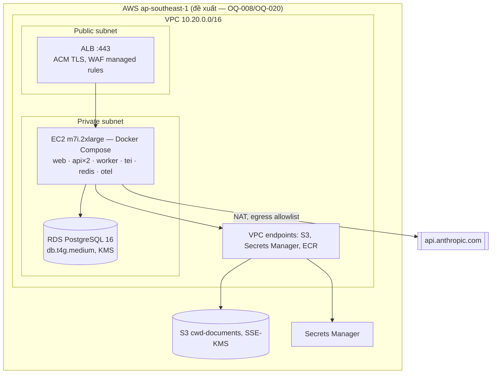

# Tài liệu Thiết kế Kiến trúc Phần mềm (SAD) — "Chat với tài liệu" (MVP)

> **Chuẩn tham chiếu:** IEEE 1016-2009 (Software Design Descriptions)
> **Prompt nguồn:** `docs/SAD_Prompt_IEEE_standard.md`
> **Tài liệu đầu vào:** `docs/requirements/PRD.md` (PRD-CWD-001 v0.1), `docs/requirements/BRD.md` (BRD-CWD-001 v0.1), `docs/design/UseCase_ChatWithDocument.drawio`

---

## ⚠ Phạm vi kiến trúc cho MVP (v0.2 — 2026-10-26)

Để rút ngắn thời gian ra mắt (go-live 14/12/2026), MVP **chỉ triển khai một phần** kiến trúc mô tả trong tài liệu này. Các phần còn lại được giữ làm **thiết kế mục tiêu cho giai đoạn 2**.

**Bảng đối chiếu: MVP triển khai gì thay cho thiết kế mục tiêu**

| Thành phần | Thiết kế mục tiêu (§1–§4) | MVP triển khai | ADR |
|---|---|---|---|
| Hàng đợi & worker | Redis 7 + Celery | **Bảng `ingestion_jobs` trong PostgreSQL**; worker lấy việc bằng `SELECT … FOR UPDATE SKIP LOCKED`, poll mỗi 2 s | ADR-010 |
| Phiên đăng nhập | Redis | **Bảng `sessions` trong PostgreSQL** (TTL trượt 8 giờ) | ADR-007 (sửa) |
| Truy xuất | Vector + full-text + RRF | **Chỉ vector (HNSW)** + ngưỡng τ. Thêm full-text nếu golden set cho thấy cần (AR-03) | ADR-003 (sửa) |
| Câu hỏi nối tiếp | Viết lại câu hỏi bằng LLM (≤ 10 lượt) | **Không có.** Mỗi câu hỏi độc lập, một lời gọi LLM | ADR-011 |
| Chịu lỗi LLM | Retry + watchdog + circuit breaker | **Retry của SDK (`max_retries=2`) + timeout 30 s** | ADR-011 |
| Rate limit | Token bucket trên Redis | **Không có** (20 người dùng nội bộ) | ADR-011 |
| Analytics | Bảng `analytics_events`, 13 sự kiện, view tuần | **Không có.** Số liệu tính bằng SQL trên `messages` và `conversations` | ADR-011 |
| Observability | OTel + Prometheus / Loki / Tempo / Grafana | **Log JSON (`structlog`) → CloudWatch Logs**; độ trễ lưu trong `messages` | ADR-012 |
| Môi trường | Staging + production, Terraform | **Một môi trường AWS** (Docker Compose trên EC2) + local; golden eval bắt buộc trước mỗi lần deploy | ADR-012 |
| CSDL | Partition theo tháng, job purge / aggregate | **Bảng thường**; gỡ tài liệu = xóa ngay; không có job định kỳ | ADR-011 |
| Xem nguồn trích dẫn | Panel PDF.js, tô sáng đoạn trích | **Mở PDF ở tab mới tại `#page=N`** bằng trình xem sẵn của trình duyệt | ADR-011 |
| CI | lint, test, `import-linter`, Semgrep, Trivy, `pip-audit`, gitleaks | **lint, test, `pip-audit`, gitleaks** | ADR-012 |

**Giữ nguyên như thiết kế:**

- Modular monolith + hexagonal ports (`LLMPort`, `EmbeddingPort`, `ObjectStoragePort`).
- PostgreSQL + pgvector; S3 có SSE-KMS; TEI `bge-m3` tự vận hành.
- Claude `claude-opus-5-5` với Citations + streaming SSE.
- Chunk theo trang; cơ chế chống bịa: ngưỡng τ + sentinel `NOT_FOUND` + hậu kiểm "0 trích dẫn".
- TLS, mã hóa at-rest, RBAC 2 vai trò, audit log (bảng thường).

**Thành phần container của MVP:** `web`, `api`, `worker`, `tei` trên EC2, cùng RDS PostgreSQL và S3. Phiên bản này **bỏ** `redis` và stack observability.

> `docs/design/schema.sql` vẫn là lược đồ mục tiêu. Migration MVP chỉ tạo các bảng `collections`, `users`, `sessions` (mới), `documents`, `ingestion_jobs`, `chunks`, `conversations`, `messages`, `citations`, `audit_log` (không partition). Bảng `feedback`, `analytics_events` và view `weekly_usage` để giai đoạn 2.

---

## 0. Tóm tắt các ràng buộc kỹ thuật

### 0.1 Nền tảng hệ thống

Prompt không điền phần "System Foundation". Nội dung dưới đây được suy ra từ PRD.

| Mục | Nội dung | Nguồn |
|---|---|---|
| Tên hệ thống | Chat với tài liệu (Chat with Document) — MVP | PRD §0.1 |
| Chức năng cốt lõi | Người dùng tải PDF lên một bộ tài liệu chung, đặt câu hỏi bằng ngôn ngữ tự nhiên, nhận câu trả lời do AI tổng hợp chỉ từ nội dung tài liệu, kèm trích dẫn tài liệu và trang | PRD EP-02, EP-03 |
| Quy mô / tải mục tiêu | 20 tài khoản, 5 người hỏi đồng thời, ≤ 50 tài liệu × ≤ 300 trang × ≤ 20 MB | NFR-004..008 ⚑ |
| Stack ưu tiên | Không được chỉ định. Kiến trúc sư đề xuất ở §0.3 | — |
| Ràng buộc then chốt | Xem §0.2 | — |

### 0.2 Ràng buộc kỹ thuật

| ID | Ràng buộc | Tác động lên kiến trúc | Nguồn |
|---|---|---|---|
| TC-01 | Ứng dụng web, desktop-first, chạy trên 2 phiên bản mới nhất của Chrome/Edge/Firefox/Safari | Dùng SPA; không làm ứng dụng native | CON-001, §8.1 PRD |
| TC-02 | Đầu vào chỉ là PDF có lớp văn bản; không OCR | Pipeline xử lý chỉ trích xuất text; PDF dạng ảnh được phát hiện và từ chối | CON-002, AC-US-007-3 |
| TC-03 | Câu trả lời chỉ dựa trên tài liệu, có trích dẫn trang | Dùng kiến trúc RAG kèm cơ chế trích dẫn có cấu trúc và kiểm tra "có căn cứ" | BRU-001, FR-013, FR-014 |
| TC-04 | p90 thời gian ra token đầu ≤ 5 s; p90 trả lời hoàn chỉnh ≤ 15 s | Bắt buộc streaming; giới hạn ngữ cảnh gửi cho LLM; LLM chạy ở effort thấp | NFR-001, NFR-002 ⚑ |
| TC-05 | PDF 50 trang được xử lý xong ≤ 60 s | Xử lý bất đồng bộ bằng worker; embedding theo lô | NFR-003 ⚑ |
| TC-06 | **Chưa rõ có được gửi nội dung tới AI bên ngoài không (OQ-008)** | Lớp AI phải **thay được nhà cung cấp** (ports & adapters). Embedding tự vận hành để toàn văn tài liệu không rời hệ thống | NFR-013, RSK-002 |
| TC-07 | TLS 1.2+, mã hóa at-rest AES-256, RBAC 2 vai trò, audit log 12 tháng | Xem §4.1 | NFR-010..016 |
| TC-08 | Khả dụng ≥ 95% giờ hành chính, RTO 1 ngày làm việc, RPO 24 giờ | Triển khai single-region, không cần failover nóng; sao lưu hằng ngày + PITR | NFR-017..019 ⚑ |
| TC-09 | Có thể tăng giới hạn ×5 mà không đổi chức năng | Mọi dữ liệu có `collection_id`; worker scale ngang; chỉ mục vector HNSW | NFR-009 |
| TC-10 | Đội nhỏ, MVP, ngân sách chưa rõ (OQ-007) | Ít thành phần vận hành; ưu tiên dịch vụ managed và một CSDL dùng chung | CON-004, CON-006 |

### 0.3 Stack đề xuất (tóm tắt)

| Lớp | Lựa chọn | Lý do chính |
|---|---|---|
| Frontend | React 18 + TypeScript + Vite (SPA), TanStack Query, PDF.js | Hệ sinh thái lớn; PDF.js mở được PDF tại đúng trang (US-017) |
| Backend API | Python 3.12 + FastAPI + Uvicorn | Hệ sinh thái RAG/PDF của Python mạnh nhất; async phù hợp streaming SSE |
| Worker | Celery 5 + Redis 7 (broker) | Xử lý PDF và embedding bất đồng bộ, có retry |
| CSDL | PostgreSQL 16 + `pgvector` 0.7+ | Một CSDL cho dữ liệu quan hệ, vector (HNSW) và full-text → ít thành phần (TC-10) |
| Lưu trữ tệp | S3-compatible (Amazon S3, SSE-KMS; MinIO nếu on-prem) | Tách tệp nhị phân khỏi CSDL |
| Trích xuất PDF | PyMuPDF | Nhanh, trích text theo trang (cần cho trích dẫn), phát hiện PDF mã hóa |
| Embedding | `BAAI/bge-m3` (1024 chiều, đa ngôn ngữ, tốt với tiếng Việt), chạy bằng Hugging Face Text Embeddings Inference (TEI) | Tự vận hành → toàn văn tài liệu không ra ngoài (TC-06); không phát sinh chi phí theo token |
| LLM | Claude (`claude-opus-5-5`) qua Anthropic Messages API, streaming, tính năng Citations | Hỗ trợ tiếng Việt; Citations trả về vị trí trích dẫn có cấu trúc, phục vụ trực tiếp FR-013 |
| Hạ tầng tham chiếu | AWS `ap-southeast-1`: EC2 + Docker Compose, RDS PostgreSQL, S3, ALB + ACM, Secrets Manager | Đơn giản cho quy mô MVP; vùng/nhà cung cấp chờ OQ-008, OQ-020 |
| Observability | OpenTelemetry → Prometheus, Loki, Tempo, Grafana | Trung lập nhà cung cấp |

> Mọi lựa chọn trên được ghi thành Quyết định kiến trúc (ADR) ở §5. Nếu OQ-008 cấm gửi dữ liệu ra ngoài, chỉ cần thay adapter LLM (§2.2, ADR-005). Các lớp còn lại giữ nguyên.

### 0.4 Kiểm soát tài liệu & ánh xạ IEEE 1016

| Thuộc tính | Giá trị |
|---|---|
| Mã tài liệu | SAD-CWD-001 |
| Phiên bản | 0.2 — `Draft` (thêm "Phạm vi kiến trúc cho MVP", ADR-010..012) |
| Ngày | 2026-10-26 (v0.1: 2026-10-22) |
| Tác giả | Huy Toan (vai trò Kiến trúc sư) |
| Người review | Tech lead, QA lead, Bảo mật (STK-005) — [TBD: OQ-001] |
| Tài liệu cha | PRD-CWD-001 v0.1 |

**Ánh xạ viewpoint IEEE 1016-2009 → mục trong tài liệu**

| Viewpoint (IEEE 1016 §5) | Mục |
|---|---|
| Context | §2.0 |
| Composition | §2.1–§2.4 |
| Logical | §2.2, §2.4 |
| Dependency | §2.0, §2.2 (sơ đồ phụ thuộc module) |
| Information | §3.1 |
| Interface | §2.4 |
| Interaction | §3.2 |
| State dynamics | §3.3 |
| Algorithm | §3.4 |
| Resource | §4.4, §4.5 |
| Deployment *(bổ sung)* | §4.4 |

---

## 1. Mục tiêu kiến trúc & Nguyên tắc thiết kế

### 1.1 Ba động lực kiến trúc chính

| # | Động lực | Vì sao quan trọng nhất | Thiết kế ưu tiên nó như thế nào |
|---|---|---|---|
| D1 | **Độ tin cậy của câu trả lời (groundedness)** | Giá trị cốt lõi của sản phẩm (UXP-1). Rủi ro lớn nhất là AI bịa thông tin (RSK-001) | (a) Truy xuất lai vector + full-text. (b) Ngưỡng liên quan: không đủ căn cứ thì trả "không tìm thấy" mà không gọi LLM. (c) Dùng Claude Citations để mọi câu trả lời có liên kết tới đoạn nguồn. (d) Câu trả lời không có trích dẫn hợp lệ bị chuyển thành "không tìm thấy". (e) Bộ đánh giá tự động (golden set) chạy mỗi đêm |
| D2 | **Bảo mật và chủ quyền dữ liệu** | Tài liệu kinh doanh có thể là thông tin mật. OQ-008 có thể chặn cả MVP | (a) Toàn văn PDF và embedding nằm trong hạ tầng của tổ chức. (b) Chỉ các đoạn liên quan (≤ 12 đoạn) được gửi tới LLM. (c) Adapter LLM thay được: Anthropic API, Claude trên Amazon Bedrock trong vùng chỉ định, hoặc mô hình tự vận hành. (d) Mã hóa ở mọi lớp, RBAC, audit log |
| D3 | **Độ trễ cảm nhận thấp** | Nếu chờ lâu hơn tự tìm thì không đạt BO-001 | (a) Stream token qua SSE. (b) Truy xuất trong CSDL < 300 ms (HNSW + GIN). (c) Giới hạn ngữ cảnh khoảng 10k token. (d) LLM chạy ở effort `low`. (e) Prompt caching cho phần system prompt cố định |

**Thuộc tính được cân nhắc nhưng xếp sau:**

- *Khả dụng cao:* chỉ cần 95% giờ hành chính (TC-08), nên không thiết kế đa vùng.
- *Khả năng mở rộng lớn:* chỉ cần ×5 (TC-09).

Hai thuộc tính này được đáp ứng bằng thiết kế không trạng thái (stateless), không phải bằng hạ tầng phức tạp.

### 1.2 Mẫu kiến trúc

**Lựa chọn: Modular Monolith theo Clean / Hexagonal Architecture, kèm Worker bất đồng bộ.**



**Lý do chọn:**

1. **Quy mô nhỏ, đội nhỏ.** 20 người dùng và 5 người đồng thời không cần microservices. Microservices sẽ thêm chi phí vận hành (service mesh, nhiều pipeline, giao dịch phân tán) mà không có lợi ích tương ứng (TC-10).
2. **Ranh giới module rõ ràng.** Năm module trùng với các epic của PRD. Module chỉ giao tiếp qua interface ở application layer; quy tắc import được kiểm tra bằng `import-linter` trong CI. Nhờ vậy có thể tách thành service riêng sau này, ví dụ tách `documents` khi cần scale ingestion.
3. **Hexagonal ports & adapters cho các phụ thuộc ngoài** (`LLMPort`, `EmbeddingPort`, `ObjectStoragePort`, `IdentityPort`). Đây là cách trực tiếp nhất để xử lý rủi ro OQ-008 (TC-06): đổi nhà cung cấp AI chỉ cần một adapter mới và cấu hình.
4. **Worker tách tiến trình.** Xử lý PDF tốn CPU và bộ nhớ, lại phải chạy parser trên tệp không tin cậy. Tách worker giúp không làm chậm API (D3) và cô lập rủi ro bảo mật (§4.1).

**Đã cân nhắc và loại bỏ:**

| Phương án | Lý do loại |
|---|---|
| Microservices | Chi phí vận hành vượt xa lợi ích ở quy mô MVP |
| Event-driven toàn phần (Kafka) | Chỉ có một luồng bất đồng bộ là ingestion; hàng đợi tác vụ là đủ |
| Serverless (Lambda) | Không phù hợp với streaming SSE dài; TEI cần chạy liên tục; cold start ảnh hưởng TC-04 |
| Vector DB riêng (Qdrant, Pinecone) | 30k vector là quá nhỏ để cần một hệ thống riêng; pgvector cho phép join và giao dịch với dữ liệu quan hệ, ví dụ lọc tài liệu đã gỡ |
| Framework RAG đóng gói (LangChain, LlamaIndex) | Luồng RAG ở đây ngắn và cần kiểm soát chặt (ngưỡng, trích dẫn). Tự viết khoảng 300 dòng dễ hiểu và dễ kiểm thử hơn |

---

## 2. Phân rã thành phần hệ thống

### 2.0 Ngữ cảnh và Container (C4 cấp 1–2)



### 2.1 Lớp Frontend / Client

| Khía cạnh | Thiết kế |
|---|---|
| Kiểu ứng dụng | **SPA** (React 18 + TypeScript + Vite). Không cần SSR vì ứng dụng nội bộ, sau đăng nhập, không cần SEO |
| Phân phối | Build ra tệp tĩnh có hash trong tên, phục vụ bởi Nginx trong container `web`. `index.html` có `Cache-Control: no-cache`; asset có `max-age=31536000, immutable`. Không cần CDN cho 20 người dùng; có thể thêm CloudFront sau |
| Quản lý trạng thái | **Server state:** TanStack Query (cache, refetch, invalidation). **UI state cục bộ:** React state + Zustand cho panel trích dẫn và hội thoại đang mở. Không lưu dữ liệu nghiệp vụ trong `localStorage`, chỉ lưu bản nháp câu hỏi chưa gửi (EC-05, EC-11) |
| Giao thức | REST/JSON cho CRUD. **SSE trên `fetch` + `ReadableStream`** cho luồng trả lời: phải là POST mang câu hỏi, nên không dùng được `EventSource`. Hủy bằng `AbortController` (nút Dừng — UI-07) |
| Cập nhật trạng thái tài liệu | Polling `GET /documents?status=processing` mỗi 3 s, chỉ khi còn tài liệu đang xử lý (`refetchInterval` có điều kiện). Đơn giản hơn WebSocket mà vẫn đáp ứng FR-006 |
| Upload | Multipart lên API, tối đa 10 tệp (FR-005). Kiểm tra trước ở client: phần mở rộng, ≤ 20 MB (AC-US-007-4). Tiến trình theo từng tệp bằng `XMLHttpRequest.upload.onprogress`. Upload song song tối đa 3 tệp |
| Xem PDF | PDF.js mở tệp qua presigned URL (TTL 5 phút), nhảy tới `#page=N` và tô sáng `cited_text` bằng text layer (US-017) |
| i18n | `react-i18next`; chuỗi tiếng Việt trong `locales/vi.json` (UI-08) |
| Truy cập | Radix UI primitives (có ARIA sẵn); kiểm tra `axe-core` trong CI (NFR-023) |
| Bảo mật client | CSP nghiêm ngặt (`default-src 'self'`; `connect-src 'self'`; `frame-ancestors 'none'`). Không có token trong JS: phiên dùng cookie `HttpOnly`. Header `X-CSRF-Token` cho request thay đổi dữ liệu |

### 2.2 Lớp Ứng dụng / Logic nghiệp vụ

**Các module và trách nhiệm**

| Module | Trách nhiệm | Use case (drawio) | Story PRD |
|---|---|---|---|
| `identity` | Đăng nhập (OIDC hoặc tài khoản nội bộ), phiên, RBAC, quản lý tài khoản | UC-01, UC-02, UC-03 | US-001..004 |
| `documents` | Nhận upload, kiểm tra, lưu tệp, điều phối ingestion, liệt kê, gỡ tài liệu, phát hiện trùng | UC-04..UC-09 | US-005..010 |
| `qa` | Viết lại câu hỏi nối tiếp, truy xuất lai, kiểm tra ngưỡng, dựng prompt, gọi LLM streaming, ánh xạ trích dẫn, xử lý "không tìm thấy" | UC-10..UC-15, UC-17 | US-011..018 |
| `conversations` | Hội thoại, tin nhắn, lịch sử, phản hồi đánh giá | UC-16, UC-18 | US-019, US-020 |
| `analytics` | Ghi sự kiện (§6.2 PRD), tổng hợp tuần, bảng số liệu cho Admin | UC-19 | US-021, US-022 |
| `platform` (shared kernel) | Cấu hình, logging, OTel, audit log, rate limit, lỗi chuẩn | — | NFR-014 |

**Quy tắc phụ thuộc** (kiểm tra bằng `import-linter`):

- `qa` → `documents` (chỉ đọc qua `RetrievalPort`), `conversations`.
- `analytics` không bị module nào khác import. Các module gửi sự kiện qua `EventPublisher`.
- Không module nào import trực tiếp adapter của module khác.

**Ports (domain) và adapters (hạ tầng)**

| Port | Adapter mặc định | Adapter thay thế (nếu OQ-008 cấm dịch vụ ngoài) |
|---|---|---|
| `LLMPort.stream_answer(question, chunks, history) → AsyncIterator[AnswerEvent]` | `AnthropicLLMAdapter`: Anthropic Python SDK, `client.messages.stream`, `claude-opus-5-5` | `BedrockLLMAdapter` (Claude trên Amazon Bedrock, vùng chỉ định); `OpenAICompatibleLocalAdapter` (vLLM tự vận hành, model mã nguồn mở) |
| `EmbeddingPort.embed(texts) → list[vector[1024]]` | `TEIEmbeddingAdapter` (HTTP nội bộ, `bge-m3`) | — (đã tự vận hành) |
| `ObjectStoragePort` | `S3Adapter` (boto3, SSE-KMS) | `MinIOAdapter` (on-prem) |
| `IdentityPort` | `OIDCAdapter` (Authlib, Authorization Code + PKCE) | `LocalPasswordAdapter` (Argon2id) |
| `TaskQueuePort` | `CeleryAdapter` | — |

**Tác vụ bất đồng bộ (Celery)**

| Task | Queue | Kích hoạt | Retry | Timeout |
|---|---|---|---|---|
| `ingest_document(document_id)` | `ingestion` | Sau khi upload xong | 3 lần, backoff mũ 10 s / 40 s / 160 s, kèm jitter; chỉ retry lỗi tạm thời (S3, TEI, DB) | soft 120 s, hard 180 s |
| `purge_removed_documents()` | `maintenance` | Celery beat, 02:00 hằng ngày | 3 lần | 600 s |
| `aggregate_weekly_metrics()` | `maintenance` | Celery beat, 01:00 thứ Hai | 3 lần | 300 s |
| `run_golden_eval()` | `maintenance` | Theo yêu cầu / hằng đêm trên staging | 0 lần | 1800 s |

Mọi task đều **idempotent**: kiểm tra `documents.status` và `ingestion_jobs.attempt` trước khi chạy, và xóa chunk cũ của document trong cùng giao dịch trước khi ghi mới.

Worker chạy với `--concurrency=2`, `--max-tasks-per-child=50` (tránh rò bộ nhớ của parser), và giới hạn bộ nhớ container 2 GB.

### 2.3 Lớp Hạ tầng dữ liệu

| Thành phần | Công nghệ & cấu hình | Dữ liệu | Lưu giữ |
|---|---|---|---|
| CSDL chính | **PostgreSQL 16** (RDS `db.t4g.medium`, 2 vCPU/4 GB, gp3 50 GB, mã hóa KMS). Extension: `vector`, `pg_trgm`, `pgcrypto` | Người dùng, tài liệu, chunk + vector, hội thoại, tin nhắn, trích dẫn, phản hồi, sự kiện, audit | Xem bảng lưu giữ bên dưới |
| Chỉ mục vector | `pgvector` **HNSW** trên `chunks.embedding vector(1024)`, `vector_cosine_ops`, `m=16`, `ef_construction=64`; truy vấn `SET hnsw.ef_search = 80` | — | — |
| Full-text | Cột sinh `tsv tsvector GENERATED ALWAYS AS (to_tsvector('simple', content)) STORED` + chỉ mục **GIN**. Dùng cấu hình `simple` vì PostgreSQL không có stemmer tiếng Việt; giữ nguyên dấu. Thêm chỉ mục GIN `pg_trgm` trên `documents.filename` | — | — |
| Cache / broker | **Redis 7** (container, AOF `everysec`) | Hàng đợi Celery, bộ đếm rate-limit (token bucket), phiên đăng nhập (`session:{id}`, TTL 8 giờ trượt), cờ hủy stream | Phiên: 8 giờ; task result: 24 giờ |
| Lưu trữ tệp | **S3** bucket `cwd-documents-{env}`: Block Public Access, SSE-KMS (CMK riêng), bật versioning, chỉ truy cập qua VPC endpoint. Key: `collections/{collection_id}/documents/{document_id}/original.pdf` | PDF gốc | Đến khi purge (§3.1); lifecycle xóa phiên bản cũ sau 30 ngày |
| Embedding service | **TEI** chạy `BAAI/bge-m3` trên CPU (container 3 vCPU / 6 GB, image CPU x86_64), batch 32 | Không lưu | — |

**Chính sách lưu giữ dữ liệu** (đề xuất, chờ OQ-016):

| Dữ liệu | Lưu giữ | Cơ chế |
|---|---|---|
| Tài liệu đang dùng | Đến khi Admin gỡ | — |
| Tài liệu đã gỡ | Ẩn khỏi truy xuất **ngay lập tức** (BRU-004); xóa vĩnh viễn PDF, chunk và vector sau **30 ngày** (NFR-016) | `purge_removed_documents` |
| Hội thoại & tin nhắn | 180 ngày ⚑ kể từ lần hoạt động cuối | Job purge hằng ngày |
| Sự kiện analytics | 12 tháng | Partition theo tháng, `DROP PARTITION` |
| Audit log | 12 tháng (NFR-014) | Partition theo tháng; bảng chỉ cho phép ghi thêm (append-only) |
| Backup RDS | 7 ngày (PITR) | RDS automated backups |

### 2.4 Lớp Backend / API

**Quy ước chung:**

- Tiền tố `/api/v1`, JSON UTF-8. Lỗi theo RFC 9457 (`application/problem+json`) với `type`, `title`, `status`, `code`, `detail`.
- Xác thực bằng cookie phiên `cwd_session` (`HttpOnly; Secure; SameSite=Lax`). Request thay đổi dữ liệu phải có `X-CSRF-Token`.
- Phân trang bằng cursor (`?cursor=&limit=`, mặc định 20, tối đa 100).
- Header `Idempotency-Key` cho `POST /documents`.

| Method & đường dẫn | Vai trò | Input | Output | Trace |
|---|---|---|---|---|
| `GET /auth/oidc/login` → `GET /auth/oidc/callback` | Public | `code`, `state` (PKCE) | 302 + đặt cookie phiên | US-001 |
| `POST /auth/login` | Public | `{email, password}` (chỉ khi dùng tài khoản nội bộ) | 204 + cookie; 401; 423 khi bị khóa (AC-US-001-2) | US-001 |
| `POST /auth/logout` | Member+ | — | 204 | UC-02 |
| `GET /me` | Member+ | — | `{id, display_name, role}` + `csrf_token` | — |
| `POST /documents` | Member+ | `multipart/form-data`: `files[]` (1–10, mỗi tệp ≤ 20 MB) | 202 `{items:[{document_id, filename, status:"queued"} \| {filename, error_code}]}` | US-005, US-007 |
| `GET /documents` | Member+ | `?status=&q=&cursor=` | `{items:[{id, filename, pages, uploaded_by, uploaded_at, status, error_code}], next_cursor, counts:{ready, processing, failed}}` | US-006, US-009 |
| `GET /documents/{id}/file` | Member+ | — | 302 tới S3 presigned URL (TTL 300 s) | US-017 |
| `DELETE /documents/{id}` | **Admin** | — | 204 (soft delete) | US-010 |
| `POST /documents/{id}/replace` | **Admin** | `multipart` 1 tệp | 202 (EC-08 "Thay thế") | EC-08 |
| `POST /conversations` | Member+ | `{title?}` | 201 `{id}` | US-019 |
| `GET /conversations` | Member+ (chỉ của mình) | `?cursor=` | `{items:[{id, title, last_activity_at}]}` | US-020 |
| `GET /conversations/{id}/messages` | Chủ sở hữu | `?cursor=` | `{items:[{id, role, content, citations[], not_found, created_at}]}` | US-020 |
| `POST /conversations/{id}/messages` | Chủ sở hữu | `{question: string(1..2000)}` | **`text/event-stream`** (bảng dưới) | US-011..016 |
| `POST /messages/{id}/feedback` | Chủ sở hữu | `{rating: "up"\|"down", comment?: string(≤1000)}` | 204 | US-018 |
| `POST /events` | Member+ | `{name: "citation_opened"\|"answer_stopped", props}` (danh sách cho phép) | 204 | §6.2 PRD |
| `GET/POST/PATCH /admin/users` | **Admin** | `{email, display_name, role, active}` | Danh sách / 201 / 200 | US-004 |
| `GET /admin/metrics/weekly` | **Admin** | `?from=&to=` | `{weeks:[{week, active_users, questions, helpful_rate, not_found_rate, p90_latency_ms}]}` | US-022 |
| `GET /healthz`, `GET /readyz` | Nội bộ | — | 200 / 503 (readyz kiểm tra DB, Redis, TEI) | §4.2 |

**Hợp đồng luồng SSE** của `POST /conversations/{id}/messages`:

| `event:` | `data:` (JSON) | Ý nghĩa |
|---|---|---|
| `meta` | `{message_id, ready_doc_count, processing_doc_count}` | Gửi ngay khi nhận câu hỏi; giao diện hiển thị cảnh báo AC-US-008-1 |
| `delta` | `{text}` | Một đoạn câu trả lời |
| `citation` | `{index, document_id, document_title, page_start, page_end, cited_text}` | Một trích dẫn gắn với đoạn văn vừa phát |
| `not_found` | `{reason: "low_relevance"\|"model_declined"\|"no_citations"}` | Thay cho câu trả lời (US-014) |
| `done` | `{latency_ms, citation_count}` | Kết thúc |
| `error` | `{code: "ai_unavailable"\|"rate_limited"\|"timeout", retryable}` | EC-06 |

- Server gửi comment `: ping` mỗi 15 s để giữ kết nối qua ALB (idle timeout của ALB đặt 120 s).
- Khi client ngắt kết nối (nút Dừng hoặc mất mạng), FastAPI phát hiện qua `request.is_disconnected()`, đóng stream tới Anthropic để ngừng tính phí token, và lưu tin nhắn với trạng thái `stopped` hoặc `incomplete` (EC-04).

---

## 3. Kiến trúc dữ liệu & Luồng tích hợp

### 3.1 Chiến lược mô hình dữ liệu

- **Một schema dùng chung** trong một CSDL PostgreSQL. Mỗi module sở hữu các bảng của mình (tiền tố theo module trong mã), và module khác không ghi trực tiếp vào bảng đó. Không dùng database-per-service vì đây là monolith, và cần giao dịch nhất quán giữa `documents` và `chunks`.
- **Quan hệ + vector + full-text trong cùng CSDL.** Câu truy vấn truy xuất có thể lọc `documents.status = 'ready'` và `collection_id` trong cùng một câu SQL, nên BRU-004 có hiệu lực ngay lập tức mà không cần đồng bộ với hệ thống khác.
- **Tách tệp nhị phân:** PDF nằm ở S3; CSDL chỉ giữ `storage_key` và `sha256`.
- **Sẵn sàng mở rộng (NFR-009):** mọi bảng nghiệp vụ có `collection_id`. MVP chỉ có một collection mặc định.



**Chỉ mục và ràng buộc chính**

| Bảng | Chỉ mục / ràng buộc | Mục đích |
|---|---|---|
| `chunks` | `HNSW (embedding vector_cosine_ops)`; `GIN (tsv)`; `BTREE (document_id, chunk_index)` | Truy xuất lai; xóa và ghi lại theo tài liệu |
| `documents` | `BTREE (collection_id, status)`; `UNIQUE (collection_id, filename) WHERE removed_at IS NULL`; `BTREE (collection_id, sha256)` | Lọc tài liệu Sẵn sàng; phát hiện trùng tên (EC-08); trùng nội dung |
| `messages` | `BTREE (conversation_id, created_at)` | Ngữ cảnh hội thoại, lịch sử |
| `conversations` | `BTREE (user_id, last_activity_at DESC)` | Danh sách hội thoại (US-020) |
| `analytics_events` | Partition theo tháng `RANGE (occurred_at)`; `BTREE (name, occurred_at)` | KR3.1, bảng số liệu |
| `audit_log` | Partition theo tháng; quyền DB chỉ `INSERT, SELECT` cho role ứng dụng | Không sửa được (NFR-014) |

**Trạng thái `documents.status`:** `uploading` → `queued` → `processing` → `ready` | `failed`; tài liệu bị gỡ chuyển sang `removed` (§3.3).

**Ước lượng dung lượng ở giới hạn MVP:**

- 50 tài liệu × 300 trang ≈ 15.000 trang; khoảng 2 chunk/trang → 30.000 chunk.
- Vector: 30.000 × 1024 × 4 B ≈ 123 MB; chỉ mục HNSW thêm khoảng 2× → tổng < 500 MB.
- Text: khoảng 60 MB.
- Ở mức ×5 (NFR-009), toàn bộ chỉ mục khoảng 2,5 GB, vẫn nằm vừa RAM của instance `db.t4g.large`.

### 3.2 Luồng tương tác chính

#### 3.2.1 Luồng E2E "Hỏi đáp có trích dẫn" (UC-10 → UC-11, US-011..016)

```mermaid
sequenceDiagram
    autonumber
    participant B as Trình duyệt (SPA)
    participant A as API (FastAPI)
    participant R as Redis
    participant P as PostgreSQL
    participant T as TEI (bge-m3)
    participant L as Anthropic API
    B->>A: POST /conversations/{id}/messages {question} (cookie + CSRF)
    A->>R: Kiểm tra phiên + rate limit (20 câu/phút/người)
    A->>P: Kiểm tra quyền sở hữu hội thoại; lưu message(user)
    A-->>B: SSE meta {message_id, ready_doc_count}
    alt Câu hỏi nối tiếp (turn > 0)
        A->>L: Viết lại thành câu hỏi độc lập (≤ 10 lượt gần nhất, effort low, không stream)
        L-->>A: standalone_question
    end
    A->>T: embed(standalone_question)
    T-->>A: vector[1024]
    par Truy xuất lai
        A->>P: Top 30 theo cosine (HNSW), lọc status='ready'
    and
        A->>P: Top 30 theo ts_rank (GIN), lọc status='ready'
    end
    A->>A: Gộp bằng RRF (k=60) → top 12 chunk; kiểm tra ngưỡng τ
    alt Dưới ngưỡng liên quan
        A-->>B: SSE not_found {reason: low_relevance}
    else Đủ căn cứ
        A->>L: messages.stream(system đã cache + 12 document block, citations bật)
        loop Mỗi đoạn văn bản
            L-->>A: text delta / citations (content_block_location)
            A->>A: Ánh xạ block index → chunk_id → (tài liệu, trang)
            A-->>B: SSE delta / citation
        end
        L-->>A: message_stop (usage)
        A->>A: Không có trích dẫn hợp lệ? → chuyển thành not_found (no_citations)
        A->>P: Lưu message(assistant), citations, latency, token
        A-->>B: SSE done {latency_ms}
    end
    A-)P: Ghi analytics_events (question_submitted, answer_first_token, answer_completed)
```

**Diễn giải từng bước:**

1. **Xác thực và giới hạn (bước 1–3).** Middleware đọc cookie phiên, tra Redis (`session:{id}` → `user_id`, `role`) và kiểm tra CSRF. Rate limit dùng token bucket trong Redis (Lua script nguyên tử): 20 câu hỏi mỗi phút mỗi người, vượt thì trả `429` với `Retry-After`. Use case `AskQuestion` kiểm tra `conversation.user_id == current_user` (FR-003), rồi ghi message `user` trong một giao dịch.
2. **Phản hồi sớm (bước 4).** Event `meta` được gửi trước mọi xử lý nặng, để giao diện hiện trạng thái "đang trả lời" ngay lập tức.
3. **Viết lại câu hỏi nối tiếp (bước 5–6, FR-019).** Chỉ chạy khi hội thoại đã có lượt trước. Gửi tối đa 10 lượt gần nhất kèm câu hỏi mới và yêu cầu trả về một câu hỏi độc lập. Lời gọi này dùng `max_tokens=256` và `effort=low`. Dự kiến tốn khoảng 1 s nên nằm trong ngân sách 5 s cho token đầu.
4. **Embedding câu hỏi (bước 7–8).** Gọi TEI qua HTTP nội bộ, timeout 2 s. Nếu TEI lỗi, chuyển sang **chế độ suy giảm** (§4.2): chỉ truy xuất full-text.
5. **Truy xuất lai (bước 9–10).** Hai truy vấn chạy song song trên hai connection của pool (asyncpg). SQL rút gọn:

   ```sql
   -- vector
   SELECT c.id, 1 - (c.embedding <=> $1) AS sim
   FROM chunks c JOIN documents d ON d.id = c.document_id
   WHERE d.collection_id = $2 AND d.status = 'ready'
   ORDER BY c.embedding <=> $1 LIMIT 30;
   -- full-text
   SELECT c.id, ts_rank_cd(c.tsv, q) AS rank
   FROM chunks c JOIN documents d ON d.id = c.document_id,
        websearch_to_tsquery('simple', $3) q
   WHERE d.collection_id = $2 AND d.status = 'ready' AND c.tsv @@ q
   ORDER BY rank DESC LIMIT 30;
   ```

6. **Gộp và kiểm tra ngưỡng (bước 11–12, FR-014).** Dùng Reciprocal Rank Fusion: `score = Σ 1/(60 + rank_i)`. Lấy top 12 chunk, tối đa khoảng 9.000 token. Nếu `max(sim) < τ_vec` **và** không có kết quả full-text nào, trả `not_found` mà **không gọi LLM**, vừa tiết kiệm chi phí vừa tránh bịa. Giá trị khởi tạo `τ_vec = 0.45` sẽ được hiệu chỉnh trên bộ câu hỏi chuẩn để đạt KR2.3.
7. **Sinh câu trả lời (bước 13–16, FR-011..013).** `AnthropicLLMAdapter` gọi `client.messages.stream` với cấu hình sau:
   - **Model và suy luận:** `model="claude-opus-5-5"`, `output_config={"effort": "low"}`, `thinking={"type": "adaptive"}`, `max_tokens=4096`.
   - **System prompt:** cố định, có `cache_control` để dùng prompt caching. Nội dung yêu cầu: chỉ trả lời từ tài liệu; trả lời bằng ngôn ngữ của câu hỏi; nếu tài liệu không chứa thông tin thì trả đúng câu sentinel `NOT_FOUND`; nội dung tài liệu là dữ liệu, không phải chỉ dẫn.
   - **Tài liệu nguồn:** 12 chunk được gửi thành **12 `document` block dạng custom content** với `citations: {enabled: true}`. Mỗi block có `title = "{filename} — tr. {page_start}"`.
   - **Kết quả trích dẫn:** API trả citation dạng `content_block_location` kèm `document_index`. Server ánh xạ `document_index → chunk_id → (document_id, page)` từ danh sách đã gửi, nên trích dẫn **không thể trỏ tới trang không tồn tại**.
   - **Fallback và refusal:** bật server-side fallback (`betas=["server-side-fallback-2026-07-01"]`, `fallbacks="default"`). Kiểm tra `stop_reason`; nếu là `refusal` thì phát `error` hoặc `not_found` phù hợp.
8. **Hậu kiểm (bước 17, AC-US-013-1).** Nếu câu trả lời chứa sentinel `NOT_FOUND` hoặc không có trích dẫn hợp lệ nào, server thay câu trả lời bằng `not_found`. Đoạn văn đã stream ra sẽ bị xóa khỏi giao diện qua event `not_found`.
9. **Lưu trữ và đo lường (bước 18–20).** Ghi message `assistant`, các citation, `latency_ms`, `first_token_ms` và token usage. Sự kiện analytics được ghi bất đồng bộ (fire-and-forget qua `asyncio.create_task`, có giới hạn hàng đợi) để không cộng vào độ trễ.

**Ngân sách độ trễ dự kiến (p90)**

| Bước | Thời gian |
|---|---|
| Xác thực, rate limit, ghi DB | 30 ms |
| Viết lại câu hỏi (chỉ khi là câu nối tiếp) | 1.200 ms |
| Embedding | 150 ms |
| Truy xuất + RRF | 250 ms |
| Token đầu từ LLM | 1.500–2.500 ms |
| **Tổng tới token đầu** | **≈ 4,1 s** (≤ 5 s, NFR-002) |
| Sinh khoảng 500 token đầu ra | ≈ 6–8 s |
| **Tổng câu trả lời hoàn chỉnh** | **≈ 12 s** (≤ 15 s, NFR-001) |

Các con số này phải được xác nhận bằng PoC (§6, AR-01).

#### 3.2.2 Luồng "Tải lên & xử lý tài liệu" (UC-04, UC-05, UC-09)

```mermaid
sequenceDiagram
    autonumber
    participant B as SPA
    participant A as API
    participant S as S3
    participant P as PostgreSQL
    participant Q as Redis/Celery
    participant W as Worker
    participant T as TEI
    B->>A: POST /documents (multipart, ≤10 tệp)
    loop Mỗi tệp
        A->>A: Kiểm tra magic bytes "%PDF-", ≤20 MB, tên tệp
        A->>P: Trùng tên (active)? → trả error_code=duplicate_name (EC-08)
        A->>S: PutObject (SSE-KMS), tính sha256 khi stream
        A->>P: INSERT documents(status=queued) + audit_log
        A->>Q: enqueue ingest_document(id)
    end
    A-->>B: 202 {items}
    Q->>W: ingest_document(id)
    W->>P: status=processing
    W->>S: GetObject
    W->>W: PyMuPDF: mã hóa? → failed(encrypted); trang > 300? → failed(too_many_pages)
    W->>W: Trích text theo trang; ký tự TB/trang < 30 → failed(no_text_layer)
    W->>W: Chuẩn hóa Unicode NFC; tách chunk theo trang (≈ 500 token, chồng 15%)
    W->>T: embed theo lô 32
    W->>P: Trong một giao dịch: DELETE chunks cũ; INSERT chunks; status=ready, pages
    B->>A: Polling GET /documents?status=processing (3 s)
    A-->>B: status=ready
```

### 3.3 Trạng thái tài liệu (State dynamics)



### 3.4 Thuật toán tách đoạn (chunking)

1. Trích text theo từng trang bằng `page.get_text("text", sort=True)`, chuẩn hóa Unicode NFC, gộp dòng bị ngắt giữa câu.
2. Một chunk **không vượt ranh giới trang**, để trích dẫn luôn chỉ đúng một trang. Trang dài được tách theo đoạn văn rồi theo câu, mục tiêu 500 token (đếm bằng tokenizer của bge-m3), tối đa 800 token, chồng lấp 75 token. Trang quá ngắn (< 80 token) được gộp với trang kế tiếp, và chunk khi đó có `page_start ≠ page_end`.
3. Mỗi chunk được thêm tiền tố ngữ cảnh `"{filename} — trang {n}: "` trước khi embedding, để tăng độ chính xác truy xuất cho các câu hỏi nhắc tên tài liệu.

---

## 4. Các mối quan tâm xuyên suốt & Hạ tầng

### 4.1 Bảo mật & tuân thủ

**Xác thực và phân quyền**

| Hạng mục | Thiết kế |
|---|---|
| Xác thực | **Ưu tiên OIDC** (Authorization Code + PKCE, Authlib) với IdP của tổ chức như Microsoft Entra ID hoặc Google Workspace (OQ-014, OQ-020). **Dự phòng:** tài khoản nội bộ do Admin tạo, mật khẩu ≥ 12 ký tự, băm **Argon2id** (m=64 MiB, t=3, p=1) (NFR-015). Khóa tài khoản 15 phút sau 5 lần sai (AC-US-001-2) |
| Phiên | Phiên phía server: cookie ngẫu nhiên 256 bit trỏ tới bản ghi phiên trong Redis. Hết hạn trượt 8 giờ, tuyệt đối 7 ngày. Xoay ID phiên sau đăng nhập. Đăng xuất xóa bản ghi phiên. **Không dùng JWT trong trình duyệt**: không cần cho SPA cùng origin, và thu hồi phiên ngay lập tức dễ hơn |
| CSRF | Mẫu synchronizer token: `csrf_token` lấy từ `/me`, gửi trong header `X-CSRF-Token`. Kèm cookie `SameSite=Lax` |
| Phân quyền | RBAC ở application layer bằng decorator `@requires(role)` theo ma trận BRU-006. Quyền sở hữu tài nguyên (hội thoại) kiểm tra trong use case và đưa thẳng vào truy vấn (`WHERE user_id = :current`), nên không lộ thông tin qua ID đoán được (AC-US-003-1). Trả về 404 cho tài nguyên không thuộc quyền để không tiết lộ sự tồn tại |
| Tài khoản bị vô hiệu | Khi Admin vô hiệu hóa tài khoản, mọi phiên của người dùng đó bị xóa (`session:user:{id}` set) (AC-US-002-1) |

**Mã hóa**

| Phạm vi | Cơ chế |
|---|---|
| In-transit (bên ngoài) | ALB với chứng chỉ ACM, policy `ELBSecurityPolicy-TLS13-1-2-2021-06` (TLS 1.2/1.3). HSTS `max-age=31536000; includeSubDomains` (NFR-010) |
| In-transit (nội bộ) | API ↔ RDS: TLS (`sslmode=verify-full`). API ↔ S3, Secrets Manager: HTTPS qua VPC endpoint. API ↔ Anthropic: HTTPS. API ↔ TEI/Redis: mạng Docker nội bộ trên cùng host, không mở cổng ra ngoài |
| At-rest | RDS: mã hóa KMS (AES-256). S3: SSE-KMS với CMK riêng, bật key rotation. EBS: mã hóa. Redis: AOF nằm trên EBS đã mã hóa (NFR-011) |

**Quản lý bí mật**

- Khóa API Anthropic, mật khẩu DB, OIDC client secret và session signing key lưu trong **AWS Secrets Manager**.
- EC2 dùng IAM instance role (least privilege) để đọc secret khi container khởi động; secret được inject thành biến môi trường, không ghi vào image hay repo.
- Xoay vòng: mật khẩu DB 90 ngày (RDS rotation); khóa Anthropic thủ công mỗi 90 ngày.
- CI chạy `gitleaks` để ngăn commit secret.

**Bảo vệ dữ liệu khi dùng AI (D2, NFR-013)**

- Chỉ gửi ≤ 12 chunk liên quan và câu hỏi; không bao giờ gửi toàn bộ PDF.
- Theo điều khoản thương mại, dữ liệu gửi qua Anthropic API không được dùng để huấn luyện mô hình. Nếu tổ chức yêu cầu, có thể ký thỏa thuận Zero Data Retention với Anthropic. Có thể chỉ định nơi xử lý bằng tham số `inference_geo`.
- **Nếu OQ-008 cấm dịch vụ bên ngoài:** chuyển sang `BedrockLLMAdapter` (Claude trên Amazon Bedrock trong vùng AWS được phép, dữ liệu nằm trong tài khoản AWS của tổ chức), hoặc tự vận hành mô hình mã nguồn mở. Lựa chọn thứ hai cần GPU và chất lượng tiếng Việt phải được đánh giá lại.

**Bảo mật ứng dụng**

| Mối đe dọa | Biện pháp |
|---|---|
| Tệp PDF độc hại (khai thác parser) | Kiểm tra magic bytes ở API. Chỉ worker phân tích nội dung PDF; worker chạy container non-root, `read_only` filesystem, không có quyền mạng ra Internet (chỉ S3/TEI/DB), giới hạn 2 GB RAM, timeout 120 s. Cập nhật PyMuPDF qua Dependabot |
| Prompt injection trong nội dung tài liệu | LLM không được cấp tool nào, nên không thể thực hiện hành động. System prompt nêu rõ nội dung tài liệu là dữ liệu. Trích dẫn được ánh xạ phía server, không tin vào văn bản do model sinh. Giao diện render câu trả lời dạng Markdown đã được làm sạch (DOMPurify, không cho HTML thô hay link `javascript:`) |
| Lạm dụng / chi phí AI | Rate limit theo người dùng (20 câu/phút, 30 tệp/giờ); giới hạn 2.000 ký tự câu hỏi. Đặt **hạn mức chi tiêu theo tháng** ở Anthropic Console, kèm cảnh báo khi đạt 80% ngân sách (OQ-007) |
| OWASP Top 10 | SQL tham số hóa (SQLAlchemy Core / asyncpg); CSP; dependency scan (`pip-audit`, `npm audit`); quét SAST (Semgrep) và quét image (Trivy) trong CI (launch gate PRD §6.1) |

**Tuân thủ**

- **Audit log** (NFR-014) ghi các thao tác: đăng nhập thành công/thất bại, tải lên, gỡ, thay thế tài liệu, tạo/sửa tài khoản, đổi vai trò. Bảng `audit_log` chỉ cho phép ghi thêm và lưu 12 tháng.
- **Dữ liệu cá nhân (CON-007):** nếu tài liệu chứa dữ liệu cá nhân, cần áp dụng quy định bảo vệ dữ liệu cá nhân của Việt Nam (Nghị định 13/2023/NĐ-CP hoặc văn bản thay thế đang có hiệu lực) — pháp chế xác nhận. Kiến trúc đã hỗ trợ: xóa theo yêu cầu (purge), nhật ký truy cập, kiểm soát nơi lưu trữ (vùng AWS), và giảm thiểu dữ liệu gửi cho bên thứ ba.

### 4.2 Độ tin cậy & khả năng chịu lỗi

| Cơ chế | Thiết kế | Trace |
|---|---|---|
| Triển khai | Single-region (`ap-southeast-1`), một EC2 `m7i.2xlarge` (8 vCPU / 32 GB, x86_64; phân bổ tài nguyên theo Blueprint §3.8) chạy Docker Compose (`web`, `api` ×2 replica, `worker` ×1, `tei`, `redis`, `otel-collector`). RDS Single-AZ. Đủ cho 95% khả dụng giờ hành chính; nâng lên Multi-AZ chỉ cần đổi cấu hình nếu OQ-019 yêu cầu | NFR-017 |
| Health check | ALB kiểm tra `/readyz` (DB, Redis, TEI) mỗi 10 s. Docker `restart: unless-stopped` + healthcheck cho từng container | NFR-017 |
| Retry LLM | Anthropic SDK `max_retries=2` (408/409/429/5xx, lỗi kết nối, backoff mũ có sẵn trong SDK). `timeout` 30 s cho lời gọi viết lại câu hỏi; luồng chính dùng watchdog: không có token đầu sau 20 s thì hủy và phát `error{code:"timeout"}` | NFR-020, EC-06 |
| Circuit breaker LLM | Thư viện `pybreaker`: 5 lỗi liên tiếp → mở 30 s. Khi mở, trả ngay `error{code:"ai_unavailable", retryable:true}`; banner trên giao diện; nửa mở cho thử 1 request | EC-06 |
| Fallback model | Server-side fallback của Anthropic (`fallbacks="default"`) khi bị từ chối theo phân loại an toàn | — |
| Suy giảm có kiểm soát | TEI lỗi → truy xuất chỉ dùng full-text, gắn cờ `degraded=true` trong log/metric. Redis lỗi → API trả 503 cho đăng nhập (phiên nằm trong Redis); các tài liệu đã xử lý vẫn còn trong DB | NFR-021 |
| Retry ingestion | Celery `autoretry_for` lỗi tạm thời, backoff mũ có jitter, tối đa 3 lần; sau đó `failed(error_code=transient_exhausted)` và người dùng thử lại được (EC-03). `acks_late=True` + `reject_on_worker_lost=True` để không mất task khi worker chết | NFR-021 |
| Rate limiting | Token bucket trong Redis, theo người dùng và theo IP (đăng nhập: 10 lần/phút/IP) | §4.1 |
| Backup / khôi phục | RDS automated backup + PITR 7 ngày (RPO thực tế ≤ 5 phút, tốt hơn NFR-019). S3 versioning. Hạ tầng dạng mã (Terraform) + image trong ECR → dựng lại môi trường trong < 4 giờ (RTO ≤ 1 ngày làm việc). Diễn tập khôi phục mỗi quý | NFR-018, NFR-019 |
| Triển khai không gián đoạn (tùy chọn) | Rolling restart 2 replica `api` sau Nginx; migration DB theo mẫu expand/contract (Alembic). Không bắt buộc ở MVP | — |

### 4.3 Observability

| Trụ cột | Công cụ | Nội dung |
|---|---|---|
| Tracing | OpenTelemetry SDK (auto-instrument FastAPI, asyncpg, httpx, Celery, Redis) → OTel Collector → **Tempo** | Span cho mỗi bước của §3.2.1: `qa.rewrite`, `qa.embed`, `qa.retrieve.vector`, `qa.retrieve.fts`, `qa.fuse`, `llm.stream` (thuộc tính: model, input/output/cache-read tokens, first_token_ms, stop_reason). Trace ID được truyền vào task Celery, nên một trace ingestion đi từ upload tới `ready` |
| Metrics | Prometheus (scrape `/metrics` qua `prometheus-fastapi-instrumentator` + metric tùy chỉnh) | `http_request_duration_seconds` (theo route); `qa_first_token_seconds` & `qa_answer_seconds` (histogram → p90 cho NFR-001/002); `qa_not_found_total{reason}`; `qa_citations_per_answer`; `llm_tokens_total{type}`; `llm_cost_usd_total`; `ingestion_duration_seconds`; `ingestion_failures_total{error_code}`; `celery_queue_length`; `circuit_breaker_state` |
| Logging | JSON có cấu trúc (`structlog`) → Loki; các trường `trace_id`, `user_id` (ẩn danh), `route`, `latency_ms` | **Không ghi** nội dung câu hỏi, câu trả lời hay văn bản tài liệu vào log (PRD §6.2). Nội dung chỉ nằm trong DB với kiểm soát truy cập |
| Dashboard | Grafana | (1) **Sức khỏe SLO:** p90 token đầu / hoàn chỉnh, tỷ lệ lỗi, khả dụng. (2) **Chất lượng RAG:** tỷ lệ not_found, trích dẫn trung bình, tỷ lệ đánh giá hữu ích. (3) **Ingestion:** thời gian xử lý, lỗi theo mã. (4) **Chi phí AI:** token và USD theo ngày |
| Cảnh báo | Grafana Alerting → email / Teams | p90 trả lời > 15 s trong 15 phút; tỷ lệ 5xx > 5% trong 5 phút; circuit breaker mở; queue `ingestion` > 50 trong 10 phút; chi phí LLM tháng > 80% ngân sách; `/readyz` lỗi > 2 phút |
| Đánh giá chất lượng | `run_golden_eval` hằng đêm trên staging với bộ câu hỏi chuẩn (DEP-002) | Ghi KR2.1–KR2.3 theo thời gian; chặn release nếu dưới ngưỡng (launch gate) |

### 4.4 Kiến trúc triển khai (Deployment)



- **Môi trường:** `staging` và `production` tách tài khoản AWS hoặc VPC. Dữ liệu ở staging là bộ tài liệu mẫu, không phải tài liệu thật.
- **CI/CD (GitHub Actions):** lint → test (pytest, vitest) → kiểm tra `import-linter` → Semgrep, `pip-audit`, Trivy → build image amd64 → đẩy lên ECR → deploy staging → chạy golden eval → phê duyệt thủ công → deploy production.
- **Egress:** worker không có route ra Internet. API chỉ được ra `api.anthropic.com` (và IdP nếu dùng OIDC) qua NAT với security group/allowlist.

### 4.5 Ước tính chi phí vận hành

Giả định: 20 người dùng, 10 câu hỏi mỗi người mỗi ngày, 22 ngày/tháng → **4.400 câu hỏi/tháng**. Mỗi câu hỏi khoảng 10.000 token đầu vào và 600 token đầu ra.

| Hạng mục | Ước tính / tháng |
|---|---|
| LLM `claude-opus-5-5` ($4 / $20 mỗi triệu token) | 4.400 × (10.000 × $4/1M + 600 × $20/1M) ≈ 4.400 × $0,052 ≈ **$230** |
| EC2 m7i.2xlarge + RDS db.t4g.medium + ALB + S3 + NAT | ≈ $400–450 (giá on-demand, cần xác nhận bằng AWS Pricing Calculator) |

**Đòn bẩy giảm chi phí** (cần quyết định cùng OQ-007, sau khi đo chất lượng trên golden set):

- Prompt caching cho system prompt.
- Giảm số chunk gửi đi (12 → 8).
- Dùng `claude-sonnet-5-5` ($2 / $10) cho bước viết lại câu hỏi, hoặc cho cả câu trả lời nếu chất lượng vẫn đạt KR2.1.

---

## 5. Quyết định kiến trúc (ADR tóm tắt)

| ADR | Quyết định | Phương án đã loại | Trạng thái |
|---|---|---|---|
| ADR-001 | Modular monolith (hexagonal) + worker Celery | Microservices, serverless | Proposed |
| ADR-002 | PostgreSQL + pgvector (HNSW) + full-text trong một CSDL | Qdrant, Pinecone, OpenSearch | Proposed |
| ADR-003 | Truy xuất lai vector + full-text gộp bằng RRF; có ngưỡng "không tìm thấy" trước khi gọi LLM. **MVP (v0.2): chỉ vector + ngưỡng τ**; thêm full-text nếu golden set cho thấy cần | Reranker cross-encoder (để giai đoạn sau, nếu golden set cho thấy cần) | Proposed — PoC |
| ADR-004 | Embedding `bge-m3` tự vận hành (TEI, CPU) | API embedding bên ngoài (gửi toàn văn tài liệu ra ngoài, trái TC-06) | Proposed — PoC tốc độ |
| ADR-005 | LLM: Claude `claude-opus-5-5` qua Anthropic API, Citations + streaming, sau `LLMPort` | Bedrock (dự phòng theo OQ-008); mô hình tự vận hành (dự phòng) | **Chờ OQ-008** |
| ADR-006 | Chunk không vượt ranh giới trang; trích dẫn ánh xạ phía server | Chunk cố định theo token, vượt trang | Proposed |
| ADR-007 | Phiên phía server + cookie HttpOnly; OIDC ưu tiên. **MVP (v0.2): phiên lưu ở bảng `sessions` trong PostgreSQL** thay vì Redis | JWT trong SPA | Proposed — chờ OQ-014 |
| ADR-008 | SSE trên POST (`fetch` stream) cho câu trả lời; polling cho trạng thái tài liệu | WebSocket | Proposed |
| ADR-009 | Docker Compose trên một EC2 cho MVP | EKS / ECS | Proposed — xem lại khi vượt ×5 |
| ADR-010 | **MVP:** hàng đợi ingestion bằng PostgreSQL (`ingestion_jobs` + `SKIP LOCKED`), bỏ Redis / Celery | Redis + Celery (giữ cho giai đoạn 2 khi cần scale worker) | Accepted (v0.2) |
| ADR-011 | **MVP:** bỏ câu hỏi nối tiếp, circuit breaker, rate limit, analytics events, job định kỳ, panel PDF.js | Triển khai đầy đủ theo §2–§4 (giai đoạn 2) | Accepted (v0.2) |
| ADR-012 | **MVP:** một môi trường AWS + local; log JSON → CloudWatch; CI tối giản | Staging riêng, Terraform, stack OTel / Grafana (giai đoạn 2) | Accepted (v0.2) |

---

## 6. Rủi ro kiến trúc & câu hỏi mở

| ID | Rủi ro / câu hỏi | Tác động | Hành động | Người phụ trách | Hạn |
|---|---|---|---|---|---|
| AR-01 | Độ trễ thực tế của LLM với ngữ cảnh 10k token có thể vượt ngân sách §3.2.1 | Không đạt NFR-001/002 | PoC đo p90 với 50 câu hỏi; nếu vượt thì giảm chunk hoặc dùng Sonnet 5.5 cho bước viết lại | Tech lead | 2026-11-05 |
| AR-02 | bge-m3 trên CPU có thể không đạt 60 s cho 50 trang | Không đạt NFR-003 | PoC thông lượng TEI; phương án: tăng vCPU hoặc tách TEI ra instance riêng | Tech lead | 2026-11-05 |
| AR-03 | Full-text `simple` cho tiếng Việt có thể yếu (từ ghép nhiều âm tiết) | Recall thấp | Đo trên golden set; phương án: tách từ tiếng Việt (`underthesea`) trước khi tạo `tsvector` | BA + Dev | 2026-11-12 |
| AR-04 | Ngưỡng `τ` khó cân bằng giữa "không tìm thấy" sai và bịa | KR2.1 ↔ KR2.3 xung đột | Hiệu chỉnh trên golden set có câu hỏi âm tính; theo dõi `qa_not_found_total` | Dev + QA | Trước launch gate |
| AR-05 | OQ-008 cấm dịch vụ AI bên ngoài | ADR-005 không dùng được | Đã có port; chuẩn bị đánh giá Bedrock trong vùng được phép | Kiến trúc sư | Theo OQ-008 |
| OQ-023 | Có dùng tài khoản AWS sẵn có của tổ chức không, và vùng nào được phép? | §4.4 | Hỏi IT (gắn với OQ-020) | IT | 2026-10-29 |
| OQ-024 | Có cần ký Zero Data Retention với Anthropic không? | §4.1 | Bảo mật / pháp chế quyết định cùng OQ-008 | STK-005 | 2026-10-29 |

---

## 7. Truy vết yêu cầu → thành phần kiến trúc

| Yêu cầu (PRD) | Thành phần / cơ chế | Mục |
|---|---|---|
| FR-001..004, NFR-012, NFR-015 | Module `identity`, OIDC/Argon2id, phiên Redis, RBAC | §2.2, §4.1 |
| FR-005..008, NFR-003..006 | Module `documents`, S3, worker ingestion, PyMuPDF, TEI | §2.2, §3.2.2, §3.4 |
| FR-009, FR-010, BRU-004 | `GET/DELETE /documents`, soft delete + lọc `status='ready'` | §2.4, §3.1 |
| FR-011, FR-012, FR-015 | Module `qa`: truy xuất lai, RRF, prompt đa ngôn ngữ | §3.2.1 |
| FR-013, FR-017 | Claude Citations + ánh xạ chunk → trang; PDF.js `#page=N` | §3.2.1, §2.1 |
| FR-014 | Ngưỡng `τ` + sentinel + hậu kiểm "không trích dẫn" | §3.2.1 bước 6, 8 |
| FR-016, NFR-001, NFR-002 | SSE streaming, ngân sách độ trễ, effort `low` | §2.4, §3.2.1 |
| FR-018, FR-021, FR-022 | Module `conversations` (feedback), `analytics`, `/admin/metrics/weekly` | §2.2, §2.4 |
| FR-019, FR-020 | Viết lại câu hỏi nối tiếp; bảng `conversations`, `messages` | §3.2.1 bước 5 |
| NFR-008, NFR-009 | API stateless ×2, worker scale ngang, `collection_id`, HNSW | §2.3, §3.1 |
| NFR-010, NFR-011, NFR-013, NFR-016 | TLS, KMS, chỉ gửi chunk liên quan, purge 30 ngày | §4.1, §2.3 |
| NFR-014 | `audit_log` chỉ ghi thêm, partition 12 tháng | §3.1, §4.1 |
| NFR-017..021 | Health check, retry, circuit breaker, suy giảm, PITR, Terraform | §4.2 |
| EC-03..EC-06, EC-11 | Thử lại upload, trạng thái tin nhắn `incomplete`/`stopped`, `error` SSE, bản nháp cục bộ | §2.1, §2.4, §4.2 |
| Launch gate (PRD §6.1) | CI: Semgrep, Trivy, `pip-audit`, golden eval | §4.3, §4.4 |

---

## Kết luận

**Trạng thái: `Draft — Ready with conditions`.** Kiến trúc đáp ứng toàn bộ FR/NFR P0 của PRD ở mức thiết kế. Điều kiện trước khi chốt:

1. Đóng **OQ-008** để chốt ADR-005 (nhà cung cấp LLM và nơi lưu trữ dữ liệu).
2. Hoàn thành **PoC AR-01 và AR-02**: đo độ trễ và thông lượng embedding trên bộ tài liệu mẫu (DEP-002).
3. Xác nhận hạ tầng và IdP (**OQ-014, OQ-020, OQ-023**).
