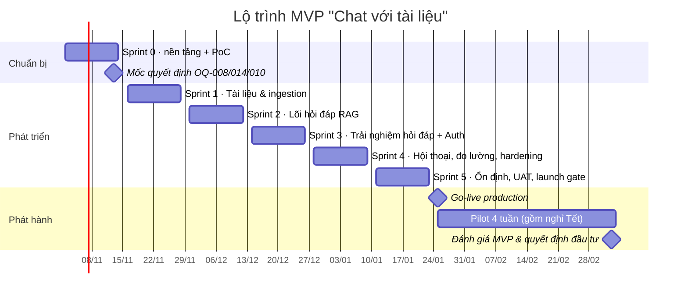
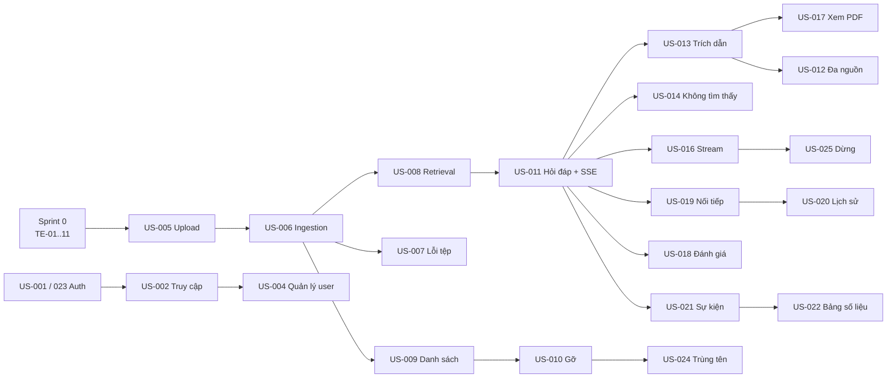

# Kế hoạch triển khai (Implementation Plan) — "Chat với tài liệu" (MVP)

> **Mã tài liệu:** IMP-CWD-001 · **Phiên bản:** 0.1 (`Draft`) · **Ngày:** 2026-10-26 · **Tác giả:** Huy Toan (Tech lead / PO)
> **Đầu vào:**
> - `docs/design/SAD.md` (SAD-CWD-001)
> - `docs/design/Blueprint_Design.md` (SDD-CWD-001)
> - `docs/design/schema.sql`
> - `docs/requirements/User_Stories.md` (US-CWD-001)
> - `docs/design/html_design/`
>
> **Người đọc:** Đội phát triển, QA, DevOps, PO và quản lý (STK-001)

---

## 1. Tóm tắt

| Mục | Nội dung |
|---|---|
| Mục tiêu | Ra mắt MVP gồm **toàn bộ 13 story P0 và 10 story P1** (88 SP), sau đó pilot 4 tuần với đội BD để đo KR1–KR3 |
| Phương pháp | Scrum, sprint 2 tuần; 1 Sprint 0 + 5 sprint phát triển |
| Thời gian | **2026-11-02 → 2027-01-22** (12 tuần phát triển); go-live **2027-01-25**; pilot **2027-01-25 → 2027-03-05** (gồm nghỉ Tết) |
| Đội ngũ (đề xuất) | 1 Tech lead (kiêm DevOps), 2 Backend, 1 Frontend, 1 QA (50%), PO/BA (50%) — **chờ xác nhận nguồn lực (OQ-006)** |
| Năng lực dự kiến | khoảng 22–25 SP/sprint từ Sprint 2 trở đi (Sprint 1 khoảng 15 SP do vừa ổn định nền tảng) |
| Điểm quyết định then chốt | **2026-11-13** (cuối Sprint 0): bắt buộc phải có quyết định OQ-008, OQ-014, OQ-010 và kết quả PoC AR-01..03. Nếu chưa có, kế hoạch phải điều chỉnh theo §9 |

> **Giả định về thời gian và nguồn lực:** BRD chưa có thời hạn (OQ-006) và chưa có thông tin về đội ngũ. Các mốc ngày và năng lực trong tài liệu này là **đề xuất**, quản lý cần xác nhận.

---

## 2. Phạm vi triển khai

| Nhóm | Story | SP | Bản phát hành |
|---|---|---|---|
| P0 — bắt buộc | US-001, 002, 003, 005, 006, 007, 008, 011, 012, 013, 014, 015, 023 | 53 | MVP (go-live) |
| P1 — nên có | US-004, 009, 010, 016, 017, 018, 019, 021, 024, 025 | 35 | MVP (go-live) |
| P2 — có thì tốt | US-020, US-022 | 8 | **Stretch** Sprint 5; nếu không kịp → bản 1.1 trong thời gian pilot |
| Hạng mục kỹ thuật (enabler) | TE-01..TE-14 (§4) | Không tính SP; tính bằng năng lực dành riêng | MVP |

**Ngoài phạm vi** (theo BRD §5.2 / §5.3):

- OCR cho PDF dạng ảnh scan.
- Định dạng tệp khác PDF.
- Ứng dụng di động.
- Tích hợp kho tài liệu bên ngoài.
- Xuất file.
- Nhiều bộ tài liệu.

---

## 3. Lộ trình tổng thể

| Mốc | Ngày | Tiêu chí đạt |
|---|---|---|
| M0 — Kết thúc Sprint 0 | 2026-11-13 | Môi trường dev / staging chạy được; CI xanh; PoC AR-01..03 có kết quả; OQ-008/014/010 đã có quyết định |
| M1 — "Walking skeleton" | 2026-11-27 | Tải PDF → xử lý → trạng thái Sẵn sàng chạy end-to-end trên staging |
| M2 — Hỏi đáp có trích dẫn | 2026-12-11 | Hỏi → câu trả lời có trích dẫn / "không tìm thấy" trên staging; golden eval chạy hằng đêm |
| M3 — Feature complete P0 | 2026-12-25 | Toàn bộ story P0 đạt DoD |
| M4 — Feature complete P1 + hardening | 2027-01-08 | Story P1 đạt DoD; kiểm thử tải, bảo mật và a11y đã chạy lần đầu |
| M5 — Launch gate | 2027-01-22 | Mọi tiêu chí PRD §6.1 đạt; UAT ký xác nhận |
| M6 — Go-live | 2027-01-25 | Production mở cho đội BD |
| M7 — Đánh giá MVP | 2027-03-05 | Báo cáo KR1–KR3 cho quản lý |

> **Lưu ý về Tết:** Tết Nguyên đán 2027 dự kiến rơi vào đầu tháng 2/2027, nên pilot được kéo dài tới 2027-03-05 để có đủ 4 tuần làm việc thực tế. **Cần xác nhận lịch nghỉ chính thức của công ty.**

---

## 4. Hạng mục kỹ thuật nền tảng (Technical Enablers)

| ID | Hạng mục | Mô tả | Sprint | Phụ trách | Trace SAD |
|---|---|---|---|---|---|
| TE-01 | Khởi tạo repo & cấu trúc mã | Monorepo `backend/`, `frontend/`, `infra/` theo Blueprint §3.1; `pyproject` (Python 3.12, FastAPI, SQLAlchemy 2, Celery); Vite + React 18 + TS; pre-commit (ruff, mypy, eslint, prettier) | S0 | Tech lead | ADR-001 |
| TE-02 | Môi trường local | `docker-compose.yml`: api, worker, web, postgres+pgvector, redis, tei, minio (thay S3); seed dữ liệu mẫu; `make dev` | S0 | Tech lead | §4.4 |
| TE-03 | CI pipeline | GitHub Actions: lint → test (pytest + Testcontainers, vitest) → `import-linter` (D-1..D-6) → Semgrep, `pip-audit`, `npm audit`, gitleaks → build image amd64 | S0 | Tech lead | §4.4, Blueprint §3.3 |
| TE-04 | Hạ tầng staging (IaC) | Terraform: VPC, ALB + ACM, EC2 `m7i.2xlarge`, RDS PostgreSQL 16, S3 (SSE-KMS), Secrets Manager, ECR; CD tự động deploy staging khi merge `main` | S0–S1 | Tech lead | §4.4 |
| TE-05 | Migration CSDL | Alembic baseline từ `docs/design/schema.sql`; job `create_next_partitions` | S0 | Backend 1 | §3.1 |
| TE-06 | Shared kernel `platform` | Config, logging JSON (`structlog`), lỗi chuẩn RFC 9457 + danh mục ERR-xx, middleware phiên / CSRF / rate limit, audit log, `EventPublisher` | S0–S1 | Backend 2 | §2.2 |
| TE-07 | Frontend shell & design system | App shell (topbar, sidebar, drawer < 1280 px), design token, component cơ bản (Button, Badge, Dialog, Toast, Table, EmptyState) từ `html_design`; i18n `vi.json`; API client + SSE parser; ánh xạ ERR-xx | S0–S1 | Frontend | Blueprint §3.1 (CMP-10..17) |
| TE-08 | PoC AR-01 — độ trễ LLM | Đo p90 thời gian tới token đầu và câu trả lời hoàn chỉnh với 12 chunk (khoảng 9k token), `claude-opus-5-5` effort `low`, 50 câu hỏi | S0 | Backend 1 | AR-01 |
| TE-09 | PoC AR-02 — thông lượng TEI | Đo thời gian embedding PDF 50 trang trên CPU 3 vCPU; quyết định tách TEI sang instance riêng nếu > 60 s | S0 | Backend 2 | AR-02 |
| TE-10 | PoC AR-03 — full-text tiếng Việt | So sánh recall của `simple` với tách từ `underthesea` trên 30 câu hỏi mẫu | S0–S1 | Backend 1 + BA | AR-03 |
| TE-11 | Golden set & eval harness | BD cung cấp bộ PDF mẫu + ≥ 50 câu hỏi có đáp án + ≥ 10 câu hỏi âm tính + ≥ 5 chuỗi câu hỏi nối tiếp (DEP-002); script `run_golden_eval` tính KR2.1–2.3; chạy hằng đêm trên staging | S0 (dữ liệu) → S2 (tự động) | BA + QA + Backend 1 | §4.3, QAS-13 |
| TE-12 | Observability | OTel SDK (FastAPI, Celery, asyncpg, httpx); Prometheus, Loki, Tempo, Grafana; 4 dashboard và các cảnh báo trong SAD §4.3 | S1 (cơ bản) → S4 (đầy đủ) | Tech lead | §4.3 |
| TE-13 | Hạ tầng production & vận hành | Terraform production; backup / PITR; runbook; diễn tập khôi phục; hạn mức chi tiêu Anthropic | S4–S5 | Tech lead | §4.2, NFR-017..019 |
| TE-14 | Kiểm thử phi chức năng | Load test k6 (5 VU, 50 tài liệu); rà soát OWASP Top 10 + bộ test prompt injection; kiểm tra a11y (axe + thủ công) | S4–S5 | QA + Tech lead | Launch gate §6.1 PRD |

---

## 5. Kế hoạch theo sprint

### Sprint 0 — Nền tảng & giảm rủi ro (02/11 → 13/11/2026)

**Mục tiêu:** dựng được môi trường làm việc, giảm rủi ro kiến trúc và có các quyết định đang chặn.

| Hạng mục | Kết quả cần có |
|---|---|
| TE-01, TE-02, TE-03, TE-05 | Repo, docker-compose và CI chạy xanh; migration baseline áp dụng được |
| TE-04 (phần 1) | Staging có VPC, RDS, S3, EC2; deploy thủ công được |
| TE-06, TE-07 (khung) | Skeleton API trả `/healthz`; SPA shell hiển thị, kết nối được API |
| TE-08, TE-09, TE-10 | Báo cáo PoC (1 trang mỗi PoC) kèm khuyến nghị |
| TE-11 (dữ liệu) | BD bàn giao bộ PDF mẫu và bộ câu hỏi chuẩn |
| Quyết định | OQ-008 (AI bên ngoài), OQ-014 (SSO / tài khoản nội bộ), OQ-010 (ngôn ngữ), OQ-013/022 (phạm vi BA), OQ-021 (giá trị ⚑) |
| Backlog | Refinement và ước lượng lại toàn bộ story; tách story > 8 SP |

**Tiêu chí thoát Sprint 0:** đạt M0. Nếu OQ-008 chưa có quyết định, Sprint 2 vẫn chạy với adapter Anthropic trên **dữ liệu mẫu, không dùng dữ liệu thật**, và áp dụng phương án dự phòng ở §9.

---

### Sprint 1 — Tài liệu & ingestion (16/11 → 27/11/2026) · 14 SP

**Mục tiêu sprint:** người dùng đăng nhập (tạm bằng tài khoản nội bộ), tải PDF lên và thấy tài liệu chuyển sang "Sẵn sàng".

| Story | SP | Backend | Frontend | Kiểm thử |
|---|---|---|---|---|
| US-023 Đăng xuất | 1 | `identity`: `POST /auth/logout`, hủy phiên Redis | Nút đăng xuất trên topbar | Integration: phiên bị xóa; Back không xem được dữ liệu |
| US-003 Hội thoại của riêng tôi | 2 | `conversations`: repository lọc theo `user_id`, trả 404 khi không thuộc quyền | — | Bộ test RBAC: B truy cập hội thoại của A → 404 |
| US-005 Tải lên PDF | 5 | `documents`: `POST /documents` (multipart, ≤ 10 tệp, magic bytes, ≤ 20 MB, `Idempotency-Key`), lưu S3 (SSE-KMS), tính sha256, audit log, enqueue | Màn hình 03: dropzone, chọn file, kiểm tra phía client, tiến trình theo tệp, thử lại khi mất mạng | Unit kiểm tra tệp; integration upload + S3 (MinIO); e2e Playwright kéo-thả |
| US-006 Trạng thái xử lý | 3 | Worker `ingest_document`: PyMuPDF trích text theo trang → chunker (ADR-006) → TEI embed theo lô → ghi `chunks` trong một giao dịch; máy trạng thái `Document` | Danh sách có badge trạng thái, polling 3 s khi còn tài liệu đang xử lý, toast khi Sẵn sàng, số đếm trên menu | Test hiệu năng: PDF 50 trang ≤ 60 s (NFR-003) |
| US-007 Báo lỗi tệp | 3 | Phát hiện `encrypted_pdf`, `no_text_layer`, `too_many_pages`, `corrupted`; retry lỗi tạm thời ×3 với backoff mũ; endpoint thử lại | Hiển thị lỗi tại dòng (ERR-07/08/10/11/17/20), nút Thử lại | Bộ tệp lỗi mẫu cho từng mã lỗi |
| *Enabler* | — | TE-04 (CD tự động lên staging), TE-06 (middleware phiên, CSRF, rate limit), TE-12 (trace cơ bản), `LocalPasswordAdapter` tạm thời cho đăng nhập | TE-07 (component cơ bản) | — |

**Demo cuối sprint:** tải 3 PDF (1 hợp lệ, 1 có mật khẩu, 1 PDF scan) và xem trạng thái tương ứng → đạt **M1**.

---

### Sprint 2 — Lõi hỏi đáp RAG (30/11 → 11/12/2026) · 23 SP

**Mục tiêu sprint:** đặt câu hỏi và nhận câu trả lời có trích dẫn; câu hỏi ngoài tài liệu nhận "không tìm thấy".

| Story | SP | Backend | Frontend | Kiểm thử |
|---|---|---|---|---|
| US-008 Mọi tài liệu Sẵn sàng là nguồn | 5 | `RetrievalPort`: truy vấn vector (HNSW) + full-text (GIN) lọc `status='ready'`; gộp bằng RRF (k=60) → top 12 | Chỉ báo "n tài liệu đang dùng"; banner "tài liệu đang xử lý" (EC-09); ô hỏi bị khóa khi chưa có tài liệu (EC-01) | Integration với Testcontainers + dữ liệu mẫu; AC-US-008-2 trên golden set |
| US-011 Hỏi bằng ngôn ngữ tự nhiên | 8 | `AskQuestion` use case; `AnthropicLLMAdapter` (`client.messages.stream`, `claude-opus-5-5`, effort `low`, prompt caching, fallback); `POST /conversations/{id}/messages` trả SSE (`meta`/`delta`/`done`/`error`); watchdog 20 s; circuit breaker; rate limit 20 câu/phút | Màn hình 04: composer (Enter / Shift+Enter, đếm 2.000 ký tự), luồng tin nhắn, parser SSE, nhãn "do AI tạo", trạng thái lỗi ERR-12 kèm Thử lại | Contract test `LLMPort` với LLM giả lập; e2e luồng hỏi; golden eval KR2.1 |
| US-013 Trích dẫn tài liệu & trang | 5 | Gửi chunk dưới dạng `document` block có `citations.enabled`; ánh xạ `document_index` → chunk → (tài liệu, trang); lưu bảng `citations`; event SSE `citation` | Nút trích dẫn trong câu, mục "Nguồn (n)" bỏ trùng, kèm đoạn trích | Unit ánh xạ; KR2.2 trên golden set; test không có trích dẫn trỏ tới trang không tồn tại |
| US-014 Không tìm thấy thông tin | 5 | `AnswerGuard`: ngưỡng τ (không gọi LLM), sentinel `NOT_FOUND`, hậu kiểm "0 trích dẫn"; system prompt coi nội dung tài liệu là dữ liệu | Khung "Không tìm thấy" có gợi ý (UI-05) | KR2.3 với ≥ 10 câu hỏi âm tính; bộ test prompt injection (≥ 10 ca) |
| *Enabler* | — | TE-11: tự động hóa golden eval hằng đêm trên staging; TE-10: áp dụng kết quả AR-03 | — | — |

**Demo cuối sprint:** chạy SC-01 và SC-03 trên dữ liệu mẫu; trình bày điểm golden eval đầu tiên → đạt **M2**.

> **Rủi ro chính của sprint:** US-011 (8 SP) là story lớn nhất. Nếu sau ngày thứ 5 chưa có luồng SSE end-to-end, chuyển US-014 phần hậu kiểm sang Sprint 3; giữ lại phần ngưỡng τ.

---

### Sprint 3 — Trải nghiệm hỏi đáp & xác thực chính thức (14/12 → 25/12/2026) · 23 SP

**Mục tiêu sprint:** hoàn thành toàn bộ story P0 (đạt M3).

| Story | SP | Backend | Frontend | Kiểm thử |
|---|---|---|---|---|
| US-012 Tổng hợp nhiều tài liệu | 5 | Tinh chỉnh prompt cho câu trả lời đa nguồn và xử lý mâu thuẫn; tinh chỉnh top-k và chunk theo golden set | — | AC-US-012-2 (≥ 80% câu đa nguồn đủ ý) |
| US-015 Tiếng Việt / tiếng Anh | 3 | Trả lời theo ngôn ngữ câu hỏi; xử lý câu hỏi không dấu (theo kết quả AR-03) | Kiểm tra toàn bộ chuỗi `vi.json`, định dạng ngày `dd/mm/yyyy` | Golden set tiếng Việt + ≥ 10 câu không dấu + câu tiếng Anh |
| US-016 Câu trả lời hiện dần | 5 | Tối ưu độ trễ: ping SSE 15 s, prompt caching, đo `first_token_ms` | Hiển thị dần, tự cuộn, `aria-live`, giữ phần đã nhận khi mất mạng (EC-04) | Load test sơ bộ k6 (NFR-001/002) |
| US-025 Dừng tạo câu trả lời | 2 | Phát hiện client ngắt kết nối → đóng stream tới Anthropic; trạng thái `stopped` | Nút Gửi ↔ Dừng, `AbortController`, nhãn "đã dừng", Thử lại | e2e: dừng ≤ 1 s |
| US-001 Đăng nhập chính thức | 5 | `OIDCAdapter` (Authorization Code + PKCE) **hoặc** hoàn thiện `LocalPasswordAdapter` theo OQ-014; khóa sau 5 lần sai; phiên trượt 8 giờ; quay về màn hình trước | Màn hình 01 đầy đủ trạng thái; giữ bản nháp câu hỏi (EC-11) | Test bảo mật đăng nhập; AC-US-001-1..8 |
| US-002 Kiểm soát truy cập tài liệu | 3 | `GET /documents/{id}/file` → presigned URL TTL 300 s; vô hiệu hóa tài khoản → xóa mọi phiên | — | AC-US-002-1..4 |

**Demo cuối sprint:** chạy đầy đủ SC-01..SC-03 bằng tài khoản thật (SSO hoặc nội bộ); báo cáo KR2.x → đạt **M3**.

---

### Sprint 4 — Hội thoại, đo lường & hardening (28/12/2026 → 08/01/2027) · 20 SP

**Mục tiêu sprint:** hoàn thành phần lớn story P1 và chạy vòng hardening đầu tiên.

| Story | SP | Backend | Frontend | Kiểm thử |
|---|---|---|---|---|
| US-017 Mở trang PDF gốc | 5 | Presigned URL kèm số trang; trạng thái "tài liệu đã bị gỡ" | Panel xem nguồn (PDF.js tải lười, tô sáng đoạn trích, điều hướng trước / sau, Esc, ngăn trượt < 1280 px) | e2e; a11y quản lý focus |
| US-009 Danh sách tài liệu | 2 | `GET /documents` có bộ lọc trạng thái, tìm theo tên (`pg_trgm`), số đếm | Tab, tìm kiếm, chỉ báo x/50, trạng thái trống | AC-US-009-1..5 |
| US-010 Gỡ tài liệu | 3 | `DELETE /documents/{id}` (Admin, xóa mềm); job `purge_removed_documents` | Hộp thoại xác nhận, ẩn nút với Member | Test sau khi gỡ thì không còn trích dẫn tới tài liệu (BRD AC-004) |
| US-019 Câu nối tiếp & hội thoại mới | 5 | Viết lại câu hỏi độc lập (≤ 10 lượt); tiêu đề tự động; `POST /conversations` | Nút Hội thoại mới, câu hỏi gợi ý (EC-02), danh sách "Gần đây" | ≥ 5 chuỗi câu nối tiếp trong golden set |
| US-018 Đánh giá câu trả lời | 2 | `POST /messages/{id}/feedback` | Nút Hữu ích / Không hữu ích, ô góp ý | AC-US-018-1..5 |
| US-021 Ghi nhận số liệu | 3 | Bảng `analytics_events` (HMAC `user_ref`); đủ 13 sự kiện của PRD §6.2; ghi bất đồng bộ | `POST /events` cho `citation_opened` / `answer_stopped` | Đối chiếu mẫu ≥ 20 câu (sai lệch ≤ 1%) |
| *Enabler* | — | TE-12 đầy đủ (dashboard + cảnh báo); TE-13 bắt đầu dựng production; TE-14 vòng 1 (k6, Semgrep / Trivy, axe) | — | — |

**Demo cuối sprint:** SC-02 (họp đối tác, câu hỏi nối tiếp), SC-04 (gỡ / thay tài liệu), dashboard Grafana → đạt **M4**.

> Sprint 4 trùng kỳ nghỉ Tết Dương lịch (01/01/2027). Năng lực dự kiến giảm khoảng 10%, đã tính vào mức 20 SP.

---

### Sprint 5 — Ổn định, UAT & launch gate (11/01 → 22/01/2027) · 8 SP (+ 8 SP stretch)

**Mục tiêu sprint:** đạt toàn bộ launch gate và được UAT ký xác nhận.

| Hạng mục | SP | Nội dung |
|---|---|---|
| US-004 Quản lý tài khoản | 5 | `GET/POST/PATCH /admin/users`, không cho tự hạ quyền, mở khóa; màn hình 06 |
| US-024 Trùng tên tệp | 3 | Phát hiện trùng (`documents_active_filename_uq`); "Giữ cả hai" / "Thay thế bản cũ" (chỉ gỡ bản cũ khi bản mới Sẵn sàng) |
| *Stretch:* US-020 Lịch sử hội thoại | 3 | Màn hình 05; nhóm theo ngày; tìm kiếm; job xóa sau 180 ngày |
| *Stretch:* US-022 Bảng số liệu | 5 | `GET /admin/metrics/weekly` (view `weekly_usage`); màn hình 07 |
| Hardening | — | TE-14 vòng 2: sửa toàn bộ lỗi Critical / High; tinh chỉnh τ / top-k để đạt KR2.x; load test cuối cùng |
| Vận hành | — | TE-13: production sẵn sàng; runbook; diễn tập khôi phục; hạn mức chi tiêu Anthropic; hướng dẫn sử dụng 1 trang |
| UAT | — | ≥ 2 đại diện BD chạy SC-01..SC-04 trên staging với dữ liệu thật (nếu OQ-008 cho phép) và ký xác nhận |

> **US-004 được đặt ở Sprint 5**, nhưng việc tạo tài khoản cho đợt go-live đầu tiên có thể làm bằng **script quản trị** (`make create-user`) từ Sprint 3. Nhờ vậy US-004 không chặn UAT.

**Kết thúc sprint:** họp launch gate với quản lý → đạt **M5**; go-live thứ Hai 25/01/2027 (**M6**).

---

### Tổng hợp SP theo sprint

| Sprint | Story | SP |
|---|---|---|
| S1 | US-023, 003, 005, 006, 007 | 14 |
| S2 | US-008, 011, 013, 014 | 23 |
| S3 | US-012, 015, 016, 025, 001, 002 | 23 |
| S4 | US-017, 009, 010, 019, 018, 021 | 20 |
| S5 | US-004, 024 (+ stretch US-020, 022) | 8 (+ 8) |
| **Tổng** | 25 story | **88 (+ 8) = 96** |

---

## 6. Phụ thuộc giữa các story

**Đường găng (critical path):** Sprint 0 → US-005 → US-006 → US-008 → US-011 → US-013 / US-014 → tinh chỉnh golden eval → launch gate. Mọi trễ hạn trên đường này đều đẩy lùi ngày go-live.

---

## 7. Môi trường, quy trình & chất lượng

### 7.1 Môi trường

| Môi trường | Mục đích | Dữ liệu | Triển khai |
|---|---|---|---|
| Local | Phát triển | Dữ liệu seed giả lập | `docker compose up` |
| CI | Kiểm thử tự động | Testcontainers, LLM giả lập | Mỗi pull request |
| Staging | Tích hợp, demo, golden eval, UAT | Bộ PDF mẫu (DEP-002); dữ liệu thật chỉ được dùng khi OQ-008 cho phép | Tự động khi merge `main` |
| Production | Pilot | Dữ liệu thật của đội BD | Thủ công, sau khi golden eval trên staging đạt ngưỡng (SAD §4.4) |

### 7.2 Quy trình làm việc

- **Nhánh:** trunk-based; feature branch ngắn ngày (`feat/US-011-ask-question`); squash merge vào `main`.
- **Pull request:** ≥ 1 reviewer; CI xanh bắt buộc; mô tả PR có ID story và AC đã kiểm tra.
- **Commit:** Conventional Commits (`feat(qa): …`, `fix(documents): …`).
- **Nghi thức Scrum:**
  - Planning: thứ Hai đầu sprint, 2 giờ.
  - Daily: 15 phút.
  - Refinement: thứ Tư tuần 2, 1 giờ.
  - Review + Retro: thứ Sáu cuối sprint.
- **Definition of Ready / Done:** theo `User_Stories.md` §9.

### 7.3 Chiến lược kiểm thử

| Mức | Công cụ | Phạm vi | Ngưỡng |
|---|---|---|---|
| Unit | pytest, vitest | `domain`, `application`, component UI | Độ phủ ≥ 80% domain / application (QAS-10) |
| Integration | pytest + Testcontainers (Postgres + pgvector, Redis, MinIO) | Repository, API, worker ingestion | Chạy < 5 phút |
| Contract | pytest | `LLMPort`, `EmbeddingPort` — chạy chung cho mọi adapter | 100% pass trước khi thêm adapter mới |
| E2E | Playwright | Luồng chính của 8 màn hình + edge case EC-xx | 100% AC P0 có test e2e hoặc test thủ công có bằng chứng |
| Chất lượng RAG | `run_golden_eval` | KR2.1, KR2.2, KR2.3, chuỗi nối tiếp | ≥ 80% / ≥ 90% / ≥ 90% ⚑; không giảm > 5 điểm giữa các lần chạy |
| Hiệu năng | k6 | 5 VU, 50 tài liệu | NFR-001..003 |
| Bảo mật | Semgrep, Trivy, `pip-audit`, gitleaks, checklist OWASP, bộ test prompt injection | Toàn bộ | 0 lỗi Critical / High |
| Khả năng tiếp cận | axe-core (CI) + kiểm tra bàn phím thủ công | Màn hình P0 | 0 lỗi serious / critical |
| UAT | Kịch bản SC-01..SC-04 | Đại diện BD | Ký xác nhận |

---

## 8. Rủi ro triển khai

| ID | Rủi ro | Xác suất | Tác động | Giảm thiểu | Kích hoạt phương án dự phòng |
|---|---|---|---|---|---|
| IR-01 | OQ-008 không cho dùng AI bên ngoài | Trung bình | Cao | `LLMPort` + contract test sẵn; chuẩn bị đánh giá Bedrock trong vùng được phép | Quyết định "không" trước 13/11 → +1 sprint (§9) |
| IR-02 | Độ trễ LLM vượt NFR-001/002 (AR-01) | Trung bình | Trung bình | Giảm số chunk 12 → 8; dùng `claude-sonnet-5-5` cho bước viết lại câu hỏi; prompt caching | p90 > 15 s trong PoC |
| IR-03 | TEI trên CPU chậm (AR-02) | Thấp | Trung bình | Tách TEI sang instance riêng hoặc tăng vCPU | PDF 50 trang > 60 s |
| IR-04 | Chất lượng câu trả lời chưa đạt KR2.x | Trung bình | Cao | Golden eval hằng đêm từ Sprint 2; dành thời gian tinh chỉnh ở S3–S5; dùng tách từ tiếng Việt (AR-03); bổ sung reranker | KR2.1 < 70% cuối Sprint 3 |
| IR-05 | BD giao bộ dữ liệu mẫu (DEP-002) chậm | Trung bình | Cao | Yêu cầu từ ngày đầu Sprint 0; BA soạn bộ tạm 20 câu nếu chậm | Chưa có dữ liệu ngày 11/11 |
| IR-06 | Thiếu nguồn lực hoặc nghỉ lễ cuối năm | Trung bình | Trung bình | Đã giảm năng lực S4; P2 là stretch | Velocity S2 < 18 SP |
| IR-07 | Chi phí AI trong lúc phát triển và eval vượt dự kiến | Thấp | Thấp | Hạn mức chi tiêu riêng cho staging; golden eval dùng prompt caching; LLM giả lập trong CI | Chi phí staging > 50% ngân sách tháng |
| IR-08 | Lỗ hổng bảo mật phát hiện muộn | Thấp | Cao | Quét SAST / dependency từ Sprint 0; rà soát OWASP ở S4 thay vì chờ tới S5 | Lỗi Critical ở vòng 1 |

---

## 9. Phương án dự phòng theo quyết định

| Tình huống tại mốc M0 (13/11) | Điều chỉnh kế hoạch |
|---|---|
| **OQ-008 = được dùng Anthropic API** | Giữ nguyên kế hoạch |
| **OQ-008 = chỉ được dùng trong tài khoản AWS của tổ chức** | Thêm `BedrockLLMAdapter` ở Sprint 2 (khoảng 3 SP); kiểm tra Citations và streaming trên Bedrock; go-live giữ nguyên nếu contract test đạt |
| **OQ-008 = không được gửi dữ liệu ra ngoài** | Thêm 1 sprint (Sprint 2b): dựng LLM tự vận hành (GPU), đánh giá lại chất lượng tiếng Việt; go-live lùi khoảng 2 tuần, rơi vào kỳ nghỉ Tết nên đề xuất go-live **22/02/2027** |
| **OQ-008 chưa có quyết định** | Phát triển và eval chỉ trên dữ liệu mẫu; **không** đưa dữ liệu thật lên staging; go-live bị chặn tại launch gate |
| **OQ-014 = SSO** | US-001 dùng `OIDCAdapter`; cần IT cấp client ID trước Sprint 3 (DEP-003) |
| **OQ-014 = tài khoản nội bộ** | US-001 dùng `LocalPasswordAdapter`; US-004 nâng lên P0, chuyển sang Sprint 3 |
| **OQ-013 / OQ-022 không duyệt các đề xuất BA** | Bỏ US-013, US-014 khỏi P0 là **không khuyến nghị** vì là lõi của BO-002. Nếu vẫn bị bỏ: giảm khoảng 10 SP, phải ghi nhận chấp nhận rủi ro RSK-001 bằng văn bản |

---

## 10. Vai trò & trách nhiệm (RACI rút gọn)

| Hạng mục | Tech lead | Backend | Frontend | QA | PO / BA | Quản lý |
|---|---|---|---|---|---|---|
| Kiến trúc, ADR, hạ tầng | **R/A** | C | C | I | I | I |
| Story backend | A | **R** | C | C | C | I |
| Story frontend | A | C | **R** | C | C | I |
| Golden set & eval | C | R | — | **R** | **A** | I |
| Kiểm thử, launch gate | C | C | C | **R** | A | I |
| Quyết định OQ | C | I | I | I | R | **A** |
| UAT & go-live | R | I | I | R | **A** | C |

*R = thực hiện · A = chịu trách nhiệm cuối cùng · C = tham vấn · I = được thông báo*

---

## 11. Ngân sách vận hành trong thời gian triển khai (ước tính)

| Hạng mục | Tháng 11–12/2026 | Tháng 01/2027 (thêm production) | Ghi chú |
|---|---|---|---|
| Hạ tầng staging | khoảng $250/tháng | khoảng $250/tháng | Có thể tắt EC2 ngoài giờ để tiết kiệm khoảng 50% |
| Hạ tầng production | — | khoảng $400–450/tháng | Theo SAD §4.5 |
| Anthropic API (phát triển + golden eval) | khoảng $50–100/tháng | khoảng $100/tháng | Golden eval khoảng 70 câu × 30 lần chạy/tháng |
| Anthropic API (pilot) | — | khoảng $230/tháng | 20 người × 10 câu/ngày (SAD §4.5) |

> Các con số là ước tính theo giá on-demand; cần xác nhận bằng AWS Pricing Calculator và hạn mức chi tiêu trong Anthropic Console (OQ-007).

---

## 12. Theo dõi tiến độ & báo cáo

| Kênh | Tần suất | Nội dung |
|---|---|---|
| Sprint review | 2 tuần | Demo theo kịch bản SC-xx, SP hoàn thành, điểm golden eval |
| Báo cáo cho quản lý | 2 tuần (sau review) | Mốc M0–M7: đạt / trễ; trạng thái OQ; rủi ro IR-xx; chi phí AI và hạ tầng |
| Burndown | Hằng ngày | Theo SP trong công cụ quản lý backlog |
| Dashboard chất lượng | Hằng đêm | KR2.1–2.3, p90 độ trễ trên staging |

---

## 13. Việc cần làm ngay (tuần 26/10 → 30/10/2026)

| # | Việc | Người phụ trách | Hạn |
|---|---|---|---|
| 1 | Xác nhận đội ngũ, timeline, ngân sách (OQ-006, OQ-007) | Quản lý | 30/10 |
| 2 | Gửi yêu cầu quyết định OQ-008, OQ-014, OQ-010 kèm hạn 13/11 | PO | 27/10 |
| 3 | Yêu cầu BD chuẩn bị bộ PDF mẫu và câu hỏi chuẩn (DEP-002) | BA | 28/10 |
| 4 | Xin tài khoản AWS staging, khóa Anthropic API (staging) và GitHub Actions | Tech lead | 30/10 |
| 5 | Tạo backlog trong công cụ quản lý (25 story + 14 enabler) | PO | 30/10 |
