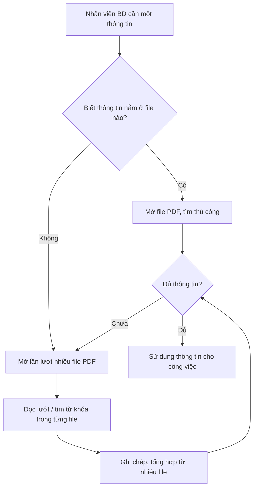
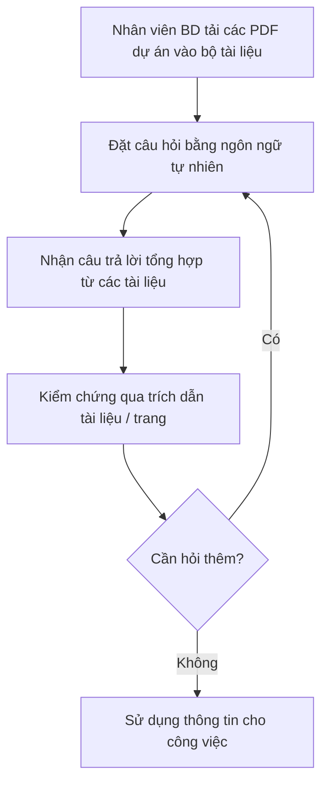

# Tài liệu Yêu cầu Nghiệp vụ (BRD) — Công cụ "Chat với tài liệu" (MVP)

> **Chuẩn áp dụng:** IEEE 29148-2018 · **Giai đoạn SDLC:** 5.2 Requirements and discovery
> **Prompt nguồn:** `docs/BRD_Prompt_IEEE_standard.md` v1.0

---

## 0. Tóm tắt kiểm tra đầu vào

**Đầu vào đã nhận**

| Source ID | Nguồn | Loại | Chủ sở hữu | Ngày / Phiên bản | Nội dung chứng minh |
|---|---|---|---|---|---|
| SRC-001 | Yêu cầu của quản lý: mục 2.1 "Business foundation" trong `docs/BRD_Prompt_IEEE_standard.md` | Sponsor brief (bản mô tả ngắn) | Quản lý giao việc (chưa rõ tên — OQ-001) | 2026-10-20 | Vấn đề nghiệp vụ, người dùng mục tiêu, mục tiêu MVP, ràng buộc web + PDF + chat AI, cho phép BA đề xuất tính năng |
| SRC-002 | Đề xuất của nhóm BA trong tài liệu này | Phân tích BA | Nhóm BA (người soạn) | 2026-10-20 | Các tính năng bổ sung, quy tắc và chỉ số được BA đề xuất. **Mọi mục có nguồn SRC-002 đều cần quản lý xác nhận (OQ-013)** |

**Đầu vào còn thiếu**

- Tên tổ chức, nhà tài trợ, chủ sở hữu nghiệp vụ (OQ-001).
- Số liệu nền (baseline): hiện tại mất bao lâu để tìm một thông tin, tần suất tìm, số người bị ảnh hưởng (OQ-002, OQ-005).
- Mục tiêu định lượng cho các chỉ số thành công (OQ-003, OQ-004, OQ-005).
- Thời hạn và ngân sách (OQ-006, OQ-007).
- Mức độ bảo mật của tài liệu và việc có được phép gửi nội dung tới dịch vụ AI bên ngoài hay không (OQ-008).
- Biên bản phỏng vấn người dùng, mẫu tài liệu PDF thực tế, quy trình hiện tại được mô tả chi tiết.

**Ba rủi ro lớn nhất đối với chất lượng yêu cầu**

1. **Không có baseline:** chưa thể chứng minh lợi ích ("giảm thời gian tìm kiếm") một cách đo lường được → BO-001 chưa kiểm chứng được cho tới khi đóng OQ-002/OQ-003.
2. **Chưa rõ phân loại bảo mật tài liệu:** quyết định này có thể thay đổi toàn bộ không gian giải pháp (OQ-008, RSK-002).
3. **Phạm vi phụ thuộc đề xuất BA chưa được duyệt:** nhiều yêu cầu có nguồn SRC-002; nếu quản lý không đồng ý, phạm vi MVP sẽ thay đổi (OQ-013, RSK-004).

---

## 1. Kiểm soát tài liệu

| Thuộc tính | Giá trị |
|---|---|
| Tiêu đề | Tài liệu Yêu cầu Nghiệp vụ — Công cụ "Chat với tài liệu" (MVP) |
| Mã tài liệu | BRD-CWD-001 |
| Phiên bản | 0.1 |
| Trạng thái | `Draft` |
| Tác giả | Huy Toan (vai trò BA / người soạn) |
| Người đóng góp | [TBD: OQ-001] |
| Người review | Đại diện đội phát triển kinh doanh, đội phát triển — [TBD: OQ-001] |
| Người phê duyệt | Quản lý giao yêu cầu — [TBD: OQ-001] |
| Phân loại bảo mật | Nội bộ (Internal) — [TBD: OQ-008] |
| Danh sách phân phối | Quản lý giao yêu cầu, đội phát triển kinh doanh, nhóm BA, đội phát triển |

**Lịch sử phiên bản**

| Phiên bản | Ngày | Tác giả | Tóm tắt thay đổi |
|---|---|---|---|
| 0.1 | 2026-10-20 | Huy Toan | Bản nháp đầu tiên dựa trên SRC-001 và đề xuất BA (SRC-002) |

---

## 2. Tóm tắt điều hành

**Vấn đề.** Trong dự án kinh doanh hiện tại có nhiều tài liệu PDF. Đội phát triển kinh doanh khó nắm bắt hết nội dung. Mỗi lần cần một thông tin, họ phải mất thời gian tổng hợp từ nhiều file PDF (SRC-001). Hiện chưa có số liệu về thời gian bị mất hay tác động tài chính [TBD: OQ-002].

**Thay đổi đề xuất.** Xây dựng MVP một công cụ web "Chat với tài liệu" (SRC-001). Người dùng tải các tệp PDF của dự án lên, rồi đặt câu hỏi bằng ngôn ngữ tự nhiên. Câu trả lời do AI tổng hợp từ nội dung tất cả tài liệu đã tải lên, kèm chỉ dẫn tới tài liệu và trang gốc để người dùng tự kiểm chứng (đề xuất BA, SRC-002).

**Lợi ích kỳ vọng và cách đo.**

- Giảm thời gian tìm một thông tin trong bộ tài liệu dự án (MET-001).
- Câu trả lời đủ chính xác và có nguồn kiểm chứng (MET-002).
- Người dùng thực sự dùng công cụ trong giai đoạn thử nghiệm (MET-003).

Giá trị nền và mục tiêu của cả ba chỉ số đang chờ xác nhận.

**Đầu tư, thời hạn, rủi ro chính.** Ngân sách [TBD: OQ-007]. Thời hạn [TBD: OQ-006]. Rủi ro chính:

- AI trả lời sai hoặc bịa thông tin (RSK-001).
- Lộ nội dung tài liệu kinh doanh (RSK-002).
- Không đọc được PDF dạng ảnh scan (RSK-003).

**Quyết định cần từ người phê duyệt.**

1. Xác nhận phạm vi MVP (mục 5) và các tính năng BA đề xuất (OQ-013).
2. Cung cấp hoặc chấp thuận phương án đo baseline (OQ-002).
3. Quyết định chính sách bảo mật dữ liệu với dịch vụ AI (OQ-008).

---

## 3. Bối cảnh nghiệp vụ và phát biểu vấn đề

### 3.1 Quy trình hiện tại

Mô tả dưới đây được suy ra từ SRC-001. Các bước chi tiết là [Unverified] và cần xác nhận qua phỏng vấn người dùng (OQ-002).

### 3.2 Quy trình mong muốn (mức nghiệp vụ)

### 3.3 Đối tượng bị ảnh hưởng

| Đối tượng | Ảnh hưởng | Bằng chứng |
|---|---|---|
| Đội phát triển kinh doanh (BD) | Tốn thời gian tổng hợp thông tin từ nhiều PDF và khó nắm hết nội dung | SRC-001 |
| Quản lý | Cần đội BD làm việc hiệu quả hơn; là người giao yêu cầu MVP | SRC-001 |

Số người bị ảnh hưởng và tần suất tìm kiếm: [TBD: OQ-005].

### 3.4 Chi phí nếu không thay đổi

- **Thời gian:** nhân viên BD tiếp tục mất thời gian tìm kiếm thủ công (SRC-001). Chưa định lượng được [TBD: OQ-002].
- **Rủi ro chất lượng:** vì khó nắm đầy đủ tài liệu, thông tin dùng cho quyết định kinh doanh có thể bị thiếu hoặc lỗi thời [Unverified].
- **Doanh thu, tuân thủ, khách hàng:** chưa có bằng chứng [TBD: OQ-002].

### 3.5 Nguyên nhân gốc và triệu chứng

| Triệu chứng (quan sát được) | Nguyên nhân gốc (giả thuyết) | Trạng thái |
|---|---|---|
| Mất nhiều thời gian để tìm một thông tin | Thông tin phân tán trên nhiều file PDF, không có điểm truy vấn chung | SRC-001 |
| Khó nắm bắt đầy đủ nội dung | Khối lượng tài liệu lớn so với năng lực đọc của đội | [Unverified] — OQ-011 |
| Phải tự tổng hợp thủ công | Không có công cụ hỏi đáp xuyên nhiều tài liệu | SRC-001 |

### 3.6 Vì sao là bây giờ

Quản lý đã yêu cầu xây dựng MVP (SRC-001). Lý do thời điểm và hạn chót cụ thể chưa được nêu [TBD: OQ-006].

---

## 4. Động lực nghiệp vụ và mục tiêu

| ID | Động lực nghiệp vụ | Mục tiêu (kết quả, không phải hoạt động) | Metric ID | Baseline | Target | Thời hạn | Nguồn |
|---|---|---|---|---|---|---|---|
| BO-001 | Mất thời gian tổng hợp thông tin từ nhiều PDF | Giảm thời gian để nhân viên BD có được câu trả lời cho một câu hỏi về nội dung tài liệu dự án | MET-001 | [TBD: OQ-002] | [TBD: OQ-003] | [TBD: OQ-006] | SRC-001 |
| BO-002 | Thông tin dùng cho công việc kinh doanh phải đáng tin cậy | Câu trả lời của công cụ đúng với nội dung tài liệu và kiểm chứng được | MET-002 | Không áp dụng (năng lực mới) | [TBD: OQ-004] | [TBD: OQ-006] | SRC-001, SRC-002 |
| BO-003 | MVP nhằm đánh giá giá trị trước khi đầu tư tiếp | Xác nhận đội BD chấp nhận sử dụng công cụ trong giai đoạn thử nghiệm | MET-003 | Không áp dụng (năng lực mới) | [TBD: OQ-005] | [TBD: OQ-006] | SRC-001, SRC-002 |

### 4.1 Định nghĩa chỉ số

| Metric | Định nghĩa | Công thức | Nguồn dữ liệu | Chủ sở hữu | Tần suất | Ngày baseline |
|---|---|---|---|---|---|---|
| MET-001 | Thời gian trung bình từ lúc người dùng bắt đầu tìm đến lúc có câu trả lời đủ dùng, đo trên một bộ câu hỏi chuẩn | Σ thời gian các câu hỏi / số câu hỏi; đo song song theo cách thủ công (baseline) và bằng công cụ | Bài đo có bấm giờ với bộ câu hỏi chuẩn do đội BD cung cấp (DEP-002) | Đại diện đội BD [TBD: OQ-001] | Một lần trước MVP (baseline), một lần khi nghiệm thu | [TBD: OQ-002] |
| MET-002 | Tỷ lệ câu trả lời được đội BD đánh giá là "đúng và có trích dẫn đúng nguồn" | Số câu đạt / tổng số câu trong bộ câu hỏi chuẩn × 100% | Bộ câu hỏi chuẩn kèm đáp án tham chiếu (DEP-002) | Đại diện đội BD | Khi nghiệm thu MVP | Không áp dụng |
| MET-003 | Số người dùng BD đặt ít nhất một câu hỏi mỗi tuần trong giai đoạn thử nghiệm | Đếm số người dùng duy nhất có ≥ 1 câu hỏi / tuần | Thống kê sử dụng của công cụ [TBD: OQ-005] | Quản lý | Hằng tuần trong giai đoạn thử nghiệm | Không áp dụng |

---

## 5. Phạm vi

### 5.1 Trong phạm vi (MVP)

- Tải lên tệp PDF thành một bộ tài liệu dùng chung để truy vấn (SRC-001).
- Hỏi đáp bằng ngôn ngữ tự nhiên với AI về nội dung các tài liệu đã tải lên (SRC-001).
- Câu trả lời tổng hợp từ nhiều tài liệu, kèm trích dẫn nguồn (SRC-001, SRC-002).
- Quản lý danh sách tài liệu: xem và gỡ tài liệu (SRC-002).
- Kênh truy cập: ứng dụng web (SRC-001).
- Đơn vị sử dụng: đội phát triển kinh doanh của dự án (SRC-001).

### 5.2 Ngoài phạm vi

| Mục | Lý do |
|---|---|
| Định dạng khác PDF (Word, Excel, ảnh, email…) | SRC-001 chỉ nêu PDF |
| Ứng dụng di động native | SRC-001 chỉ yêu cầu ứng dụng web |
| Tích hợp với hệ thống lưu trữ tài liệu hiện có (Drive, SharePoint…) | Không có trong yêu cầu MVP; chưa rõ hệ thống hiện có [Unverified] |
| Chỉnh sửa nội dung tài liệu PDF | Không phục vụ mục tiêu truy vấn |
| Dùng kiến thức bên ngoài tài liệu (Internet) để trả lời | Mâu thuẫn với BO-002 (câu trả lời phải dựa trên tài liệu) — xem BRU-001 |

### 5.3 Hoãn sang giai đoạn sau

- Đọc PDF dạng ảnh scan (OCR) — tùy kết quả OQ-012.
- Phân quyền chi tiết theo từng bộ tài liệu hoặc từng người dùng — tùy OQ-009.
- Xuất câu trả lời hoặc hội thoại ra file.
- Báo cáo thống kê sử dụng cho quản lý (ngoài phần đo MET-003 tối thiểu).

### 5.4 Ranh giới

- **Bắt đầu:** khi người dùng có tệp PDF trong tay và đưa nó vào công cụ.
- **Kết thúc:** khi người dùng nhận được câu trả lời kèm nguồn. Việc sử dụng câu trả lời trong quy trình kinh doanh nằm ngoài công cụ.
- Không có chương trình liên quan nào đã được xác định [TBD: OQ-001].

---

## 6. Bên liên quan và nhu cầu

| ID | Bên liên quan / nhóm | Vai trò | Mối quan tâm | Ảnh hưởng | Nhu cầu | Nguồn |
|---|---|---|---|---|---|---|
| STK-001 | Quản lý giao yêu cầu | Nhà tài trợ / người phê duyệt | MVP chứng minh được giá trị, đúng phạm vi | Cao | SN-005 | SRC-001 |
| STK-002 | Đội phát triển kinh doanh (BD) | Người dùng chính | Tìm thông tin nhanh, chính xác | Cao | SN-001, SN-002, SN-003, SN-004 | SRC-001 |
| STK-003 | Nhóm BA | Phân tích và đề xuất tính năng | Phạm vi rõ ràng, có thể bổ sung đề xuất | Trung bình | SN-007 | SRC-001 |
| STK-004 | Đội phát triển | Xây dựng MVP | Yêu cầu rõ, kiểm chứng được | Trung bình | SN-008 | SRC-001 |
| STK-005 | Bộ phận bảo mật / IT / pháp chế (nếu có) | Kiểm soát dữ liệu; **có thể chặn** việc đưa vào sử dụng | Tài liệu kinh doanh không bị lộ | Cao | SN-006 | [Unverified] — OQ-008 |

**Nhu cầu chi tiết**

| ID | Bên liên quan | Phát biểu nhu cầu | Khó khăn hiện tại | Bằng chứng | Ưu tiên |
|---|---|---|---|---|---|
| SN-001 | STK-002 | Tìm được thông tin cần mà không phải mở từng file PDF | Phải mở và đọc nhiều file | SRC-001 | Must |
| SN-002 | STK-002 | Nhận một câu trả lời tổng hợp khi thông tin nằm rải rác ở nhiều tài liệu | Phải tự tổng hợp thủ công | SRC-001 | Must |
| SN-003 | STK-002 | Kiểm chứng được câu trả lời lấy từ tài liệu nào, trang nào | Không tin được câu trả lời nếu không có nguồn [Unverified] | SRC-002 | Must |
| SN-004 | STK-002 | Tự đưa tài liệu mới của dự án vào để hỏi | Tài liệu mới liên tục phát sinh [Unverified] | SRC-001 | Must |
| SN-005 | STK-001 | Có MVP để đánh giá tính khả thi và giá trị trước khi đầu tư thêm | Chưa có công cụ để thử | SRC-001 | Must |
| SN-006 | STK-005 | Tài liệu kinh doanh chỉ được truy cập bởi người có quyền | Chưa rõ | [Unverified] — OQ-008 | Should |
| SN-007 | STK-003 | Phạm vi MVP được chốt rõ để các đề xuất bổ sung không làm trễ MVP | — | SRC-001 | Should |
| SN-008 | STK-004 | Mỗi yêu cầu có tiêu chí chấp nhận đo được | — | SRC-002 | Should |

---

## 7. Yêu cầu nghiệp vụ

**Quy ước ưu tiên:** **Must** (thiếu thì sáng kiến thất bại), **Should** (giá trị lớn, có cách làm thay thế), **Could** (mong muốn), **Won't** (loại trừ trong bản phát hành này). Không có file `requirements/BRD-Template.md` trong repo nên không áp dụng bảng quy đổi thang 1–5.

Yêu cầu có nguồn SRC-002 ở trạng thái `Proposed`, chờ xác nhận qua OQ-013.

### 7.1 Nhóm A — Quản lý tài liệu

| ID | Yêu cầu (`shall`) | Lý do | Nguồn | Ưu tiên | Tiêu chí chấp nhận | Phương pháp kiểm chứng | Trạng thái |
|---|---|---|---|---|---|---|---|
| BR-001 | Người dùng BD **shall** tải lên được tệp PDF vào bộ tài liệu của dự án. | Không có tài liệu thì không thể truy vấn | BO-001 / SN-004 / SRC-001 | Must | AC-001 | Test | Draft |
| BR-002 | Công cụ **shall** dùng tất cả tài liệu trong bộ tài liệu làm nguồn khi trả lời một câu hỏi. | Vấn đề gốc là thông tin phân tán ở nhiều file | BO-001 / SN-002 / SRC-001 | Must | AC-002 | Test | Draft |
| BR-003 | Người dùng BD **shall** xem được danh sách các tài liệu hiện có trong bộ tài liệu. | Người dùng cần biết câu trả lời dựa trên những tài liệu nào | SN-003 / SRC-002 | Should | AC-003 | Demonstration | Proposed |
| BR-004 | Người dùng BD **shall** gỡ được một tài liệu khỏi bộ tài liệu. | Tài liệu lỗi thời không được ảnh hưởng tới câu trả lời | BO-002 / SN-004 / SRC-002 | Should | AC-004 | Test | Proposed |
| BR-005 | Khi một tệp PDF không xử lý được, công cụ **shall** báo cho người dùng biết tệp đó không được đưa vào bộ tài liệu. | Tránh việc người dùng tưởng tài liệu đã được dùng để trả lời | BO-002 / SN-003 / SRC-002 | Should | AC-005 | Test | Proposed |

### 7.2 Nhóm B — Hỏi đáp về nội dung tài liệu

| ID | Yêu cầu (`shall`) | Lý do | Nguồn | Ưu tiên | Tiêu chí chấp nhận | Phương pháp kiểm chứng | Trạng thái |
|---|---|---|---|---|---|---|---|
| BR-006 | Người dùng BD **shall** đặt được câu hỏi bằng ngôn ngữ tự nhiên về nội dung bộ tài liệu và nhận câu trả lời. | Năng lực cốt lõi của MVP | BO-001 / SN-001 / SRC-001 | Must | AC-006 | Test | Draft |
| BR-007 | Khi thông tin trả lời nằm ở nhiều tài liệu, công cụ **shall** trả về một câu trả lời tổng hợp từ các tài liệu đó. | Thay thế việc tổng hợp thủ công | BO-001 / SN-002 / SRC-001 | Must | AC-007 | Test | Draft |
| BR-008 | Mỗi câu trả lời **shall** kèm trích dẫn tên tài liệu và số trang chứa thông tin được dùng. | Cho phép kiểm chứng, giảm rủi ro dùng thông tin sai | BO-002 / SN-003 / SRC-002 | Must | AC-008 | Test | Proposed |
| BR-009 | Khi bộ tài liệu không chứa thông tin để trả lời, công cụ **shall** thông báo rằng không tìm thấy thông tin thay vì đưa ra câu trả lời. | Câu trả lời bịa có thể dẫn tới quyết định kinh doanh sai | BO-002 / SN-003 / SRC-002 | Must | AC-009 | Test | Proposed |
| BR-010 | Trong cùng một phiên hội thoại, người dùng BD **should** đặt được câu hỏi tiếp nối tham chiếu tới câu hỏi trước mà không phải nhắc lại ngữ cảnh. | Phù hợp với cách làm việc dạng "chat" | BO-001 / SN-001 / SRC-002 | Should | AC-010 | Test | Proposed |
| BR-011 | Người dùng BD **shall** đặt được câu hỏi bằng tiếng Việt. | Người dùng là đội BD nội bộ [Unverified] | SN-001 / SRC-002 | Must | AC-011 | Test | Proposed — OQ-010 |
| BR-012 | Công cụ **shall** trả lời một câu hỏi trong vòng [TBD: OQ-015] giây. | Nếu chờ lâu hơn tìm thủ công thì không đạt BO-001 | BO-001 / SN-001 / SRC-002 | Must | AC-012 | Test | Proposed — OQ-015 |

### 7.3 Nhóm C — Truy cập, dữ liệu và đo lường

| ID | Yêu cầu (`shall`) | Lý do | Nguồn | Ưu tiên | Tiêu chí chấp nhận | Phương pháp kiểm chứng | Trạng thái |
|---|---|---|---|---|---|---|---|
| BR-013 | Chỉ người dùng được cấp quyền **shall** truy cập được bộ tài liệu và hội thoại. | Tài liệu kinh doanh có thể là thông tin mật | SN-006 / SRC-002 | Should | AC-013 | Test | Proposed — OQ-008, OQ-014 |
| BR-014 | Người dùng BD **may** xem lại các hội thoại trước đó của mình. | Tránh hỏi lại những câu đã hỏi | SN-001 / SRC-002 | Could | AC-014 | Demonstration | Proposed |
| BR-015 | Công cụ **shall** ghi nhận số câu hỏi theo từng người dùng và từng tuần. | Cần dữ liệu để đo MET-003 và đánh giá MVP | BO-003 / SN-005 / SRC-002 | Should | AC-015 | Inspection | Proposed |

### 7.4 Tiêu chí chấp nhận

Bộ dữ liệu nghiệm thu gồm bộ PDF mẫu và bộ câu hỏi chuẩn có đáp án tham chiếu, do đội BD cung cấp (DEP-002).

| ID | BR | Tiêu chí chấp nhận |
|---|---|---|
| AC-001 | BR-001 | Tải lên từng tệp trong bộ PDF mẫu: mọi tệp hợp lệ đều xuất hiện trong bộ tài liệu, và một câu hỏi có đáp án chỉ nằm trong tệp đó được trả lời đúng. |
| AC-002 | BR-002 | Với bộ PDF mẫu đã tải lên, mỗi tài liệu đều được trích dẫn trong ít nhất một câu trả lời của bộ câu hỏi chuẩn. |
| AC-003 | BR-003 | Sau khi tải lên N tệp, danh sách hiển thị đúng N tên tệp, không thiếu và không trùng. |
| AC-004 | BR-004 | Sau khi gỡ tài liệu X, các câu hỏi có đáp án chỉ nằm trong X nhận thông báo "không tìm thấy thông tin", và không câu trả lời nào trích dẫn X. |
| AC-005 | BR-005 | Tải lên một tệp PDF hỏng hoặc có mật khẩu: người dùng nhận thông báo nêu tên tệp không được đưa vào, và tệp đó không xuất hiện trong danh sách. |
| AC-006 | BR-006 | Tỷ lệ câu trả lời đúng trên bộ câu hỏi chuẩn ≥ [TBD: OQ-004]% (MET-002), theo đánh giá của đại diện đội BD. |
| AC-007 | BR-007 | Với các câu hỏi trong bộ chuẩn có đáp án ở ≥ 2 tài liệu, câu trả lời chứa đủ các ý tham chiếu từ tất cả các tài liệu liên quan ở tỷ lệ ≥ [TBD: OQ-004]%. |
| AC-008 | BR-008 | 100% câu trả lời có trích dẫn. Với ≥ [TBD: OQ-004]% trích dẫn, mở đúng tài liệu và trang được nêu thì thấy nội dung đã dùng. |
| AC-009 | BR-009 | Với ≥ 10 câu hỏi về thông tin không có trong bộ tài liệu, ≥ [TBD: OQ-004]% câu trả lời là thông báo "không tìm thấy thông tin". |
| AC-010 | BR-010 | Với ≥ 5 chuỗi câu hỏi tiếp nối (vd. "Còn đối tác thứ hai thì sao?"), câu trả lời đúng với ngữ cảnh của câu hỏi trước theo đáp án tham chiếu. |
| AC-011 | BR-011 | Bộ câu hỏi chuẩn bằng tiếng Việt đạt cùng ngưỡng của AC-006. |
| AC-012 | BR-012 | Với bộ câu hỏi chuẩn, ≥ 90% câu trả lời được trả về trong thời gian mục tiêu [TBD: OQ-015]. Ngưỡng 90% là đề xuất BA, chờ xác nhận ở OQ-015. |
| AC-013 | BR-013 | Một người không được cấp quyền không xem được danh sách tài liệu, nội dung tài liệu hay hội thoại. |
| AC-014 | BR-014 | Người dùng mở lại được một hội thoại đã kết thúc và thấy đầy đủ câu hỏi và câu trả lời. |
| AC-015 | BR-015 | Sau một tuần thử nghiệm, số liệu ghi nhận khớp với số câu hỏi thực tế trong một mẫu kiểm tra thủ công ≥ 20 câu hỏi. |

---

## 8. Quy tắc nghiệp vụ

| ID | Quy tắc | Loại | Phạm vi | Người chịu trách nhiệm thực thi | Nguồn |
|---|---|---|---|---|---|
| BRU-001 | Câu trả lời chỉ được dựa trên nội dung các tài liệu đang có trong bộ tài liệu, không bổ sung kiến thức bên ngoài. | Decision | Hỏi đáp | Chủ sở hữu nghiệp vụ [TBD: OQ-001] | SRC-002 — chờ OQ-013 |
| BRU-002 | Trong MVP, chỉ tài liệu định dạng PDF được chấp nhận. | Policy | Quản lý tài liệu | Quản lý (STK-001) | SRC-001 |
| BRU-003 | Một tệp tải lên không được vượt quá [TBD: OQ-011] MB và [TBD: OQ-011] trang. | Policy | Quản lý tài liệu | Quản lý (STK-001) | [TBD: OQ-011] |
| BRU-004 | Tài liệu bị gỡ khỏi bộ tài liệu không còn được dùng làm nguồn trả lời kể từ thời điểm gỡ. | Decision | Quản lý tài liệu, hỏi đáp | Chủ sở hữu nghiệp vụ | SRC-002 |
| BRU-005 | Thời gian lưu giữ tài liệu và hội thoại là [TBD: OQ-016]. | Policy / Legal | Dữ liệu | Bộ phận bảo mật (STK-005) | [TBD: OQ-016] |

---

## 9. Ràng buộc

| ID | Ràng buộc | Loại | Bên áp đặt | Tác động | Nguồn |
|---|---|---|---|---|---|
| CON-001 | Sản phẩm phải là ứng dụng web. | Technical | Quản lý (STK-001) | Loại trừ ứng dụng desktop / di động native | SRC-001 |
| CON-002 | Đầu vào tài liệu là tệp PDF. | Technical | Quản lý (STK-001) | Giới hạn định dạng xử lý trong MVP | SRC-001 |
| CON-003 | Tương tác với tài liệu qua hình thức chat với AI. | Technical | Quản lý (STK-001) | Cần năng lực AI hiểu ngôn ngữ tự nhiên (DEP-001) | SRC-001 |
| CON-004 | Sản phẩm ở mức MVP. | Organizational | Quản lý (STK-001) | Ưu tiên năng lực cốt lõi; các tính năng khác hoãn lại (mục 5.3) | SRC-001 |
| CON-005 | Thời hạn bàn giao MVP: [TBD: OQ-006]. | Time | Quản lý (STK-001) | Quyết định số lượng yêu cầu Should/Could được đưa vào | [TBD: OQ-006] |
| CON-006 | Ngân sách, bao gồm chi phí dịch vụ AI: [TBD: OQ-007]. | Budget | Quản lý (STK-001) | Giới hạn lựa chọn dịch vụ AI và khối lượng sử dụng | [TBD: OQ-007] |

---

## 10. Giả định, phụ thuộc và rủi ro

| ID | Hạng mục | Loại | Mô tả | Tác động nếu sai | Người phụ trách | Kiểm chứng / giảm thiểu | Hạn |
|---|---|---|---|---|---|---|---|
| ASM-001 | PDF là dạng văn bản | Assumption | Phần lớn PDF của dự án chứa văn bản trích xuất được, không phải ảnh scan | Không đọc được nội dung, BR-002 không đạt | Đội BD | Kiểm tra bộ PDF mẫu (DEP-002) | 2026-10-27 |
| ASM-002 | Một bộ tài liệu dùng chung | Assumption | Toàn đội BD dùng chung một bộ tài liệu của dự án | Cần phân quyền theo người hoặc theo bộ, phạm vi tăng | Quản lý | Xác nhận qua OQ-009 | 2026-10-27 |
| ASM-003 | Ngôn ngữ | Assumption | Tài liệu và câu hỏi chủ yếu bằng tiếng Việt và/hoặc tiếng Anh | Chất lượng trả lời giảm với ngôn ngữ khác | Đội BD | Xác nhận qua OQ-010 | 2026-10-27 |
| ASM-004 | Được dùng dịch vụ AI bên ngoài | Assumption | Được phép gửi nội dung tài liệu tới dịch vụ AI của bên thứ ba | Phải thay đổi phương án hoặc dừng MVP | Bộ phận bảo mật / Quản lý | Xác nhận qua OQ-008 | 2026-10-27 |
| ASM-005 | Quy mô người dùng nhỏ | Assumption | Số người dùng trong MVP chỉ giới hạn trong đội BD của một dự án | Yêu cầu tải và chi phí tăng | Quản lý | Xác nhận qua OQ-005 | 2026-11-03 |
| DEP-001 | Dịch vụ AI ngôn ngữ | Dependency | Có quyền truy cập dịch vụ AI xử lý ngôn ngữ tự nhiên, đã được duyệt về bảo mật và chi phí | Không thể đáp ứng BR-006 đến BR-010 | Đội phát triển / Quản lý | Theo dõi cùng OQ-007, OQ-008 | 2026-11-03 |
| DEP-002 | Bộ dữ liệu nghiệm thu | Dependency | Đội BD cung cấp bộ PDF mẫu và bộ câu hỏi chuẩn có đáp án tham chiếu | Không đo được MET-001, MET-002; không nghiệm thu được | Đội BD | Lập danh sách và chốt ngày giao | 2026-11-03 |
| RSK-001 | AI trả lời sai / bịa | Risk | AI suy diễn ngoài tài liệu → câu trả lời sai → quyết định kinh doanh sai | Cao | Đội phát triển | BR-008 (trích dẫn), BR-009 (không tìm thấy), BRU-001; nghiệm thu bằng AC-008, AC-009 | Khi nghiệm thu |
| RSK-002 | Lộ dữ liệu | Risk | Nội dung tài liệu mật bị gửi hoặc lưu ở bên thứ ba không được phép → vi phạm bảo mật hoặc hợp đồng | Cao | Bộ phận bảo mật | Đóng OQ-008 trước khi phát triển; BR-013 | 2026-10-27 |
| RSK-003 | PDF scan | Risk | Tài liệu là ảnh scan → không trích xuất được nội dung → câu trả lời thiếu | Trung bình | Đội phát triển | BR-005 thông báo; đánh giá OQ-012 | 2026-11-03 |
| RSK-004 | Phình phạm vi | Risk | Thêm nhiều đề xuất BA → trễ MVP | Trung bình | Nhóm BA | Chốt phạm vi qua OQ-013; giữ các mục Could / Won't | 2026-10-27 |
| RSK-005 | Không chứng minh được giá trị | Risk | Không có baseline → không đo được cải thiện → không có căn cứ đầu tư tiếp | Trung bình | Quản lý | Đo baseline MET-001 trước khi bàn giao MVP (OQ-002) | 2026-11-03 |

> Ngày hạn ở bảng trên là **đề xuất của BA**, cần quản lý xác nhận.

---

## 11. Truy vết

| Mục tiêu nghiệp vụ | Nhu cầu | Yêu cầu nghiệp vụ | Tiêu chí chấp nhận | ID PRD/SRS hạ nguồn |
|---|---|---|---|---|
| BO-001 | SN-004 | BR-001 | AC-001 | [TBD] |
| BO-001 | SN-002 | BR-002 | AC-002 | [TBD] |
| — | SN-003 | BR-003 | AC-003 | [TBD] |
| BO-002 | SN-004 | BR-004 | AC-004 | [TBD] |
| BO-002 | SN-003 | BR-005 | AC-005 | [TBD] |
| BO-001 | SN-001 | BR-006 | AC-006 | [TBD] |
| BO-001 | SN-002 | BR-007 | AC-007 | [TBD] |
| BO-002 | SN-003 | BR-008 | AC-008 | [TBD] |
| BO-002 | SN-003 | BR-009 | AC-009 | [TBD] |
| BO-001 | SN-001 | BR-010 | AC-010 | [TBD] |
| — | SN-001 | BR-011 | AC-011 | [TBD] |
| BO-001 | SN-001 | BR-012 | AC-012 | [TBD] |
| — | SN-006 | BR-013 | AC-013 | [TBD] |
| — | SN-001 | BR-014 | AC-014 | [TBD] |
| BO-003 | SN-005 | BR-015 | AC-015 | [TBD] |

**Báo cáo độ bao phủ**

- **Mục tiêu chưa có yêu cầu:** không có. BO-001, BO-002 và BO-003 đều có ít nhất một BR.
- **Yêu cầu mồ côi (không có BO và không có SN):** không có. BR-003, BR-011, BR-013 và BR-014 chỉ truy vết tới nhu cầu, không tới mục tiêu. Điều này chấp nhận được theo quy tắc của prompt.
- **Nhu cầu chưa có yêu cầu:** SN-007 và SN-008. Đây là nhu cầu về quy trình, được đáp ứng bởi chính tài liệu BRD này (phạm vi rõ ràng, tiêu chí chấp nhận cho từng BR), không cần BR riêng.
- **Yêu cầu thiếu tiêu chí chấp nhận / phương pháp kiểm chứng:** không có. Tuy nhiên AC-006 đến AC-009, AC-011 và AC-012 còn ngưỡng [TBD] (OQ-004, OQ-015).

---

## 12. Câu hỏi mở và quyết định

Người phụ trách được ghi theo vai trò vì chưa có tên (OQ-001). Ngày "Cần trước" là đề xuất của BA.

| ID | Câu hỏi / quyết định cần đưa ra | Vì sao quan trọng | Người phụ trách | Cần trước | Trạng thái | Kết quả |
|---|---|---|---|---|---|---|
| OQ-001 | Tên tổ chức, nhà tài trợ, chủ sở hữu nghiệp vụ, người phê duyệt và người review là ai? | Mục 1, 14; người phụ trách các chỉ số | Quản lý (STK-001) | 2026-10-27 | Open | — |
| OQ-002 | Hiện nay một nhân viên BD mất bao lâu để tìm một thông tin? Có thể đo baseline bằng bộ câu hỏi chuẩn không? | Baseline của MET-001; chứng minh BO-001 | Đội BD (STK-002) | 2026-11-03 | Open | — |
| OQ-003 | Mục tiêu giảm thời gian tìm kiếm (MET-001) là bao nhiêu? | Target của BO-001 | Quản lý (STK-001) | 2026-11-03 | Open | — |
| OQ-004 | Ngưỡng độ chính xác chấp nhận được (MET-002) là bao nhiêu %? | Ngưỡng của AC-006 đến AC-009 và AC-011 | Quản lý + Đội BD | 2026-11-03 | Open | — |
| OQ-005 | Đội BD có bao nhiêu người, tần suất tìm thông tin ra sao? Mục tiêu sử dụng trong thử nghiệm (MET-003) là bao nhiêu? | Target của BO-003; quy mô MVP | Quản lý (STK-001) | 2026-11-03 | Open | — |
| OQ-006 | Hạn bàn giao MVP và lý do thời điểm là gì? | CON-005; ưu tiên phạm vi | Quản lý (STK-001) | 2026-10-27 | Open | — |
| OQ-007 | Ngân sách cho MVP, bao gồm chi phí dịch vụ AI, là bao nhiêu? | CON-006; DEP-001 | Quản lý (STK-001) | 2026-10-27 | Open | — |
| OQ-008 | Tài liệu được phân loại bảo mật ở mức nào? Có được gửi nội dung tới dịch vụ AI bên ngoài không? Có yêu cầu nơi lưu trữ dữ liệu không? | ASM-004, RSK-002, BR-013; có thể chặn toàn bộ MVP | Bộ phận bảo mật (STK-005) / Quản lý | 2026-10-27 | Open | — |
| OQ-009 | Toàn đội dùng chung một bộ tài liệu, hay mỗi người / mỗi dự án có bộ riêng? | ASM-002; phạm vi phân quyền | Quản lý (STK-001) | 2026-10-27 | Open | — |
| OQ-010 | Tài liệu và câu hỏi dùng những ngôn ngữ nào? | BR-011, ASM-003 | Đội BD (STK-002) | 2026-10-27 | Open | — |
| OQ-011 | Số lượng tài liệu dự kiến, dung lượng và số trang tối đa mỗi tệp là bao nhiêu? | BRU-003; quy mô | Đội BD (STK-002) | 2026-11-03 | Open | — |
| OQ-012 | Có PDF dạng ảnh scan không? Nếu có, có cần hỗ trợ trong MVP không? | ASM-001, RSK-003; phạm vi 5.3 | Đội BD + Quản lý | 2026-11-03 | Open | — |
| OQ-013 | Quản lý có chấp thuận các đề xuất BA (BR-003, 004, 005, 008, 009, 010, 011, 012, 013, 014, 015; BRU-001, BRU-004) và mức ưu tiên đề xuất không? | Chốt phạm vi MVP; RSK-004 | Quản lý (STK-001) | 2026-10-27 | Open | — |
| OQ-014 | MVP có cần đăng nhập / xác thực người dùng không? | BR-013 | Quản lý + Bộ phận bảo mật | 2026-10-27 | Open | — |
| OQ-015 | Thời gian chờ một câu trả lời tối đa chấp nhận được là bao nhiêu giây? | BR-012, AC-012 | Đội BD (STK-002) | 2026-11-03 | Open | — |
| OQ-016 | Tài liệu và hội thoại được lưu giữ bao lâu, và xóa như thế nào? | BRU-005; tuân thủ | Bộ phận bảo mật (STK-005) | 2026-11-03 | Open | — |

**Quyết định đã ghi nhận**

| Ngày | Người quyết định | Quyết định | Lý do |
|---|---|---|---|
| 2026-10-20 | Quản lý (STK-001) | Phát triển MVP ứng dụng web cho phép upload PDF và chat với AI về nội dung tài liệu | SRC-001 |
| 2026-10-20 | Quản lý (STK-001) | Cho phép nhóm BA đề xuất thêm tính năng | SRC-001 |

---

## 13. Thuật ngữ và tài liệu tham chiếu

### 13.1 Thuật ngữ

| Thuật ngữ | Định nghĩa |
|---|---|
| AI | Trí tuệ nhân tạo; ở đây là năng lực hiểu câu hỏi ngôn ngữ tự nhiên và tạo câu trả lời từ nội dung tài liệu |
| BA | Business Analyst — chuyên viên phân tích nghiệp vụ |
| BD | Business Development — đội phát triển kinh doanh |
| Bộ tài liệu | Tập hợp các tệp PDF đã tải lên, được dùng chung làm nguồn trả lời câu hỏi |
| Bộ câu hỏi chuẩn | Danh sách câu hỏi kèm đáp án tham chiếu do đội BD soạn, dùng để đo MET-001, MET-002 và nghiệm thu |
| Câu trả lời đúng | Câu trả lời mà đại diện đội BD đánh giá là khớp nội dung với đáp án tham chiếu |
| Trích dẫn | Chỉ dẫn tên tài liệu và số trang chứa thông tin được dùng trong câu trả lời |
| "Bịa" (hallucination) | Hiện tượng AI tạo thông tin không có trong tài liệu nguồn |
| MVP | Minimum Viable Product — phiên bản tối thiểu đủ để đánh giá giá trị |
| PDF dạng văn bản | PDF có lớp chữ trích xuất được |
| PDF dạng scan | PDF chỉ chứa hình ảnh trang giấy, cần OCR để đọc chữ |
| OCR | Nhận dạng ký tự quang học |
| Phiên hội thoại | Chuỗi câu hỏi và câu trả lời liên tiếp, trong đó câu sau có thể tham chiếu câu trước |

### 13.2 Tài liệu tham chiếu

| Tên | Phiên bản | Vị trí | Ngày truy cập |
|---|---|---|---|
| BRD Prompt — IEEE standard | 1.0 | `docs/BRD_Prompt_IEEE_standard.md` | 2026-10-20 |
| ISO/IEC/IEEE 29148 — Requirements engineering | 2018 | Chuẩn quốc tế (bản có bản quyền) | 2026-10-20 |

---

## 14. Phê duyệt

| Vai trò | Tên | Quyết định | Chữ ký / ngày |
|---|---|---|---|
| Nhà tài trợ (Executive sponsor) | [TBD: OQ-001] | [Approve / Approve with conditions / Reject] | |
| Chủ sở hữu nghiệp vụ | [TBD: OQ-001] | [Approve / Reject] | |
| Product manager / Product owner | [TBD: OQ-001] | [Approve / Reject] | |
| Bảo mật / Pháp chế (nếu có) | [TBD: OQ-008] | [Approve / Reject] | |

**Phiên bản đề nghị phê duyệt:** chưa có. Bản 0.1 chỉ dùng để review.

**Điều kiện phê duyệt đề xuất:** đóng các câu hỏi OQ-001, OQ-004, OQ-008 và OQ-013 trước khi baseline.

---

## 15. Phụ lục

### 15.1 Trích nguyên văn SRC-001

> Bối cảnh giả sử: trong một dự án kinh doanh, có nhiều tài liệu PDF mà đội phát triển kinh doanh khó lòng nắm bắt đầu đủ, mỗi khi cần tìm một thông tin thường tốn thời gian tổng hợp từ nhiều file pdf.
> Bạn nhận được yêu cầu từ quản lý, phát triển một MVP cho một công cụ "Chat với tài liệu".
> Mục tiêu: một ứng dụng web cho phép người dùng upload pdf file và chat với AI để truy vấn về nội dung cả các tài liệu đã được upload.
> Có thể có thêm tính năng theo gợi ý từ đội BA.

### 15.2 Ghi chú cho PRD / SAD hạ nguồn (không phải yêu cầu nghiệp vụ)

- BR-002, BR-007 và BR-008 gợi ý cần một cơ chế truy xuất đoạn văn liên quan trước khi sinh câu trả lời (vd. RAG). Việc lựa chọn kỹ thuật thuộc SAD.
- Lựa chọn nhà cung cấp và mô hình AI phụ thuộc vào kết quả OQ-007 và OQ-008.

### 15.3 Kết quả kiểm tra theo checklist (mục 5 của prompt)

| Hạng mục | Kết quả | Ghi chú / ID bị ảnh hưởng |
|---|---|---|
| Mỗi yêu cầu dùng cú pháp `shall` và chỉ một nghĩa vụ | Đạt | BR-010 dùng **should** và BR-014 dùng **may** vì là tùy chọn |
| Không có ngôn ngữ giải pháp / thiết kế | Đạt | Các gợi ý kỹ thuật được chuyển sang 15.2 |
| Định lượng khi số lượng ảnh hưởng nghiệm thu | **Chưa đạt** | BR-012, AC-006 đến AC-009, AC-011, AC-012, BRU-003 còn [TBD] (OQ-004, OQ-011, OQ-015) |
| Không còn từ mơ hồ | Đạt | — |
| Thuật ngữ chuyên biệt có trong glossary | Đạt | — |
| Không trùng lặp / mâu thuẫn | Đạt | — |
| ID duy nhất, cố định | Đạt | — |
| Mỗi BO có ít nhất một BR | Đạt | — |
| Mỗi BR truy vết tới BO hoặc SN | Đạt | — |
| Mỗi BR có AC và phương pháp kiểm chứng | Đạt | — |
| Mỗi nhóm stakeholder có nhu cầu | Đạt | — |
| Phạm vi, loại trừ, giả định, phụ thuộc, rủi ro đầy đủ | Đạt | — |
| Mỗi OQ có người phụ trách và hạn | Đạt (theo vai trò) | Tên cụ thể chờ OQ-001 |
| Vấn đề có bằng chứng, không chỉ khẳng định | **Một phần** | Chỉ có SRC-001; chưa có số liệu (OQ-002) |
| Baseline và target có nguồn, đo được | **Chưa đạt** | MET-001, MET-002, MET-003 (OQ-002 đến OQ-005) |
| Lợi ích và chi phí nêu bằng ngôn ngữ nghiệp vụ | **Một phần** | Chi phí chưa có (OQ-007) |
| Sponsor xác nhận vấn đề và kết quả mong muốn | **Chưa đạt** | Chờ review (OQ-001, OQ-013) |
| Người đọc nghiệp vụ hiểu được | Đạt | — |

---

## Kết luận mức độ sẵn sàng

**`Ready with conditions`** — Tài liệu sẵn sàng cho buổi review với quản lý và đội BD, nhưng **chưa đủ điều kiện phê duyệt / baseline**.

Các hạng mục chặn phê duyệt:

- **OQ-008** — phân loại bảo mật và việc dùng dịch vụ AI bên ngoài (chặn toàn bộ MVP; RSK-002).
- **OQ-013** — xác nhận các yêu cầu Must do BA đề xuất: BR-008, BR-009, BR-011, BR-012.
- **OQ-004, OQ-015** — ngưỡng định lượng cho các yêu cầu Must (BR-006 đến BR-009, BR-011, BR-012).
- **OQ-002, OQ-003** — baseline và target cho BO-001.
- **OQ-001** — xác định người phê duyệt.
