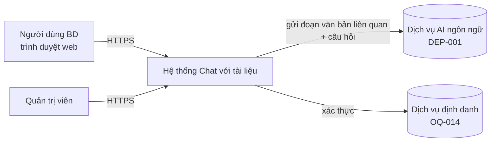
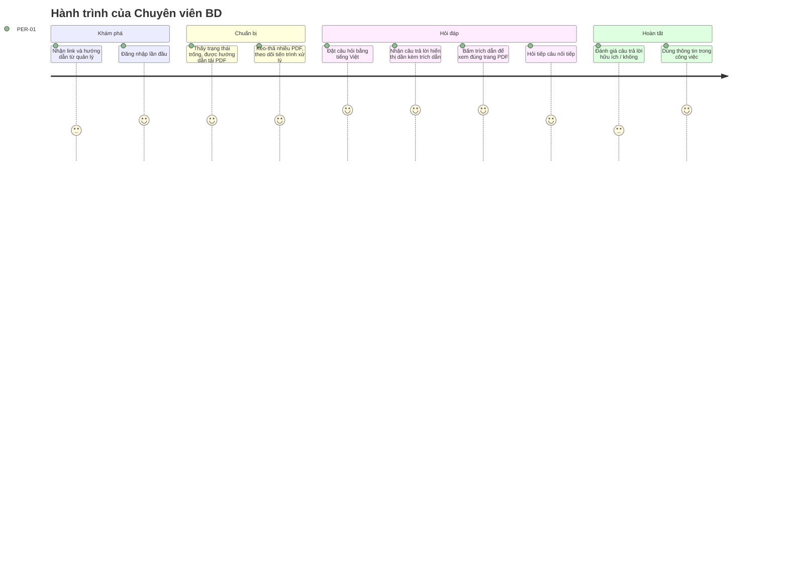

# Tài liệu Yêu cầu Sản phẩm (PRD) — "Chat với tài liệu" (MVP)

> **Chuẩn tham chiếu:** IEEE 29148-2018 · **Prompt nguồn:** `docs/PRD_Prompt_IEEE_standard.md`
> **Tài liệu đầu vào:** `docs/requirements/BRD.md` (BRD-CWD-001 v0.1) và kết quả review trong `docs/BRD_IEEE_29148_Checklist.xlsx`

---

## 0. Kiểm tra nền tảng sản phẩm

### 0.1 Nền tảng sản phẩm (lấy từ BRD)

Prompt PRD để trống phần "Product Foundation". Nội dung dưới đây được lấy từ BRD.

| Mục | Nội dung | Nguồn |
|---|---|---|
| Tên sản phẩm | Chat với tài liệu (Chat with Document) — MVP | BRD §2 |
| Người dùng mục tiêu | Đội phát triển kinh doanh (BD) của một dự án kinh doanh có nhiều tài liệu PDF | BRD STK-002 |
| Vấn đề | Thông tin nằm rải rác trong nhiều file PDF. Mỗi lần cần một thông tin, nhân viên BD phải mở từng file và tự tổng hợp, mất thời gian và dễ sót | BRD §3, SRC-001 |
| Giải pháp cốt lõi | Ứng dụng web: tải PDF lên một bộ tài liệu chung, hỏi bằng ngôn ngữ tự nhiên, nhận câu trả lời tổng hợp từ tất cả tài liệu, có trích dẫn tài liệu và trang để kiểm chứng | BRD §2, BR-001..BR-009 |
| Trụ cột UX | Xem 0.2 (đề xuất của PM, BRD chưa nêu) | — |

### 0.2 Đánh giá các trụ cột UX

| # | Trụ cột đề xuất | Lý do | Đánh giá |
|---|---|---|---|
| UXP-1 | **Có căn cứ trước tiên:** mọi câu trả lời đều có trích dẫn bấm được; nếu không có căn cứ thì nói rõ "không tìm thấy" | BO-002, BR-008, BR-009, RSK-001 | Hợp lệ — đây là yếu tố tạo niềm tin, khác biệt so với chatbot thông thường |
| UXP-2 | **Ít thao tác:** kéo-thả nhiều file, hỏi được ngay khi tài liệu sẵn sàng, không cần cấu hình | BO-001, SN-001 | Hợp lệ |
| UXP-3 | **Minh bạch trạng thái:** người dùng luôn biết tài liệu nào đang xử lý, đã sẵn sàng hay lỗi | BR-005, RSK-003 | Hợp lệ |
| UXP-4 | **Desktop-first:** tối ưu cho trình duyệt máy tính, vẫn dùng được trên tablet | CON-001; nhân viên BD làm việc với PDF chủ yếu trên máy tính [Unverified] | Hợp lệ có điều kiện — cần xác nhận qua OQ-017 |
| UXP-5 | **Tiếng Việt mặc định:** giao diện tiếng Việt; hỏi được bằng tiếng Việt và tiếng Anh | BR-011, ASM-003 | Hợp lệ có điều kiện — chờ OQ-010 |
| — | *Hoạt động offline* | — | **Loại bỏ** — trái với CON-003 (cần dịch vụ AI) và giá trị MVP thấp |

### 0.3 Lưu ý về đầu vào

- **BRD chưa được phê duyệt** ("Ready with conditions"). PRD này kế thừa các câu hỏi mở của BRD. Các yêu cầu phụ thuộc vào câu hỏi mở được ghi trạng thái `Proposed`.
- **Giá trị định lượng đề xuất:** BRD để `[TBD]` cho thời gian phản hồi, độ chính xác, giới hạn file và số người dùng. PRD cần con số cụ thể để thiết kế và kiểm thử, nên PM **đề xuất giá trị mặc định**, đánh dấu ⚑ và liên kết với OQ tương ứng. Quản lý có thể thay đổi các giá trị này mà không làm thay đổi cấu trúc PRD.
- **Sửa các lỗi BRD đã phát hiện khi review:**
  - BR-013 được tách thành hai yêu cầu là US-002 và US-003.
  - Chủ ngữ được thống nhất thành "Hệ thống" trong các yêu cầu `shall`.
  - Đã bổ sung persona, kịch bản sử dụng và yêu cầu khả dụng (các dòng Pending trong checklist BRD).

---

## 1. Kiểm soát tài liệu

| Thuộc tính | Giá trị |
|---|---|
| Mã tài liệu | PRD-CWD-001 |
| Phiên bản | 0.1 |
| Trạng thái | `Draft` |
| Tác giả | Huy Toan (PM / BA) |
| Người review | Quản lý (STK-001), đại diện đội BD (STK-002), Tech lead (STK-004), QA, Design — [TBD: OQ-001] |
| Người phê duyệt | Quản lý giao yêu cầu (STK-001) |
| Tài liệu cha | BRD-CWD-001 v0.1 |
| Tài liệu con dự kiến | SRS, SAD, Test plan |

| Phiên bản | Ngày | Tác giả | Thay đổi |
|---|---|---|---|
| 0.1 | 2026-10-20 | Huy Toan | Bản nháp đầu tiên từ BRD v0.1 |

### 1.1 Mục đích và phạm vi hệ thống

**Mục đích:** PRD đặc tả sản phẩm MVP ở mức đủ để Engineering, Design và QA lập kế hoạch, thiết kế và kiểm thử. Tài liệu mô tả *sản phẩm làm gì*, không mô tả *cách xây dựng*. Các quyết định kiến trúc thuộc SAD.

**Ranh giới hệ thống:**



- **Trong hệ thống:**
  - Tài khoản và phân quyền.
  - Tải lên và xử lý PDF.
  - Bộ tài liệu.
  - Hỏi đáp có trích dẫn.
  - Lịch sử hội thoại.
  - Ghi nhận số liệu sử dụng.
- **Ngoài hệ thống (bên ngoài ranh giới):**
  - Dịch vụ AI ngôn ngữ.
  - Dịch vụ định danh, nếu dùng SSO.
  - Nơi người dùng lưu PDF gốc.
- **Ngoài phạm vi MVP:** kế thừa BRD §5.2 và §5.3:
  - Định dạng khác PDF.
  - OCR.
  - Ứng dụng di động native.
  - Tích hợp kho tài liệu.
  - Xuất file.

### 1.2 Bối cảnh nghiệp vụ

Sản phẩm phục vụ ba mục tiêu nghiệp vụ của BRD:

- **BO-001:** giảm thời gian tìm thông tin.
- **BO-002:** câu trả lời đúng và kiểm chứng được.
- **BO-003:** đội BD chấp nhận sử dụng.

MVP là bước kiểm chứng giá trị trước khi đầu tư thêm (SN-005). Vì vậy PRD ưu tiên:

1. Chất lượng câu trả lời có căn cứ.
2. Khả năng đo lường được ngay từ ngày đầu.
3. Phạm vi tính năng tối thiểu.

---

## 2. Tóm tắt điều hành & Chiến lược

### 2.1 Tầm nhìn sản phẩm

> **Mỗi nhân viên kinh doanh có được câu trả lời có căn cứ từ toàn bộ tài liệu dự án chỉ bằng một câu hỏi, thay vì mở và đọc từng file.**

Về dài hạn (ngoài MVP), sản phẩm có thể mở rộng sang:

- Nhiều định dạng tài liệu khác.
- Nhiều dự án, mỗi dự án một bộ tài liệu riêng.
- Tích hợp kho tài liệu của tổ chức.

### 2.2 Mục tiêu và kết quả then chốt (OKR)

Các giá trị có dấu ⚑ là đề xuất của PM, chờ xác nhận qua OQ được ghi kèm.

| Objective | Key Result | Đo bằng | Trace |
|---|---|---|---|
| **O1. Rút ngắn thời gian tìm thông tin** | KR1.1: Thời gian trung bình để có câu trả lời đủ dùng trên bộ câu hỏi chuẩn giảm ≥ 50% ⚑ so với baseline tìm thủ công | Bài đo có bấm giờ (MET-001) | BO-001, OQ-002/003 |
| | KR1.2: p90 thời gian từ lúc gửi câu hỏi đến khi có câu trả lời hoàn chỉnh ≤ 15 giây ⚑ | Sự kiện `answer_completed.latency_ms` | BR-012, OQ-015 |
| **O2. Câu trả lời đáng tin cậy** | KR2.1: ≥ 80% ⚑ câu trả lời trên bộ câu hỏi chuẩn được đội BD đánh giá là đúng | Bộ câu hỏi chuẩn (MET-002) | BO-002, OQ-004 |
| | KR2.2: ≥ 90% ⚑ trích dẫn trỏ đúng tài liệu và trang chứa thông tin | Kiểm tra thủ công trên bộ câu hỏi chuẩn | BR-008 |
| | KR2.3: ≥ 90% ⚑ câu hỏi ngoài phạm vi tài liệu nhận phản hồi "không tìm thấy" | Bộ câu hỏi âm tính (≥ 10 câu) | BR-009 |
| **O3. Được đội BD chấp nhận sử dụng** | KR3.1: ≥ 70% ⚑ thành viên đội BD đặt ≥ 1 câu hỏi mỗi tuần, trong 4 tuần thử nghiệm | Sự kiện `question_submitted` (MET-003) | BO-003, OQ-005 |
| | KR3.2: Tỷ lệ phản hồi "hữu ích" ≥ 70% ⚑ trên các câu trả lời được đánh giá | Sự kiện `answer_feedback` | BO-002, BO-003 |

---

## 3. Persona & Hành trình người dùng

### 3.1 Persona mục tiêu

Các persona dưới đây là **giả thuyết**, suy ra từ BRD [Unverified]. Cần xác nhận qua phỏng vấn 3–5 nhân viên BD (OQ-018).

| ID | Persona | Loại | Mô tả | Mức thành thạo kỹ thuật | Mục tiêu khi dùng | Khó khăn hiện tại |
|---|---|---|---|---|---|---|
| PER-01 | **Chuyên viên BD** | Chính | Làm việc hằng ngày với đối tác, khách hàng; cần tra cứu điều khoản, số liệu, thông tin đối tác trong tài liệu dự án | Dùng thành thạo văn phòng và web; không có kiến thức về AI | Trả lời nhanh, chính xác câu hỏi của khách hàng hoặc quản lý | Mở nhiều PDF, tìm thủ công, sợ bỏ sót |
| PER-02 | **Trưởng nhóm BD / Quản lý** | Phụ | Giao việc, ra quyết định, theo dõi hiệu quả của MVP | Như PER-01 | Nắm nhanh bức tranh tổng thể; biết công cụ có được dùng và có giá trị không | Không có số liệu đánh giá |
| PER-03 | **Quản trị viên (Admin)** | Phụ | Có thể là trưởng nhóm BD hoặc IT; quản lý người dùng và bộ tài liệu | Trung bình – khá | Kiểm soát ai được truy cập, giữ bộ tài liệu luôn cập nhật | Chưa có công cụ |

### 3.2 Kịch bản sử dụng chính

| ID | Kịch bản | Persona | Trace |
|---|---|---|---|
| SC-01 | Khách hàng hỏi về một điều khoản thanh toán. Chuyên viên BD hỏi công cụ, nhận câu trả lời kèm trích dẫn trang hợp đồng, mở trang đó để xác nhận rồi trả lời khách | PER-01 | BR-006, BR-008 |
| SC-02 | Chuẩn bị họp với đối tác: hỏi "Tóm tắt mọi thông tin về đối tác X", nhận câu trả lời tổng hợp từ 3 tài liệu khác nhau | PER-01 | BR-007 |
| SC-03 | Hỏi một thông tin không có trong tài liệu: công cụ trả lời "không tìm thấy", người dùng biết phải tìm ở nguồn khác | PER-01 | BR-009 |
| SC-04 | Có phiên bản hợp đồng mới: quản trị viên gỡ bản cũ và tải bản mới; các câu trả lời sau đó chỉ dựa trên bản mới | PER-03 | BR-001, BR-004 |
| SC-05 | Sau 4 tuần, quản lý xem số liệu sử dụng để quyết định có đầu tư tiếp hay không | PER-02 | BR-015, BO-003 |

### 3.3 Hành trình người dùng cấp cao (PER-01)



---

## 4. Yêu cầu chức năng & User Stories

**Quy ước:**

- **Ưu tiên:** **P0** = bắt buộc để ra mắt (tương ứng Must trong BRD); **P1** = nên có (Should); **P2** = có thì tốt (Could).
- **ID:** `EP-xx` là epic, `US-xxx` là user story, `FR-xxx` là yêu cầu chức năng (`shall`).
- Mỗi US có một FR tương ứng để truy vết xuống SRS và test case.
- **Trạng thái:** `Draft` nếu yêu cầu bắt nguồn từ SRC-001; `Proposed` nếu chờ xác nhận OQ.

### 4.1 Ma trận Epic / tính năng

| Epic | Tên | Mục tiêu | Số story (P0/P1/P2) | Trace BRD |
|---|---|---|---|---|
| EP-01 | Truy cập & phân quyền | Chỉ người được cấp quyền mới dùng được hệ thống | 3 / 1 / 0 | BR-013, SN-006 |
| EP-02 | Quản lý bộ tài liệu | Đưa PDF vào hệ thống và giữ bộ tài liệu cập nhật | 4 / 2 / 0 | BR-001..005 |
| EP-03 | Hỏi đáp có trích dẫn | Trả lời câu hỏi có căn cứ từ toàn bộ tài liệu | 5 / 3 / 0 | BR-006..012 |
| EP-04 | Hội thoại & lịch sử | Hỏi nối tiếp, quay lại các hội thoại cũ | 0 / 1 / 1 | BR-010, BR-014 |
| EP-05 | Đo lường sử dụng | Có dữ liệu để đánh giá MVP | 0 / 1 / 1 | BR-015, BO-003 |

### 4.2 EP-01 — Truy cập & phân quyền

MVP **đề xuất** bắt buộc đăng nhập, với 2 vai trò là `Member` (thành viên) và `Admin` (quản trị viên). Đề xuất này chờ quyết định ở OQ-014 và OQ-008.

| ID | User story | Ưu tiên | FR (`shall`) | Trace | Trạng thái |
|---|---|---|---|---|---|
| US-001 | Là **Chuyên viên BD**, tôi muốn đăng nhập bằng tài khoản được cấp, để chỉ người trong đội mới xem được tài liệu dự án. | P0 | FR-001: Hệ thống **shall** yêu cầu xác thực trước khi cho truy cập bất kỳ chức năng nào. | BR-013, SN-006 | Proposed (OQ-014) |
| US-002 | Là **Quản trị viên**, tôi muốn chỉ người dùng được cấp quyền mới xem được bộ tài liệu, để bảo vệ thông tin kinh doanh. | P0 | FR-002: Hệ thống **shall** chỉ hiển thị danh sách và nội dung tài liệu cho người dùng có vai trò Member hoặc Admin. | BR-013 (tách) | Proposed (OQ-008) |
| US-003 | Là **Chuyên viên BD**, tôi muốn hội thoại của tôi chỉ mình tôi xem được, để thoải mái đặt câu hỏi. | P0 | FR-003: Hệ thống **shall** chỉ cho phép chủ sở hữu hội thoại xem nội dung hội thoại đó. | BR-013 (tách) | Proposed (OQ-009) |
| US-004 | Là **Quản trị viên**, tôi muốn thêm và vô hiệu hóa tài khoản người dùng, để kiểm soát ai được truy cập. | P1 | FR-004: Hệ thống **shall** cho phép Admin tạo, vô hiệu hóa tài khoản và gán vai trò. | BR-013 | Proposed |

**Tiêu chí chấp nhận (P0)**

- **AC-US-001-1:** *Given* người dùng chưa đăng nhập, *When* truy cập bất kỳ URL nào của ứng dụng, *Then* hệ thống chuyển tới trang đăng nhập và không trả về dữ liệu tài liệu hay hội thoại nào.
- **AC-US-001-2:** *Given* người dùng nhập sai thông tin đăng nhập 5 lần liên tiếp ⚑, *When* thử lần thứ 6, *Then* tài khoản bị tạm khóa 15 phút ⚑ và người dùng thấy thông báo tương ứng.
- **AC-US-002-1:** *Given* một tài khoản đã bị vô hiệu hóa, *When* người đó gọi trực tiếp đường dẫn tải hoặc xem tài liệu, *Then* hệ thống từ chối (HTTP 401/403) và không trả về nội dung.
- **AC-US-003-1:** *Given* người dùng A có hội thoại H, *When* người dùng B (Member) truy cập H qua đường dẫn trực tiếp, *Then* hệ thống từ chối truy cập và không hiển thị nội dung H.

### 4.3 EP-02 — Quản lý bộ tài liệu

Giả định cho MVP: cả đội dùng chung **một bộ tài liệu** (ASM-002, chờ OQ-009). Member được tải lên tài liệu; quyền gỡ tài liệu thuộc Admin (BRU-006, xem §8).

| ID | User story | Ưu tiên | FR (`shall`) | Trace | Trạng thái |
|---|---|---|---|---|---|
| US-005 | Là **Chuyên viên BD**, tôi muốn tải lên một hoặc nhiều file PDF cùng lúc (kéo-thả hoặc chọn file), để đưa tài liệu dự án vào hệ thống nhanh chóng. | P0 | FR-005: Hệ thống **shall** chấp nhận tải lên tối đa 10 ⚑ tệp PDF trong một lần thao tác. | BR-001, SN-004 | Draft |
| US-006 | Là **Chuyên viên BD**, tôi muốn thấy trạng thái xử lý của từng tài liệu (Đang tải lên / Đang xử lý / Sẵn sàng / Lỗi), để biết khi nào có thể hỏi về tài liệu đó. | P0 | FR-006: Hệ thống **shall** hiển thị trạng thái xử lý của từng tài liệu và tự cập nhật khi trạng thái thay đổi. | BR-001, BR-005, UXP-3 | Draft |
| US-007 | Là **Chuyên viên BD**, tôi muốn được báo rõ khi một file không xử lý được và lý do, để tôi xử lý file đó theo cách khác. | P0 | FR-007: Hệ thống **shall** thông báo tên tệp và lý do khi từ chối hoặc xử lý thất bại một tệp (sai định dạng, quá dung lượng, có mật khẩu, không có lớp văn bản, hỏng). | BR-005, RSK-003 | Draft |
| US-008 | Là **Chuyên viên BD**, tôi muốn mọi tài liệu ở trạng thái Sẵn sàng đều được dùng làm nguồn trả lời, để không phải chọn file trước khi hỏi. | P0 | FR-008: Hệ thống **shall** dùng tất cả tài liệu có trạng thái Sẵn sàng trong bộ tài liệu làm nguồn khi trả lời. | BR-002, SN-002 | Draft |
| US-009 | Là **Chuyên viên BD**, tôi muốn xem danh sách tài liệu (tên, số trang, người tải, ngày tải, trạng thái), để biết câu trả lời dựa trên những tài liệu nào. | P1 | FR-009: Hệ thống **shall** hiển thị danh sách tài liệu với tên tệp, số trang, người tải lên, ngày tải lên và trạng thái. | BR-003 | Proposed (OQ-013) |
| US-010 | Là **Quản trị viên**, tôi muốn gỡ một tài liệu lỗi thời khỏi bộ tài liệu, để nó không còn ảnh hưởng tới câu trả lời. | P1 | FR-010: Hệ thống **shall** cho phép Admin gỡ một tài liệu, sau khi người dùng xác nhận thao tác. | BR-004, BRU-004 | Proposed (OQ-013) |

**Tiêu chí chấp nhận (P0)**

- **AC-US-005-1:** *Given* người dùng đã đăng nhập và đang ở màn hình Tài liệu, *When* kéo-thả 3 tệp PDF hợp lệ (mỗi tệp ≤ 20 MB ⚑), *Then* cả 3 tệp xuất hiện trong danh sách với trạng thái "Đang tải lên", kèm thanh tiến trình riêng cho từng tệp.
- **AC-US-005-2:** *Given* người dùng chọn 11 tệp, *When* xác nhận tải lên, *Then* hệ thống thông báo giới hạn 10 tệp mỗi lần và không tải tệp nào cho tới khi người dùng chọn lại.
- **AC-US-006-1:** *Given* một tệp PDF dạng văn bản, 50 trang, đã tải lên xong, *When* hệ thống xử lý xong, *Then* trạng thái chuyển sang "Sẵn sàng" trong ≤ 60 giây ⚑ mà người dùng không cần tải lại trang.
- **AC-US-007-1:** *Given* người dùng tải lên tệp `.docx` đổi tên thành `.pdf`, *When* hệ thống kiểm tra tệp, *Then* tệp được đánh dấu "Lỗi — không phải tệp PDF hợp lệ" và không được dùng làm nguồn trả lời.
- **AC-US-007-2:** *Given* một tệp PDF có mật khẩu, *When* tải lên, *Then* trạng thái là "Lỗi — tệp được bảo vệ bằng mật khẩu".
- **AC-US-007-3:** *Given* một tệp PDF chỉ chứa ảnh scan, *When* xử lý, *Then* trạng thái là "Lỗi — không đọc được văn bản (PDF dạng ảnh chưa được hỗ trợ)".
- **AC-US-007-4:** *Given* một tệp lớn hơn 20 MB ⚑ hoặc dài hơn 300 trang ⚑, *When* tải lên, *Then* hệ thống từ chối ngay ở trình duyệt, nêu rõ giới hạn và không bắt đầu tải lên.
- **AC-US-008-1:** *Given* bộ tài liệu có tài liệu A (Sẵn sàng) và B (Đang xử lý), *When* người dùng đặt câu hỏi, *Then* câu trả lời chỉ dựa trên A, và giao diện hiển thị thông báo "1 tài liệu đang xử lý, chưa được dùng để trả lời".

### 4.4 EP-03 — Hỏi đáp có trích dẫn

| ID | User story | Ưu tiên | FR (`shall`) | Trace | Trạng thái |
|---|---|---|---|---|---|
| US-011 | Là **Chuyên viên BD**, tôi muốn đặt câu hỏi bằng ngôn ngữ tự nhiên và nhận câu trả lời từ nội dung tài liệu, để không phải tự đọc từng file. | P0 | FR-011: Hệ thống **shall** trả lời câu hỏi bằng ngôn ngữ tự nhiên (tối đa 2.000 ký tự ⚑) chỉ dựa trên nội dung bộ tài liệu. | BR-006, BRU-001 | Draft |
| US-012 | Là **Chuyên viên BD**, tôi muốn câu trả lời tổng hợp thông tin từ nhiều tài liệu khi cần, để không phải tự ghép nối. | P0 | FR-012: Hệ thống **shall** tổng hợp trong một câu trả lời thông tin liên quan từ tất cả các tài liệu chứa thông tin đó. | BR-007 | Draft |
| US-013 | Là **Chuyên viên BD**, tôi muốn mỗi ý trong câu trả lời có trích dẫn tên tài liệu và số trang, để tôi kiểm chứng trước khi dùng. | P0 | FR-013: Hệ thống **shall** gắn với mỗi câu trả lời ít nhất một trích dẫn gồm tên tài liệu và số trang nguồn. | BR-008, UXP-1 | Proposed (OQ-013) |
| US-014 | Là **Chuyên viên BD**, tôi muốn hệ thống nói rõ khi tài liệu không có thông tin, để tôi không dùng nhầm thông tin bịa. | P0 | FR-014: Hệ thống **shall** trả lời bằng thông báo "không tìm thấy thông tin trong tài liệu" khi bộ tài liệu không chứa căn cứ cho câu hỏi. | BR-009, RSK-001 | Proposed (OQ-013) |
| US-015 | Là **Chuyên viên BD**, tôi muốn hỏi bằng tiếng Việt (hoặc tiếng Anh) và nhận câu trả lời cùng ngôn ngữ với câu hỏi, để giao tiếp tự nhiên. | P0 | FR-015: Hệ thống **shall** trả lời bằng ngôn ngữ của câu hỏi, với tiếng Việt và tiếng Anh. | BR-011 | Proposed (OQ-010) |
| US-016 | Là **Chuyên viên BD**, tôi muốn câu trả lời hiện dần ngay khi có, để không phải chờ màn hình trống. | P1 | FR-016: Hệ thống **shall** bắt đầu hiển thị nội dung câu trả lời trong ≤ 5 giây ⚑ (p90) sau khi gửi câu hỏi. | BR-012 | Proposed (OQ-015) |
| US-017 | Là **Chuyên viên BD**, tôi muốn bấm vào trích dẫn để mở đúng trang PDF gốc, để kiểm chứng nhanh. | P1 | FR-017: Hệ thống **shall** mở tài liệu được trích dẫn tại đúng trang được trích dẫn khi người dùng chọn trích dẫn đó. | BR-008, SN-003 | Proposed |
| US-018 | Là **Chuyên viên BD**, tôi muốn đánh giá câu trả lời là hữu ích hoặc không hữu ích, để nhóm sản phẩm cải thiện chất lượng. | P1 | FR-018: Hệ thống **shall** cho phép người dùng gửi đánh giá hữu ích / không hữu ích, kèm góp ý tùy chọn, cho từng câu trả lời. | BO-002, MET-002, KR3.2 | Proposed |

> Yêu cầu thời gian trả lời hoàn chỉnh (BR-012) được đặc tả là NFR-001 ở §7 vì đây là yêu cầu hiệu năng.

**Tiêu chí chấp nhận (P0)**

- **AC-US-011-1:** *Given* bộ tài liệu chuẩn (DEP-002) đã Sẵn sàng, *When* QA chạy bộ câu hỏi chuẩn, *Then* ≥ 80% ⚑ câu trả lời được đại diện đội BD đánh giá là đúng (KR2.1).
- **AC-US-011-2:** *Given* bộ tài liệu chưa có tài liệu nào ở trạng thái Sẵn sàng, *When* người dùng mở màn hình hỏi đáp, *Then* ô nhập câu hỏi bị vô hiệu hóa và có hướng dẫn "Tải lên tài liệu để bắt đầu".
- **AC-US-011-3:** *Given* câu hỏi dài hơn 2.000 ký tự ⚑, *When* người dùng gửi, *Then* hệ thống không gửi câu hỏi và hiển thị số ký tự vượt giới hạn.
- **AC-US-012-1:** *Given* thông tin về đối tác X nằm ở tài liệu A trang 3 và tài liệu B trang 7, *When* hỏi "Tóm tắt thông tin về đối tác X", *Then* câu trả lời chứa thông tin từ cả hai nguồn và có trích dẫn cả A–tr.3 và B–tr.7.
- **AC-US-013-1:** *Given* bất kỳ câu trả lời nào không phải "không tìm thấy", *When* câu trả lời hiển thị xong, *Then* có ≥ 1 trích dẫn dạng `[Tên tài liệu, tr. N]`.
- **AC-US-013-2:** *Given* bộ câu hỏi chuẩn, *When* QA mở từng trích dẫn, *Then* ≥ 90% ⚑ trích dẫn trỏ đúng trang chứa thông tin được dùng (KR2.2).
- **AC-US-014-1:** *Given* bộ ≥ 10 câu hỏi về thông tin không có trong tài liệu, *When* gửi từng câu, *Then* ≥ 90% ⚑ phản hồi là thông báo "không tìm thấy thông tin trong tài liệu" và không kèm nội dung suy diễn (KR2.3).
- **AC-US-014-2:** *Given* một câu hỏi về kiến thức chung (vd. "Thủ đô của Pháp là gì?") mà tài liệu không đề cập, *When* gửi câu hỏi, *Then* hệ thống trả về thông báo "không tìm thấy thông tin trong tài liệu", không trả lời từ kiến thức bên ngoài (BRU-001).
- **AC-US-015-1:** *Given* bộ câu hỏi chuẩn viết bằng tiếng Việt, *When* chạy kiểm thử, *Then* câu trả lời bằng tiếng Việt và đạt cùng ngưỡng như AC-US-011-1.
- **AC-US-015-2:** *Given* một câu hỏi bằng tiếng Anh về tài liệu tiếng Việt, *When* gửi câu hỏi, *Then* câu trả lời bằng tiếng Anh và trích dẫn đúng tài liệu tiếng Việt.

### 4.5 EP-04 — Hội thoại & lịch sử

| ID | User story | Ưu tiên | FR (`shall`) | Trace | Trạng thái |
|---|---|---|---|---|---|
| US-019 | Là **Chuyên viên BD**, tôi muốn hỏi tiếp câu nối tiếp mà không nhắc lại ngữ cảnh, và bắt đầu hội thoại mới khi đổi chủ đề. | P1 | FR-019: Hệ thống **shall** dùng tối đa 10 ⚑ lượt hỏi đáp trước đó trong cùng hội thoại làm ngữ cảnh cho câu hỏi tiếp theo. | BR-010 | Proposed |
| US-020 | Là **Chuyên viên BD**, tôi muốn xem lại danh sách các hội thoại cũ của mình, để không phải hỏi lại. | P2 | FR-020: Hệ thống **shall** lưu và hiển thị danh sách hội thoại của người dùng, sắp xếp theo thời gian gần nhất. | BR-014 | Proposed |

### 4.6 EP-05 — Đo lường sử dụng

| ID | User story | Ưu tiên | FR (`shall`) | Trace | Trạng thái |
|---|---|---|---|---|---|
| US-021 | Là **Quản lý**, tôi muốn có số liệu về số người dùng và số câu hỏi theo tuần, để đánh giá MVP. | P1 | FR-021: Hệ thống **shall** ghi nhận các sự kiện sử dụng được định nghĩa ở §6.2. | BR-015, BO-003 | Proposed |
| US-022 | Là **Quản lý**, tôi muốn xem bảng tổng hợp số liệu sử dụng ngay trong ứng dụng. | P2 | FR-022: Hệ thống **shall** hiển thị cho Admin bảng số người dùng hoạt động, số câu hỏi và tỷ lệ đánh giá hữu ích theo tuần. | BO-003 | Proposed |

---

## 5. Yêu cầu UX & UI

### 5.1 Bố cục và luồng tương tác chính

Phần này mô tả *đặc điểm logic* của giao diện. Bố cục chi tiết và hình ảnh do Design quyết định.

```
┌───────────────────────────────────────────────────────────────┐
│ Thanh trên: Tên sản phẩm · Người dùng · Đăng xuất            │
├──────────────┬────────────────────────────────┬───────────────┤
│ Cột trái     │ Khu vực hội thoại              │ Cột phải      │
│ - Hội thoại  │ - Câu hỏi / câu trả lời        │ (mở khi chọn  │
│   mới        │ - Trích dẫn [Tài liệu, tr.N]   │  trích dẫn)   │
│ - Lịch sử    │   bấm được                     │ Trình xem PDF │
│   (P2)       │ - Nút Hữu ích / Không          │ tại trang N   │
│ - Tài liệu   │ ─────────────────────────────  │               │
│   (n Sẵn     │ Ô nhập câu hỏi + Gửi           │               │
│    sàng)     │ "Đang dùng n tài liệu"         │               │
└──────────────┴────────────────────────────────┴───────────────┘
```

| ID | Yêu cầu UI (logic) | Trace |
|---|---|---|
| UI-01 | Màn hình chính gồm ba khu vực: điều hướng (hội thoại, tài liệu), hội thoại, và xem nguồn trích dẫn. | US-011, US-017 |
| UI-02 | Màn hình Tài liệu có vùng kéo-thả, nút chọn tệp và danh sách tài liệu kèm trạng thái. | US-005, US-006, US-009 |
| UI-03 | Khu vực hội thoại luôn hiển thị số tài liệu Sẵn sàng đang được dùng làm nguồn. | US-008, UXP-3 |
| UI-04 | Trích dẫn được hiển thị khác biệt với nội dung trả lời và có thể chọn được. | US-013, US-017 |
| UI-05 | Phản hồi "không tìm thấy" được hiển thị khác biệt với câu trả lời thông thường, kèm gợi ý diễn đạt lại câu hỏi hoặc tải thêm tài liệu. | US-014 |
| UI-06 | Phím Enter gửi câu hỏi; Shift+Enter xuống dòng. | US-011 |
| UI-07 | Khi đang chờ câu trả lời, hiển thị chỉ báo đang xử lý và nút Dừng. | US-016 |
| UI-08 | Giao diện tiếng Việt. Chuỗi hiển thị được tách khỏi mã để có thể bổ sung ngôn ngữ khác sau này. | UXP-5 |
| UI-09 | Bố cục dùng được ở độ rộng màn hình ≥ 1280 px (desktop). Ở 768–1279 px (tablet), các cột bên thu gọn thành ngăn trượt. | UXP-4 |
| UI-10 | Mọi chức năng P0 thao tác được hoàn toàn bằng bàn phím. Độ tương phản chữ đạt WCAG 2.1 AA. | Chất lượng |

### 5.2 Trường hợp biên & trạng thái lỗi

| ID | Tình huống | Hành vi yêu cầu |
|---|---|---|
| EC-01 | **Trạng thái trống:** chưa có tài liệu | Hiển thị hướng dẫn 3 bước và nút "Tải lên tài liệu". Ô hỏi bị vô hiệu hóa (AC-US-011-2). |
| EC-02 | **Trạng thái trống:** chưa có hội thoại | Hiển thị 3 câu hỏi gợi ý mẫu. Chọn một câu sẽ điền sẵn vào ô nhập. |
| EC-03 | **Mất mạng khi tải lên** | Tệp đang tải chuyển sang "Lỗi — mất kết nối" kèm nút "Thử lại". Các tệp đã tải xong không bị ảnh hưởng. |
| EC-04 | **Mất mạng khi đang nhận câu trả lời** | Giữ phần đã nhận, gắn nhãn "Câu trả lời chưa hoàn tất", có nút "Thử lại". Câu hỏi không bị mất. |
| EC-05 | **Mất mạng khi đang soạn câu hỏi** | Giữ nội dung ô nhập. Hiển thị băng báo "Mất kết nối"; nút Gửi bị vô hiệu cho tới khi có kết nối lại. |
| EC-06 | **Dịch vụ AI quá thời gian chờ (> 30 giây ⚑) hoặc lỗi** | Hiển thị "Hệ thống đang bận, vui lòng thử lại". Không hiển thị lỗi kỹ thuật thô. Ghi sự kiện `answer_failed`. |
| EC-07 | **Tệp không hợp lệ** (sai định dạng, quá dung lượng, có mật khẩu, PDF ảnh, hỏng) | Như AC-US-007-1..4; mỗi lỗi có thông điệp riêng. |
| EC-08 | **Trùng tên tệp** đã có trong bộ tài liệu | Hỏi người dùng: "Thay thế bản cũ" (chỉ Admin) hoặc "Giữ cả hai" (thêm hậu tố ngày tải lên). |
| EC-09 | **Hỏi khi tài liệu đang xử lý** | Như AC-US-008-1. |
| EC-10 | **Trích dẫn tới tài liệu đã bị gỡ** (trong hội thoại cũ) | Trích dẫn hiển thị "Tài liệu đã bị gỡ"; không mở được nội dung. |
| EC-11 | **Phiên đăng nhập hết hạn** | Chuyển tới trang đăng nhập; sau khi đăng nhập lại, quay về màn hình trước đó và giữ câu hỏi chưa gửi. |
| EC-12 | **Câu hỏi rỗng hoặc chỉ có khoảng trắng** | Nút Gửi bị vô hiệu hóa. |
| EC-13 | **Hai người cùng tải một tệp** cùng lúc | Áp dụng EC-08 cho người tải sau. |
| EC-14 | **Bộ tài liệu đạt giới hạn** 50 tài liệu ⚑ | Từ chối tải thêm, nêu giới hạn và gợi ý Admin gỡ tài liệu cũ. |

---

## 6. Tiêu chí phát hành & Chỉ số sau ra mắt

### 6.1 Tiêu chí cổng phát hành (Launch gate)

Tất cả các tiêu chí phải **Đạt** trước khi mở cho đội BD dùng thử.

| Nhóm | Tiêu chí | Ngưỡng |
|---|---|---|
| Quyết định | Các OQ chặn đã đóng: OQ-008 (bảo mật / AI bên ngoài), OQ-013 (phạm vi), OQ-014 (đăng nhập) | Đóng 100% |
| Chất lượng câu trả lời | KR2.1, KR2.2, KR2.3 trên bộ câu hỏi chuẩn (DEP-002) | ≥ 80% / ≥ 90% / ≥ 90% ⚑ |
| Hiệu năng | NFR-001, NFR-002, NFR-003 đo trong môi trường staging với 5 người dùng đồng thời | Đạt |
| QA | 100% tiêu chí chấp nhận của các story P0 đã pass; không còn lỗi Critical / High | Đạt |
| QA | Kiểm thử hồi quy tự động cho luồng đăng nhập → tải lên → hỏi → trích dẫn | Có, chạy xanh |
| Bảo mật | Rà soát theo OWASP Top 10 (2021); không còn lỗ hổng Critical / High | Đạt |
| Bảo mật | NFR-010..NFR-014 đã xác minh | Đạt |
| Đo lường | Mọi sự kiện ở §6.2 được ghi nhận đúng trong staging (kiểm tra mẫu) | Đạt |
| UAT | ≥ 2 đại diện đội BD dùng thử với SC-01..SC-04 và ký xác nhận | Đạt |
| Vận hành | Có hướng dẫn sử dụng 1 trang và đầu mối hỗ trợ | Có |

### 6.2 Phân tích & theo dõi (telemetry)

**Nguyên tắc riêng tư:**

- Sự kiện **không chứa** nội dung câu hỏi, câu trả lời hay nội dung tài liệu; chỉ chứa metadata.
- Người dùng được định danh bằng ID nội bộ ẩn danh hóa.
- Thời gian lưu sự kiện: 12 tháng ⚑ (OQ-016).

| Sự kiện | Khi nào | Thuộc tính chính | Dùng cho |
|---|---|---|---|
| `user_logged_in` | Đăng nhập thành công | `user_id`, `role` | KR3.1 |
| `document_upload_started` | Bắt đầu tải một tệp | `doc_id`, `size_bytes` | Phễu tải lên |
| `document_ready` | Tệp xử lý xong | `doc_id`, `pages`, `processing_ms` | AC-US-006-1 |
| `document_failed` | Tệp bị từ chối / lỗi | `doc_id`, `reason_code` | RSK-003, OQ-012 |
| `document_removed` | Admin gỡ tệp | `doc_id` | Theo dõi bộ tài liệu |
| `conversation_created` | Tạo hội thoại mới | `conversation_id` | Mức độ sử dụng |
| `question_submitted` | Gửi câu hỏi | `conversation_id`, `turn_index`, `lang`, `char_count`, `ready_doc_count` | KR3.1, KR1.2 |
| `answer_first_token` | Hiển thị phần đầu câu trả lời | `latency_ms` | NFR-002 |
| `answer_completed` | Câu trả lời hoàn tất | `latency_ms`, `citation_count`, `doc_count_cited`, `not_found` (bool) | KR1.2, KR2.3 |
| `answer_failed` | Lỗi / quá thời gian chờ | `error_code` | NFR-020 |
| `answer_stopped` | Người dùng bấm Dừng | `elapsed_ms` | Trải nghiệm chờ |
| `citation_opened` | Mở một trích dẫn | `doc_id`, `page` | Mức độ kiểm chứng |
| `answer_feedback` | Gửi đánh giá | `rating` (up/down), `has_comment` | KR3.2 |

**Phễu cần theo dõi:**

1. Đăng nhập → tải tài liệu đầu tiên → câu hỏi đầu tiên → mở trích dẫn → đánh giá.
2. Tỷ lệ `document_failed` / `document_upload_started`, theo `reason_code`.
3. Tỷ lệ câu trả lời `not_found = true`. Nếu tỷ lệ cao, có thể bộ tài liệu đang thiếu hoặc chất lượng truy xuất kém.

---

## 7. Yêu cầu phi chức năng

Các giá trị có dấu ⚑ là đề xuất của PM, chờ xác nhận.

### 7.1 Hiệu năng & dung lượng

| ID | Yêu cầu | Ngưỡng | Trace |
|---|---|---|---|
| NFR-001 | Hệ thống **shall** trả về câu trả lời hoàn chỉnh trong thời gian p90 không quá ngưỡng | ≤ 15 giây ⚑ (p90), với bộ tài liệu 50 tệp | BR-012, KR1.2, OQ-015 |
| NFR-002 | Hệ thống **shall** hiển thị phần đầu tiên của câu trả lời trong thời gian p90 không quá ngưỡng | ≤ 5 giây ⚑ (p90) | US-016 |
| NFR-003 | Hệ thống **shall** chuyển một tệp PDF dạng văn bản 50 trang sang trạng thái Sẵn sàng trong thời gian không quá ngưỡng | ≤ 60 giây ⚑ | US-006 |
| NFR-004 | Hệ thống **shall** chấp nhận tệp PDF có dung lượng tối đa | 20 MB ⚑ | BRU-003, OQ-011 |
| NFR-005 | Hệ thống **shall** chấp nhận tệp PDF có số trang tối đa | 300 trang ⚑ | BRU-003, OQ-011 |
| NFR-006 | Hệ thống **shall** hỗ trợ một bộ tài liệu có số tài liệu tối đa | 50 tài liệu ⚑ | OQ-011 |
| NFR-007 | Màn hình chính **shall** tải xong lần đầu trong thời gian không quá ngưỡng, trên kết nối 10 Mbps | ≤ 3 giây ⚑ | UX |

### 7.2 Khả năng mở rộng

| ID | Yêu cầu | Ngưỡng | Trace |
|---|---|---|---|
| NFR-008 | Hệ thống **shall** đáp ứng NFR-001 và NFR-002 khi có số người dùng đặt câu hỏi đồng thời | 5 người ⚑ (tổng 20 tài khoản ⚑) | ASM-005, OQ-005 |
| NFR-009 | Hệ thống **shall** cho phép tăng giới hạn ở NFR-006 và NFR-008 lên gấp 5 lần bằng thay đổi cấu hình và hạ tầng, không cần thay đổi chức năng | Kiểm chứng bằng phân tích kiến trúc (SAD) | Tầm nhìn §2.1 |

### 7.3 Bảo mật & quyền riêng tư

| ID | Yêu cầu | Trace |
|---|---|---|
| NFR-010 | Mọi giao tiếp giữa trình duyệt và hệ thống **shall** được mã hóa bằng HTTPS với TLS 1.2 trở lên. | SN-006 |
| NFR-011 | Tài liệu, hội thoại và thông tin tài khoản lưu trữ **shall** được mã hóa khi lưu (at rest), dùng AES-256 hoặc tương đương. | SN-006, RSK-002 |
| NFR-012 | Hệ thống **shall** áp dụng phân quyền theo vai trò như ma trận ở §8 (BRU-006). | BR-013 |
| NFR-013 | Hệ thống **shall** chỉ gửi tới dịch vụ AI các đoạn văn bản cần thiết để trả lời câu hỏi, không gửi toàn bộ tệp, và chỉ khi OQ-008 cho phép. | RSK-002, OQ-008 |
| NFR-014 | Hệ thống **shall** ghi nhật ký kiểm toán (ai, khi nào, thao tác gì) cho các thao tác đăng nhập, tải lên, gỡ tài liệu và quản lý tài khoản; lưu 12 tháng ⚑. | Checklist BRD dòng 16 |
| NFR-015 | Mật khẩu (nếu không dùng SSO) **shall** được lưu dưới dạng băm có salt, dùng thuật toán chuyên dụng cho mật khẩu. | US-001 |
| NFR-016 | Hệ thống **shall** xóa vĩnh viễn nội dung tài liệu khỏi lưu trữ trong vòng 30 ngày ⚑ sau khi tài liệu bị gỡ. | BRU-005, OQ-016 |

### 7.4 Độ tin cậy & khả dụng

| ID | Yêu cầu | Ngưỡng | Trace |
|---|---|---|---|
| NFR-017 | Hệ thống **shall** khả dụng trong giờ làm việc (08:00–18:00, thứ Hai–thứ Sáu, giờ Việt Nam) | ≥ 95% ⚑ mỗi tháng | Checklist BRD dòng 17, OQ-019 |
| NFR-018 | Thời gian khôi phục khi sự cố (RTO) **shall** không vượt quá ngưỡng | 1 ngày làm việc ⚑ | OQ-019 |
| NFR-019 | Lượng dữ liệu tối đa có thể mất khi sự cố (RPO) **shall** không vượt quá ngưỡng (sao lưu hằng ngày) | 24 giờ ⚑ | OQ-019 |
| NFR-020 | Khi dịch vụ AI không phản hồi, hệ thống **shall** báo lỗi cho người dùng trong thời gian không quá ngưỡng, không treo giao diện | ≤ 30 giây ⚑ | EC-06 |
| NFR-021 | Khi một tệp xử lý thất bại, hệ thống **shall** giữ nguyên trạng thái và khả năng sử dụng của các tài liệu khác | Kiểm thử | EC-07 |

> MVP không yêu cầu hoạt động 24/7 hay cơ chế dự phòng nóng (failover). Lý do: người dùng là một đội nội bộ, làm việc trong giờ hành chính (ASM-005). Cần quản lý xác nhận qua OQ-019.

### 7.5 Khả năng sử dụng

| ID | Yêu cầu | Ngưỡng |
|---|---|---|
| NFR-022 | Người dùng mới **shall** hoàn thành được việc tải 1 tài liệu và nhận câu trả lời có trích dẫn đầu tiên mà không cần hướng dẫn trực tiếp | ≥ 4/5 người tham gia kiểm thử khả dụng, trong ≤ 5 phút ⚑ |
| NFR-023 | Giao diện **shall** đạt mức tương phản và thao tác bàn phím theo WCAG 2.1 AA cho các màn hình P0 | Kiểm tra bằng công cụ tự động và thủ công |

---

## 8. Yêu cầu giao diện kết nối

### 8.1 Giao diện người dùng

Xem §5.1 (UI-01..UI-10). Trình duyệt hỗ trợ: 2 phiên bản mới nhất của Chrome, Edge, Firefox và Safari trên máy tính.

### 8.2 Giao diện phần cứng

Không áp dụng. Sản phẩm chạy trên trình duyệt web và không tương tác trực tiếp với thiết bị phần cứng.

### 8.3 Giao diện phần mềm

| ID | Hệ thống ngoài | Mục đích | Dữ liệu trao đổi | Yêu cầu | Trạng thái |
|---|---|---|---|---|---|
| IF-01 | **Dịch vụ AI ngôn ngữ** (bên thứ ba hoặc tự vận hành — OQ-008) | Hiểu câu hỏi và sinh câu trả lời | Gửi: câu hỏi, ngữ cảnh hội thoại, các đoạn văn bản liên quan. Nhận: câu trả lời | Phải hỗ trợ tiếng Việt; có cam kết không dùng dữ liệu gửi đi để huấn luyện mô hình; có giới hạn chi phí theo tháng (OQ-007) | Proposed |
| IF-02 | **Dịch vụ định danh** (SSO của tổ chức nếu có, nếu không thì tài khoản nội bộ — OQ-014) | Xác thực người dùng | Danh tính, email | Theo chuẩn của tổ chức | Proposed |
| IF-03 | **Lưu trữ tệp và dữ liệu** | Lưu PDF, nội dung đã xử lý, hội thoại, sự kiện | — | Đáp ứng NFR-011, NFR-016, NFR-019; nơi lưu trữ theo OQ-008 | Proposed |

Lựa chọn cụ thể nhà cung cấp, mô hình AI, cơ sở dữ liệu và kỹ thuật truy xuất thuộc SAD. Không được quyết định trong PRD.

### 8.4 Giao diện truyền thông

- Mọi giao tiếp trình duyệt ↔ hệ thống và hệ thống ↔ dịch vụ ngoài dùng **HTTPS (TLS 1.2+)**.
- Việc hiển thị câu trả lời dần (US-016) cần một cơ chế đẩy dữ liệu từ máy chủ, chẳng hạn Server-Sent Events hoặc WebSocket. Chọn cơ chế nào thuộc SAD.

### 8.5 Môi trường vận hành

| Thành phần | Yêu cầu |
|---|---|
| Phía người dùng | Máy tính có trình duyệt theo §8.1, độ phân giải ≥ 1280 px, kết nối mạng ≥ 10 Mbps |
| Phía máy chủ | Hạ tầng đám mây hoặc máy chủ nội bộ, tùy OQ-008 và OQ-020. Phải có môi trường staging tách biệt với production |
| Vị trí dữ liệu | Theo quyết định OQ-008 (nội địa hay quốc tế) |

---

## 9. Ràng buộc, quy tắc & phụ thuộc

### 9.1 Ràng buộc thiết kế (kế thừa BRD và bổ sung)

| ID | Ràng buộc | Nguồn |
|---|---|---|
| CON-001 | Ứng dụng web | BRD |
| CON-002 | Đầu vào chỉ là PDF; PDF dạng ảnh scan chưa được hỗ trợ trong MVP | BRD, OQ-012 |
| CON-003 | Tương tác qua chat với AI | BRD |
| CON-004 | Phạm vi MVP | BRD |
| CON-005 / CON-006 | Thời hạn và ngân sách | BRD — [TBD: OQ-006, OQ-007] |
| CON-007 | Nếu tài liệu chứa dữ liệu cá nhân, hệ thống phải tuân thủ quy định bảo vệ dữ liệu cá nhân của Việt Nam (Nghị định 13/2023/NĐ-CP và văn bản thay thế đang có hiệu lực); pháp chế cần xác nhận | Review BRD, OQ-008 |

### 9.2 Quy tắc nghiệp vụ & ma trận phân quyền

Kế thừa BRU-001..BRU-005 từ BRD và bổ sung:

**BRU-006 — Ma trận phân quyền (đề xuất, OQ-014):**

| Thao tác | Member | Admin |
|---|---|---|
| Đặt câu hỏi, xem trích dẫn | ✔ | ✔ |
| Tải lên tài liệu | ✔ | ✔ |
| Gỡ tài liệu / thay thế bản cũ | — | ✔ |
| Xem hội thoại của chính mình | ✔ | ✔ |
| Xem hội thoại của người khác | — | — |
| Quản lý tài khoản | — | ✔ |
| Xem bảng số liệu sử dụng (US-022) | — | ✔ |

### 9.3 Phụ thuộc

| ID | Phụ thuộc | Ảnh hưởng nếu thiếu |
|---|---|---|
| DEP-001 | Dịch vụ AI ngôn ngữ đã được duyệt về bảo mật và chi phí | Chặn EP-03 |
| DEP-002 | Bộ PDF mẫu và bộ câu hỏi chuẩn (gồm câu hỏi âm tính) từ đội BD | Chặn launch gate chất lượng |
| DEP-003 | Dịch vụ định danh (nếu dùng SSO) | Chặn EP-01 |
| DEP-004 | Môi trường hạ tầng (staging, production) | Chặn phát hành |
| DEP-005 | Design cung cấp thiết kế giao diện cho §5 | Chặn phát triển frontend |

---

## 10. Truy vết BRD → PRD

| BRD | PRD (US / FR / NFR) | Ghi chú |
|---|---|---|
| BR-001 | US-005, US-006 | |
| BR-002 | US-008 | |
| BR-003 | US-009 | |
| BR-004 | US-010 | |
| BR-005 | US-007 | P0 trong PRD (BRD: Should) — vì cần cho UXP-3 và RSK-003; chờ OQ-013 |
| BR-006 | US-011 | |
| BR-007 | US-012 | |
| BR-008 | US-013, US-017 | |
| BR-009 | US-014 | |
| BR-010 | US-019 | |
| BR-011 | US-015 | |
| BR-012 | NFR-001, US-016 / NFR-002 | |
| BR-013 | US-001, US-002, US-003, US-004, NFR-010..016 | Đã tách theo review BRD; P0 trong PRD (BRD: Should) — chờ OQ-008 |
| BR-014 | US-020 | |
| BR-015 | US-021, US-022, §6.2 | |
| BO-002 / MET-002 | US-018 | Story mới, phục vụ đo lường |

**Độ bao phủ:**

- 15/15 BR có ít nhất một story hoặc NFR tương ứng.
- Không có story mồ côi: US-018 truy vết tới BO-002.
- Có **2 thay đổi ưu tiên so với BRD** (BR-005, BR-013) cần quản lý xác nhận.

---

## 11. Câu hỏi mở

Kế thừa toàn bộ OQ-001..OQ-016 của BRD. Bổ sung các câu hỏi riêng của PRD:

| ID | Câu hỏi | Ảnh hưởng | Người phụ trách | Cần trước | Trạng thái |
|---|---|---|---|---|---|
| OQ-017 | Nhân viên BD có cần dùng trên điện thoại không? | UXP-4, UI-09 | Đội BD | 2026-10-27 | Open |
| OQ-018 | Xác nhận persona PER-01..03 qua phỏng vấn 3–5 nhân viên BD | §3 | Nhóm BA | 2026-11-03 | Open |
| OQ-019 | Chấp nhận mức khả dụng giờ hành chính 95%, RTO 1 ngày, RPO 24 giờ cho MVP? | NFR-017..019 | Quản lý | 2026-11-03 | Open |
| OQ-020 | Tổ chức có hạ tầng đám mây / SSO sẵn có không? | IF-02, §8.5 | IT | 2026-10-27 | Open |
| OQ-021 | Duyệt toàn bộ giá trị đề xuất ⚑ trong PRD (giới hạn tệp, thời gian, ngưỡng chất lượng, số người dùng) | §2.2, §4, §7 | Quản lý + Tech lead | 2026-11-03 | Open |
| OQ-022 | Duyệt việc nâng ưu tiên BR-005 và BR-013 lên P0 | §10 | Quản lý | 2026-10-27 | Open |

---

## 12. Thuật ngữ bổ sung

Kế thừa glossary BRD §13.1. Bổ sung:

| Thuật ngữ | Định nghĩa |
|---|---|
| p90 | Giá trị mà 90% số lần đo nhỏ hơn hoặc bằng |
| RTO / RPO | Thời gian khôi phục mục tiêu / Lượng dữ liệu tối đa có thể mất khi sự cố |
| Sẵn sàng (trạng thái tài liệu) | Tài liệu đã được xử lý xong và được dùng làm nguồn trả lời |
| Câu hỏi âm tính | Câu hỏi về thông tin chắc chắn không có trong bộ tài liệu, dùng để kiểm thử BR-009 |
| SSO | Single Sign-On — đăng nhập một lần bằng tài khoản của tổ chức |
| ⚑ | Giá trị đề xuất của PM, chờ xác nhận (OQ-021) |

---

## Kết luận mức độ sẵn sàng

**`Ready with conditions`** — PRD đủ để Engineering, Design và QA bắt đầu ước lượng và thiết kế. **Chưa đủ để bắt đầu phát triển** cho tới khi đóng các câu hỏi sau:

- **OQ-008:** bảo mật và dịch vụ AI bên ngoài. Chặn EP-03 và IF-01.
- **OQ-013 / OQ-022:** phạm vi và các thay đổi ưu tiên.
- **OQ-014:** đăng nhập. Chặn EP-01.
- **OQ-021:** các giá trị đề xuất ⚑. Ảnh hưởng tới launch gate.
