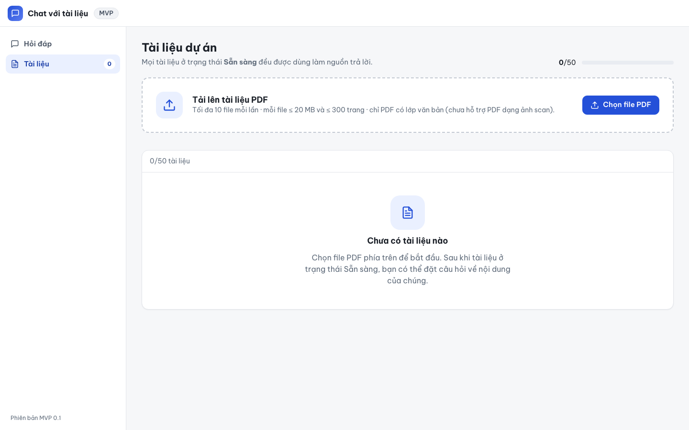
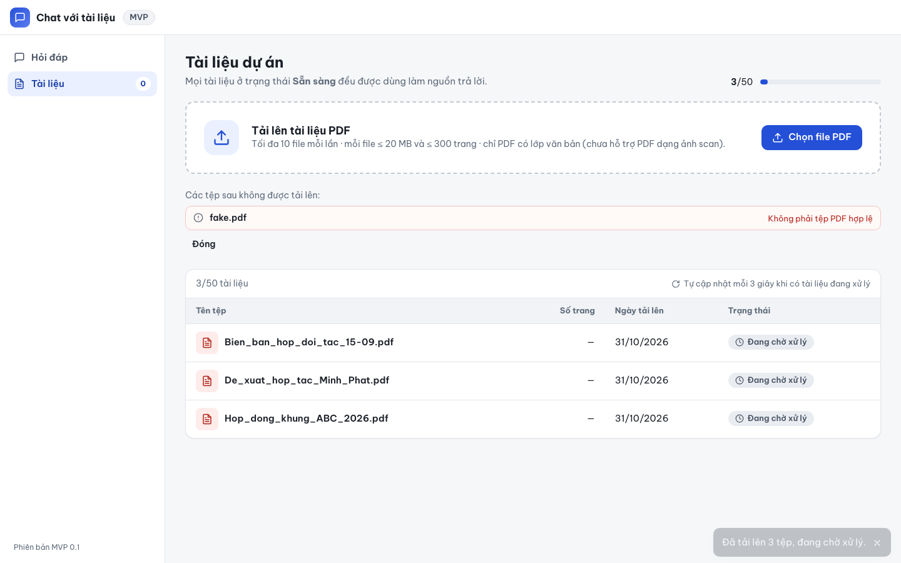
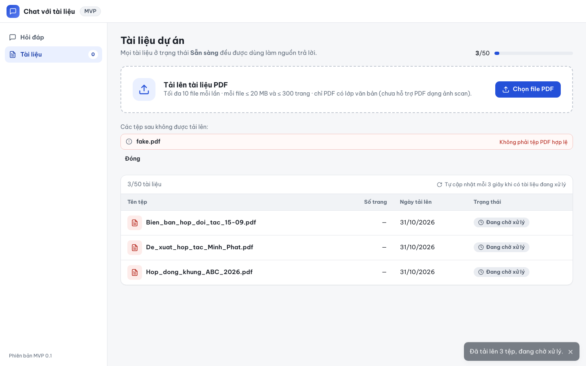
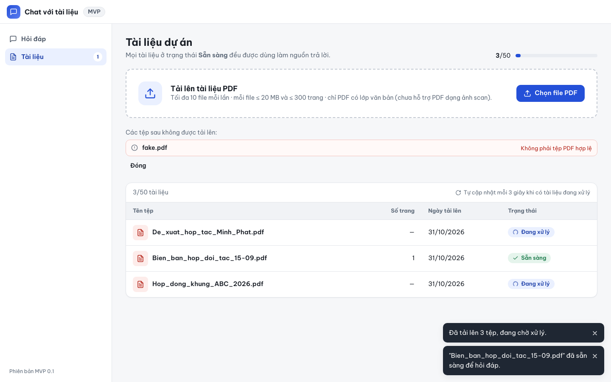
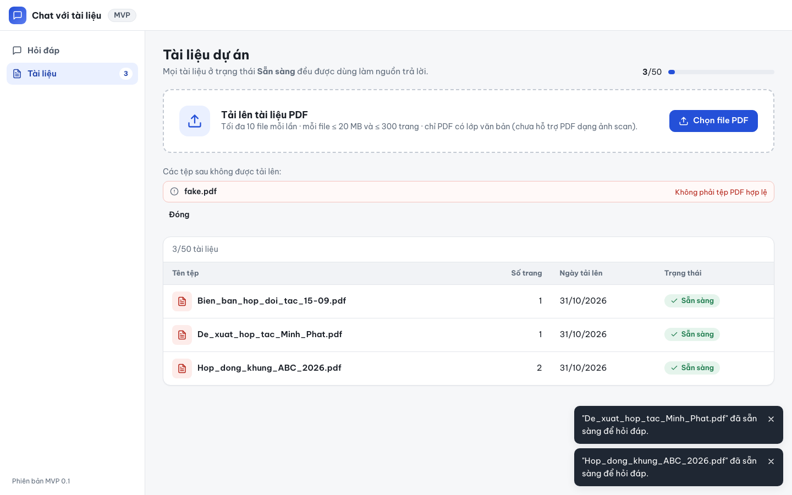

# Báo cáo kiểm thử — E2E-001: Tải lên PDF và theo dõi trạng thái tới Sẵn sàng

| Mục | Giá trị |
|---|---|
| Test case | [E2E-001](../../docs/07-verification/test_cases/E2E-001.md) |
| Kết luận | **✅ Đạt** |
| Thời gian chạy | 2026-10-31 22:16:31 → 22:16:44 (UTC+7) |
| Người / agent thực hiện | Claude Code (agent), script Playwright tự động |
| Commit | `2766492 (có thay đổi chưa commit)` |
| Môi trường | localhost · web http://localhost:5173 · API http://localhost:8000 · Darwin 27.0.0 arm64 · Docker 29.6.2 · ANTHROPIC_API_KEY: không |
| Script | [E2E-001.mjs](E2E-001.mjs) |

## Kết quả từng bước

| # | Thao tác | Kết quả mong đợi | Kết quả thực tế | Đạt? | Bằng chứng |
|---|---|---|---|---|---|
| 1 | Mở /documents | Tiêu đề "Tài liệu dự án"; "Chưa có tài liệu nào"; "0/50 tài liệu" | Có tiêu đề và trạng thái trống; "0/50 tài liệu" xuất hiện 1 lần | ✅ | [ảnh](screenshots/01-buoc-1-mo-documents.png) |
| 2 | Chọn 3 PDF mẫu + fake.pdf | fake.pdf bị từ chối "Không phải tệp PDF hợp lệ"; nút "Đang tải lên…" khi gửi | fake.pdf: "Không phải tệp PDF hợp lệ"; trạng thái "Đang tải lên…" đã hiển thị | ✅ | [ảnh](screenshots/02-buoc-2-chon-3-pdf-mau-fake-pdf.png) |
| 3 | Chờ phản hồi tải lên | Thông báo "Đã tải lên 3 tệp, đang chờ xử lý."; bảng 3 dòng; ghi chú tự cập nhật | Toast "Đã tải lên 3 tệp…" hiện; 3 dòng; trạng thái: Đang chờ xử lý, Đang chờ xử lý, Đang chờ xử lý; ghi chú tự cập nhật: có | ✅ | [ảnh](screenshots/03-buoc-3-cho-phan-hoi-tai-len.png) |
| 4 | Không tải lại trang, chờ tới khi cả 3 Sẵn sàng (≤ 5 phút) | Mỗi dòng chuyển "Sẵn sàng"; mỗi tài liệu có toast "<tên>" đã sẵn sàng để hỏi đáp. | 3/3 dòng Sẵn sàng; toast sẵn sàng cho 3/3 tệp (Bien_ban_hop_doi_tac_15-09.pdf, De_xuat_hop_tac_Minh_Phat.pdf, Hop_dong_khung_ABC_2026.pdf) | ✅ | [ảnh](screenshots/05-buoc-4-khong-tai-lai-trang-cho-toi-khi-ca-3-san-sang-5-phut.png) |
| 5 | Kiểm tra bảng và sidebar | Cột Tên tệp/Số trang/Ngày tải lên/Trạng thái; ngày dd/mm/yyyy; sidebar 3 (title "3 tài liệu Sẵn sàng"); không tải lại trang | Cột: Tên tệp / Số trang / Ngày tải lên / Trạng thái; ngày: 31/10/2026, 31/10/2026, 31/10/2026; sidebar "3" (title "3 tài liệu Sẵn sàng"); số lần tải trang (load): 1 | ✅ | [ảnh](screenshots/06-buoc-5-kiem-tra-bang-va-sidebar.png) |

## Bằng chứng

- Video: [video.webm](video.webm)
- Log: [logs/checks.json](logs/checks.json), [logs/browser-console.log](logs/browser-console.log), [logs/setup.log](logs/setup.log)
- Ảnh:

  

  

  

  

  

  

## Lỗi phát hiện

Không có.

## Ghi chú và sai lệch so với test case

Không có.
