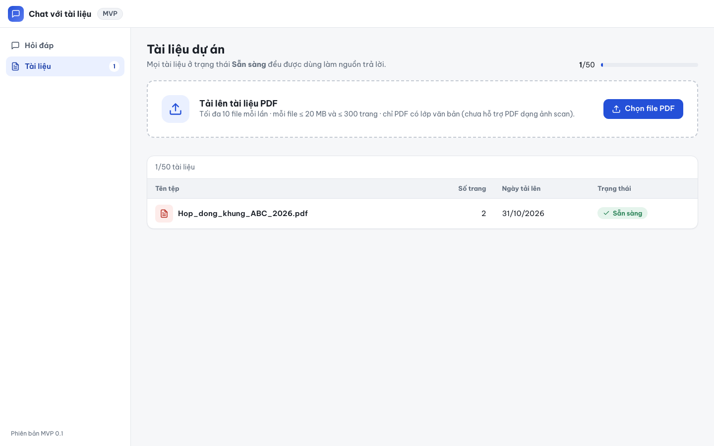
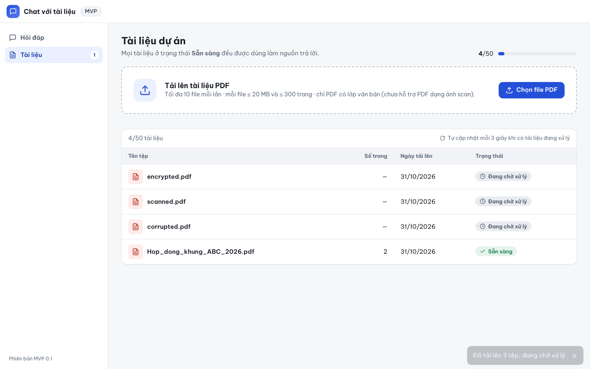
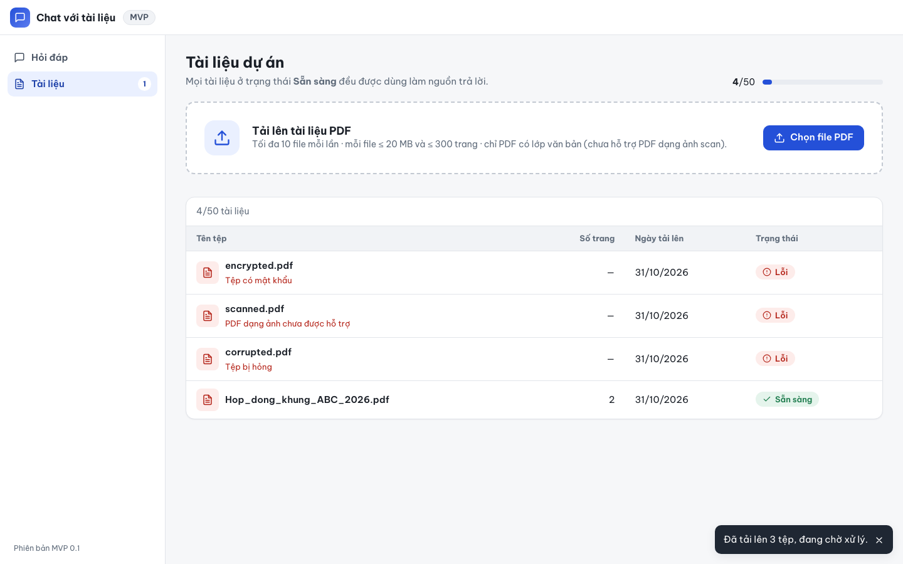

# Báo cáo kiểm thử — E2E-002: Tệp lỗi sau xử lý hiển thị đúng lý do

| Mục | Giá trị |
|---|---|
| Test case | [E2E-002](../../docs/07-verification/test_cases/E2E-002.md) |
| Kết luận | **✅ Đạt** |
| Thời gian chạy | 2026-10-31 22:18:39 → 22:18:50 (UTC+7) |
| Người / agent thực hiện | Claude Code (agent), script Playwright tự động |
| Commit | `2766492 (có thay đổi chưa commit)` |
| Môi trường | localhost · web http://localhost:5173 · API http://localhost:8000 · Darwin 27.0.0 arm64 · Docker 29.6.2 · ANTHROPIC_API_KEY: không |
| Script | [E2E-002.mjs](E2E-002.mjs) |

## Kết quả từng bước

| # | Thao tác | Kết quả mong đợi | Kết quả thực tế | Đạt? | Bằng chứng |
|---|---|---|---|---|---|
| 1 | Mở /documents | 1 dòng "Sẵn sàng" | 1 dòng: Hop_dong_khung_ABC_2026.pdf 2 31/10/2026 Sẵn sàng | ✅ | [ảnh](screenshots/01-buoc-1-mo-documents.png) |
| 2 | Tải lên encrypted.pdf, scanned.pdf, corrupted.pdf | 3 dòng mới ở trạng thái đang chờ / đang xử lý | 4 dòng; encrypted.pdf: Đang chờ xử lý; scanned.pdf: Đang chờ xử lý; corrupted.pdf: Đang chờ xử lý | ✅ | [ảnh](screenshots/02-buoc-2-tai-len-encrypted-pdf-scanned-pdf-corrupted-pdf.png) |
| 3 | Chờ tới khi không còn tài liệu đang xử lý | encrypted → Lỗi + "Tệp có mật khẩu"; scanned → Lỗi + "PDF dạng ảnh chưa được hỗ trợ"; corrupted → Lỗi + "Tệp bị hỏng" | encrypted.pdf: Lỗi – "Tệp có mật khẩu"; scanned.pdf: Lỗi – "PDF dạng ảnh chưa được hỗ trợ"; corrupted.pdf: Lỗi – "Tệp bị hỏng" | ✅ | [ảnh](screenshots/03-buoc-3-cho-toi-khi-khong-con-tai-lieu-dang-xu-ly.png) |
| 4 | Kiểm tra tài liệu Sẵn sàng ban đầu | Hop_dong_khung_ABC_2026.pdf vẫn "Sẵn sàng"; sidebar vẫn 1 | ABC: Sẵn sàng; sidebar "1" | ✅ | [ảnh](screenshots/04-buoc-4-kiem-tra-tai-lieu-san-sang-ban-dau.png) |

## Bằng chứng

- Video: [video.webm](video.webm)
- Log: [logs/checks.json](logs/checks.json), [logs/browser-console.log](logs/browser-console.log), [logs/setup.log](logs/setup.log)
- Ảnh:

  

  

  

  

## Lỗi phát hiện

Không có.

## Ghi chú và sai lệch so với test case

Không có.
