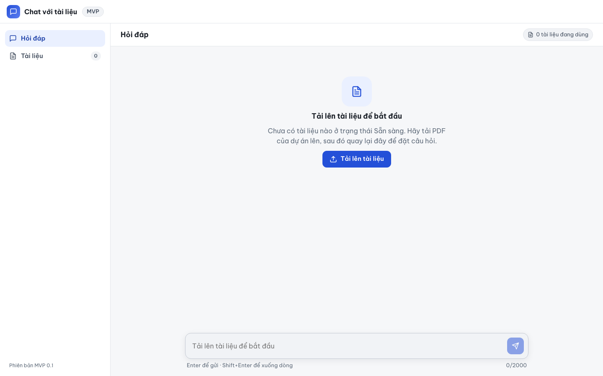

# Báo cáo kiểm thử — E2E-004: Chưa có tài liệu Sẵn sàng: khóa ô hỏi

| Mục | Giá trị |
|---|---|
| Test case | [E2E-004](../../docs/07-verification/test_cases/E2E-004.md) |
| Kết luận | **✅ Đạt** |
| Thời gian chạy | 2026-10-31 22:18:55 → 22:18:57 (UTC+7) |
| Người / agent thực hiện | Claude Code (agent), script Playwright tự động |
| Commit | `2766492 (có thay đổi chưa commit)` |
| Môi trường | localhost · web http://localhost:5173 · API http://localhost:8000 · Darwin 27.0.0 arm64 · Docker 29.6.2 · ANTHROPIC_API_KEY: không |
| Script | [E2E-004.mjs](E2E-004.mjs) |

## Kết quả từng bước

| # | Thao tác | Kết quả mong đợi | Kết quả thực tế | Đạt? | Bằng chứng |
|---|---|---|---|---|---|
| 1 | Mở http://localhost:5173/ | Tự chuyển tới /ask | URL: http://localhost:5173/ask | ✅ | [ảnh](screenshots/01-buoc-1-mo-http-localhost-5173.png) |
| 2 | Quan sát vùng hỏi đáp | "Tải lên tài liệu để bắt đầu" + "Chưa có tài liệu nào ở trạng thái Sẵn sàng…"; ô nhập và nút "Gửi câu hỏi" bị vô hiệu | Tiêu đề khóa: có; textarea disabled=true, placeholder="Tải lên tài liệu để bắt đầu"; nút Gửi disabled=true | ✅ | [ảnh](screenshots/02-buoc-2-quan-sat-vung-hoi-dap.png) |
| 3 | Bấm "Tải lên tài liệu" | Chuyển tới /documents | URL: http://localhost:5173/documents | ✅ | [ảnh](screenshots/03-buoc-3-bam-tai-len-tai-lieu.png) |

## Bằng chứng

- Video: [video.webm](video.webm)
- Log: [logs/checks.json](logs/checks.json), [logs/browser-console.log](logs/browser-console.log), [logs/setup.log](logs/setup.log)
- Ảnh:

  

  

  

## Lỗi phát hiện

Không có.

## Ghi chú và sai lệch so với test case

Không có.
