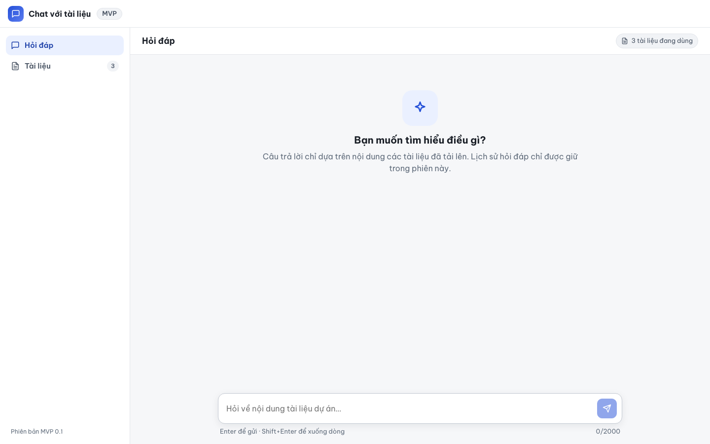
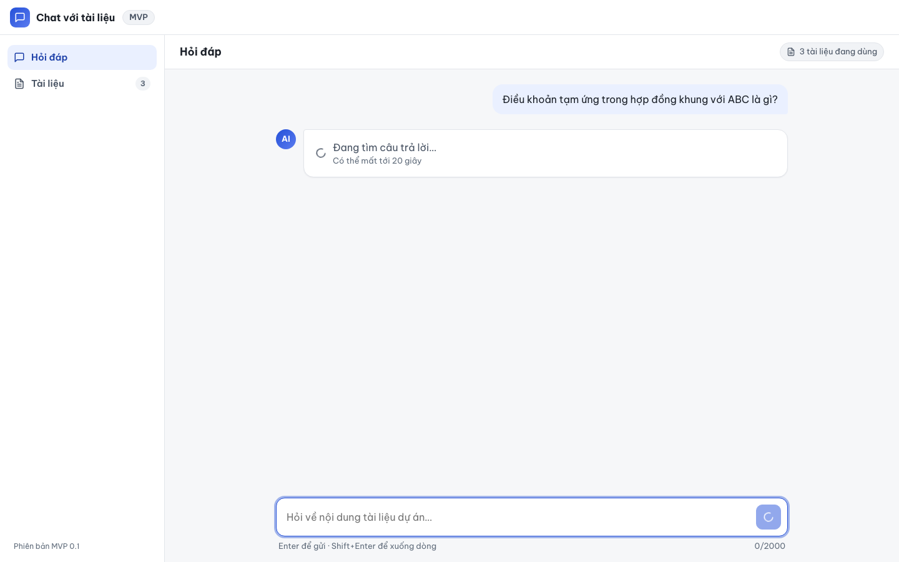
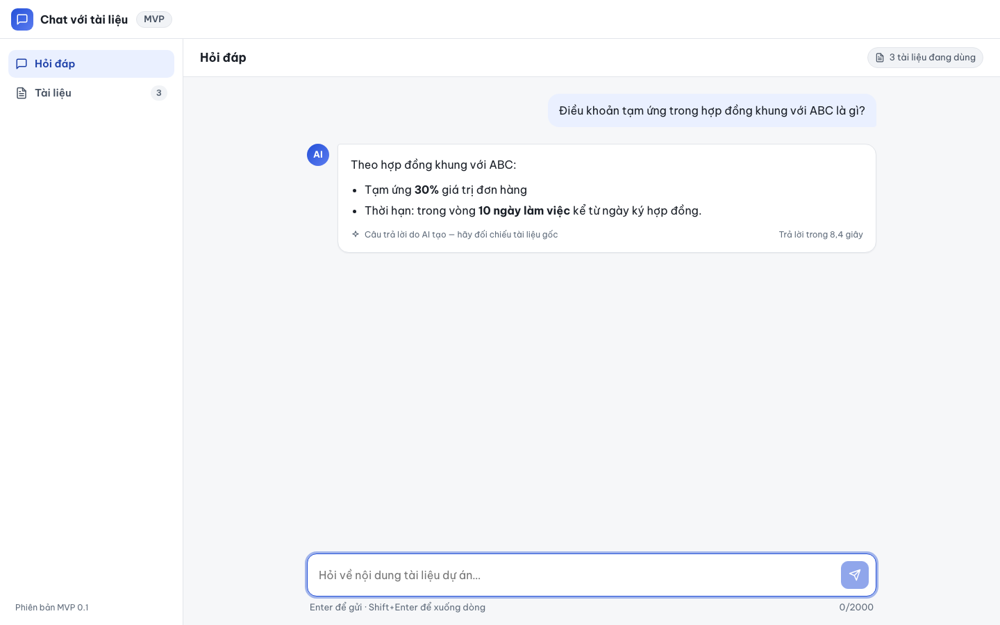

# Báo cáo kiểm thử — E2E-005: Hỏi và nhận câu trả lời

| Mục | Giá trị |
|---|---|
| Test case | [E2E-005](../../docs/07-verification/test_cases/E2E-005.md) |
| Kết luận | **✅ Đạt** |
| Thời gian chạy | 2026-10-31 22:20:27 → 22:20:43 (UTC+7) |
| Người / agent thực hiện | Claude Code (agent), script Playwright tự động |
| Commit | `2766492 (có thay đổi chưa commit)` |
| Môi trường | localhost · web http://localhost:5173 · API http://localhost:8000 · Darwin 27.0.0 arm64 · Docker 29.6.2 · ANTHROPIC_API_KEY: không |
| Script | [E2E-005.mjs](E2E-005.mjs) |

## Kết quả từng bước

| # | Thao tác | Kết quả mong đợi | Kết quả thực tế | Đạt? | Bằng chứng |
|---|---|---|---|---|---|
| 1 | Mở /ask | Sidebar 3 tài liệu Sẵn sàng; "Bạn muốn tìm hiểu điều gì?"; ô nhập dùng được | Sidebar "3"; lời chào hiển thị; textarea enabled=true | ✅ | [ảnh](screenshots/01-buoc-1-mo-ask.png) |
| 2 | Nhập "Điều khoản tạm ứng trong hợp đồng khung với ABC là gì?" và nhấn Enter | Bong bóng câu hỏi; "Đang tìm câu trả lời…" và "Có thể mất tới 20 giây" | Bong bóng: "Điều khoản tạm ứng trong hợp đồng khung với ABC là gì?"; trạng thái chờ: "Đang tìm câu trả lời… Có thể mất tới 20 giây" | ✅ | [ảnh](screenshots/02-buoc-2-nhap-dieu-khoan-tam-ung-trong-hop-dong-khung-voi-abc-.png) |
| 3 | Chờ câu trả lời (tối đa 60 s) | Câu trả lời Markdown nêu tạm ứng 30%; nhãn "Câu trả lời do AI tạo — hãy đối chiếu tài liệu gốc"; "Trả lời trong N giây" | In đậm: 30%, 10 ngày làm việc; 2 mục danh sách; chân: "Câu trả lời do AI tạo — hãy đối chiếu tài liệu gốc Trả lời trong 8,4 giây"; số request /ask (giả lập): 1 | ✅ | [ảnh](screenshots/03-buoc-3-cho-cau-tra-loi-toi-da-60-s.png) |

## Bằng chứng

- Video: [video.webm](video.webm)
- Log: [logs/checks.json](logs/checks.json), [logs/browser-console.log](logs/browser-console.log), [logs/setup.log](logs/setup.log)
- Ảnh:

  

  

  

## Lỗi phát hiện

Không có.

## Ghi chú và sai lệch so với test case

- Không có ANTHROPIC_API_KEY trên máy chạy test: gọi thật `POST /api/v1/ask` trả `503 ai_unavailable`. Các bước 2–3 dùng **API giả lập** (page.route, trễ 3 s) theo điều kiện tiên quyết của test case; phần gọi Claude thật chưa được kiểm chứng (xem INT-022, EVAL-*).
