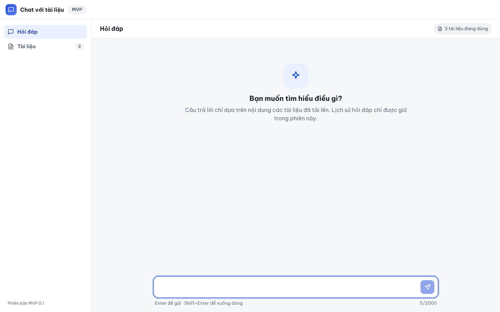
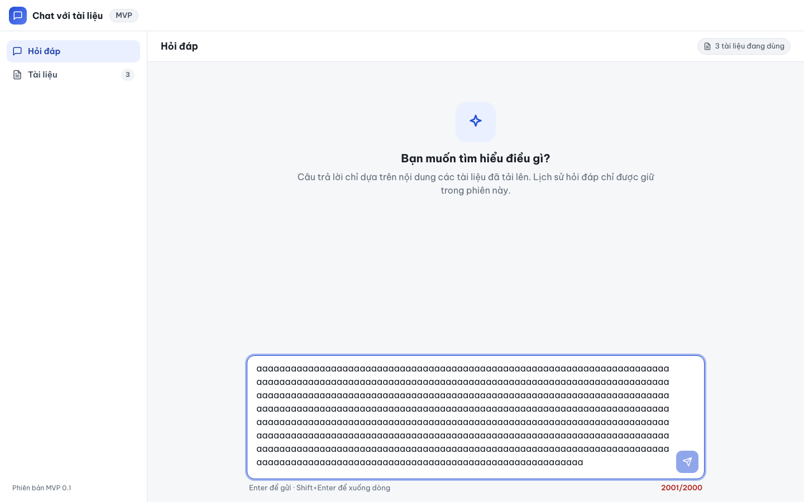
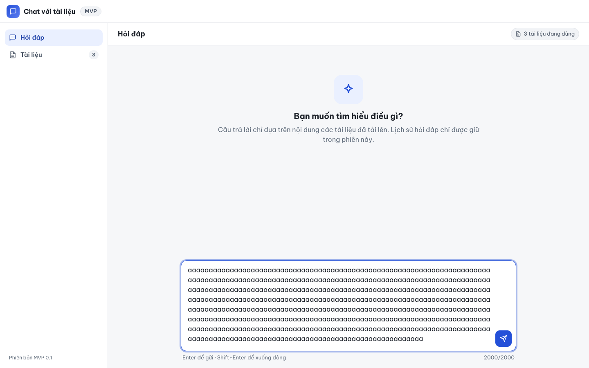
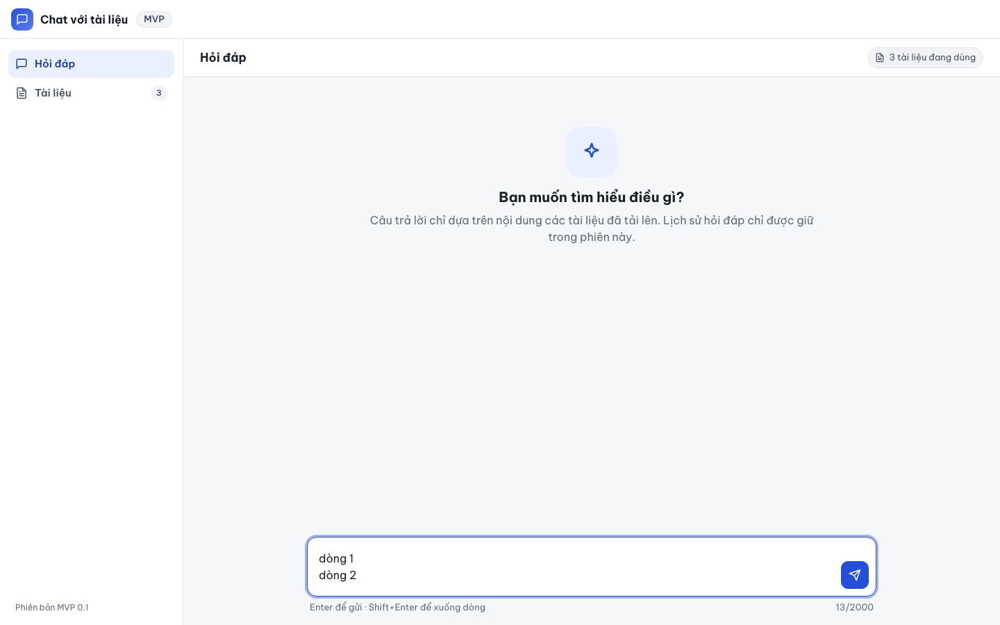
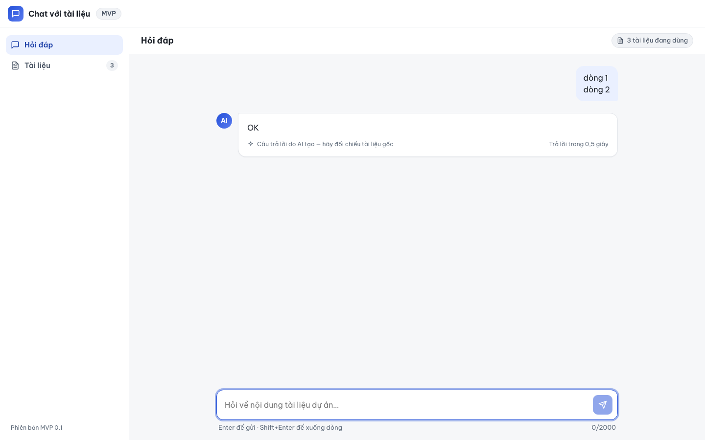

# Báo cáo kiểm thử — E2E-006: Kiểm tra ô nhập câu hỏi

| Mục | Giá trị |
|---|---|
| Test case | [E2E-006](../../docs/07-verification/test_cases/E2E-006.md) |
| Kết luận | **✅ Đạt** |
| Thời gian chạy | 2026-10-31 22:19:13 → 22:19:25 (UTC+7) |
| Người / agent thực hiện | Claude Code (agent), script Playwright tự động |
| Commit | `2766492 (có thay đổi chưa commit)` |
| Môi trường | localhost · web http://localhost:5173 · API http://localhost:8000 · Darwin 27.0.0 arm64 · Docker 29.6.2 · ANTHROPIC_API_KEY: không |
| Script | [E2E-006.mjs](E2E-006.mjs) |

## Kết quả từng bước

| # | Thao tác | Kết quả mong đợi | Kết quả thực tế | Đạt? | Bằng chứng |
|---|---|---|---|---|---|
| 1 | Mở /ask, nhập 5 dấu cách, nhấn Enter | Nút "Gửi câu hỏi" bị vô hiệu; Enter không tạo request | Nút Gửi disabled=true; số request: 0 | ✅ | [ảnh](screenshots/01-buoc-1-mo-ask-nhap-5-dau-cach-nhan-enter.png) |
| 2 | Dán 2001 ký tự | Bộ đếm "2001/2000"; thông báo "Câu hỏi dài quá 1 ký tự."; nút Gửi bị vô hiệu | Bộ đếm "2001/2000" (class "over", title "Câu hỏi dài quá 1 ký tự."); thông báo hiển thị trên màn hình: không (chỉ tooltip); aria-invalid=true; nút Gửi disabled=true | ✅ | [ảnh](screenshots/02-buoc-2-dan-2001-ky-tu.png) |
| 3 | Xóa 1 ký tự (còn 2000) | Bộ đếm "2000/2000"; nút Gửi dùng được | Bộ đếm "2000/2000"; nút Gửi enabled=true | ✅ | [ảnh](screenshots/03-buoc-3-xoa-1-ky-tu-con-2000.png) |
| 4 | Xóa hết, gõ "dòng 1", Shift+Enter, gõ "dòng 2" | Ô nhập có 2 dòng; không có request /api/v1/ask | Giá trị: "dòng 1\ndòng 2"; số request: 0 | ✅ | [ảnh](screenshots/04-buoc-4-xoa-het-go-dong-1-shift-enter-go-dong-2.png) |
| 5 | Nhấn Enter | Đúng 1 request /api/v1/ask với question chứa xuống dòng | Số request: 1; question gửi đi: "dòng 1\ndòng 2" | ✅ | [ảnh](screenshots/05-buoc-5-nhan-enter.png) |

## Bằng chứng

- Video: [video.webm](video.webm)
- Log: [logs/checks.json](logs/checks.json), [logs/browser-console.log](logs/browser-console.log), [logs/setup.log](logs/setup.log)
- Ảnh:

  

  

  

  

  

## Lỗi phát hiện

Không có.

## Ghi chú và sai lệch so với test case

- `/api/v1/ask` được giả lập (page.route) để đếm request, không gọi Claude.
- Bước 2: thông báo "Câu hỏi dài quá 1 ký tự." chỉ nằm trong thuộc tính `title` (tooltip) của bộ đếm, không hiển thị trên màn hình. T-021 không bắt buộc hiển thị thông báo này nên bước vẫn tính Đạt; đề xuất (Minor/UX) hiển thị thông báo trực tiếp.
