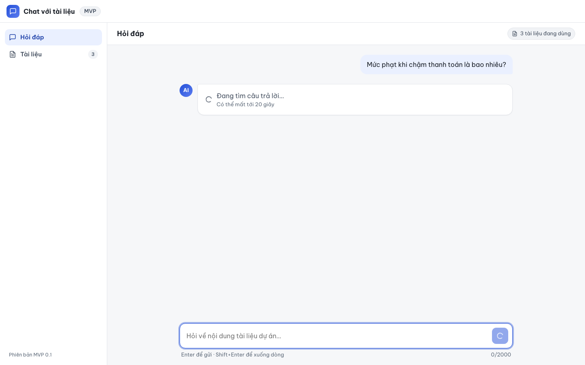
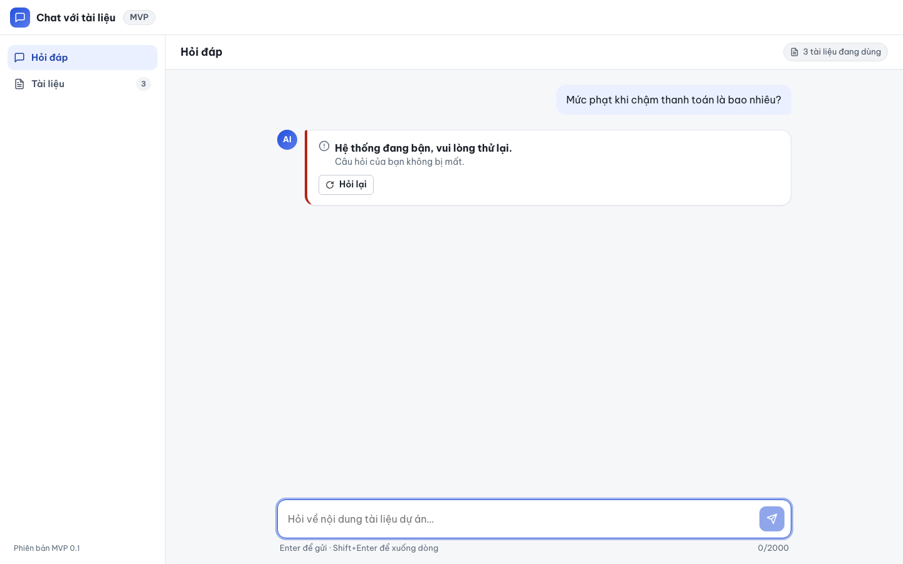
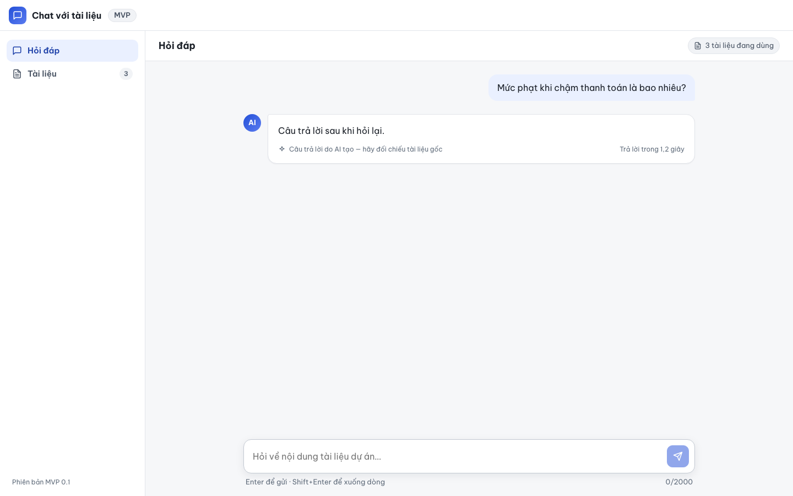
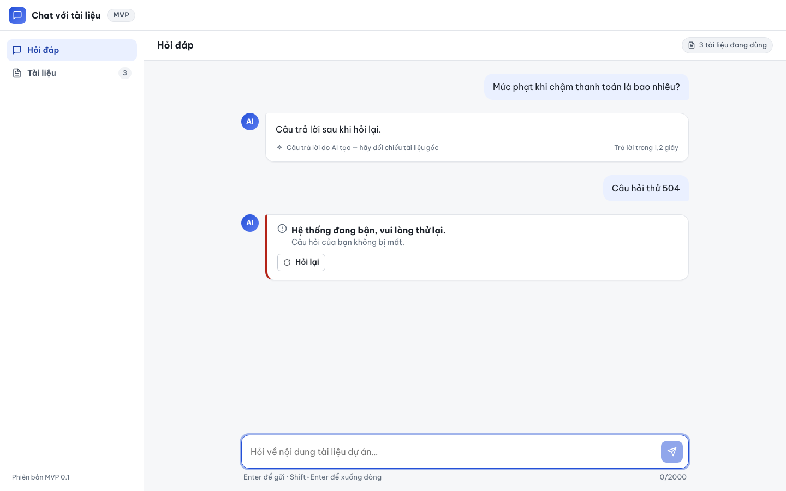

# Báo cáo kiểm thử — E2E-007: Lỗi AI và nút Hỏi lại

| Mục | Giá trị |
|---|---|
| Test case | [E2E-007](../../docs/07-verification/test_cases/E2E-007.md) |
| Kết luận | **✅ Đạt** |
| Thời gian chạy | 2026-10-31 22:19:25 → 22:19:39 (UTC+7) |
| Người / agent thực hiện | Claude Code (agent), script Playwright tự động |
| Commit | `2766492 (có thay đổi chưa commit)` |
| Môi trường | localhost · web http://localhost:5173 · API http://localhost:8000 · Darwin 27.0.0 arm64 · Docker 29.6.2 · ANTHROPIC_API_KEY: không |
| Script | [E2E-007.mjs](E2E-007.mjs) |

## Kết quả từng bước

| # | Thao tác | Kết quả mong đợi | Kết quả thực tế | Đạt? | Bằng chứng |
|---|---|---|---|---|---|
| 1 | Mở /ask, gửi "Mức phạt khi chậm thanh toán là bao nhiêu?" | Spinner "Đang tìm câu trả lời…" | Spinner "Đang tìm câu trả lời…" hiển thị | ✅ | [ảnh](screenshots/01-buoc-1-mo-ask-gui-muc-phat-khi-cham-thanh-toan-la-bao-nhieu.png) |
| 2 | Quan sát phản hồi lỗi | "Hệ thống đang bận, vui lòng thử lại." + "Câu hỏi của bạn không bị mất."; nút "Hỏi lại"; không có chữ kỹ thuật | Nội dung: "Hệ thống đang bận, vui lòng thử lại. Câu hỏi của bạn không bị mất. Hỏi lại"; nút Hỏi lại: 1; chữ kỹ thuật: không | ✅ | [ảnh](screenshots/02-buoc-2-quan-sat-phan-hoi-loi.png) |
| 3 | Bấm "Hỏi lại" | Hiện "Câu trả lời sau khi hỏi lại." kèm nhãn AI; tổng 2 request | Câu trả lời: "Câu trả lời sau khi hỏi lại."; nhãn AI: 1; số request: 2; khối lỗi còn lại: 0; câu hỏi gửi lại: "Mức phạt khi chậm thanh toán là bao nhiêu?" | ✅ | [ảnh](screenshots/03-buoc-3-bam-hoi-lai.png) |
| 4 | (Ghi nhận) Giả lập 504 HTML như Nginx timeout | Ghi lại thông điệp và việc có nút Hỏi lại (không tính đạt / không đạt) — RISK-008 | "Hệ thống đang bận, vui lòng thử lại. Câu hỏi của bạn không bị mất. Hỏi lại"; nút Hỏi lại: có | ✅ | [ảnh](screenshots/04-buoc-4-ghi-nhan-gia-lap-504-html-nhu-nginx-timeout.png) |

## Bằng chứng

- Video: [video.webm](video.webm)
- Log: [logs/checks.json](logs/checks.json), [logs/browser-console.log](logs/browser-console.log), [logs/setup.log](logs/setup.log)
- Ảnh:

  

  

  

  

## Lỗi phát hiện

Không có.

## Ghi chú và sai lệch so với test case

- `/api/v1/ask` được giả lập: lần 1 trả 503 `ai_unavailable` (problem+json), lần 2 trả 200; bước 4 trả 504 HTML giống Nginx timeout.
- Bước 4 (ghi nhận RISK-008): với 504 HTML, giao diện hiện "Hệ thống đang bận, vui lòng thử lại. Câu hỏi của bạn không bị mất. Hỏi lại", nút Hỏi lại: có.
