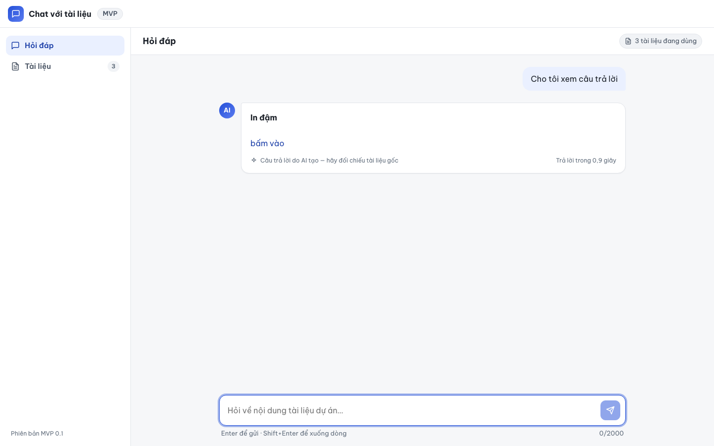
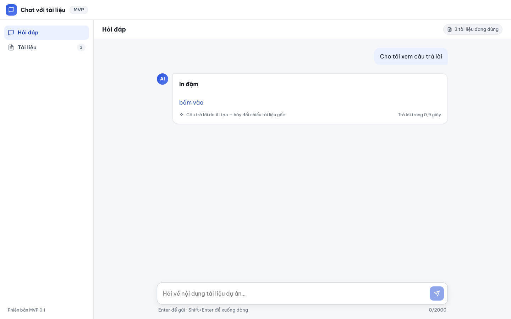

# Báo cáo kiểm thử — E2E-008: XSS trong câu trả lời không được thực thi

| Mục | Giá trị |
|---|---|
| Test case | [E2E-008](../../docs/07-verification/test_cases/E2E-008.md) |
| Kết luận | **✅ Đạt** |
| Thời gian chạy | 2026-10-31 22:19:39 → 22:19:53 (UTC+7) |
| Người / agent thực hiện | Claude Code (agent), script Playwright tự động |
| Commit | `2766492 (có thay đổi chưa commit)` |
| Môi trường | localhost · web http://localhost:5173 · API http://localhost:8000 · Darwin 27.0.0 arm64 · Docker 29.6.2 · ANTHROPIC_API_KEY: không |
| Script | [E2E-008.mjs](E2E-008.mjs) |

## Kết quả từng bước

| # | Thao tác | Kết quả mong đợi | Kết quả thực tế | Đạt? | Bằng chứng |
|---|---|---|---|---|---|
| 1 | Mở /ask và gửi một câu hỏi bất kỳ | Câu trả lời giả lập hiển thị; "In đậm" được in đậm | Câu trả lời hiển thị; <strong>: In đậm | ✅ | [ảnh](screenshots/01-buoc-1-mo-ask-va-gui-mot-cau-hoi-bat-ky.png) |
| 2 | Kiểm tra hộp thoại | Không có dialog nào | Số dialog: 0 | ✅ | [ảnh](screenshots/02-buoc-2-kiem-tra-hop-thoai.png) |
| 3 | Kiểm tra DOM vùng câu trả lời | Không có \n\n[bấm vào](javascript:alert('xss-link'))`.
