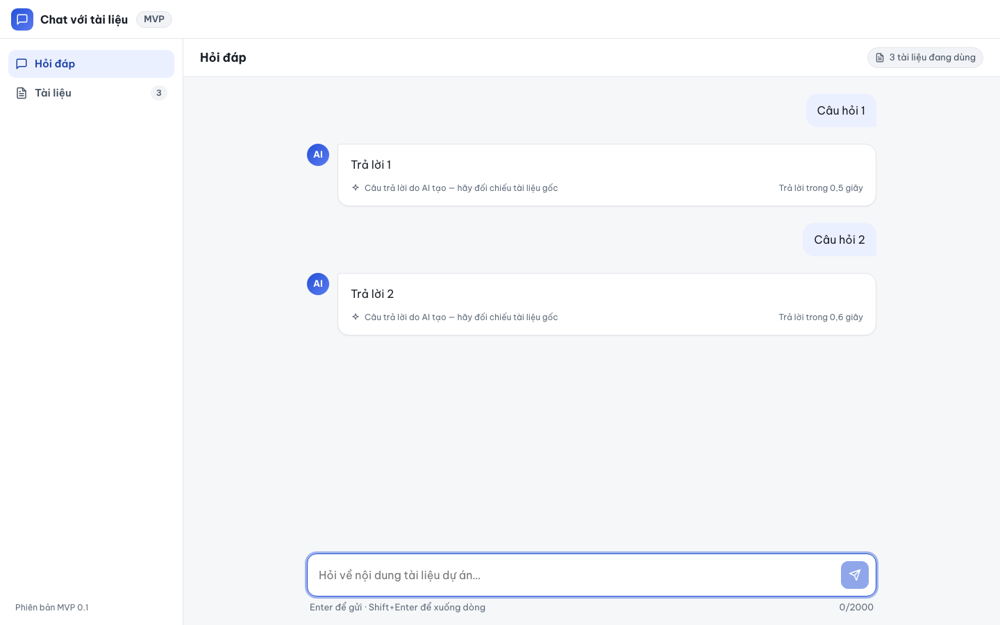

# Báo cáo kiểm thử — E2E-009: Lịch sử hỏi đáp chỉ giữ trong trang

| Mục | Giá trị |
|---|---|
| Test case | [E2E-009](../../docs/07-verification/test_cases/E2E-009.md) |
| Kết luận | **✅ Đạt** |
| Thời gian chạy | 2026-10-31 22:19:53 → 22:20:04 (UTC+7) |
| Người / agent thực hiện | Claude Code (agent), script Playwright tự động |
| Commit | `2766492 (có thay đổi chưa commit)` |
| Môi trường | localhost · web http://localhost:5173 · API http://localhost:8000 · Darwin 27.0.0 arm64 · Docker 29.6.2 · ANTHROPIC_API_KEY: không |
| Script | [E2E-009.mjs](E2E-009.mjs) |

## Kết quả từng bước

| # | Thao tác | Kết quả mong đợi | Kết quả thực tế | Đạt? | Bằng chứng |
|---|---|---|---|---|---|
| 1 | Gửi "Câu hỏi 1" rồi "Câu hỏi 2" | Hiển thị 2 cặp theo thứ tự Câu hỏi 1 → Trả lời 1 → Câu hỏi 2 → Trả lời 2 | Thứ tự: Câu hỏi 1 → Trả lời 1 → Câu hỏi 2 → Trả lời 2 | ✅ | [ảnh](screenshots/01-buoc-1-gui-cau-hoi-1-roi-cau-hoi-2.png) |
| 2 | Tải lại trang | Không còn cặp hỏi–đáp; hiện "Bạn muốn tìm hiểu điều gì?" | Số bong bóng câu hỏi còn lại: 0; lời chào hiển thị | ✅ | [ảnh](screenshots/02-buoc-2-tai-lai-trang.png) |

## Bằng chứng

- Video: [video.webm](video.webm)
- Log: [logs/checks.json](logs/checks.json), [logs/browser-console.log](logs/browser-console.log), [logs/setup.log](logs/setup.log)
- Ảnh:

  

  

## Lỗi phát hiện

Không có.

## Ghi chú và sai lệch so với test case

- `/api/v1/ask` được giả lập trả lần lượt "Trả lời 1", "Trả lời 2".
