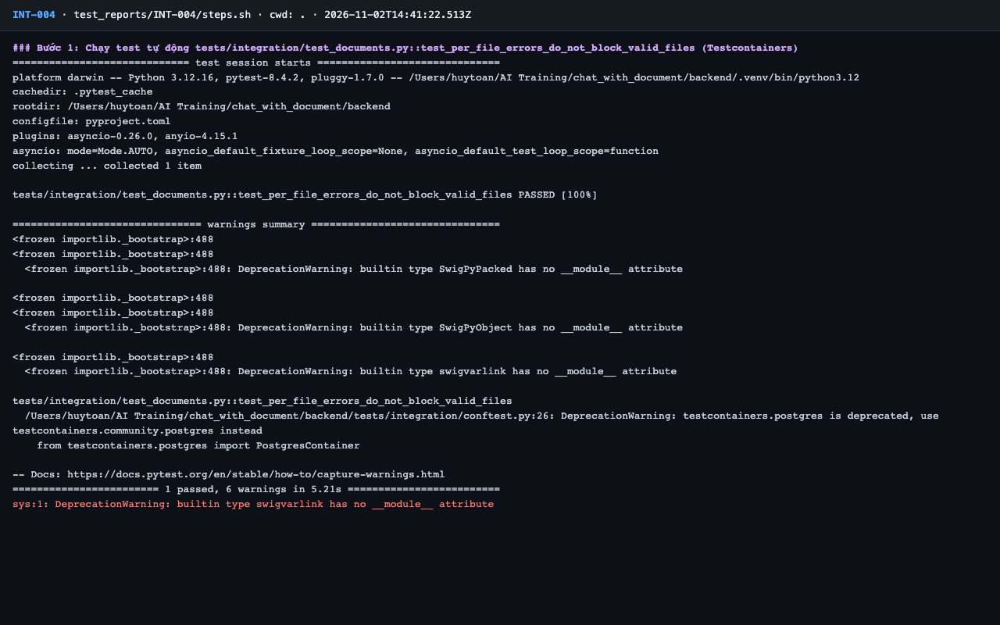
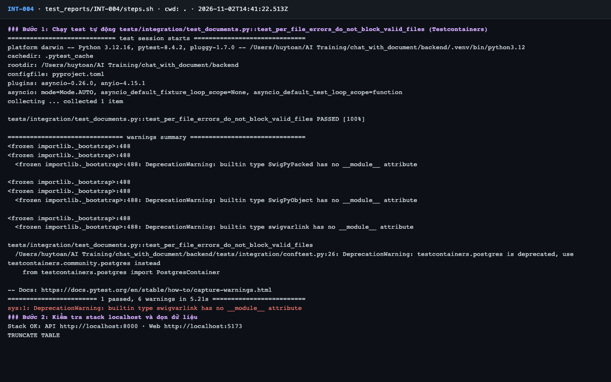
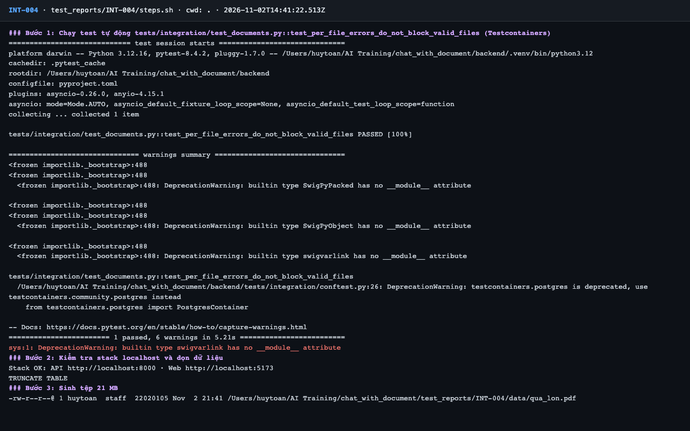
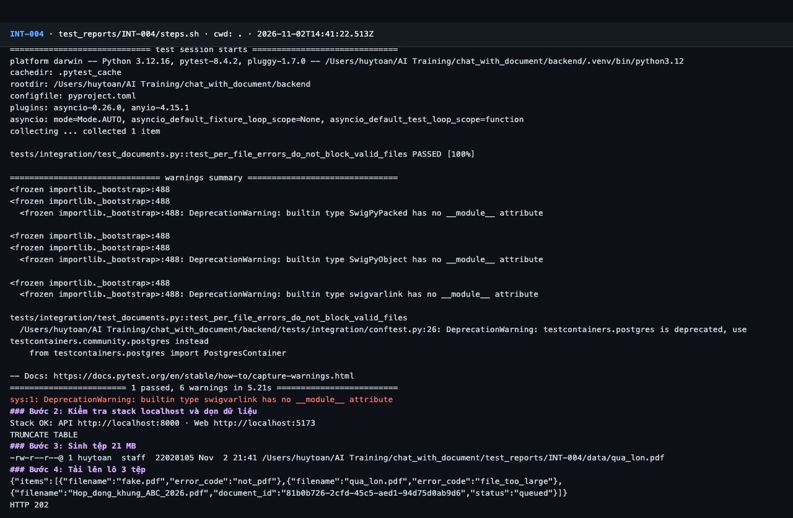
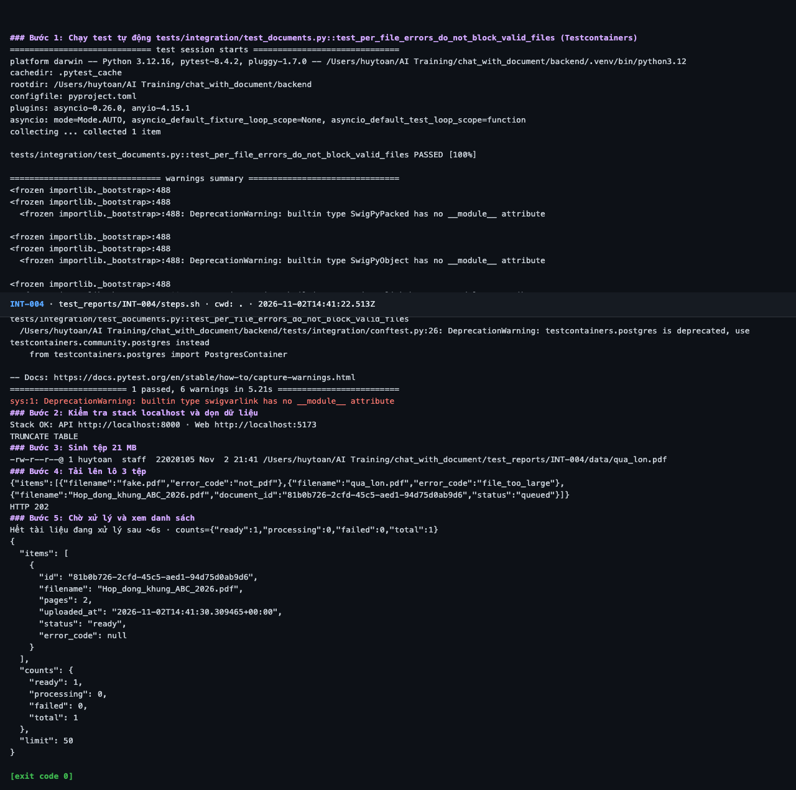

# Báo cáo kiểm thử — INT-004: Lô trộn: tệp lỗi không chặn tệp hợp lệ

| Mục | Giá trị |
|---|---|
| Test case | [INT-004](../../docs/07-verification/test_cases/INT-004.md) |
| Kết luận | **✅ Đạt** |
| Thời gian chạy | 2026-11-02 21:41:22 → 21:41:38 (UTC+7) |
| Người / agent thực hiện | Claude Code (agent), `frontend/e2e/run-cli.mjs` + `steps.sh` |
| Commit | `c02cc72 (có thay đổi chưa commit)` |
| Môi trường | localhost · web http://localhost:5173 · API http://localhost:8000 · Darwin 27.0.0 arm64 · Docker 29.6.2 · ANTHROPIC_API_KEY: không |
| Script | [steps.sh](steps.sh) |

## Kết quả từng bước

| # | Thao tác | Kết quả mong đợi | Kết quả thực tế | Đạt? | Bằng chứng |
|---|---|---|---|---|---|
| 1 | Chạy test tự động `tests/integration/test_documents.py::test_per_file_errors_do_not_block_valid_files` (Testcontainers) | passed, exit code 0 | pytest: `1 passed, 6 warnings in 5.21s` | ✅ | [ảnh](screenshots/01-buoc-1-chay-test-tu-dong-tests-integration-test-documents-py.png) |
| 2 | Kiểm tra stack localhost và dọn dữ liệu | `Stack OK`; lệnh TRUNCATE thành công | Stack OK; TRUNCATE TABLE | ✅ | [ảnh](screenshots/02-buoc-2-kiem-tra-stack-localhost-va-don-du-lieu.png) |
| 3 | Sinh tệp 21 MB | Tệp ~22 MB trong `data/` | `qua_lon.pdf` | ✅ | [ảnh](screenshots/03-buoc-3-sinh-tep-21-mb.png) |
| 4 | Tải lên lô 3 tệp | HTTP 202; `fake.pdf` → `error_code: not_pdf`; `qua_lon.pdf` → `file_too_large`; PDF mẫu → `status: queued` | `HTTP 202`; `"filename":"fake.pdf","error_code":"not_pdf"`; `"filename":"qua_lon.pdf","error_code":"file_too_large"`; `"filename":"Hop_dong_khung_ABC_2026.pdf","document_id":"81b0b726-2cfd-45c5-aed1-94d75d0ab9d6","status":"queued"` | ✅ | [ảnh](screenshots/04-buoc-4-tai-len-lo-3-tep.png) |
| 5 | Chờ xử lý và xem danh sách | Chỉ 1 tài liệu, trạng thái `ready` | Danh sách có 1 tài liệu, trạng thái ready: có | ✅ | [ảnh](screenshots/05-buoc-5-cho-xu-ly-va-xem-danh-sach-ket-thuc.png) |

## Bằng chứng

- Video: [video.webm](video.webm)
- Log: [logs/cleanup.log](logs/cleanup.log), [logs/run-meta.json](logs/run-meta.json), [logs/steps.log](logs/steps.log)
- Ảnh:

  

  

  

  

  

## Lỗi phát hiện

Không có.

## Ghi chú và sai lệch so với test case

Không có.
