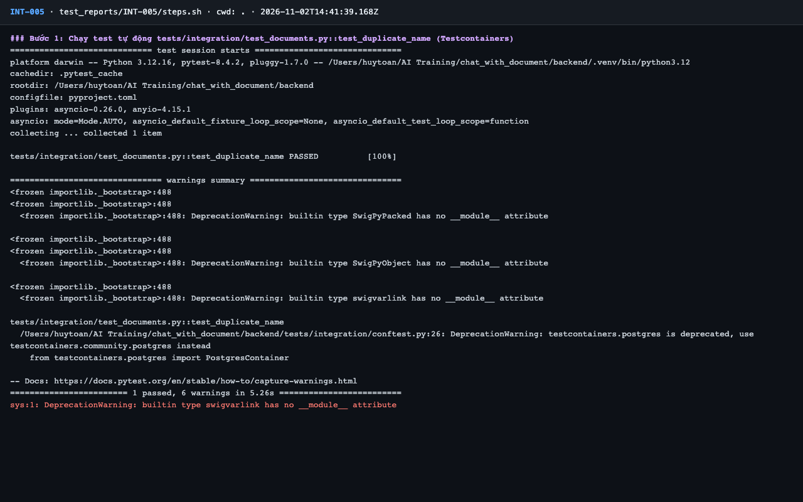
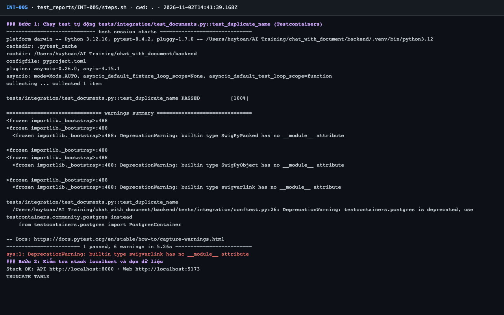
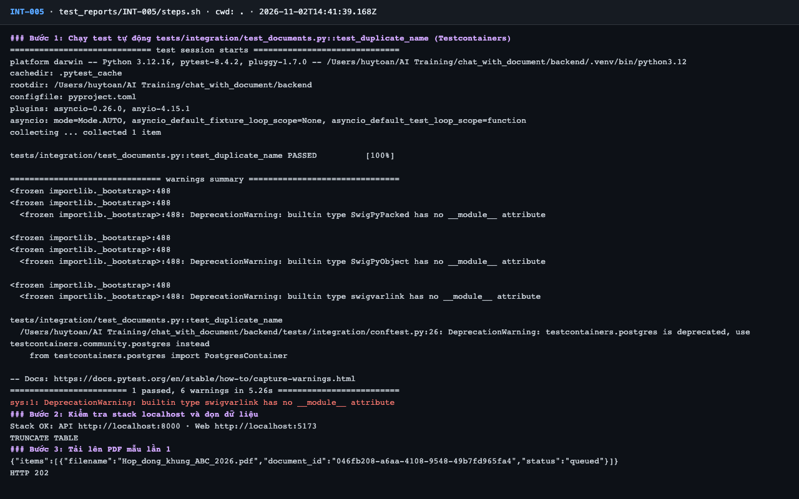
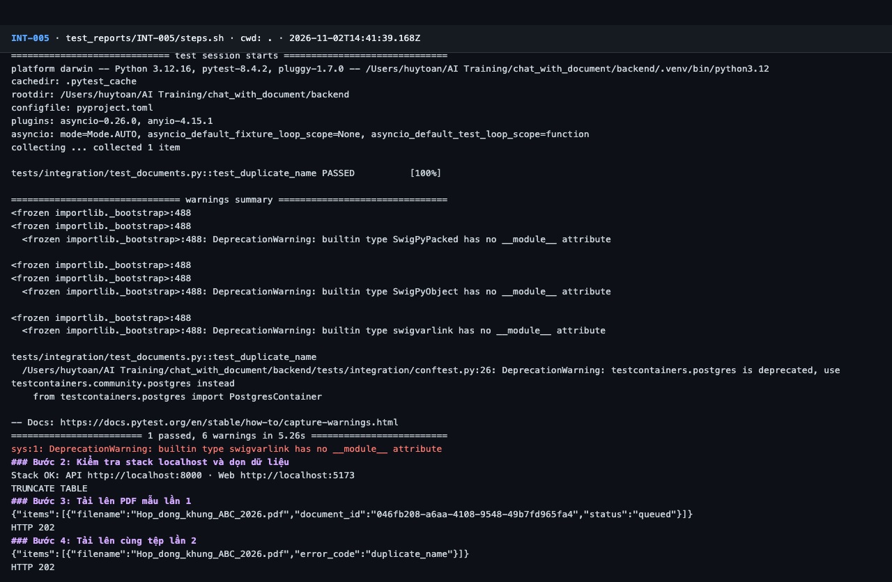
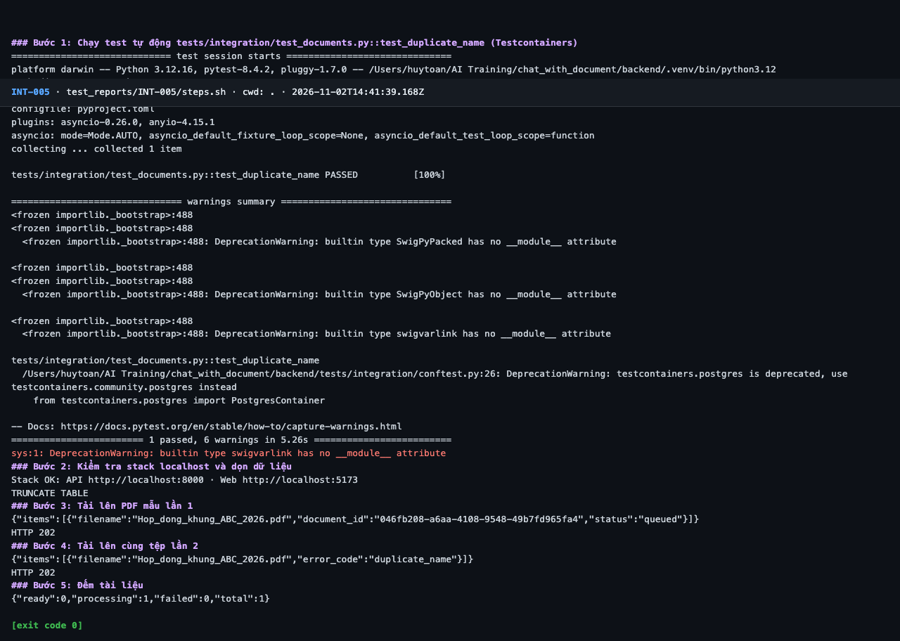

# Báo cáo kiểm thử — INT-005: Trùng tên tài liệu đã có

| Mục | Giá trị |
|---|---|
| Test case | [INT-005](../../docs/07-verification/test_cases/INT-005.md) |
| Kết luận | **✅ Đạt** |
| Thời gian chạy | 2026-11-02 21:41:38 → 21:41:48 (UTC+7) |
| Người / agent thực hiện | Claude Code (agent), `frontend/e2e/run-cli.mjs` + `steps.sh` |
| Commit | `c02cc72 (có thay đổi chưa commit)` |
| Môi trường | localhost · web http://localhost:5173 · API http://localhost:8000 · Darwin 27.0.0 arm64 · Docker 29.6.2 · ANTHROPIC_API_KEY: không |
| Script | [steps.sh](steps.sh) |

## Kết quả từng bước

| # | Thao tác | Kết quả mong đợi | Kết quả thực tế | Đạt? | Bằng chứng |
|---|---|---|---|---|---|
| 1 | Chạy test tự động `tests/integration/test_documents.py::test_duplicate_name` (Testcontainers) | passed, exit code 0 | pytest: `1 passed, 6 warnings in 5.26s` | ✅ | [ảnh](screenshots/01-buoc-1-chay-test-tu-dong-tests-integration-test-documents-py.png) |
| 2 | Kiểm tra stack localhost và dọn dữ liệu | `Stack OK`; lệnh TRUNCATE thành công | Stack OK; TRUNCATE TABLE | ✅ | [ảnh](screenshots/02-buoc-2-kiem-tra-stack-localhost-va-don-du-lieu.png) |
| 3 | Tải lên PDF mẫu lần 1 | HTTP 202, `status: queued` | HTTP 202; 1 item `queued` | ✅ | [ảnh](screenshots/03-buoc-3-tai-len-pdf-mau-lan-1.png) |
| 4 | Tải lên cùng tệp lần 2 | HTTP 202, item có `error_code: "duplicate_name"` | `HTTP 202`; `"error_code":"duplicate_name"` | ✅ | [ảnh](screenshots/04-buoc-4-tai-len-cung-tep-lan-2.png) |
| 5 | Đếm tài liệu | `total: 1` | `"total":1` | ✅ | [ảnh](screenshots/05-buoc-5-dem-tai-lieu-ket-thuc.png) |

## Bằng chứng

- Video: [video.webm](video.webm)
- Log: [logs/cleanup.log](logs/cleanup.log), [logs/run-meta.json](logs/run-meta.json), [logs/steps.log](logs/steps.log)
- Ảnh:

  

  

  

  

  

## Lỗi phát hiện

Không có.

## Ghi chú và sai lệch so với test case

Không có.
