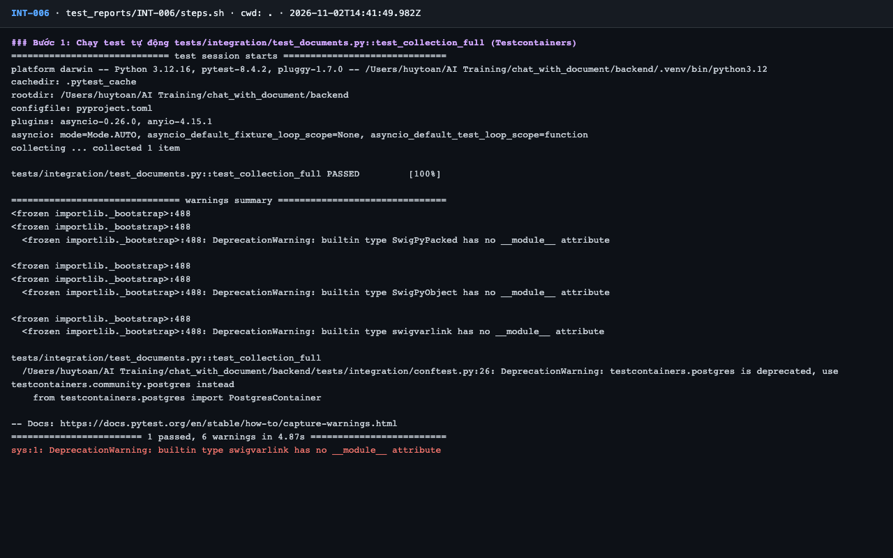
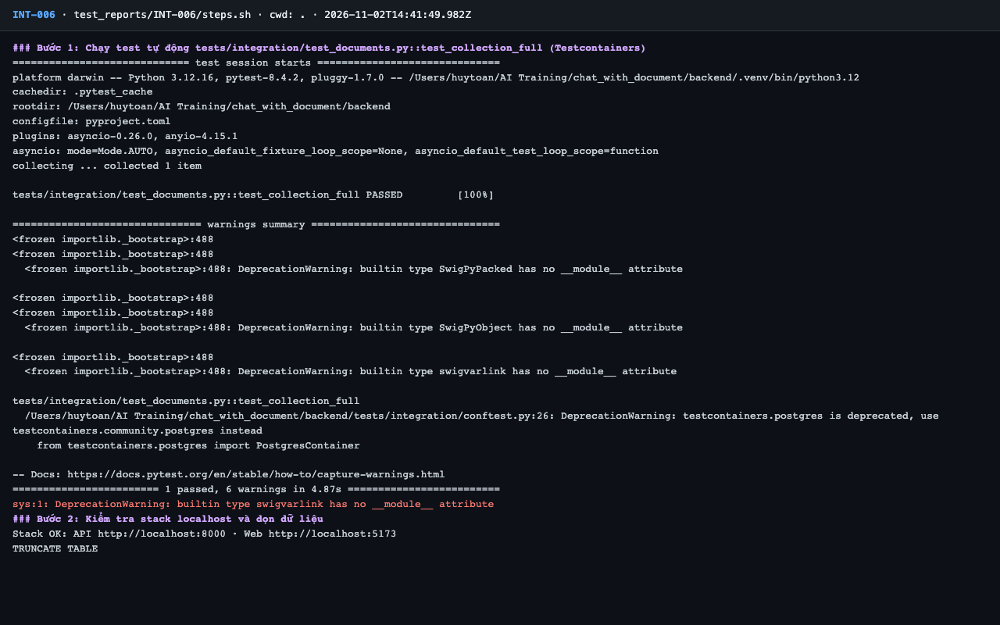
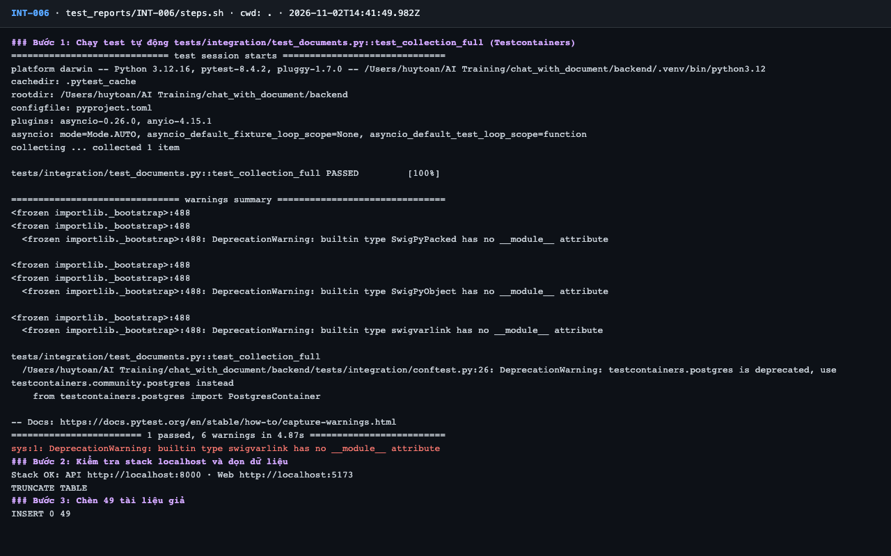
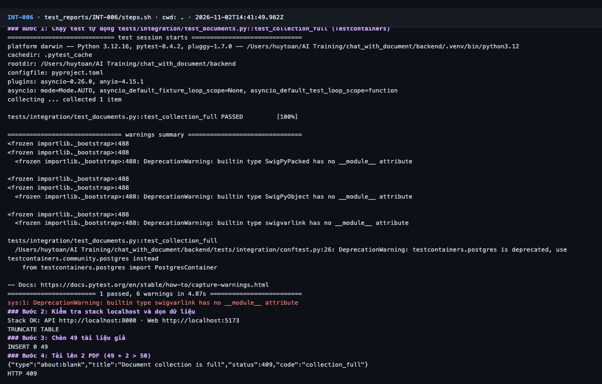
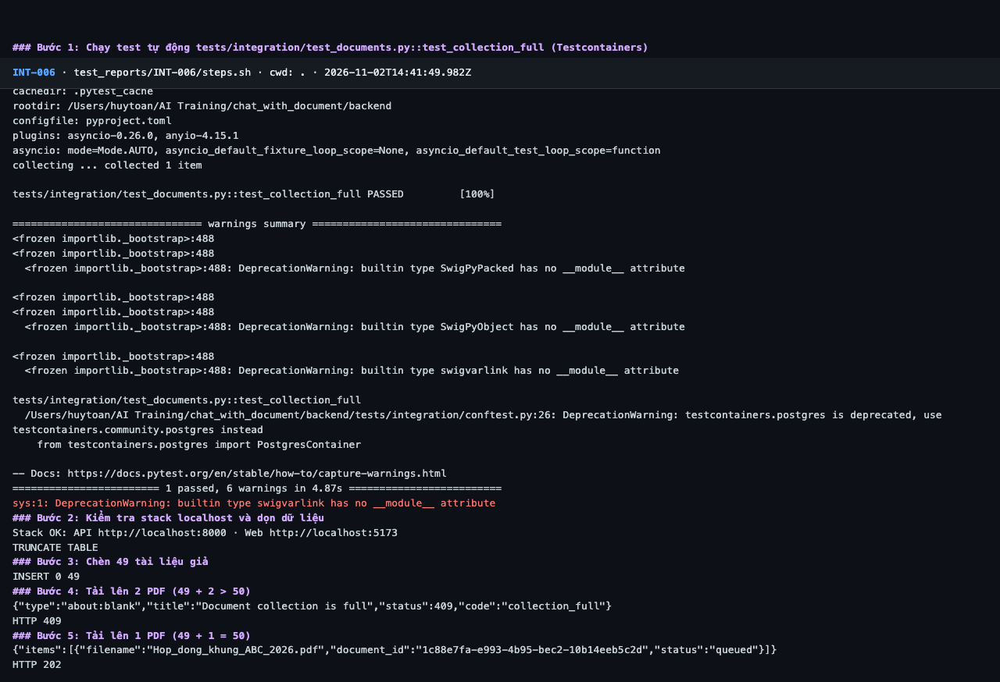
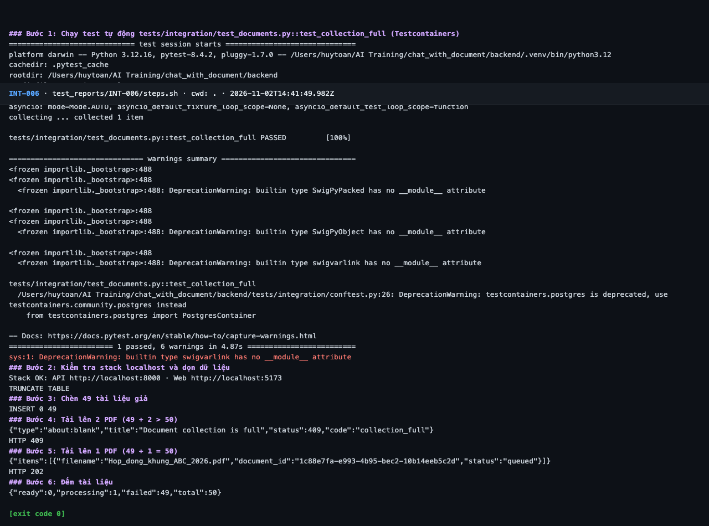

# Báo cáo kiểm thử — INT-006: Bộ tài liệu đạt giới hạn 50

| Mục | Giá trị |
|---|---|
| Test case | [INT-006](../../docs/07-verification/test_cases/INT-006.md) |
| Kết luận | **✅ Đạt** |
| Thời gian chạy | 2026-11-02 21:41:49 → 21:41:59 (UTC+7) |
| Người / agent thực hiện | Claude Code (agent), `frontend/e2e/run-cli.mjs` + `steps.sh` |
| Commit | `c02cc72 (có thay đổi chưa commit)` |
| Môi trường | localhost · web http://localhost:5173 · API http://localhost:8000 · Darwin 27.0.0 arm64 · Docker 29.6.2 · ANTHROPIC_API_KEY: không |
| Script | [steps.sh](steps.sh) |

## Kết quả từng bước

| # | Thao tác | Kết quả mong đợi | Kết quả thực tế | Đạt? | Bằng chứng |
|---|---|---|---|---|---|
| 1 | Chạy test tự động `tests/integration/test_documents.py::test_collection_full` (Testcontainers) | passed, exit code 0 | pytest: `1 passed, 6 warnings in 4.87s` | ✅ | [ảnh](screenshots/01-buoc-1-chay-test-tu-dong-tests-integration-test-documents-py.png) |
| 2 | Kiểm tra stack localhost và dọn dữ liệu | `Stack OK`; lệnh TRUNCATE thành công | Stack OK; TRUNCATE TABLE | ✅ | [ảnh](screenshots/02-buoc-2-kiem-tra-stack-localhost-va-don-du-lieu.png) |
| 3 | Chèn 49 tài liệu giả | `INSERT 0 49` | `INSERT 0 49` | ✅ | [ảnh](screenshots/03-buoc-3-chen-49-tai-lieu-gia.png) |
| 4 | Tải lên 2 PDF (49 + 2 > 50) | HTTP 409, `code: "collection_full"` | `HTTP 409`; `"code":"collection_full"` | ✅ | [ảnh](screenshots/04-buoc-4-tai-len-2-pdf-49-2-50.png) |
| 5 | Tải lên 1 PDF (49 + 1 = 50) | HTTP 202, `status: queued` | HTTP 202; 1 item `queued` | ✅ | [ảnh](screenshots/05-buoc-5-tai-len-1-pdf-49-1-50.png) |
| 6 | Đếm tài liệu | `total: 50` | `"total":50` | ✅ | [ảnh](screenshots/06-buoc-6-dem-tai-lieu-ket-thuc.png) |

## Bằng chứng

- Video: [video.webm](video.webm)
- Log: [logs/cleanup.log](logs/cleanup.log), [logs/run-meta.json](logs/run-meta.json), [logs/steps.log](logs/steps.log)
- Ảnh:

  

  

  

  

  

  

## Lỗi phát hiện

Không có.

## Ghi chú và sai lệch so với test case

Không có.
