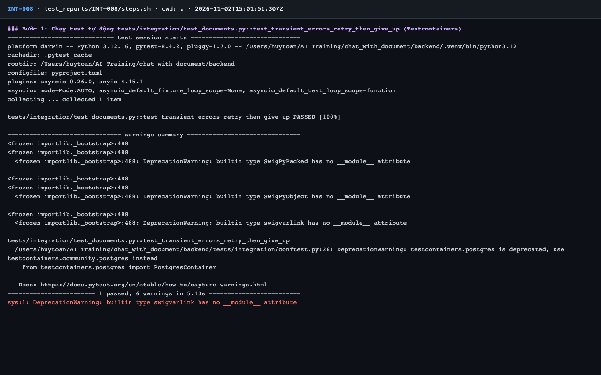
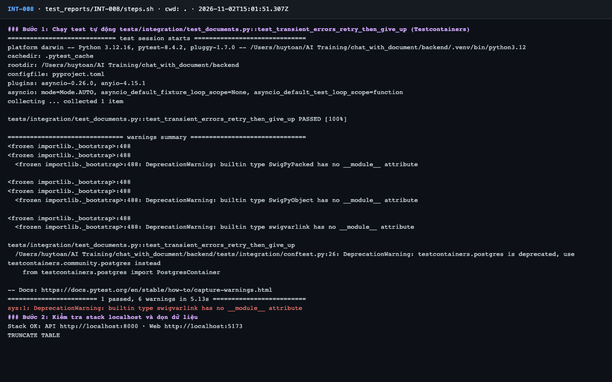
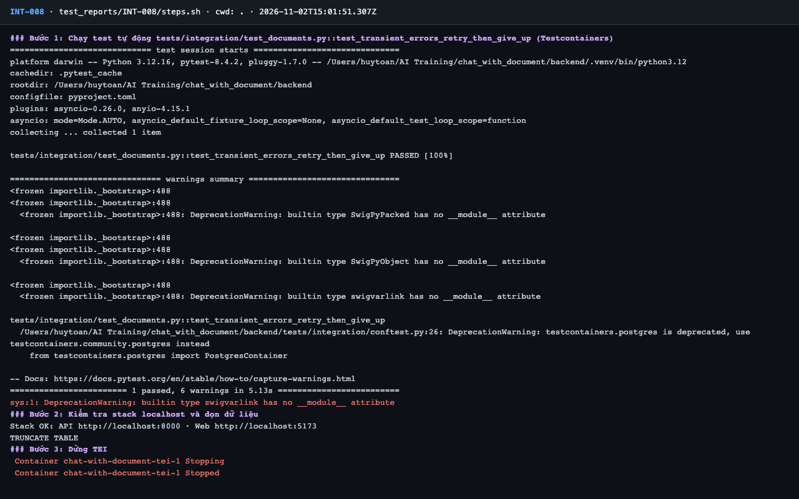
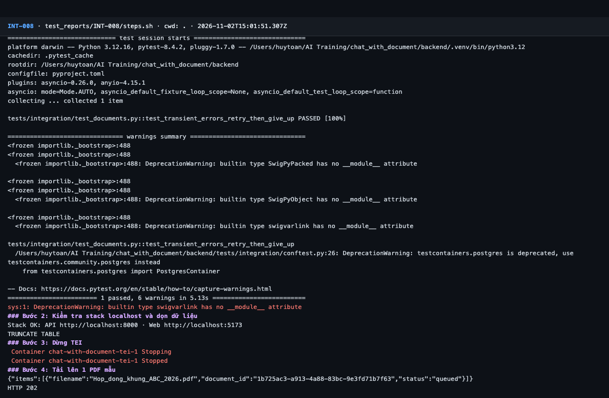
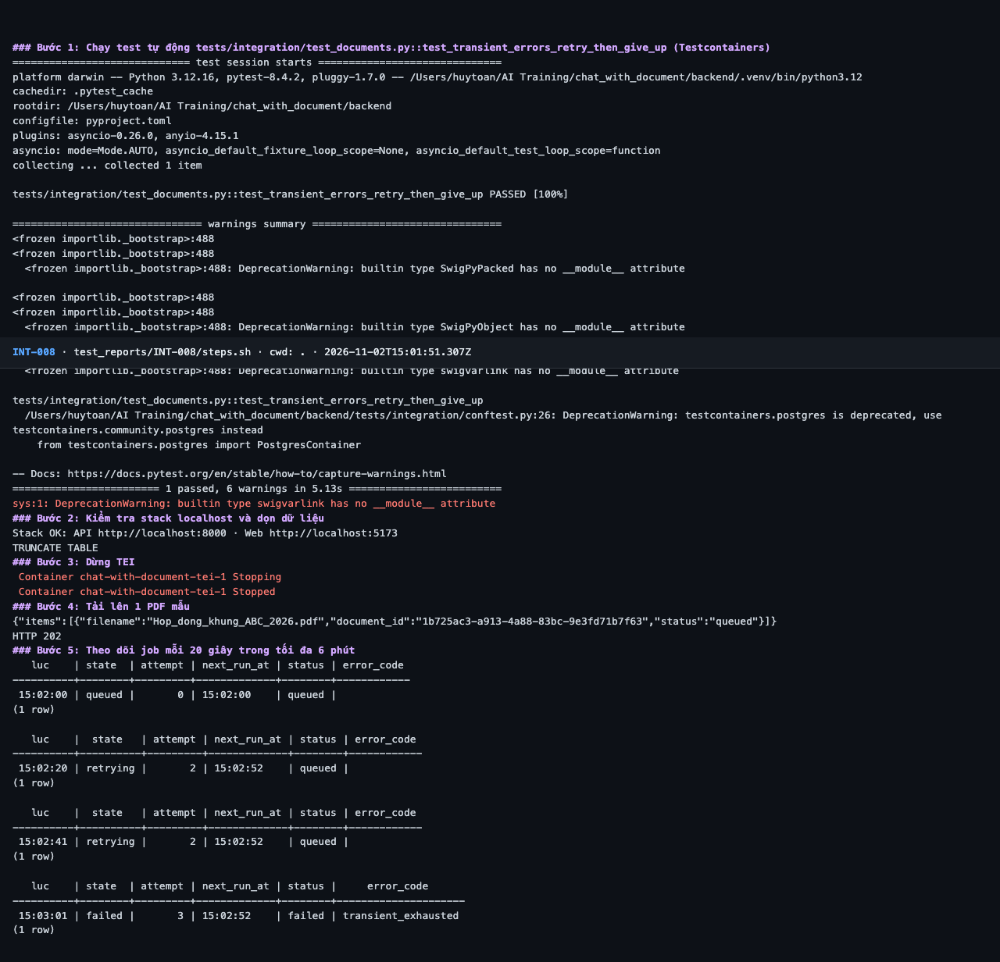
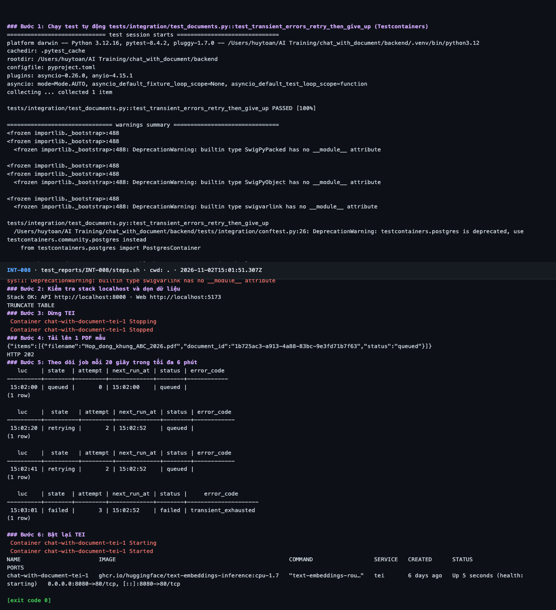

# Báo cáo kiểm thử — INT-008: Lỗi tạm thời: thử lại 3 lần rồi transient_exhausted

| Mục | Giá trị |
|---|---|
| Test case | [INT-008](../../docs/07-verification/test_cases/INT-008.md) |
| Kết luận | **✅ Đạt** |
| Thời gian chạy | 2026-11-02 22:01:50 → 22:03:09 (UTC+7) |
| Người / agent thực hiện | Claude Code (agent), `frontend/e2e/run-cli.mjs` + `steps.sh` |
| Commit | `c02cc72 (có thay đổi chưa commit)` |
| Môi trường | localhost · web http://localhost:5173 · API http://localhost:8000 · Darwin 27.0.0 arm64 · Docker 29.6.2 · ANTHROPIC_API_KEY: không |
| Script | [steps.sh](steps.sh) |

## Kết quả từng bước

| # | Thao tác | Kết quả mong đợi | Kết quả thực tế | Đạt? | Bằng chứng |
|---|---|---|---|---|---|
| 1 | Chạy test tự động `tests/integration/test_documents.py::test_transient_errors_retry_then_give_up` (Testcontainers) | passed, exit code 0 | pytest: `1 passed, 6 warnings in 5.13s` | ✅ | [ảnh](screenshots/01-buoc-1-chay-test-tu-dong-tests-integration-test-documents-py.png) |
| 2 | Kiểm tra stack localhost và dọn dữ liệu | `Stack OK`; lệnh TRUNCATE thành công | Stack OK; TRUNCATE TABLE | ✅ | [ảnh](screenshots/02-buoc-2-kiem-tra-stack-localhost-va-don-du-lieu.png) |
| 3 | Dừng TEI | Container `tei` stopped | `tei-1 Stopped` | ✅ | [ảnh](screenshots/03-buoc-3-dung-tei.png) |
| 4 | Tải lên 1 PDF mẫu | HTTP 202, `queued` | HTTP 202; 1 item `queued` | ✅ | [ảnh](screenshots/04-buoc-4-tai-len-1-pdf-mau.png) |
| 5 | Theo dõi job mỗi 20 giây trong tối đa 6 phút | `attempt` tăng 1 → 2 → 3, `next_run_at` giãn theo backoff; cuối cùng `state` kết thúc và tài liệu `failed` / `transient_exhausted` | Chuỗi: 15:02:00 attempt=0 next=15:02:00 queued/queued → 15:02:20 attempt=2 next=15:02:52 retrying/queued → 15:02:41 attempt=2 next=15:02:52 retrying/queued → 15:03:01 attempt=3 next=15:02:52 failed/failed; cuối: failed / transient_exhausted | ✅ | [ảnh](screenshots/05-buoc-5-theo-doi-job-moi-20-giay-trong-toi-da-6-phut.png) |
| 6 | Bật lại TEI | Container `tei` healthy | `tei-1   ghcr.io/huggingface/text-embeddings-inference:cpu-1.7   "text-embeddings-rou…"   tei       6 days ago   Up` | ✅ | [ảnh](screenshots/06-buoc-6-bat-lai-tei-ket-thuc.png) |

## Bằng chứng

- Video: [video.webm](video.webm)
- Log: [logs/cleanup.log](logs/cleanup.log), [logs/run-meta.json](logs/run-meta.json), [logs/steps.log](logs/steps.log), [logs/worker-retry-timeline.log](logs/worker-retry-timeline.log)
- Ảnh:

  

  

  

  

  

  

## Lỗi phát hiện

Không có.

## Ghi chú và sai lệch so với test case

- Vòng lấy mẫu 20 giây không bắt được `attempt = 1`; [logs/worker-retry-timeline.log](logs/worker-retry-timeline.log) cho thấy đủ 3 lần thử: 15:02:01, 15:02:11 (cách 10 s), 15:02:51 (cách 40 s), khoảng cách tăng dần. Lần thứ 3 là `ingest_gave_up`.
- Thực tế TEI dừng ~1 phút, ít hơn "4–5 phút" trong điều kiện tiên quyết vì 3 lần thử chỉ có 2 khoảng chờ (10 s, 40 s).
- Sau bước 6, TEI cần ~40 s khởi động lại; driver chờ `/health` trước khi chạy test tiếp theo.
