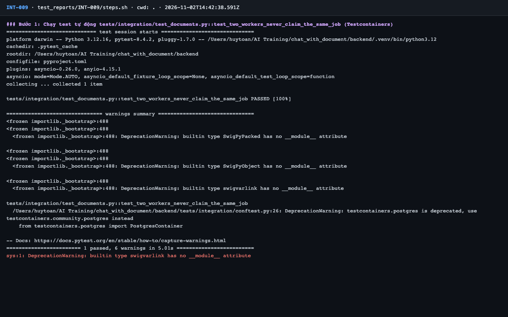
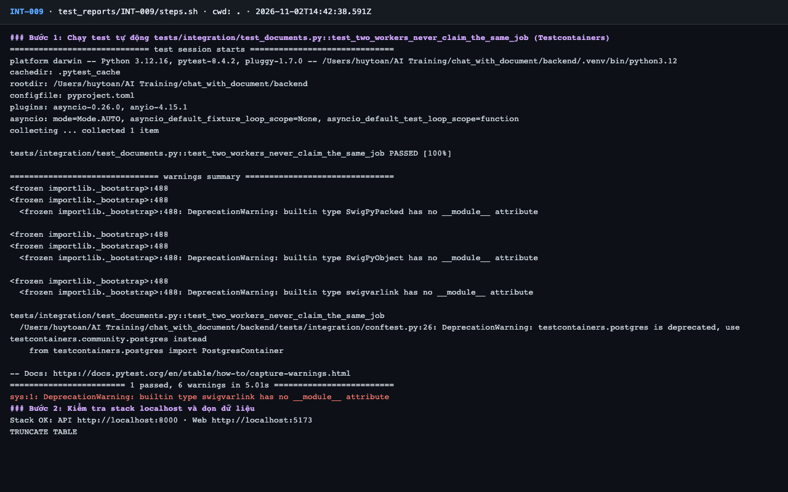
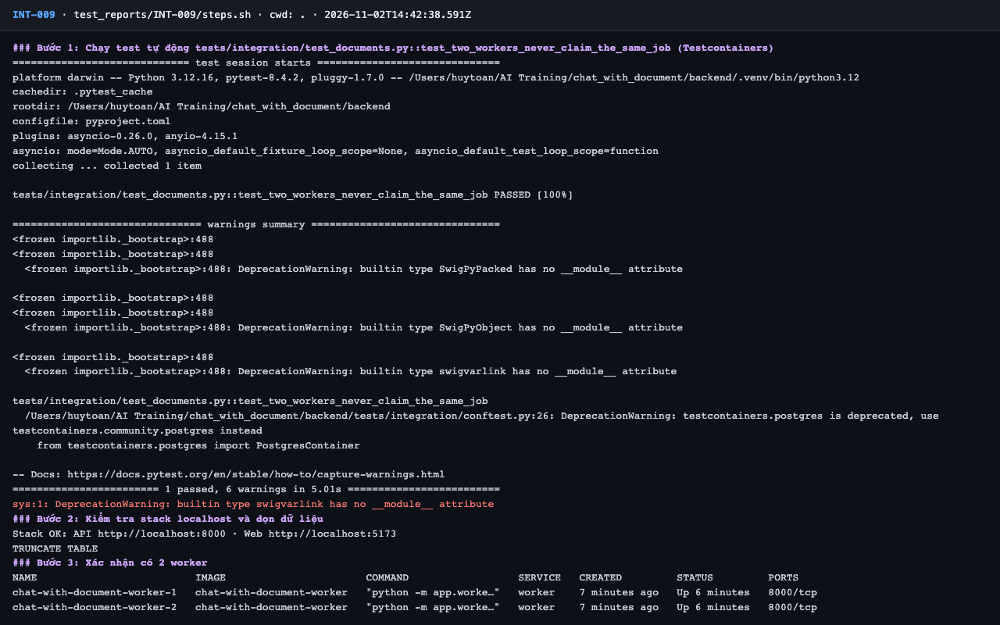
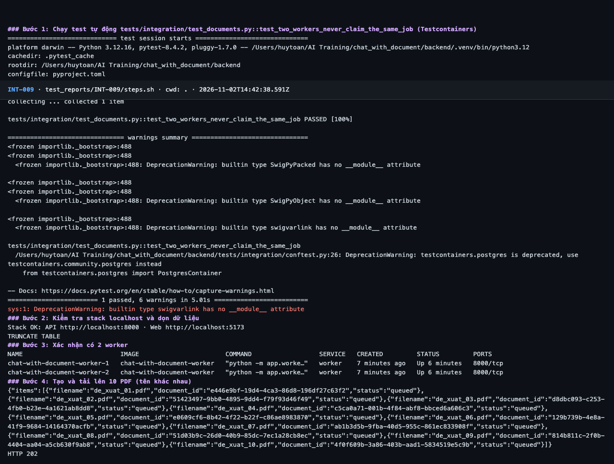
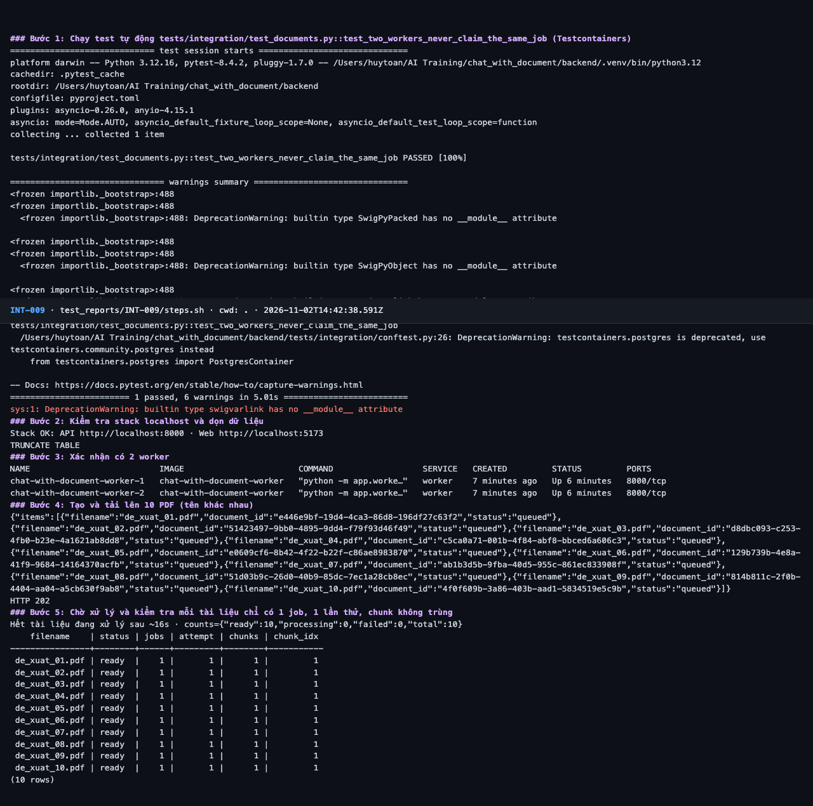
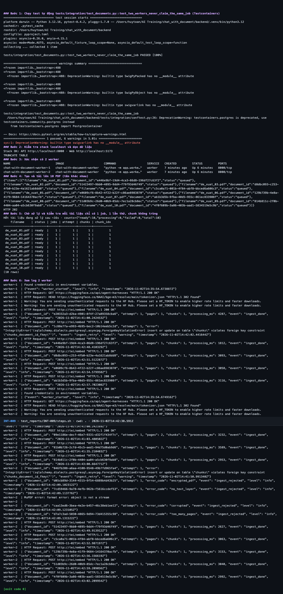

# Báo cáo kiểm thử — INT-009: Hai worker không lấy trùng một job

| Mục | Giá trị |
|---|---|
| Test case | [INT-009](../../docs/07-verification/test_cases/INT-009.md) |
| Kết luận | **✅ Đạt** |
| Thời gian chạy | 2026-11-02 21:42:38 → 21:43:06 (UTC+7) |
| Người / agent thực hiện | Claude Code (agent), `frontend/e2e/run-cli.mjs` + `steps.sh` |
| Commit | `c02cc72 (có thay đổi chưa commit)` |
| Môi trường | localhost · web http://localhost:5173 · API http://localhost:8000 · Darwin 27.0.0 arm64 · Docker 29.6.2 · ANTHROPIC_API_KEY: không |
| Script | [steps.sh](steps.sh) |

## Kết quả từng bước

| # | Thao tác | Kết quả mong đợi | Kết quả thực tế | Đạt? | Bằng chứng |
|---|---|---|---|---|---|
| 1 | Chạy test tự động `tests/integration/test_documents.py::test_two_workers_never_claim_the_same_job` (Testcontainers) | passed, exit code 0 | pytest: `1 passed, 6 warnings in 5.01s` | ✅ | [ảnh](screenshots/01-buoc-1-chay-test-tu-dong-tests-integration-test-documents-py.png) |
| 2 | Kiểm tra stack localhost và dọn dữ liệu | `Stack OK`; lệnh TRUNCATE thành công | Stack OK; TRUNCATE TABLE | ✅ | [ảnh](screenshots/02-buoc-2-kiem-tra-stack-localhost-va-don-du-lieu.png) |
| 3 | Xác nhận có 2 worker | 2 container `worker` đang chạy | 2 container worker Up | ✅ | [ảnh](screenshots/03-buoc-3-xac-nhan-co-2-worker.png) |
| 4 | Tạo và tải lên 10 PDF (tên khác nhau) | HTTP 202, 10 item `queued` | HTTP 202; 10 item `queued` | ✅ | [ảnh](screenshots/04-buoc-4-tao-va-tai-len-10-pdf-ten-khac-nhau.png) |
| 5 | Chờ xử lý và kiểm tra mỗi tài liệu chỉ có 1 job, 1 lần thử, chunk không trùng | 10 tài liệu `ready`; mỗi dòng `jobs = 1`, `attempt = 1`; không có `chunk_index` trùng | 10 dòng; ready: 10; jobs=1: 10; attempt=1: 10; chunks=chunk_idx: 10 | ✅ | [ảnh](screenshots/05-buoc-5-cho-xu-ly-va-kiem-tra-moi-tai-lieu-chi-co-1-job-1-lan.png) |
| 6 | Xem log 2 worker | Cả hai worker đều nhận việc (log có số liệu, không có nội dung tài liệu) | Dòng log worker-1: 20; worker-2: 30; không có văn bản tài liệu trong log | ✅ | [ảnh](screenshots/06-buoc-6-xem-log-2-worker-ket-thuc.png) |

## Bằng chứng

- Video: [video.webm](video.webm)
- Log: [logs/cleanup.log](logs/cleanup.log), [logs/run-meta.json](logs/run-meta.json), [logs/steps.log](logs/steps.log)
- Ảnh:

  

  

  

  

  

  

## Lỗi phát hiện

Không có.

## Ghi chú và sai lệch so với test case

Không có.
