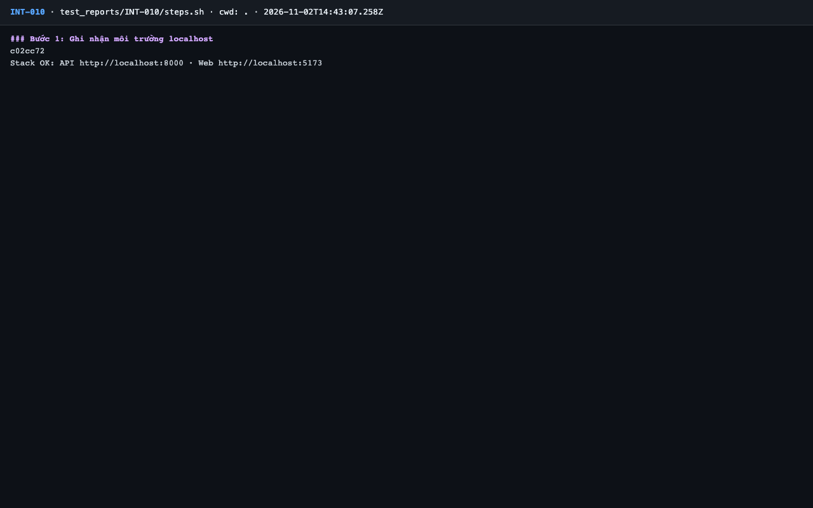
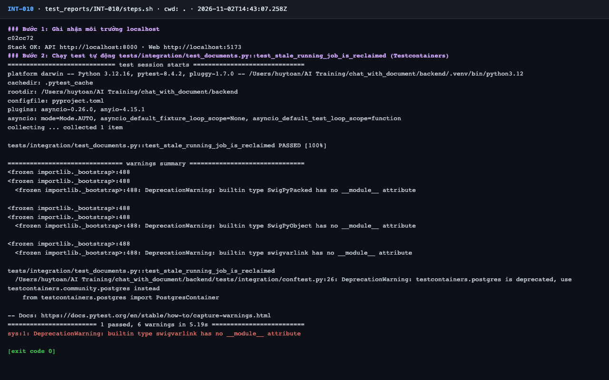

# Báo cáo kiểm thử — INT-010: Thu hồi job treo (running quá hạn)

| Mục | Giá trị |
|---|---|
| Test case | [INT-010](../../docs/07-verification/test_cases/INT-010.md) |
| Kết luận | **✅ Đạt** |
| Thời gian chạy | 2026-11-02 21:43:06 → 21:43:16 (UTC+7) |
| Người / agent thực hiện | Claude Code (agent), `frontend/e2e/run-cli.mjs` + `steps.sh` |
| Commit | `c02cc72 (có thay đổi chưa commit)` |
| Môi trường | localhost · web http://localhost:5173 · API http://localhost:8000 · Darwin 27.0.0 arm64 · Docker 29.6.2 · ANTHROPIC_API_KEY: không |
| Script | [steps.sh](steps.sh) |

## Kết quả từng bước

| # | Thao tác | Kết quả mong đợi | Kết quả thực tế | Đạt? | Bằng chứng |
|---|---|---|---|---|---|
| 1 | Ghi nhận môi trường localhost | In commit và trạng thái stack | `c02cc72`; `Stack OK` | ✅ | [ảnh](screenshots/01-buoc-1-ghi-nhan-moi-truong-localhost.png) |
| 2 | Chạy test tự động `tests/integration/test_documents.py::test_stale_running_job_is_reclaimed` (Testcontainers) | passed, exit code 0 | pytest: `1 passed, 6 warnings in 5.19s` | ✅ | [ảnh](screenshots/02-buoc-2-chay-test-tu-dong-tests-integration-test-documents-py.png) |

## Bằng chứng

- Video: [video.webm](video.webm)
- Log: [logs/run-meta.json](logs/run-meta.json), [logs/steps.log](logs/steps.log)
- Ảnh:

  

  

## Lỗi phát hiện

Không có.

## Ghi chú và sai lệch so với test case

Không có.
