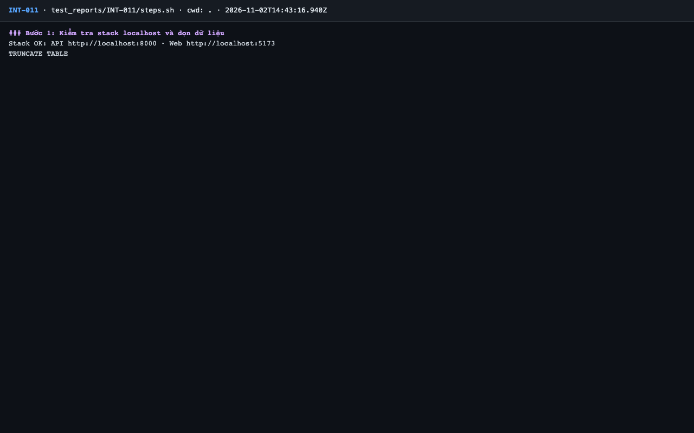
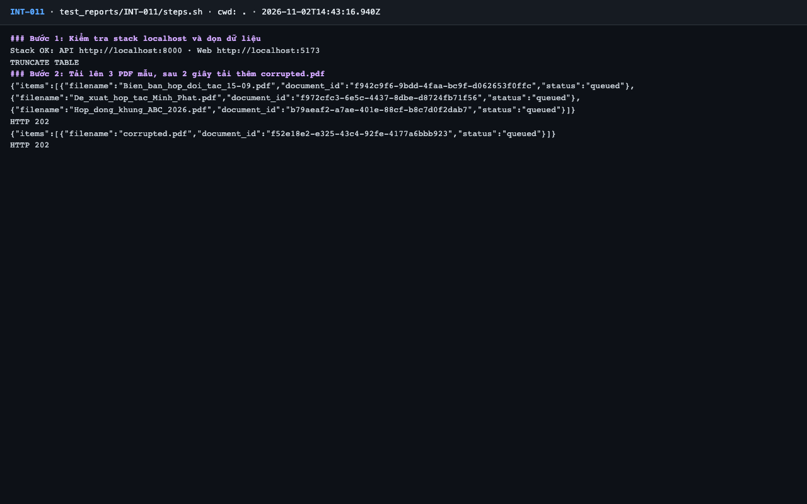
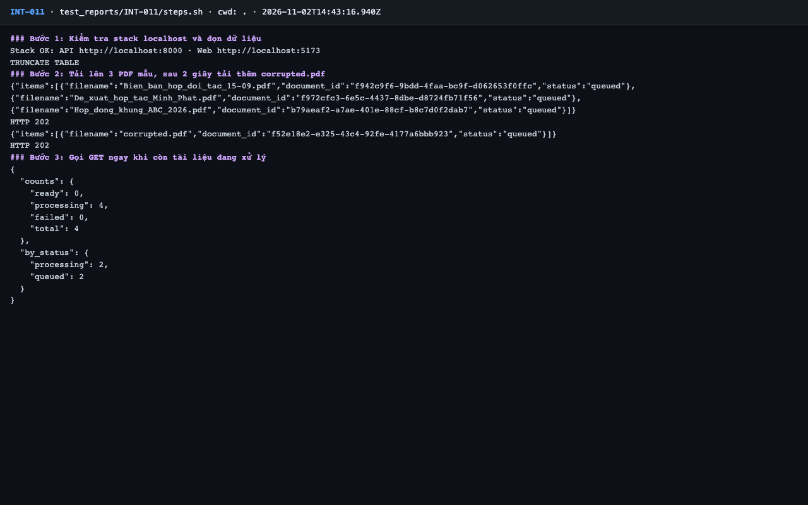
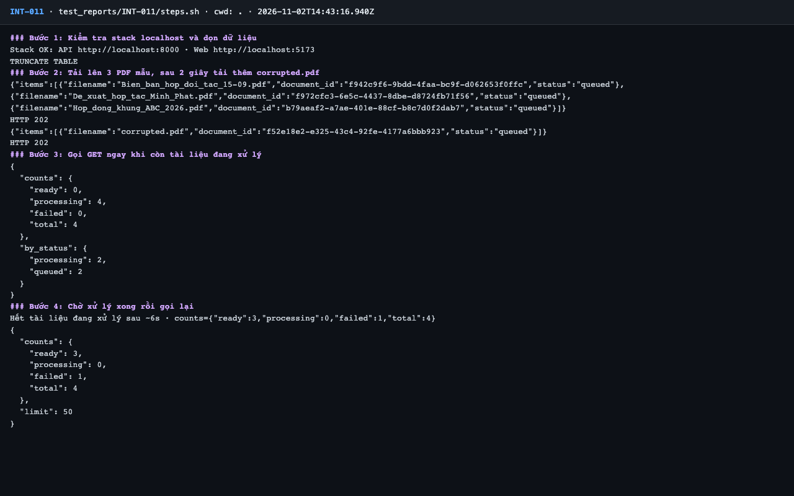
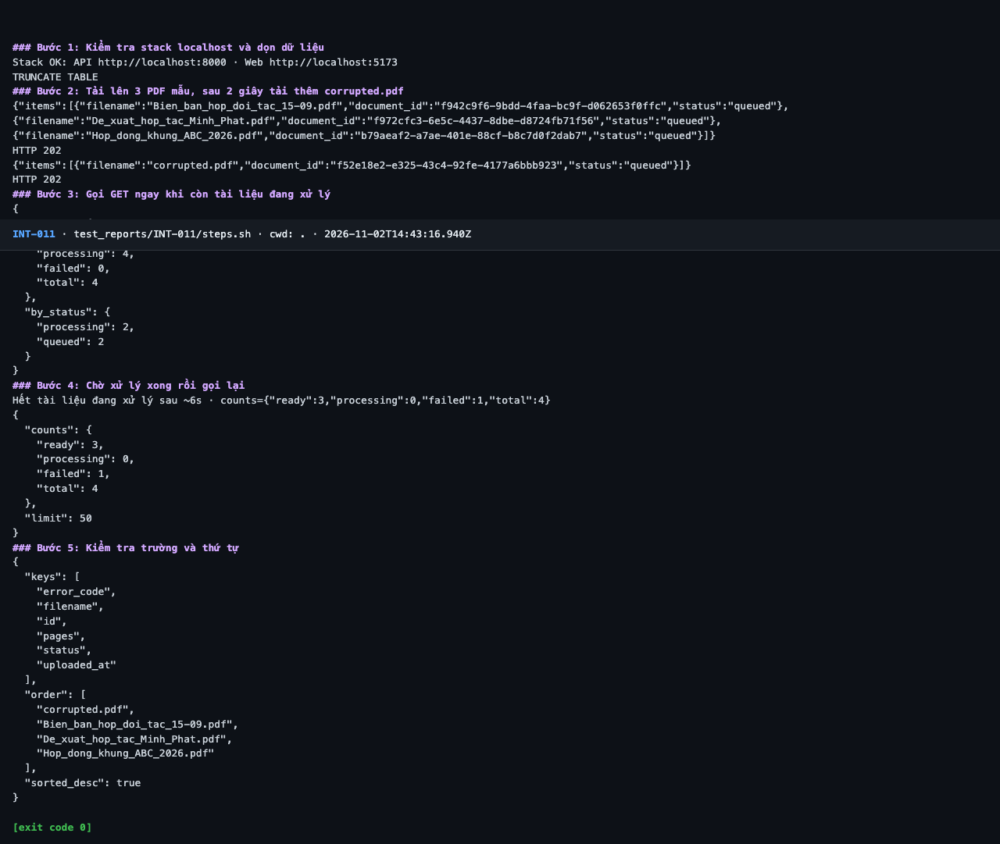

# Báo cáo kiểm thử — INT-011: GET /documents: danh sách, counts, thứ tự

| Mục | Giá trị |
|---|---|
| Test case | [INT-011](../../docs/07-verification/test_cases/INT-011.md) |
| Kết luận | **✅ Đạt** |
| Thời gian chạy | 2026-11-02 21:43:16 → 21:43:27 (UTC+7) |
| Người / agent thực hiện | Claude Code (agent), `frontend/e2e/run-cli.mjs` + `steps.sh` |
| Commit | `c02cc72 (có thay đổi chưa commit)` |
| Môi trường | localhost · web http://localhost:5173 · API http://localhost:8000 · Darwin 27.0.0 arm64 · Docker 29.6.2 · ANTHROPIC_API_KEY: không |
| Script | [steps.sh](steps.sh) |

## Kết quả từng bước

| # | Thao tác | Kết quả mong đợi | Kết quả thực tế | Đạt? | Bằng chứng |
|---|---|---|---|---|---|
| 1 | Kiểm tra stack localhost và dọn dữ liệu | `Stack OK`; lệnh TRUNCATE thành công | Stack OK; TRUNCATE TABLE | ✅ | [ảnh](screenshots/01-buoc-1-kiem-tra-stack-localhost-va-don-du-lieu.png) |
| 2 | Tải lên 3 PDF mẫu, sau 2 giây tải thêm `corrupted.pdf` | Hai response HTTP 202 | 2 response HTTP 202 | ✅ | [ảnh](screenshots/02-buoc-2-tai-len-3-pdf-mau-sau-2-giay-tai-them-corrupted-pdf.png) |
| 3 | Gọi GET ngay khi còn tài liệu đang xử lý | `counts.processing` > 0; `processing` = số item có status `queued` + `processing` | counts={"ready": 0, "processing": 4, "failed": 0, "total": 4}; by_status={"processing": 2, "queued": 2} | ✅ | [ảnh](screenshots/03-buoc-3-goi-get-ngay-khi-con-tai-lieu-dang-xu-ly.png) |
| 4 | Chờ xử lý xong rồi gọi lại | `counts` = `{ready:3, processing:0, failed:1, total:4}`, `limit: 50` | {"counts": {"ready": 3, "processing": 0, "failed": 1, "total": 4}, "limit": 50} | ✅ | [ảnh](screenshots/04-buoc-4-cho-xu-ly-xong-roi-goi-lai.png) |
| 5 | Kiểm tra trường và thứ tự | Mỗi item có đủ `id, filename, pages, uploaded_at, status, error_code`; `sorted_desc: true`; item `corrupted.pdf` đứng đầu | keys=['error_code', 'filename', 'id', 'pages', 'status', 'uploaded_at']; sorted_desc=True; đầu danh sách=corrupted.pdf | ✅ | [ảnh](screenshots/05-buoc-5-kiem-tra-truong-va-thu-tu-ket-thuc.png) |

## Bằng chứng

- Video: [video.webm](video.webm)
- Log: [logs/cleanup.log](logs/cleanup.log), [logs/run-meta.json](logs/run-meta.json), [logs/steps.log](logs/steps.log)
- Ảnh:

  

  

  

  

  

## Lỗi phát hiện

Không có.

## Ghi chú và sai lệch so với test case

Không có.
