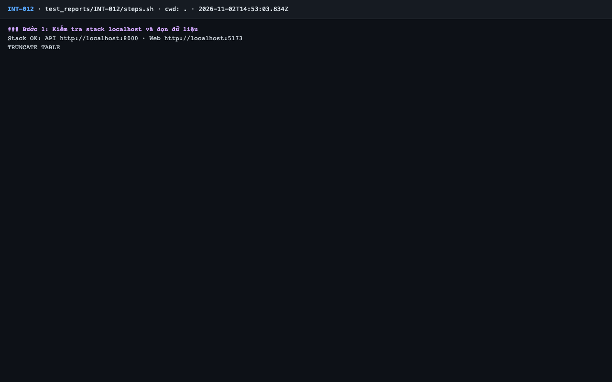
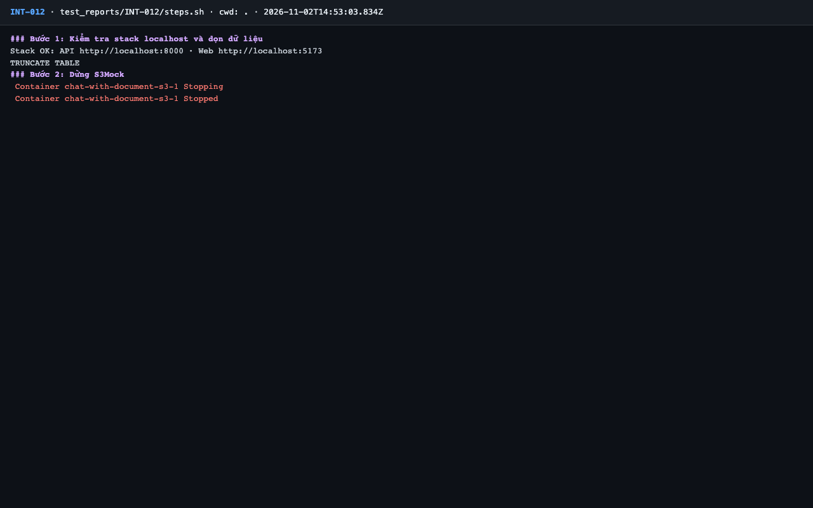
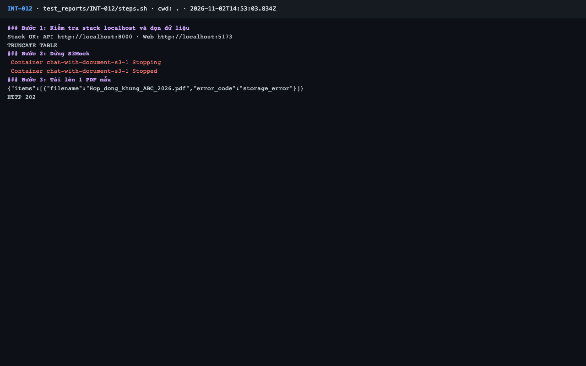
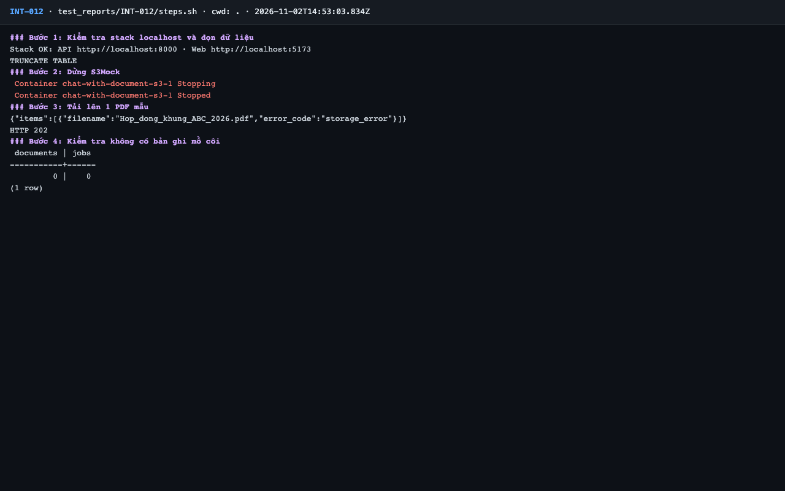
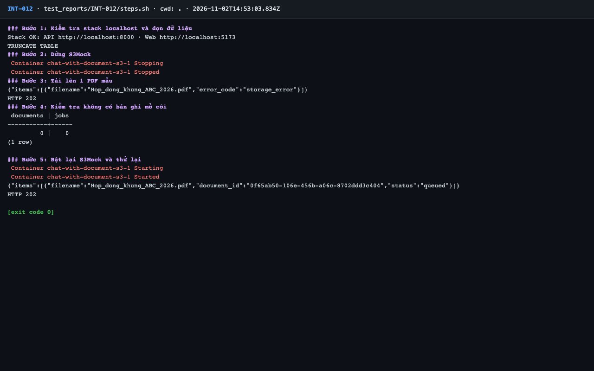

# Báo cáo kiểm thử — INT-012: Lỗi lưu trữ S3 khi tải lên → 502 storage_error

| Mục | Giá trị |
|---|---|
| Test case | [INT-012](../../docs/07-verification/test_cases/INT-012.md) |
| Kết luận | **✅ Đạt** |
| Thời gian chạy | 2026-11-02 21:53:03 → 21:53:13 (UTC+7) |
| Người / agent thực hiện | Claude Code (agent), `frontend/e2e/run-cli.mjs` + `steps.sh` |
| Commit | `c02cc72 (có thay đổi chưa commit)` |
| Môi trường | localhost · web http://localhost:5173 · API http://localhost:8000 · Darwin 27.0.0 arm64 · Docker 29.6.2 · ANTHROPIC_API_KEY: không |
| Script | [steps.sh](steps.sh) |

## Kết quả từng bước

| # | Thao tác | Kết quả mong đợi | Kết quả thực tế | Đạt? | Bằng chứng |
|---|---|---|---|---|---|
| 1 | Kiểm tra stack localhost và dọn dữ liệu | `Stack OK`; lệnh TRUNCATE thành công | Stack OK; TRUNCATE TABLE | ✅ | [ảnh](screenshots/01-buoc-1-kiem-tra-stack-localhost-va-don-du-lieu.png) |
| 2 | Dừng S3Mock | Container `s3` stopped | `s3-1 Stopped` | ✅ | [ảnh](screenshots/02-buoc-2-dung-s3mock.png) |
| 3 | Tải lên 1 PDF mẫu | HTTP 502, `code: "storage_error"` (hoặc item lỗi `storage_error` — ghi nhận đúng dạng trả về) | HTTP 202 với item `"error_code":"storage_error"` (dạng thứ hai mà cột mong đợi của bước này cho phép), không phải 502 | ✅ | [ảnh](screenshots/03-buoc-3-tai-len-1-pdf-mau.png) |
| 4 | Kiểm tra không có bản ghi mồ côi | `count = 0` ở cả `documents` và `ingestion_jobs` | documents=0, jobs=0 | ✅ | [ảnh](screenshots/04-buoc-4-kiem-tra-khong-co-ban-ghi-mo-coi.png) |
| 5 | Bật lại S3Mock và thử lại | Container `s3` chạy; upload trả 202 `queued` | HTTP 202; 1 item `queued` | ✅ | [ảnh](screenshots/05-buoc-5-bat-lai-s3mock-va-thu-lai-ket-thuc.png) |

## Bằng chứng

- Video: [video.webm](video.webm)
- Log: [logs/cleanup.log](logs/cleanup.log), [logs/run-meta.json](logs/run-meta.json), [logs/steps.log](logs/steps.log)
- Ảnh:

  

  

  

  

  

## Lỗi phát hiện

Không có.

## Ghi chú và sai lệch so với test case

- **Mâu thuẫn trong test case (TC-03):** cột mong đợi bước 3 cho phép "hoặc item lỗi `storage_error` — ghi nhận đúng dạng trả về", còn "Tiêu chí đạt" và tên test ghi 502. Ứng dụng trả **202 + lỗi theo từng tệp** (`upload.py`), khác Blueprint ERR-16 (502). Kết luận ✅ theo cột mong đợi của bước; Tech lead / QA cần chốt lại hợp đồng API. Nếu chốt 502 thì kết quả này là ❌.
- Sau `reset_data` lúc worker đang xử lý có thể có log `ForeignKeyViolationError` ở worker: do thao tác dọn dữ liệu của test, không phải lỗi luồng chính.
