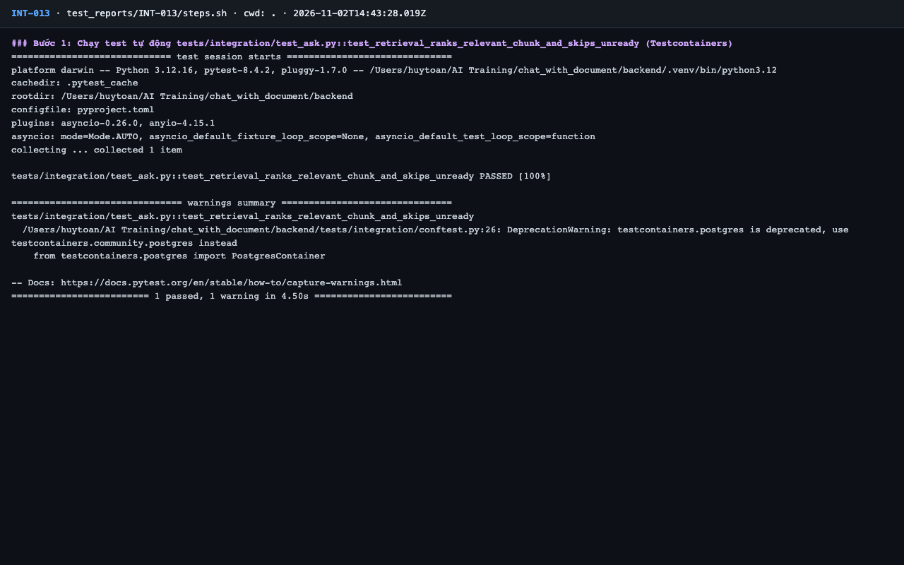
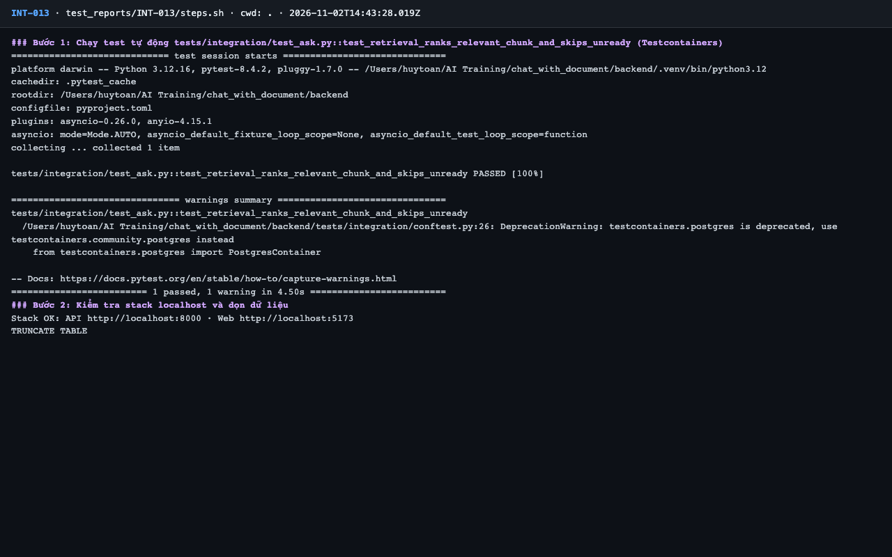
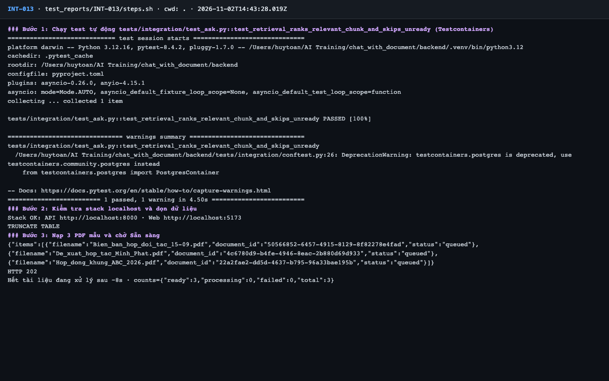
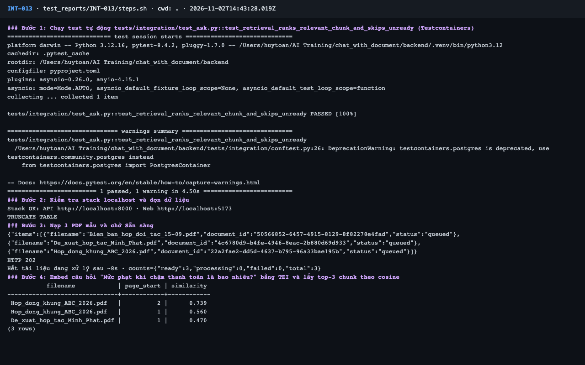
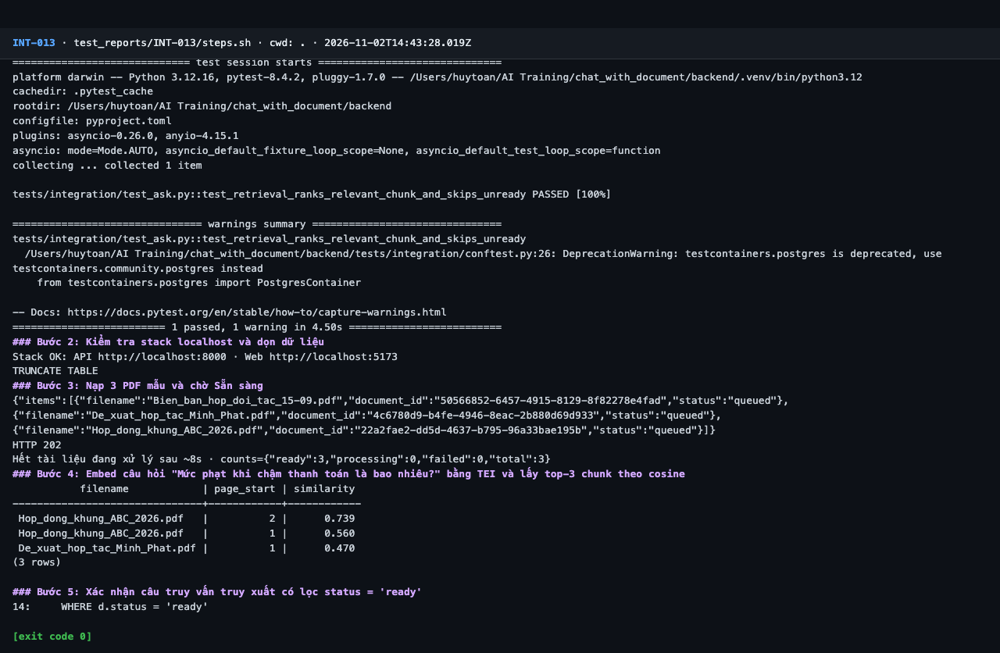

# Báo cáo kiểm thử — INT-013: Truy xuất xếp hạng đúng đoạn và bỏ tài liệu chưa Sẵn sàng

| Mục | Giá trị |
|---|---|
| Test case | [INT-013](../../docs/07-verification/test_cases/INT-013.md) |
| Kết luận | **✅ Đạt** |
| Thời gian chạy | 2026-11-02 21:43:27 → 21:43:45 (UTC+7) |
| Người / agent thực hiện | Claude Code (agent), `frontend/e2e/run-cli.mjs` + `steps.sh` |
| Commit | `c02cc72 (có thay đổi chưa commit)` |
| Môi trường | localhost · web http://localhost:5173 · API http://localhost:8000 · Darwin 27.0.0 arm64 · Docker 29.6.2 · ANTHROPIC_API_KEY: không |
| Script | [steps.sh](steps.sh) |

## Kết quả từng bước

| # | Thao tác | Kết quả mong đợi | Kết quả thực tế | Đạt? | Bằng chứng |
|---|---|---|---|---|---|
| 1 | Chạy test tự động `tests/integration/test_ask.py::test_retrieval_ranks_relevant_chunk_and_skips_unready` (Testcontainers) | passed, exit code 0 | pytest: `1 passed, 1 warning in 4.50s` | ✅ | [ảnh](screenshots/01-buoc-1-chay-test-tu-dong-tests-integration-test-ask-py-test-.png) |
| 2 | Kiểm tra stack localhost và dọn dữ liệu | `Stack OK`; lệnh TRUNCATE thành công | Stack OK; TRUNCATE TABLE | ✅ | [ảnh](screenshots/02-buoc-2-kiem-tra-stack-localhost-va-don-du-lieu.png) |
| 3 | Nạp 3 PDF mẫu và chờ Sẵn sàng | `ready: 3` | ready: 3 | ✅ | [ảnh](screenshots/03-buoc-3-nap-3-pdf-mau-va-cho-san-sang.png) |
| 4 | Embed câu hỏi "Mức phạt khi chậm thanh toán là bao nhiêu?" bằng TEI và lấy top-3 chunk theo cosine | Top-1 thuộc `Hop_dong_khung_ABC_2026.pdf`; độ tương đồng top-1 cao hơn rõ rệt so với tài liệu khác | Top-3: Hop_dong_khung_ABC_2026.pdf tr.2 sim=0.739; Hop_dong_khung_ABC_2026.pdf tr.1 sim=0.560; De_xuat_hop_tac_Minh_Phat.pdf tr.1 sim=0.470 | ✅ | [ảnh](screenshots/04-buoc-4-embed-cau-hoi-muc-phat-khi-cham-thanh-toan-la-bao-nhi.png) |
| 5 | Xác nhận câu truy vấn truy xuất có lọc `status = 'ready'` | Có dòng `WHERE d.status = 'ready'` | `WHERE d.status = 'ready'` | ✅ | [ảnh](screenshots/05-buoc-5-xac-nhan-cau-truy-van-truy-xuat-co-loc-status-ready-k.png) |

## Bằng chứng

- Video: [video.webm](video.webm)
- Log: [logs/cleanup.log](logs/cleanup.log), [logs/run-meta.json](logs/run-meta.json), [logs/steps.log](logs/steps.log)
- Ảnh:

  

  

  

  

  

## Lỗi phát hiện

Không có.

## Ghi chú và sai lệch so với test case

Không có.
