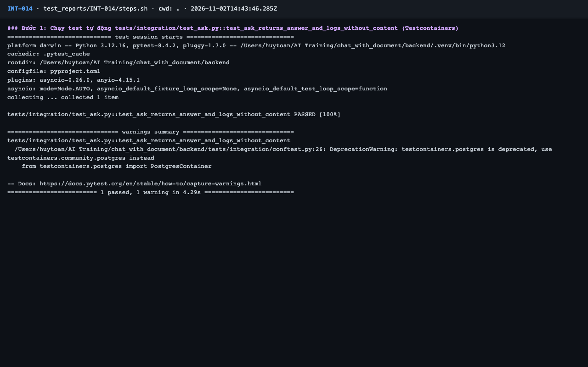
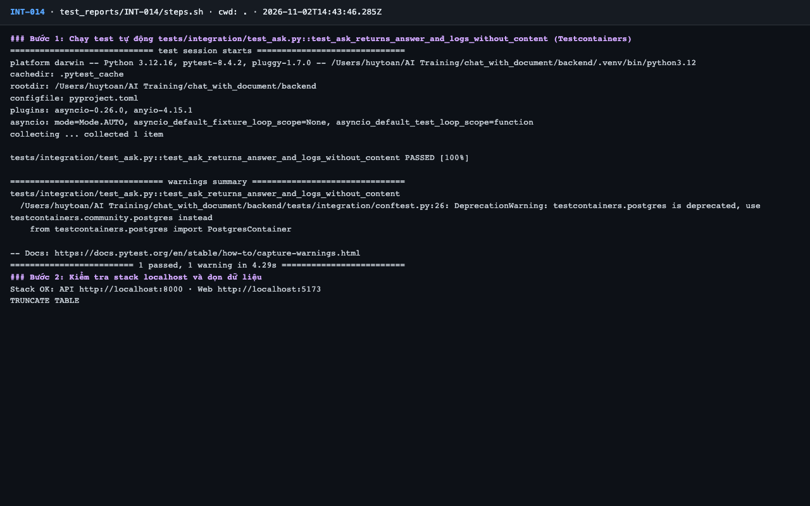
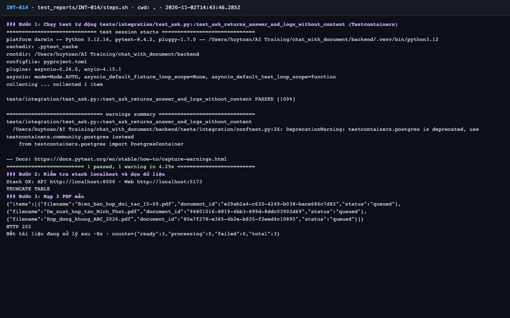
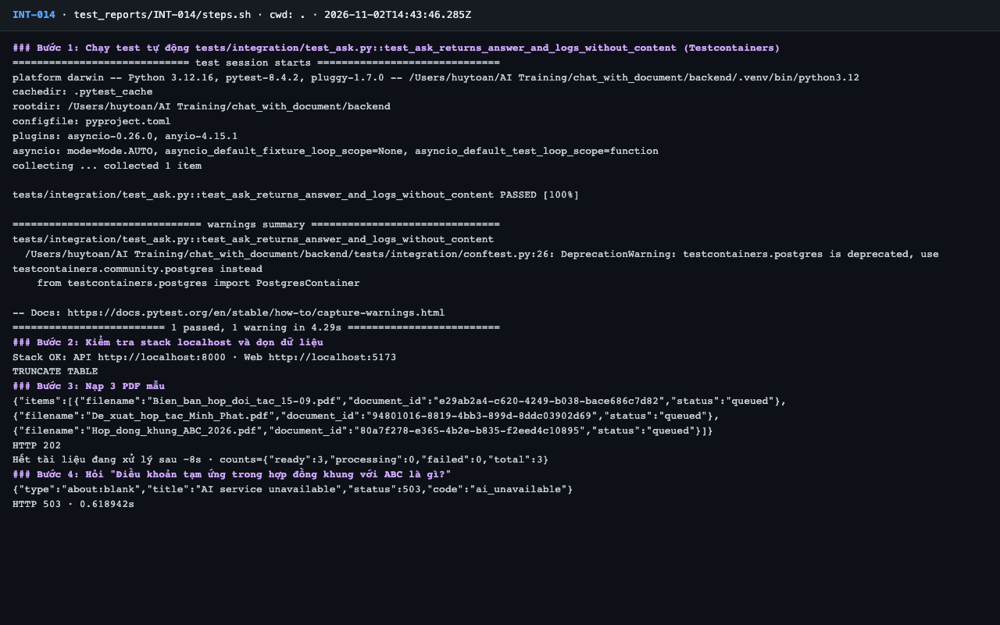
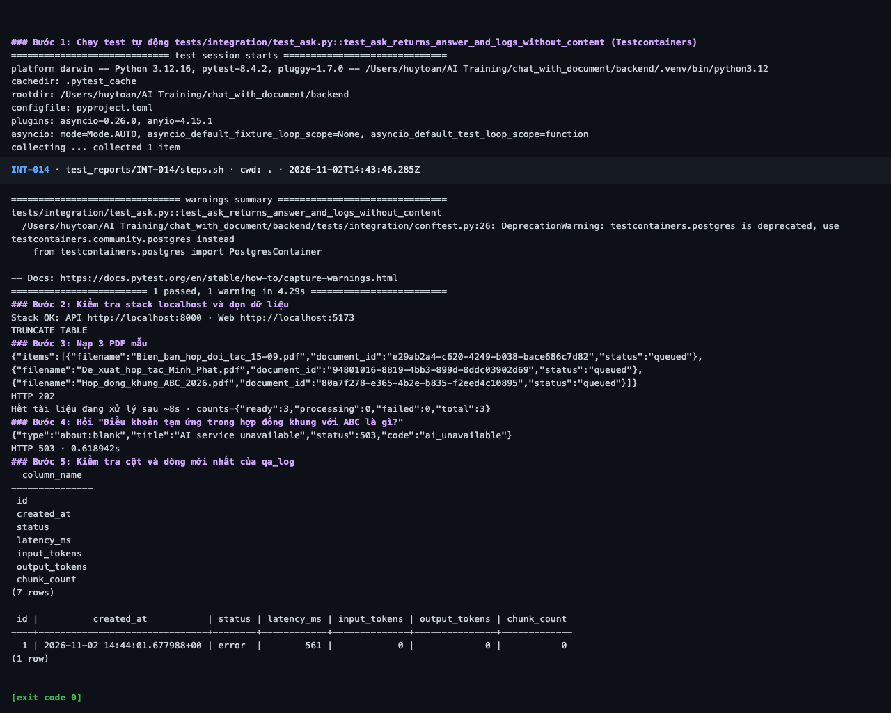

# Báo cáo kiểm thử — INT-014: Hỏi đáp thành công và qa_log không chứa nội dung

| Mục | Giá trị |
|---|---|
| Test case | [INT-014](../../docs/07-verification/test_cases/INT-014.md) |
| Kết luận | **⛔ Bị chặn** |
| Thời gian chạy | 2026-11-02 21:43:45 → 21:44:03 (UTC+7) |
| Người / agent thực hiện | Claude Code (agent), `frontend/e2e/run-cli.mjs` + `steps.sh` |
| Commit | `c02cc72 (có thay đổi chưa commit)` |
| Môi trường | localhost · web http://localhost:5173 · API http://localhost:8000 · Darwin 27.0.0 arm64 · Docker 29.6.2 · ANTHROPIC_API_KEY: không |
| Script | [steps.sh](steps.sh) |

> ⛔ Bước 4 cần Claude thật; không có `ANTHROPIC_API_KEY` (test case ghi: ⛔ Bị chặn cho phần Claude thật, vẫn ghi kết quả bước 1 và 5).

## Kết quả từng bước

| # | Thao tác | Kết quả mong đợi | Kết quả thực tế | Đạt? | Bằng chứng |
|---|---|---|---|---|---|
| 1 | Chạy test tự động `tests/integration/test_ask.py::test_ask_returns_answer_and_logs_without_content` (Testcontainers) | passed, exit code 0 | pytest: `1 passed, 1 warning in 4.29s` | ✅ | [ảnh](screenshots/01-buoc-1-chay-test-tu-dong-tests-integration-test-ask-py-test-.png) |
| 2 | Kiểm tra stack localhost và dọn dữ liệu | `Stack OK`; lệnh TRUNCATE thành công | Stack OK; TRUNCATE TABLE | ✅ | [ảnh](screenshots/02-buoc-2-kiem-tra-stack-localhost-va-don-du-lieu.png) |
| 3 | Nạp 3 PDF mẫu | `ready: 3` | ready: 3 | ✅ | [ảnh](screenshots/03-buoc-3-nap-3-pdf-mau.png) |
| 4 | Hỏi "Điều khoản tạm ứng trong hợp đồng khung với ABC là gì?" | HTTP 200; `answer` tiếng Việt nêu tạm ứng 30% trong 10 ngày làm việc; có `latency_ms` | Không có khóa: HTTP 503 · 0.618942s "code":"ai_unavailable" — phần Claude thật không kiểm chứng được | ⛔ | [ảnh](screenshots/04-buoc-4-hoi-dieu-khoan-tam-ung-trong-hop-dong-khung-voi-abc-l.png) |
| 5 | Kiểm tra cột và dòng mới nhất của `qa_log` | Cột đúng: `id, created_at, status, latency_ms, input_tokens, output_tokens, chunk_count`; dòng mới `status = ok`, `chunk_count` > 0 | Cột: id, created_at, status, latency_ms, input_tokens, output_tokens, chunk_count (không có cột văn bản). Dòng mới nhất: 1 \| 2026-11-02 14:44:01.677988+00 \| error  \|        561 \|            0 \|             0 \|           0 — `status = ok` chưa kiểm chứng được vì không có khóa | ✅ | [ảnh](screenshots/05-buoc-5-kiem-tra-cot-va-dong-moi-nhat-cua-qa-log-ket-thuc.png) |

## Bằng chứng

- Video: [video.webm](video.webm)
- Log: [logs/cleanup.log](logs/cleanup.log), [logs/run-meta.json](logs/run-meta.json), [logs/steps.log](logs/steps.log)
- Ảnh:

  

  

  

  

  

## Lỗi phát hiện

Không có.

## Ghi chú và sai lệch so với test case

- Bước 1 dùng FakeLLM và đã passed. Bước 4 trả 503 vì không có khóa. Bước 5: cột `qa_log` đúng, không có cột văn bản; dòng mới nhất có `status = error` nên kỳ vọng `status = ok`, `chunk_count` > 0 **chưa được kiểm chứng** với Claude thật.
- Không giả lập: test case không cho phép giả lập bước 4.
