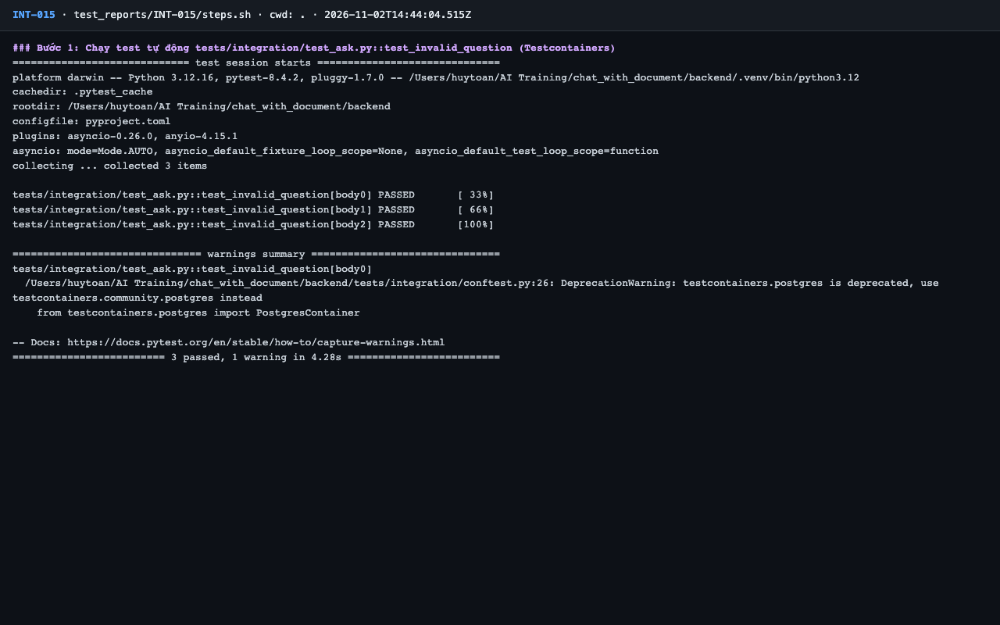
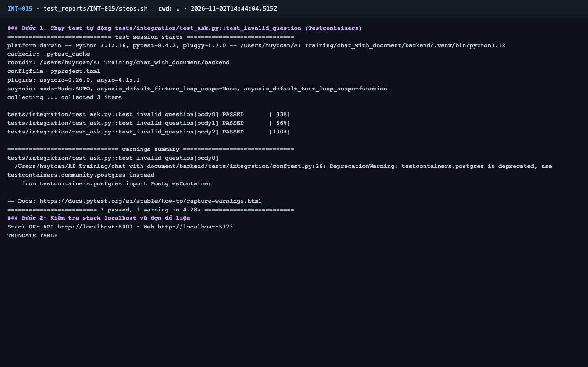
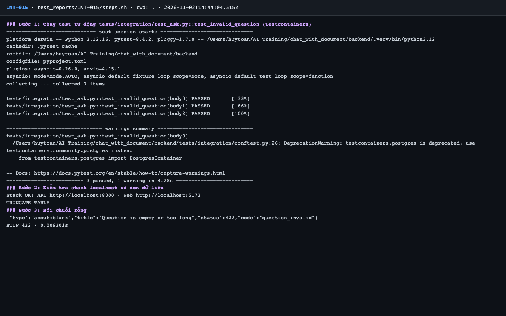
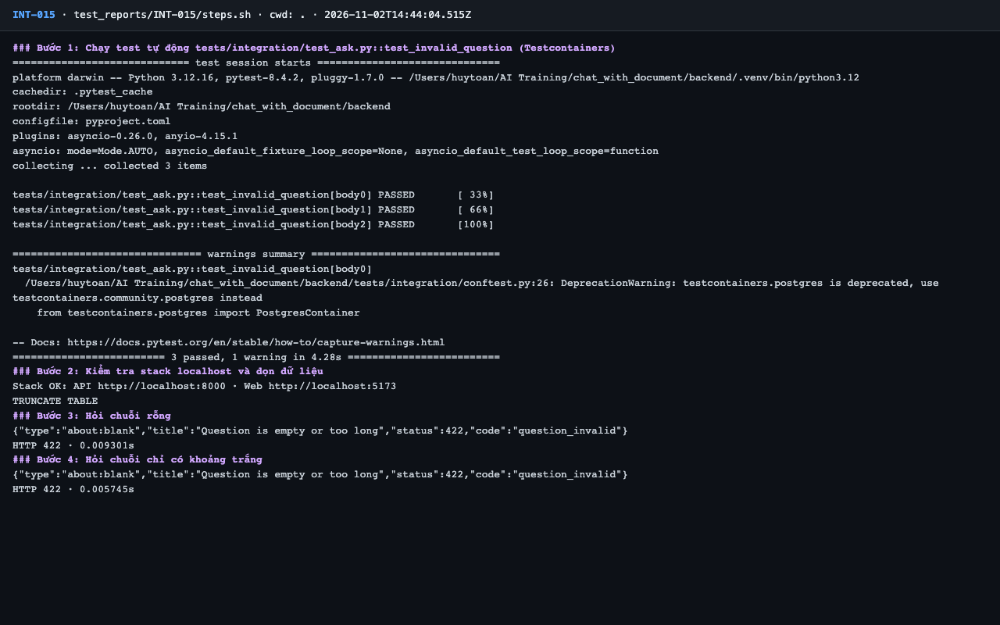
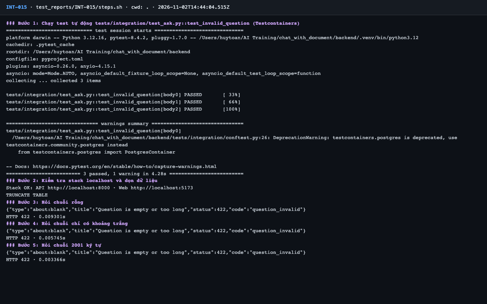
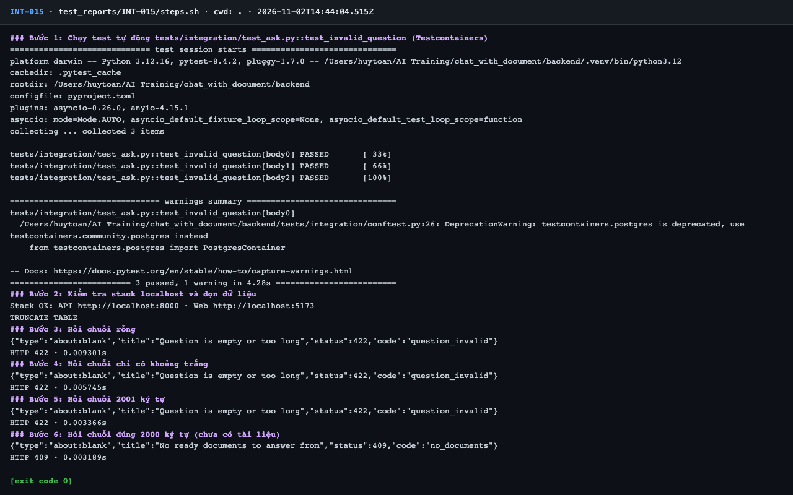

# Báo cáo kiểm thử — INT-015: Câu hỏi rỗng / quá dài → 422 question_invalid

| Mục | Giá trị |
|---|---|
| Test case | [INT-015](../../docs/07-verification/test_cases/INT-015.md) |
| Kết luận | **✅ Đạt** |
| Thời gian chạy | 2026-11-02 21:44:04 → 21:44:12 (UTC+7) |
| Người / agent thực hiện | Claude Code (agent), `frontend/e2e/run-cli.mjs` + `steps.sh` |
| Commit | `c02cc72 (có thay đổi chưa commit)` |
| Môi trường | localhost · web http://localhost:5173 · API http://localhost:8000 · Darwin 27.0.0 arm64 · Docker 29.6.2 · ANTHROPIC_API_KEY: không |
| Script | [steps.sh](steps.sh) |

## Kết quả từng bước

| # | Thao tác | Kết quả mong đợi | Kết quả thực tế | Đạt? | Bằng chứng |
|---|---|---|---|---|---|
| 1 | Chạy test tự động `tests/integration/test_ask.py::test_invalid_question` (Testcontainers) | passed, exit code 0 | pytest: `3 passed, 1 warning in 4.28s` | ✅ | [ảnh](screenshots/01-buoc-1-chay-test-tu-dong-tests-integration-test-ask-py-test-.png) |
| 2 | Kiểm tra stack localhost và dọn dữ liệu | `Stack OK`; lệnh TRUNCATE thành công | Stack OK; TRUNCATE TABLE | ✅ | [ảnh](screenshots/02-buoc-2-kiem-tra-stack-localhost-va-don-du-lieu.png) |
| 3 | Hỏi chuỗi rỗng | HTTP 422, `code: question_invalid` | `HTTP 422`; `"code":"question_invalid"` | ✅ | [ảnh](screenshots/03-buoc-3-hoi-chuoi-rong.png) |
| 4 | Hỏi chuỗi chỉ có khoảng trắng | HTTP 422, `code: question_invalid` | `HTTP 422`; `"code":"question_invalid"` | ✅ | [ảnh](screenshots/04-buoc-4-hoi-chuoi-chi-co-khoang-trang.png) |
| 5 | Hỏi chuỗi 2001 ký tự | HTTP 422, `code: question_invalid` | `HTTP 422`; `"code":"question_invalid"` | ✅ | [ảnh](screenshots/05-buoc-5-hoi-chuoi-2001-ky-tu.png) |
| 6 | Hỏi chuỗi đúng 2000 ký tự (chưa có tài liệu) | **Không** phải 422; nhận 409 `no_documents` (đã qua bước kiểm tra độ dài) | `HTTP 409`; `"code":"no_documents"` | ✅ | [ảnh](screenshots/06-buoc-6-hoi-chuoi-dung-2000-ky-tu-chua-co-tai-lieu-ket-thuc.png) |

## Bằng chứng

- Video: [video.webm](video.webm)
- Log: [logs/run-meta.json](logs/run-meta.json), [logs/steps.log](logs/steps.log)
- Ảnh:

  

  

  

  

  

  

## Lỗi phát hiện

Không có.

## Ghi chú và sai lệch so với test case

Không có.
