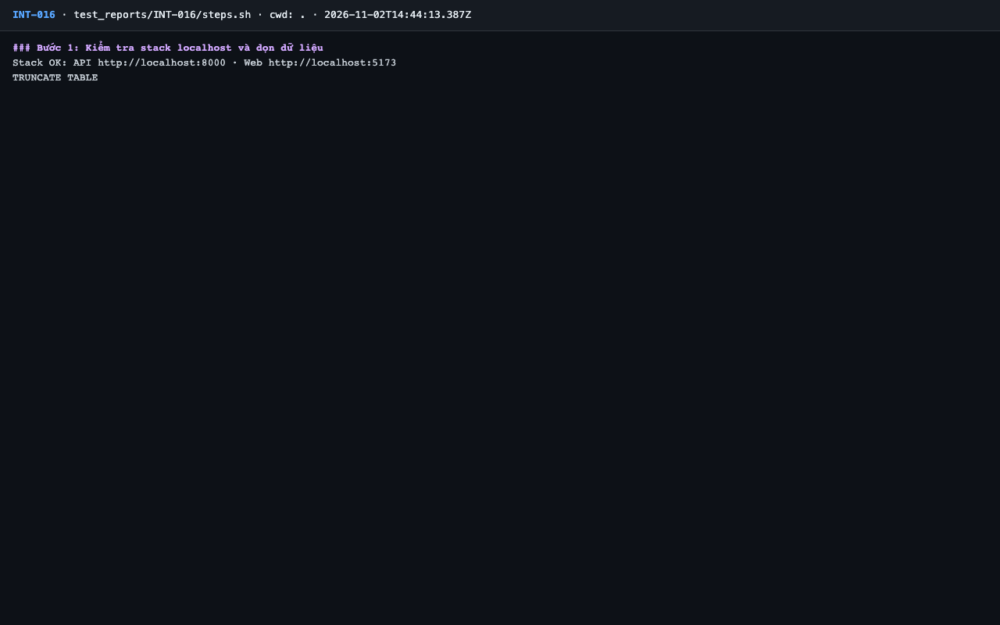
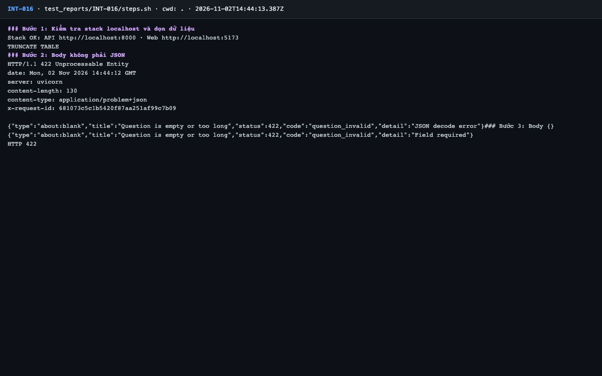
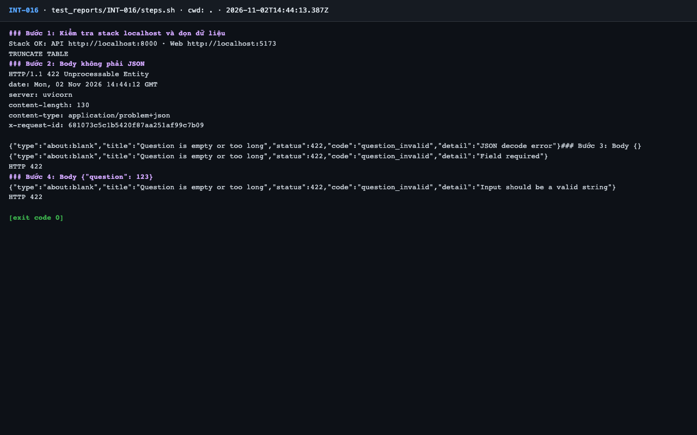

# Báo cáo kiểm thử — INT-016: Body không hợp lệ → 422 question_invalid (problem+json)

| Mục | Giá trị |
|---|---|
| Test case | [INT-016](../../docs/07-verification/test_cases/INT-016.md) |
| Kết luận | **✅ Đạt** |
| Thời gian chạy | 2026-11-02 21:44:12 → 21:44:15 (UTC+7) |
| Người / agent thực hiện | Claude Code (agent), `frontend/e2e/run-cli.mjs` + `steps.sh` |
| Commit | `c02cc72 (có thay đổi chưa commit)` |
| Môi trường | localhost · web http://localhost:5173 · API http://localhost:8000 · Darwin 27.0.0 arm64 · Docker 29.6.2 · ANTHROPIC_API_KEY: không |
| Script | [steps.sh](steps.sh) |

## Kết quả từng bước

| # | Thao tác | Kết quả mong đợi | Kết quả thực tế | Đạt? | Bằng chứng |
|---|---|---|---|---|---|
| 1 | Kiểm tra stack localhost và dọn dữ liệu | `Stack OK`; lệnh TRUNCATE thành công | Stack OK; TRUNCATE TABLE | ✅ | [ảnh](screenshots/01-buoc-1-kiem-tra-stack-localhost-va-don-du-lieu.png) |
| 2 | Body không phải JSON | HTTP 422, `content-type: application/problem+json`, `code: question_invalid` | `HTTP/1.1 422`; `content-type: application/problem+json`; `"code":"question_invalid"` | ✅ | [ảnh](screenshots/02-buoc-2-body-khong-phai-json.png) |
| 3 | Body `{}` | HTTP 422, `code: question_invalid` | `HTTP 422`; `"code":"question_invalid"` | ✅ | [ảnh](screenshots/03-buoc-4-body-question-123-ket-thuc.png) |
| 4 | Body `{"question": 123}` | HTTP 422, `code: question_invalid` | `HTTP 422`; `"code":"question_invalid"` | ✅ | [ảnh](screenshots/03-buoc-4-body-question-123-ket-thuc.png) |

## Bằng chứng

- Video: [video.webm](video.webm)
- Log: [logs/run-meta.json](logs/run-meta.json), [logs/steps.log](logs/steps.log)
- Ảnh:

  

  

  

## Lỗi phát hiện

Không có.

## Ghi chú và sai lệch so với test case

Không có.
