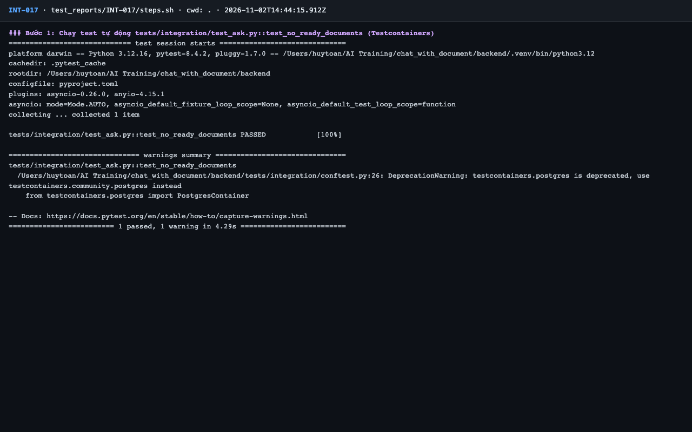
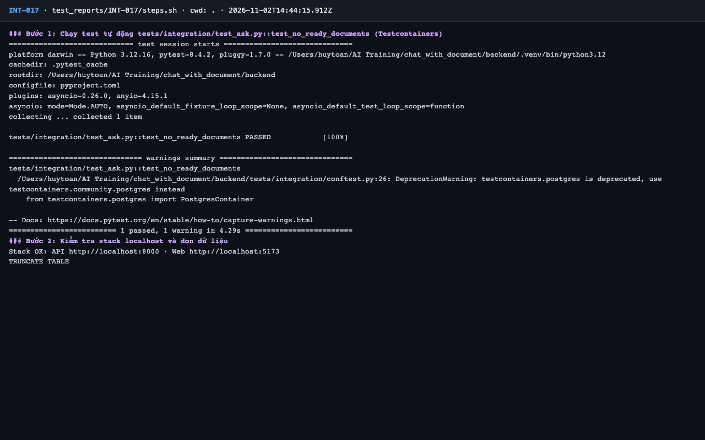
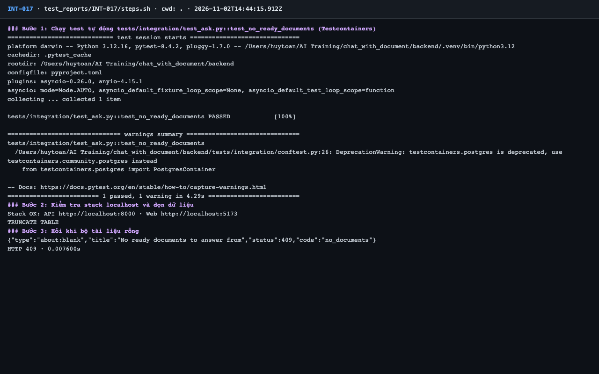
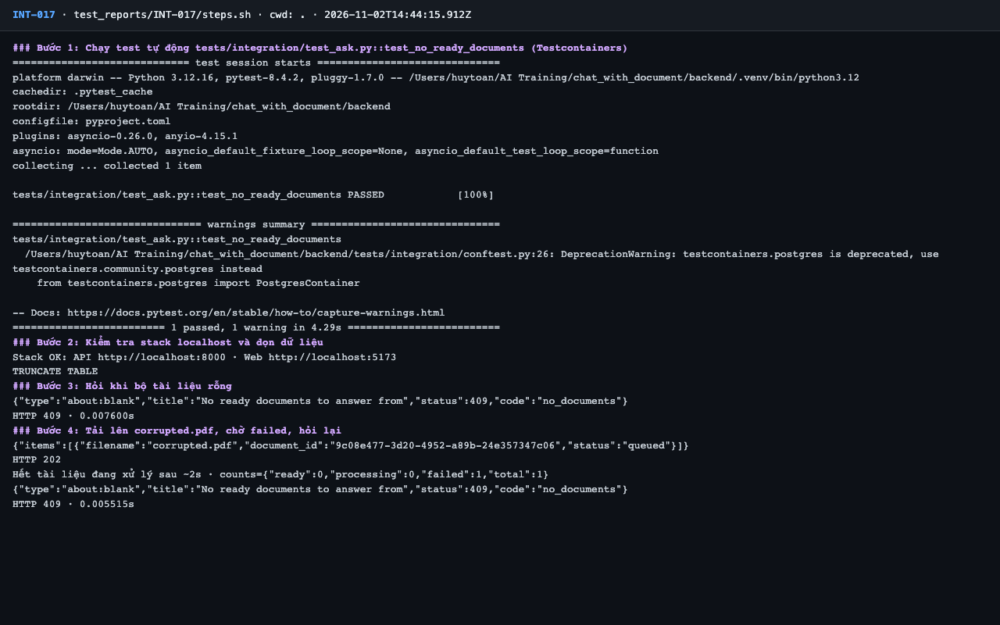
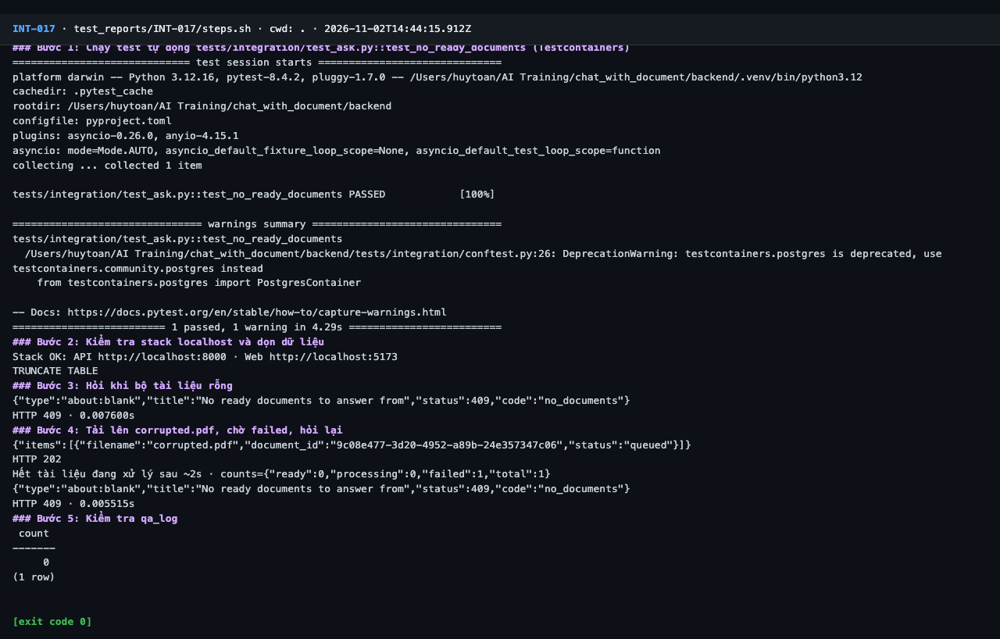

# Báo cáo kiểm thử — INT-017: Không có tài liệu Sẵn sàng → 409 no_documents

| Mục | Giá trị |
|---|---|
| Test case | [INT-017](../../docs/07-verification/test_cases/INT-017.md) |
| Kết luận | **✅ Đạt** |
| Thời gian chạy | 2026-11-02 21:44:15 → 21:44:26 (UTC+7) |
| Người / agent thực hiện | Claude Code (agent), `frontend/e2e/run-cli.mjs` + `steps.sh` |
| Commit | `c02cc72 (có thay đổi chưa commit)` |
| Môi trường | localhost · web http://localhost:5173 · API http://localhost:8000 · Darwin 27.0.0 arm64 · Docker 29.6.2 · ANTHROPIC_API_KEY: không |
| Script | [steps.sh](steps.sh) |

## Kết quả từng bước

| # | Thao tác | Kết quả mong đợi | Kết quả thực tế | Đạt? | Bằng chứng |
|---|---|---|---|---|---|
| 1 | Chạy test tự động `tests/integration/test_ask.py::test_no_ready_documents` (Testcontainers) | passed, exit code 0 | pytest: `1 passed, 1 warning in 4.29s` | ✅ | [ảnh](screenshots/01-buoc-1-chay-test-tu-dong-tests-integration-test-ask-py-test-.png) |
| 2 | Kiểm tra stack localhost và dọn dữ liệu | `Stack OK`; lệnh TRUNCATE thành công | Stack OK; TRUNCATE TABLE | ✅ | [ảnh](screenshots/02-buoc-2-kiem-tra-stack-localhost-va-don-du-lieu.png) |
| 3 | Hỏi khi bộ tài liệu rỗng | HTTP 409, `code: no_documents` | `HTTP 409`; `"code":"no_documents"` | ✅ | [ảnh](screenshots/03-buoc-3-hoi-khi-bo-tai-lieu-rong.png) |
| 4 | Tải lên `corrupted.pdf`, chờ `failed`, hỏi lại | HTTP 409, `code: no_documents` | `HTTP 409`; `"code":"no_documents"`; `"failed":1` | ✅ | [ảnh](screenshots/04-buoc-4-tai-len-corrupted-pdf-cho-failed-hoi-lai.png) |
| 5 | Kiểm tra `qa_log` | Không có dòng nào (409 xảy ra trước khi gọi AI) hoặc ghi nhận nếu có | count(qa_log) = 0 | ✅ | [ảnh](screenshots/05-buoc-5-kiem-tra-qa-log-ket-thuc.png) |

## Bằng chứng

- Video: [video.webm](video.webm)
- Log: [logs/cleanup.log](logs/cleanup.log), [logs/run-meta.json](logs/run-meta.json), [logs/steps.log](logs/steps.log)
- Ảnh:

  

  

  

  

  

## Lỗi phát hiện

Không có.

## Ghi chú và sai lệch so với test case

Không có.
