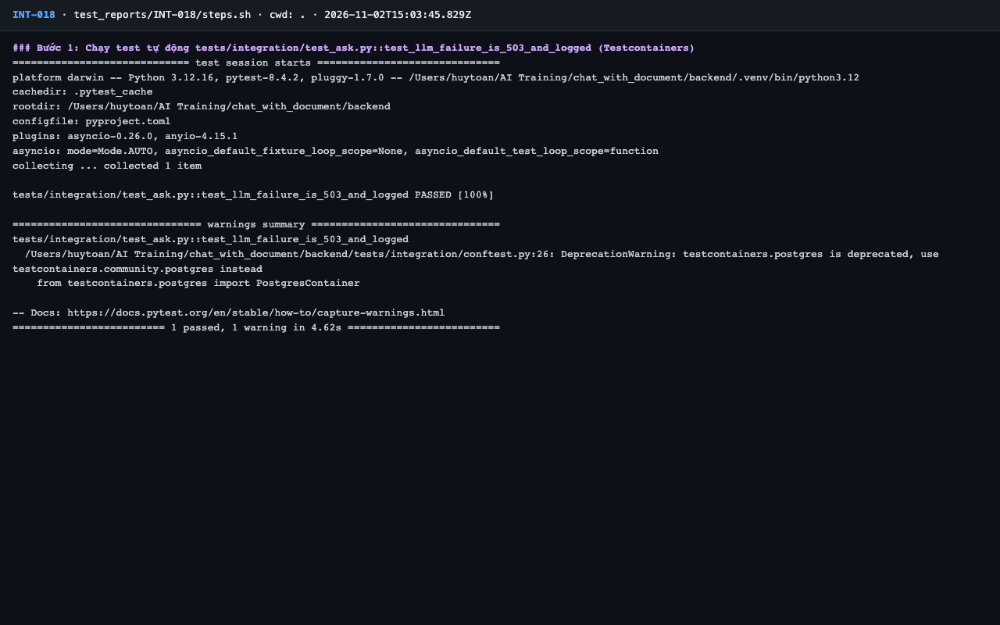
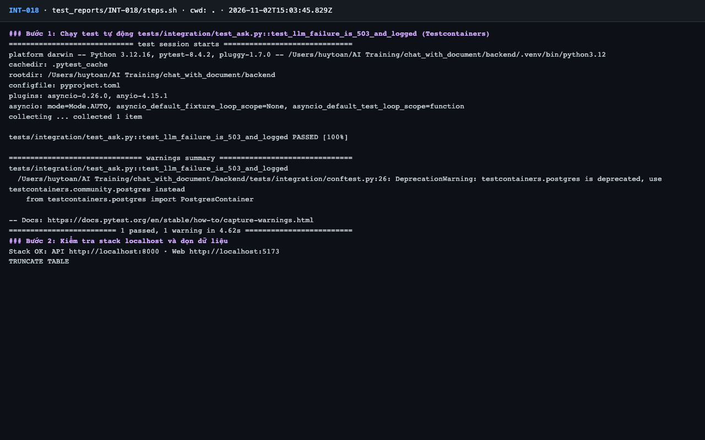
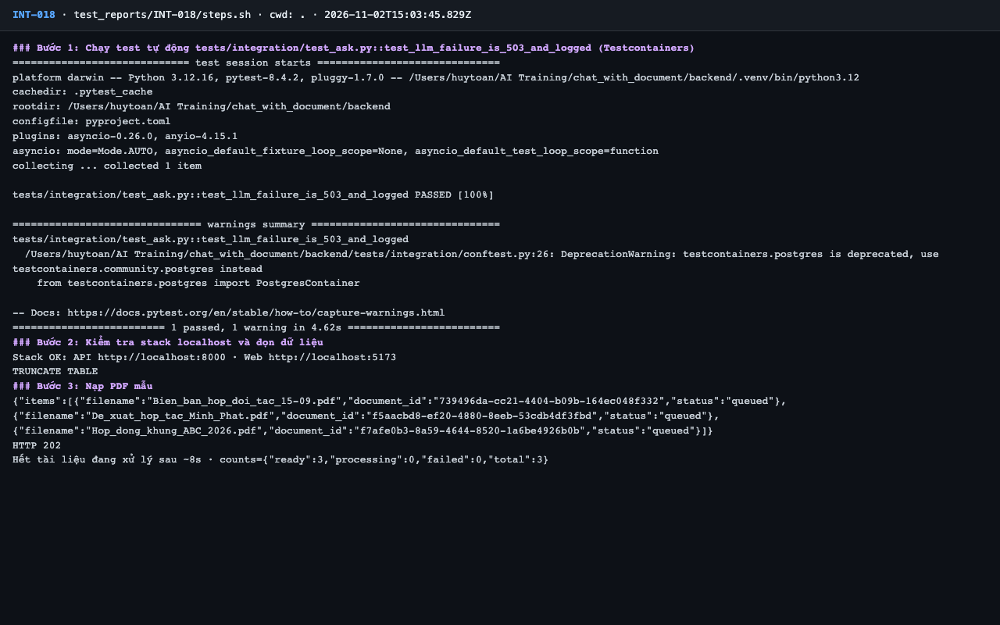
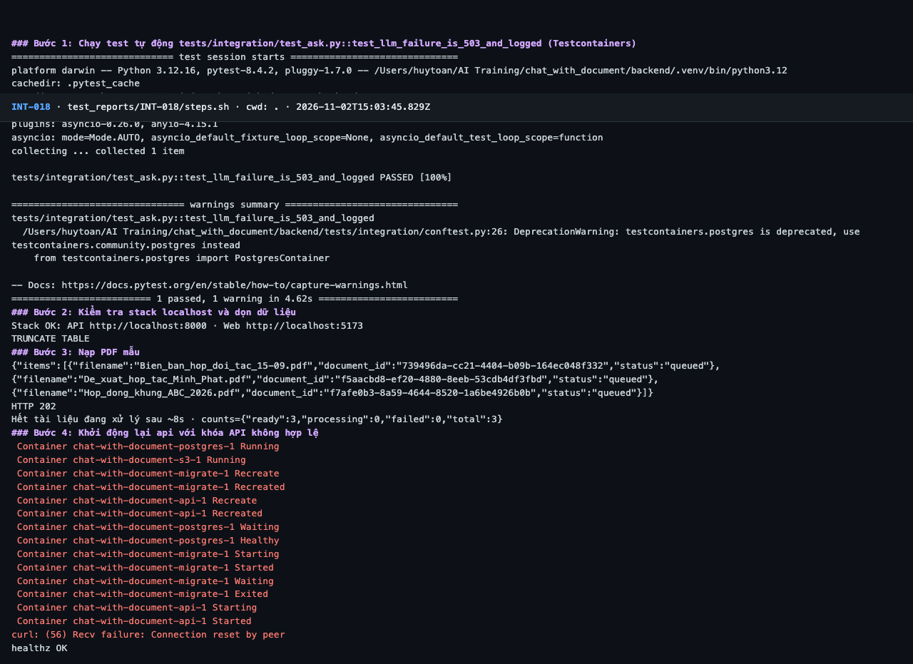
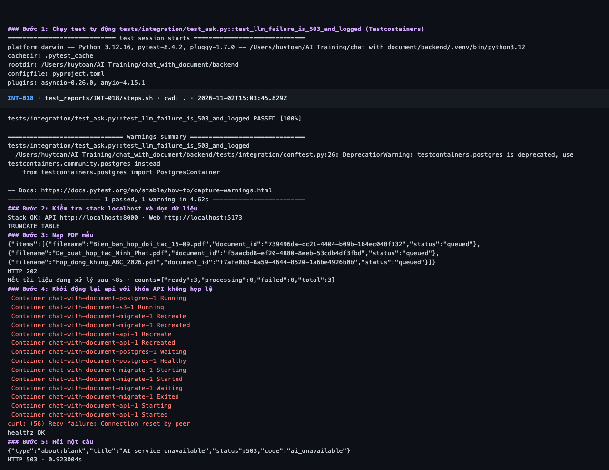
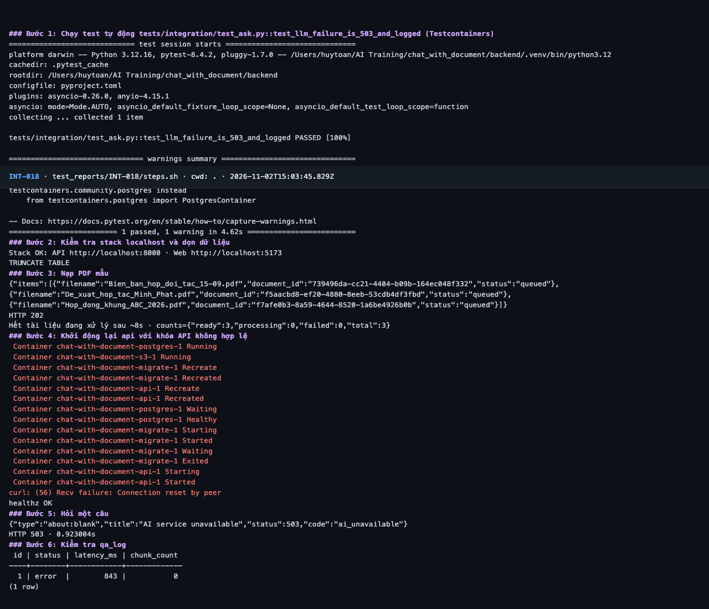
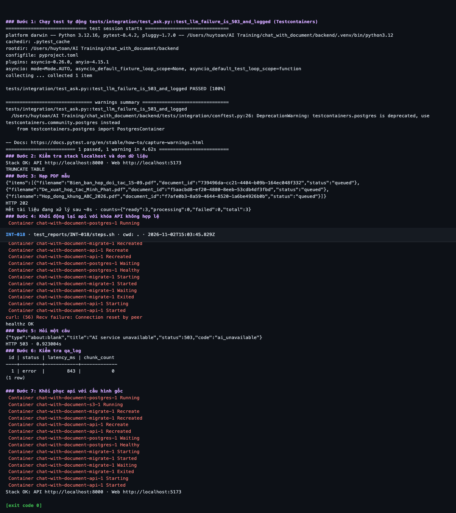

# Báo cáo kiểm thử — INT-018: LLM lỗi → 503 ai_unavailable và qa_log status error

| Mục | Giá trị |
|---|---|
| Test case | [INT-018](../../docs/07-verification/test_cases/INT-018.md) |
| Kết luận | **✅ Đạt** |
| Thời gian chạy | 2026-11-02 22:03:45 → 22:04:16 (UTC+7) |
| Người / agent thực hiện | Claude Code (agent), `frontend/e2e/run-cli.mjs` + `steps.sh` |
| Commit | `c02cc72 (có thay đổi chưa commit)` |
| Môi trường | localhost · web http://localhost:5173 · API http://localhost:8000 · Darwin 27.0.0 arm64 · Docker 29.6.2 · ANTHROPIC_API_KEY: không |
| Script | [steps.sh](steps.sh) |

## Kết quả từng bước

| # | Thao tác | Kết quả mong đợi | Kết quả thực tế | Đạt? | Bằng chứng |
|---|---|---|---|---|---|
| 1 | Chạy test tự động `tests/integration/test_ask.py::test_llm_failure_is_503_and_logged` (Testcontainers) | passed, exit code 0 | pytest: `1 passed, 1 warning in 4.62s` | ✅ | [ảnh](screenshots/01-buoc-1-chay-test-tu-dong-tests-integration-test-ask-py-test-.png) |
| 2 | Kiểm tra stack localhost và dọn dữ liệu | `Stack OK`; lệnh TRUNCATE thành công | Stack OK; TRUNCATE TABLE | ✅ | [ảnh](screenshots/02-buoc-2-kiem-tra-stack-localhost-va-don-du-lieu.png) |
| 3 | Nạp PDF mẫu | `ready: 3` | ready: 3 | ✅ | [ảnh](screenshots/03-buoc-3-nap-pdf-mau.png) |
| 4 | Khởi động lại api với khóa API không hợp lệ | Container `api` chạy lại, `/healthz` 200 | `healthz OK` | ✅ | [ảnh](screenshots/04-buoc-4-khoi-dong-lai-api-voi-khoa-api-khong-hop-le.png) |
| 5 | Hỏi một câu | HTTP 503, `code: ai_unavailable`, không lộ thông điệp kỹ thuật của Anthropic | HTTP 503 · 0.923004s; "code":"ai_unavailable"; không có thông điệp kỹ thuật của Anthropic | ✅ | [ảnh](screenshots/05-buoc-5-hoi-mot-cau.png) |
| 6 | Kiểm tra `qa_log` | Dòng mới nhất `status = error` | Dòng mới nhất status = error | ✅ | [ảnh](screenshots/06-buoc-6-kiem-tra-qa-log.png) |
| 7 | Khôi phục api với cấu hình gốc | Container `api` chạy lại với `.env` | `Stack OK` | ✅ | [ảnh](screenshots/07-buoc-7-khoi-phuc-api-voi-cau-hinh-goc-ket-thuc.png) |

## Bằng chứng

- Video: [video.webm](video.webm)
- Log: [logs/cleanup.log](logs/cleanup.log), [logs/run-meta.json](logs/run-meta.json), [logs/steps.log](logs/steps.log)
- Ảnh:

  

  

  

  

  

  

  

## Lỗi phát hiện

Không có.

## Ghi chú và sai lệch so với test case

- Theo đúng test case, api chạy với chuỗi **không hợp lệ** `sk-ant-invalid`, nên api gọi tới API Anthropic bằng chuỗi này và nhận lỗi (503 sau 0,9 s). Nguyên nhân cụ thể (401 hay lỗi mạng) không được ghi lại vì adapter ánh xạ về LLM unavailable và log container đã mất khi recreate api ở bước 7. Đây không phải khóa thật; không tìm hay dùng khóa nào.
- **Lỗi văn bản test case (TC-04):** "Tiêu chí đạt" ghi bước 6, 7 và "Dọn dẹp" ghi bước 8, lệch một số so với bảng bước (503 ở bước 5, `qa_log` ở bước 6, khôi phục ở bước 7). Đánh giá theo bảng bước.
