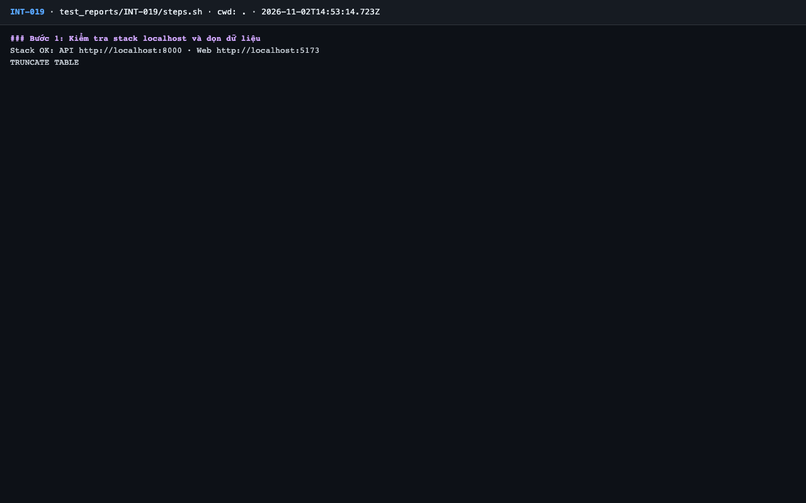
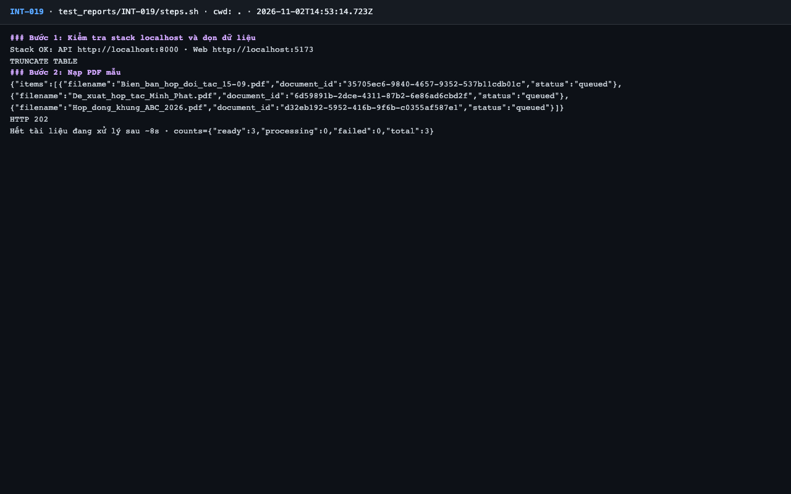
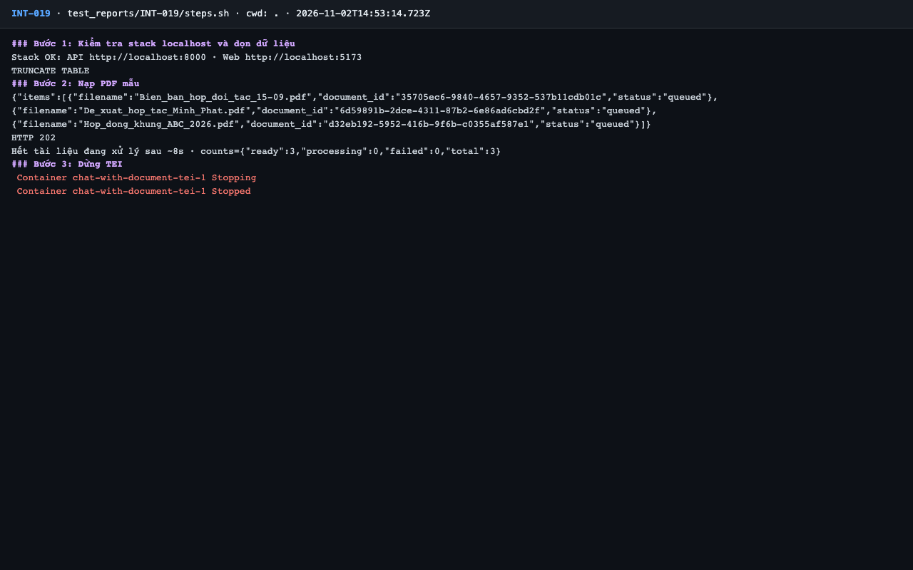
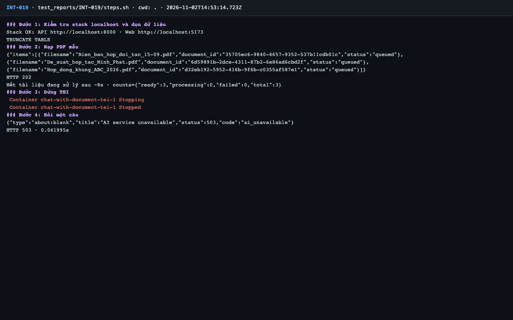
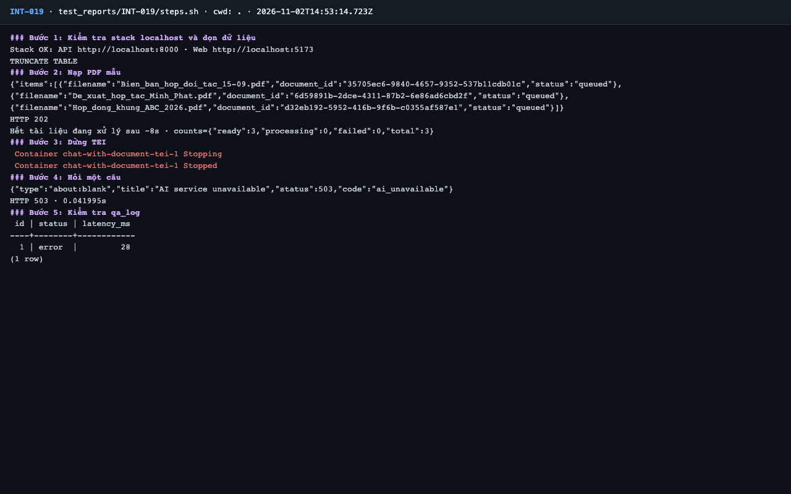
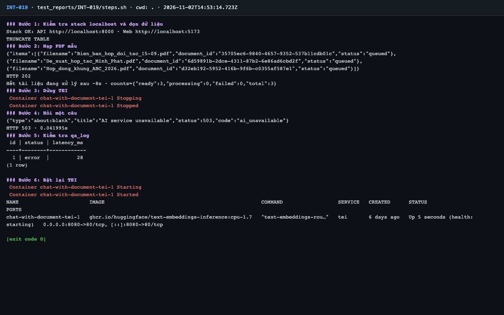

# Báo cáo kiểm thử — INT-019: TEI lỗi khi hỏi → 503 ai_unavailable

| Mục | Giá trị |
|---|---|
| Test case | [INT-019](../../docs/07-verification/test_cases/INT-019.md) |
| Kết luận | **✅ Đạt** |
| Thời gian chạy | 2026-11-02 21:53:14 → 21:53:32 (UTC+7) |
| Người / agent thực hiện | Claude Code (agent), `frontend/e2e/run-cli.mjs` + `steps.sh` |
| Commit | `c02cc72 (có thay đổi chưa commit)` |
| Môi trường | localhost · web http://localhost:5173 · API http://localhost:8000 · Darwin 27.0.0 arm64 · Docker 29.6.2 · ANTHROPIC_API_KEY: không |
| Script | [steps.sh](steps.sh) |

## Kết quả từng bước

| # | Thao tác | Kết quả mong đợi | Kết quả thực tế | Đạt? | Bằng chứng |
|---|---|---|---|---|---|
| 1 | Kiểm tra stack localhost và dọn dữ liệu | `Stack OK`; lệnh TRUNCATE thành công | Stack OK; TRUNCATE TABLE | ✅ | [ảnh](screenshots/01-buoc-1-kiem-tra-stack-localhost-va-don-du-lieu.png) |
| 2 | Nạp PDF mẫu | `ready: 3` | ready: 3 | ✅ | [ảnh](screenshots/02-buoc-2-nap-pdf-mau.png) |
| 3 | Dừng TEI | Container `tei` stopped | `tei-1 Stopped` | ✅ | [ảnh](screenshots/03-buoc-3-dung-tei.png) |
| 4 | Hỏi một câu | HTTP 503, `code: ai_unavailable` | `HTTP 503`; `"code":"ai_unavailable"` | ✅ | [ảnh](screenshots/04-buoc-4-hoi-mot-cau.png) |
| 5 | Kiểm tra `qa_log` | Dòng mới nhất `status = error` | Dòng mới nhất status = error | ✅ | [ảnh](screenshots/05-buoc-5-kiem-tra-qa-log.png) |
| 6 | Bật lại TEI | Container `tei` chạy | `tei-1   ghcr.io/huggingface/text-embeddings-inference:cpu-1.7   "text-embeddings-rou…"   tei       6 days ago   Up` | ✅ | [ảnh](screenshots/06-buoc-6-bat-lai-tei-ket-thuc.png) |

## Bằng chứng

- Video: [video.webm](video.webm)
- Log: [logs/cleanup.log](logs/cleanup.log), [logs/run-meta.json](logs/run-meta.json), [logs/steps.log](logs/steps.log)
- Ảnh:

  

  

  

  

  

  

## Lỗi phát hiện

Không có.

## Ghi chú và sai lệch so với test case

- Sau bước 6, TEI cần ~40 s khởi động lại; driver chờ `/health` trước khi chạy test tiếp theo.
