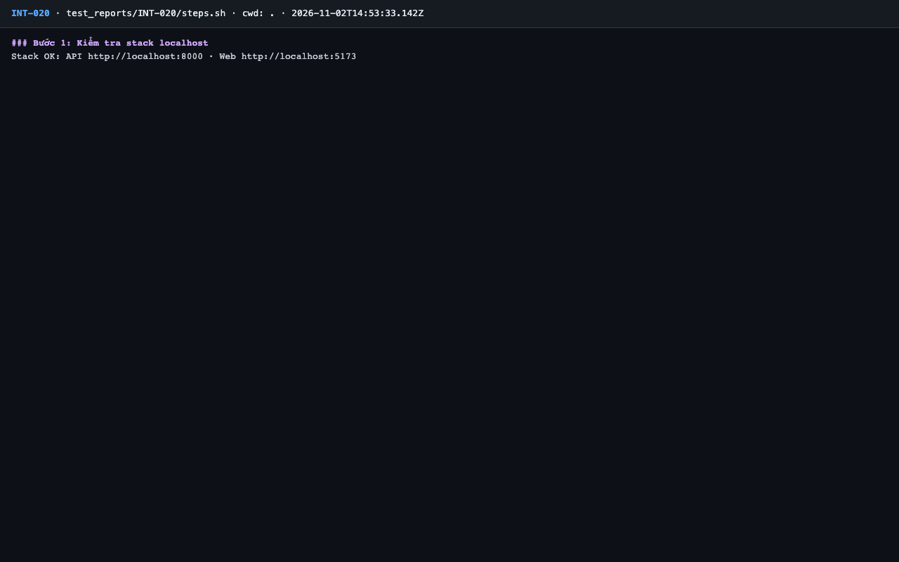
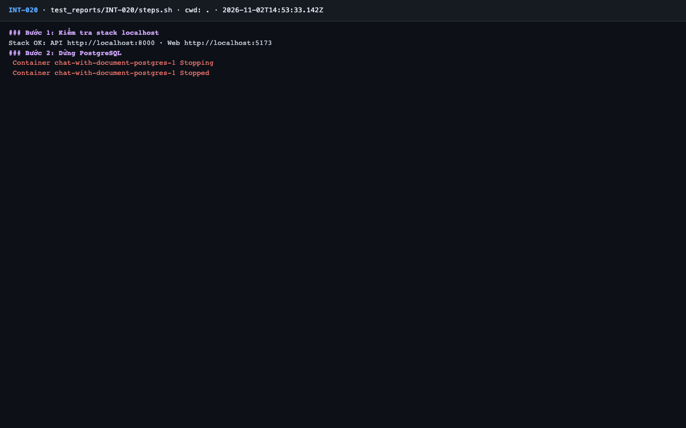
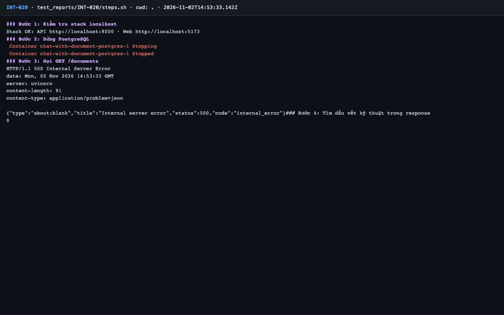
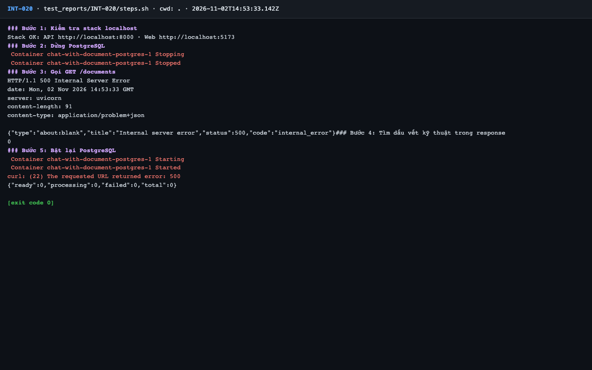

# Báo cáo kiểm thử — INT-020: Lỗi không lường trước → 500 internal_error, không lộ stack trace

| Mục | Giá trị |
|---|---|
| Test case | [INT-020](../../docs/07-verification/test_cases/INT-020.md) |
| Kết luận | **✅ Đạt** |
| Thời gian chạy | 2026-11-02 21:53:32 → 21:53:39 (UTC+7) |
| Người / agent thực hiện | Claude Code (agent), `frontend/e2e/run-cli.mjs` + `steps.sh` |
| Commit | `c02cc72 (có thay đổi chưa commit)` |
| Môi trường | localhost · web http://localhost:5173 · API http://localhost:8000 · Darwin 27.0.0 arm64 · Docker 29.6.2 · ANTHROPIC_API_KEY: không |
| Script | [steps.sh](steps.sh) |

## Kết quả từng bước

| # | Thao tác | Kết quả mong đợi | Kết quả thực tế | Đạt? | Bằng chứng |
|---|---|---|---|---|---|
| 1 | Kiểm tra stack localhost | `Stack OK` | `Stack OK` | ✅ | [ảnh](screenshots/01-buoc-1-kiem-tra-stack-localhost.png) |
| 2 | Dừng PostgreSQL | Container `postgres` stopped | `postgres-1 Stopped` | ✅ | [ảnh](screenshots/02-buoc-2-dung-postgresql.png) |
| 3 | Gọi GET /documents | HTTP 500, `application/problem+json`, `code: internal_error` | `HTTP/1.1 500`; `content-type: application/problem+json`; `"code":"internal_error"` | ✅ | [ảnh](screenshots/03-buoc-3-goi-get-documents.png) |
| 4 | Tìm dấu vết kỹ thuật trong response | `0` dòng chứa `Traceback`, `File "`, `asyncpg`, `/app/` | 0 dòng dấu vết kỹ thuật | ✅ | [ảnh](screenshots/04-buoc-5-bat-lai-postgresql-ket-thuc.png) |
| 5 | Bật lại PostgreSQL | `postgres` healthy; `/api/v1/documents` trả 200 | postgres chạy lại, /documents 200, counts trả về | ✅ | [ảnh](screenshots/04-buoc-5-bat-lai-postgresql-ket-thuc.png) |

## Bằng chứng

- Video: [video.webm](video.webm)
- Log: [logs/run-meta.json](logs/run-meta.json), [logs/steps.log](logs/steps.log)
- Ảnh:

  

  

  

  

## Lỗi phát hiện

| # | Mô tả | Mức độ (Blocker / Critical / Major / Minor) | Bước | Bằng chứng |
|---|---|---|---|---|
| 1 | Worker thoát hẳn khi mất kết nối PostgreSQL: lỗi không được bắt trong vòng lặp `run_forever` (`backend/app/worker/main.py:37`). Compose local không tự khởi động lại nên hàng đợi ngừng tới khi chạy tay. `infra/docker-compose.prod.yml` có `restart: unless-stopped` nên giảm nhẹ trên AWS (chưa kiểm chứng trên AWS) | Minor | Sau bước 2 | [OPS-007/logs/run1-worker-all.log](../OPS-007/logs/run1-worker-all.log) |

## Ghi chú và sai lệch so với test case

- Trong bước 5 có một lần `curl: (22) ... 500` trong vòng chờ postgres, sau đó trả 200.
- **Phát hiện ngoài phạm vi test case:** khi postgres dừng, **cả 2 worker thoát hẳn** (`ConnectionRefusedError` không được bắt trong `run_forever`) và không tự chạy lại vì compose local không có `restart`. Điều này làm hỏng lần chạy OPS-007 đầu tiên. Xem lỗi bên dưới.
