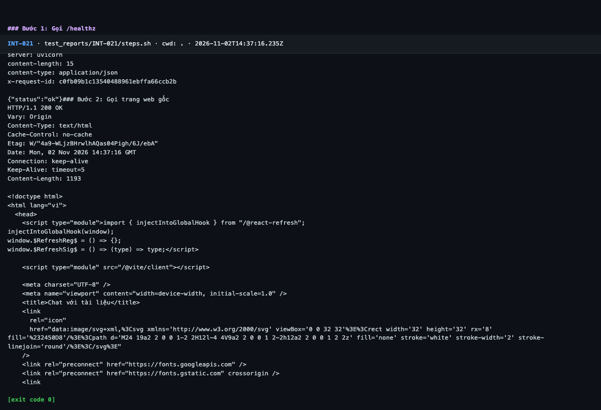
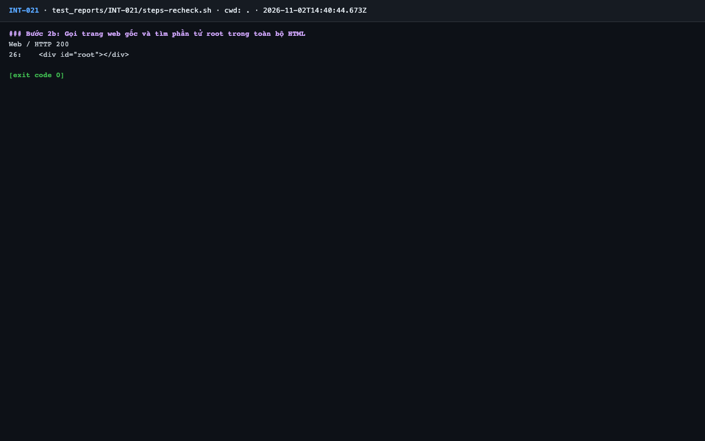

# Báo cáo kiểm thử — INT-021: /healthz trả 200

| Mục | Giá trị |
|---|---|
| Test case | [INT-021](../../docs/07-verification/test_cases/INT-021.md) |
| Kết luận | **✅ Đạt** |
| Thời gian chạy | 2026-11-02 21:37:15 → 21:37:18 (UTC+7) |
| Người / agent thực hiện | Claude Code (agent), `frontend/e2e/run-cli.mjs` + `steps.sh` |
| Commit | `c02cc72 (có thay đổi chưa commit)` |
| Môi trường | localhost · web http://localhost:5173 · API http://localhost:8000 · Darwin 27.0.0 arm64 · Docker 29.6.2 · ANTHROPIC_API_KEY: không |
| Script | [steps-recheck.sh](steps-recheck.sh), [steps.sh](steps.sh) |

## Kết quả từng bước

| # | Thao tác | Kết quả mong đợi | Kết quả thực tế | Đạt? | Bằng chứng |
|---|---|---|---|---|---|
| 1 | Gọi `/healthz` | HTTP 200 | `HTTP/1.1 200` | ✅ | [ảnh](screenshots/01-buoc-1-goi-healthz-ket-thuc.png) |
| 2 | Gọi trang web gốc | HTTP 200, HTML có `
` | HTTP 200. Script gợi ý `head -30` cắt mất phần tử root; kiểm tra lại toàn bộ HTML (`steps-recheck.sh`): dòng 26 `

` | ✅ | — |

## Bằng chứng

- Video: [video-02.webm](video-02.webm), [video.webm](video.webm)
- Log: [logs/run-meta.json](logs/run-meta.json), [logs/steps-recheck.log](logs/steps-recheck.log), [logs/steps.log](logs/steps.log)
- Ảnh:

  

  

## Lỗi phát hiện

Không có.

## Ghi chú và sai lệch so với test case

- **Lỗi script test case (TC-02):** `head -30` trong script gợi ý cắt HTML trước `
` nên bước 2 không thể chứng minh từ log gốc. Bổ sung `steps-recheck.sh` (video-02.webm) trong thư mục test này; không sửa test case.
