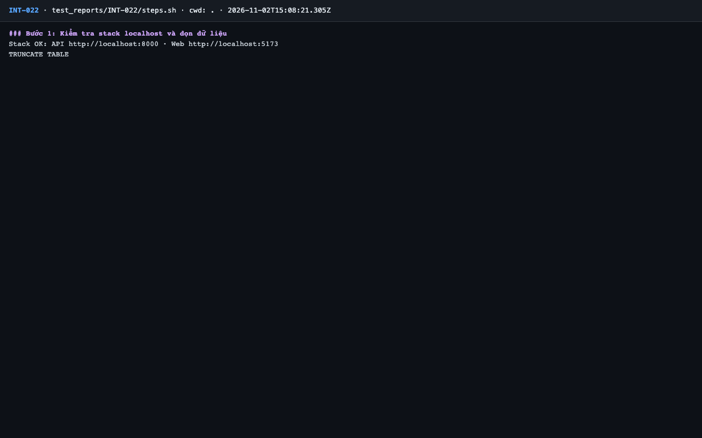
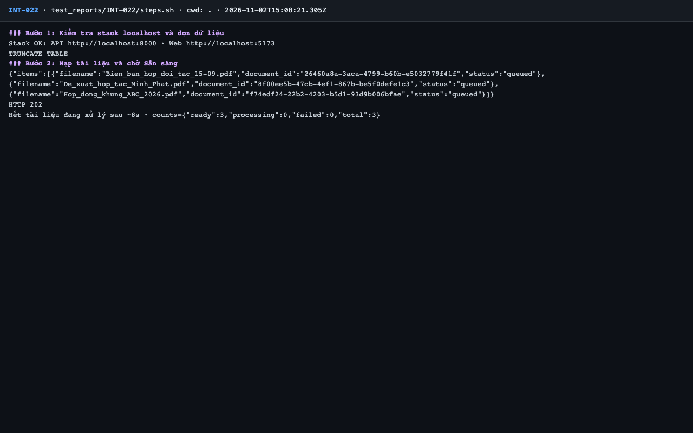
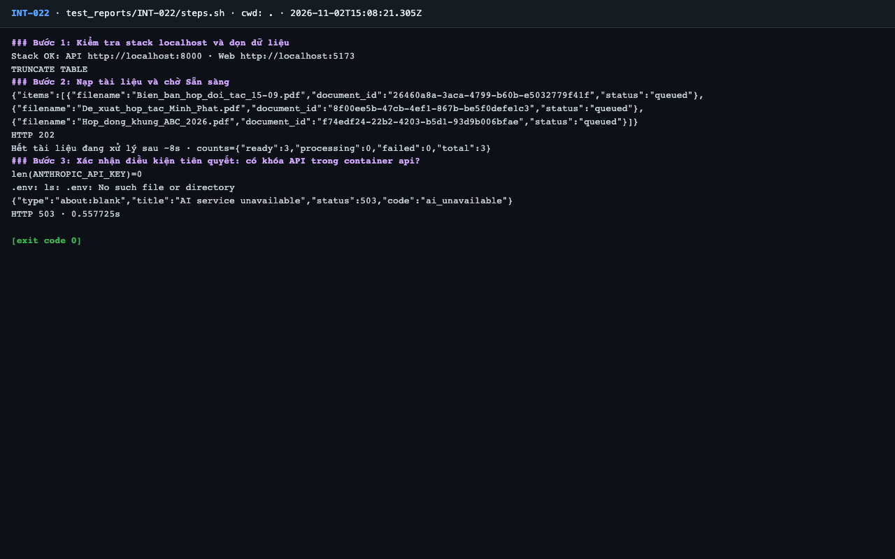

# Báo cáo kiểm thử — INT-022: Gọi Claude thật với tài liệu mẫu (live)

| Mục | Giá trị |
|---|---|
| Test case | [INT-022](../../docs/07-verification/test_cases/INT-022.md) |
| Kết luận | **⛔ Bị chặn** |
| Thời gian chạy | 2026-11-02 22:08:20 → 22:08:32 (UTC+7) |
| Người / agent thực hiện | Claude Code (agent), `frontend/e2e/run-cli.mjs` + `steps.sh` |
| Commit | `c02cc72 (có thay đổi chưa commit)` |
| Môi trường | localhost · web http://localhost:5173 · API http://localhost:8000 · Darwin 27.0.0 arm64 · Docker 29.6.2 · ANTHROPIC_API_KEY: không |
| Script | [steps.sh](steps.sh) |

> ⛔ Cần Claude thật nhưng không có `ANTHROPIC_API_KEY`; không dùng khóa nào và không giả lập vì test case không cho phép. Chỉ chạy tới bước chứng minh điều kiện tiên quyết.

## Kết quả từng bước

| # | Thao tác | Kết quả mong đợi | Kết quả thực tế | Đạt? | Bằng chứng |
|---|---|---|---|---|---|
| 1 | Kiểm tra stack localhost và dọn dữ liệu | `Stack OK`; lệnh TRUNCATE thành công | Stack OK; TRUNCATE TABLE | ✅ | [ảnh](screenshots/01-buoc-1-kiem-tra-stack-localhost-va-don-du-lieu.png) |
| 2 | Nạp PDF mẫu | `ready: 3` | ready: 3 | ✅ | [ảnh](screenshots/02-buoc-2-nap-tai-lieu-va-cho-san-sang.png) |
| 3 | G-001: điều khoản tạm ứng ABC | 200; nêu tạm ứng 30% giá trị đơn hàng trong 10 ngày làm việc | Chứng minh thiếu khóa: `len(ANTHROPIC_API_KEY)=0`, không có `.env`; hỏi thử 1 câu → HTTP 503 `ai_unavailable`. Golden set / câu live KHÔNG chạy | ⛔ | [ảnh](screenshots/03-buoc-3-xac-nhan-dieu-kien-tien-quyet-co-khoa-api-trong-conta.png) |
| 4 | G-002: mức phạt chậm thanh toán | 200; nêu 0,05%/ngày, tối đa 8% | Không chạy — bị chặn vì thiếu khóa API | — | — |
| 5 | G-003: chiết khấu Minh Phát | 200; nêu 12% cho đơn ≥ 500 triệu, hợp tác 24 tháng | Không chạy — bị chặn vì thiếu khóa API | — | — |
| 6 | G-051: câu ngoài tài liệu | 200; câu trả lời là "Không tìm thấy thông tin…", không trả lời "Paris" | Không chạy — bị chặn vì thiếu khóa API | — | — |

## Bằng chứng

- Video: [video.webm](video.webm)
- Log: [logs/cleanup.log](logs/cleanup.log), [logs/run-meta.json](logs/run-meta.json), [logs/steps.log](logs/steps.log)
- Ảnh:

  

  

  

## Lỗi phát hiện

Không có.

## Ghi chú và sai lệch so với test case

- Chỉ chạy bước 1–2 và một câu hỏi để chứng minh thiếu khóa (script khác script gợi ý: không chạy `make eval`, không chấm điểm). Không có số đo chất lượng hay độ trễ nào được ghi nhận.
