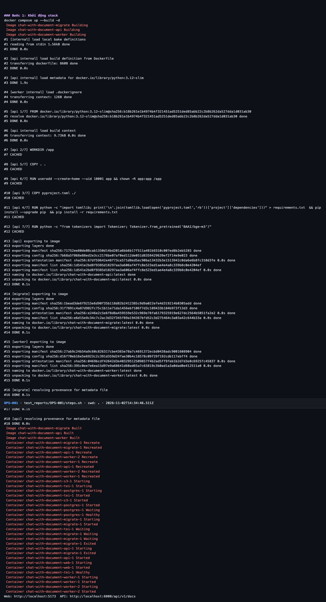
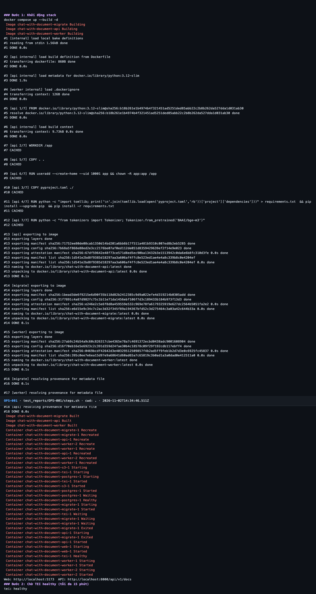
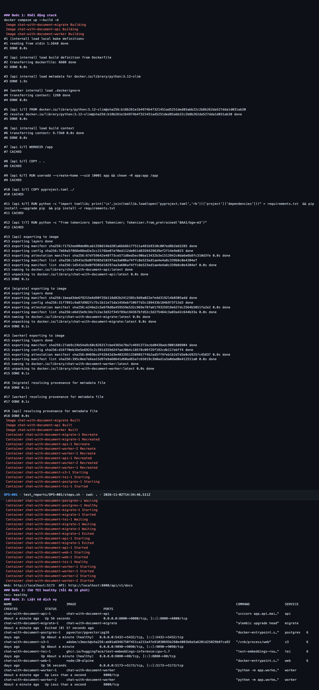
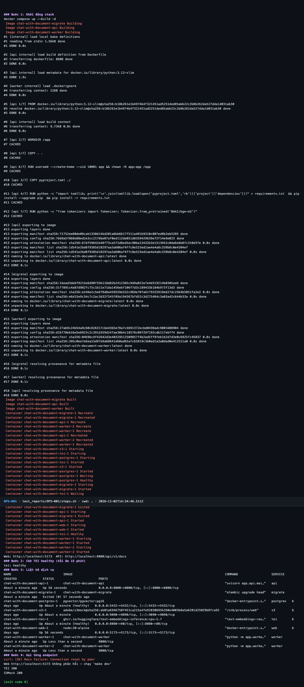
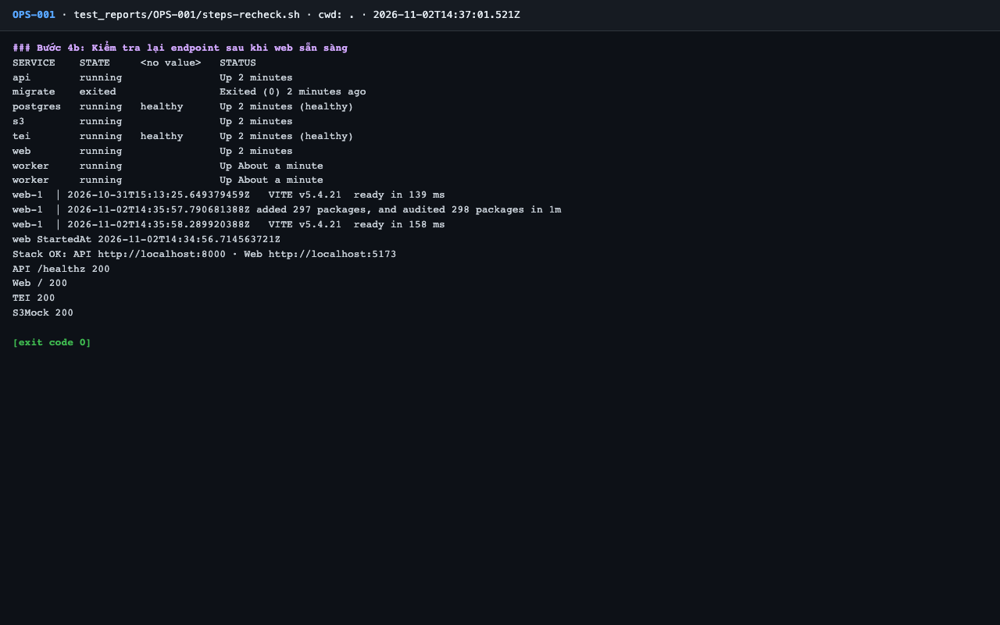

# Báo cáo kiểm thử — OPS-001: make dev dựng đủ stack healthy

| Mục | Giá trị |
|---|---|
| Test case | [OPS-001](../../docs/07-verification/test_cases/OPS-001.md) |
| Kết luận | **✅ Đạt** |
| Thời gian chạy | 2026-11-02 21:34:45 → 21:36:03 (UTC+7) |
| Người / agent thực hiện | Claude Code (agent), `frontend/e2e/run-cli.mjs` + `steps.sh` |
| Commit | `c02cc72 (có thay đổi chưa commit)` |
| Môi trường | localhost · web http://localhost:5173 · API http://localhost:8000 · Darwin 27.0.0 arm64 · Docker 29.6.2 · ANTHROPIC_API_KEY: không |
| Script | [steps-recheck.sh](steps-recheck.sh), [steps.sh](steps.sh) |

## Kết quả từng bước

| # | Thao tác | Kết quả mong đợi | Kết quả thực tế | Đạt? | Bằng chứng |
|---|---|---|---|---|---|
| 1 | Khởi động stack | Lệnh kết thúc, in URL web và API | `Web: http://localhost:5173`; `API: http://localhost:8000` | ✅ | [ảnh](screenshots/01-buoc-1-khoi-dong-stack.png) |
| 2 | Chờ TEI healthy (tối đa 15 phút) | `tei` healthy | `tei: healthy` | ✅ | [ảnh](screenshots/02-buoc-2-cho-tei-healthy-toi-da-15-phut.png) |
| 3 | Liệt kê dịch vụ | postgres (healthy), s3, tei (healthy), api, 2 worker, web đều `running`; migrate `exited (0)` | postgres (healthy), s3, tei (healthy), api, worker ×2, web đều Up; migrate Exited (0) | ✅ | [ảnh](screenshots/03-buoc-3-liet-ke-dich-vu.png) |
| 4 | Gọi từng endpoint | API `/healthz` 200; web 200; TEI `/health` 200; S3Mock 200 | Lần gọi đầu (ngay sau make dev): TEI 200, S3Mock 200, API OK, nhưng web `Connection reset by peer` vì container web còn đang chạy `npm ci`. Kiểm tra lại (video-02, `steps-recheck.sh`) sau khi Vite sẵn sàng: API /healthz 200, Web / 200, TEI 200, S3Mock 200 | ✅ | [ảnh](screenshots/04-buoc-4-goi-tung-endpoint-ket-thuc.png) |

## Bằng chứng

- Video: [video-02.webm](video-02.webm), [video.webm](video.webm)
- Log: [logs/run-meta.json](logs/run-meta.json), [logs/steps-recheck.log](logs/steps-recheck.log), [logs/steps.log](logs/steps.log)
- Ảnh:

  

  

  

  

  

## Lỗi phát hiện

| # | Mô tả | Mức độ (Blocker / Critical / Major / Minor) | Bước | Bằng chứng |
|---|---|---|---|---|
| 1 | `make dev` báo xong và in URL web trong khi web còn ~1 phút mới phản hồi (`npm ci` mỗi lần khởi động, không có healthcheck / chờ) | Minor | 4 | [logs/steps.log](logs/steps.log) |

## Ghi chú và sai lệch so với test case

- **Lỗi script test case (TC-01):** script gợi ý gọi web ngay sau `make dev`, nhưng container `web` chạy `npm ci` mỗi lần khởi động và compose không có healthcheck cho web. Lần chạy đầu: web `Connection reset by peer` ở bước 4 (Vite sẵn sàng lúc 21:35:58, sau ~62 s kể từ khi container khởi động). Thực hiện lại bước 4 bằng `steps-recheck.sh` (video-02.webm) sau khi web sẵn sàng: cả 4 endpoint 200. Kết luận ✅ dựa trên lần kiểm tra lại; lần đầu giữ nguyên trong [logs/steps.log](logs/steps.log).
- Stack khởi động từ trạng thái đã có image và model (`tei-cache`), không phải máy sạch: thời gian dựng ~1 phút không đại diện cho lần đầu.
- `make dev` in URL web trước khi web phản hồi được: xem Lỗi phát hiện.
- Kiểm tra ngoài test case: `len(ANTHROPIC_API_KEY)=0` trong container api; không có tệp `.env`.
