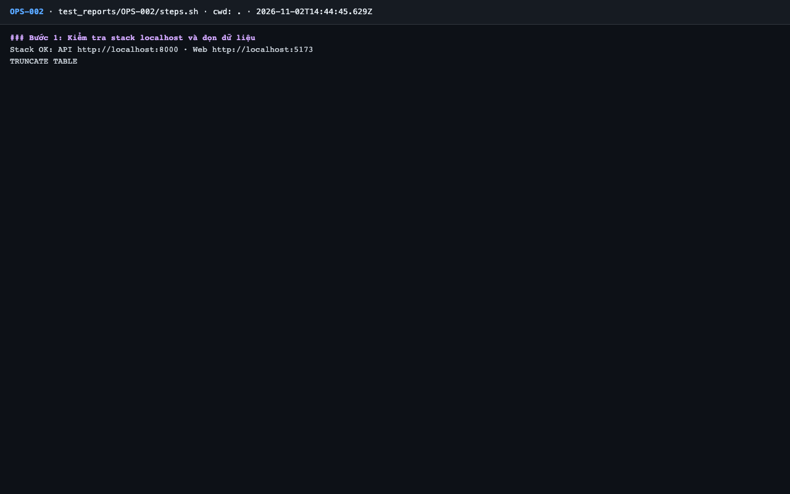
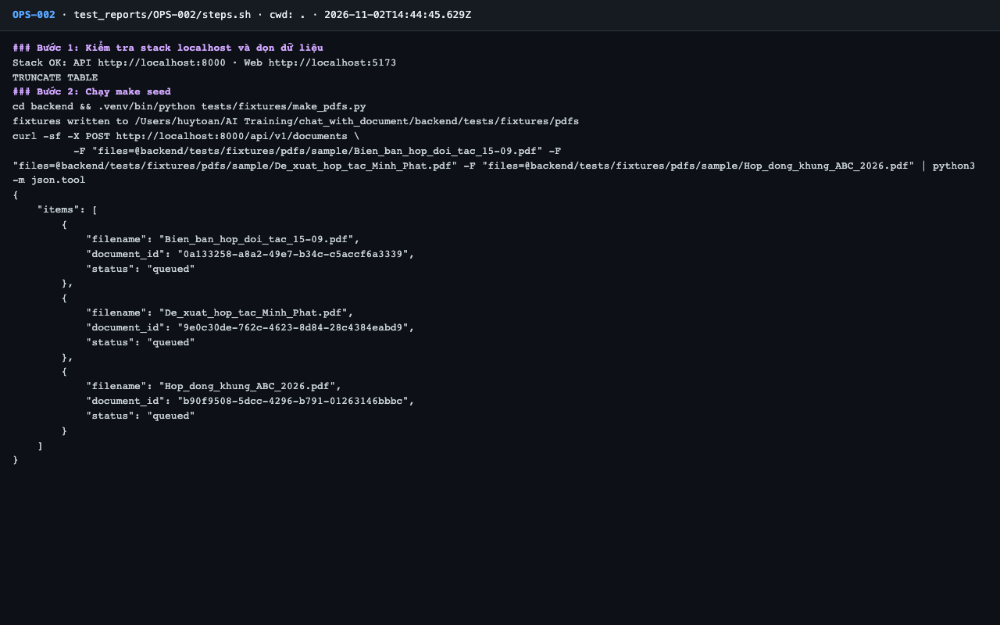
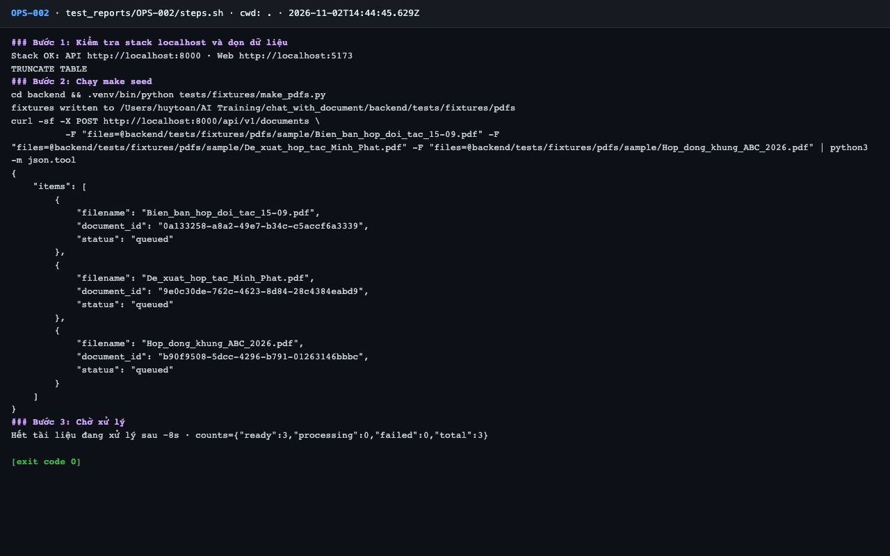

# Báo cáo kiểm thử — OPS-002: make seed nạp 3 PDF mẫu tới Sẵn sàng

| Mục | Giá trị |
|---|---|
| Test case | [OPS-002](../../docs/07-verification/test_cases/OPS-002.md) |
| Kết luận | **✅ Đạt** |
| Thời gian chạy | 2026-11-02 21:44:45 → 21:44:57 (UTC+7) |
| Người / agent thực hiện | Claude Code (agent), `frontend/e2e/run-cli.mjs` + `steps.sh` |
| Commit | `c02cc72 (có thay đổi chưa commit)` |
| Môi trường | localhost · web http://localhost:5173 · API http://localhost:8000 · Darwin 27.0.0 arm64 · Docker 29.6.2 · ANTHROPIC_API_KEY: không |
| Script | [steps.sh](steps.sh) |

## Kết quả từng bước

| # | Thao tác | Kết quả mong đợi | Kết quả thực tế | Đạt? | Bằng chứng |
|---|---|---|---|---|---|
| 1 | Kiểm tra stack localhost và dọn dữ liệu | `Stack OK`; lệnh TRUNCATE thành công | Stack OK; TRUNCATE TABLE | ✅ | [ảnh](screenshots/01-buoc-1-kiem-tra-stack-localhost-va-don-du-lieu.png) |
| 2 | Chạy `make seed` | JSON 3 item `queued` | 3 item `queued` | ✅ | [ảnh](screenshots/02-buoc-2-chay-make-seed.png) |
| 3 | Chờ xử lý | `{ready:3, processing:0, failed:0, total:3}` | `{"ready":3,"processing":0,"failed":0,"total":3}` | ✅ | [ảnh](screenshots/03-buoc-3-cho-xu-ly-ket-thuc.png) |

## Bằng chứng

- Video: [video.webm](video.webm)
- Log: [logs/cleanup.log](logs/cleanup.log), [logs/run-meta.json](logs/run-meta.json), [logs/steps.log](logs/steps.log)
- Ảnh:

  

  

  

## Lỗi phát hiện

| # | Mô tả | Mức độ (Blocker / Critical / Major / Minor) | Bước | Bằng chứng |
|---|---|---|---|---|
| 1 | `make fixtures` / `make seed` (nằm trong README §2 và AGENTS.md) ghi đè 5 PDF fixture được git theo dõi bằng nội dung khác bản đã commit, làm bẩn cây làm việc | Minor | 2 | [logs/steps.log](logs/steps.log) |

## Ghi chú và sai lệch so với test case

- `make seed` phụ thuộc `make fixtures`, và `make fixtures` sinh lại 5 tệp PDF được git theo dõi với nội dung khác bản đã commit. Agent đã `git restore` lại và đối chiếu shasum trùng trước khi chạy tiếp (không có tệp nào khác bị đổi).
