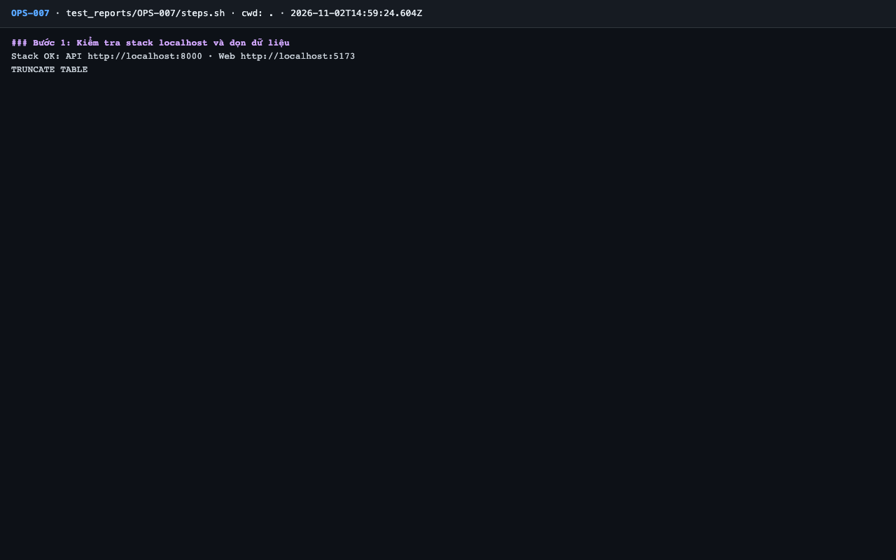
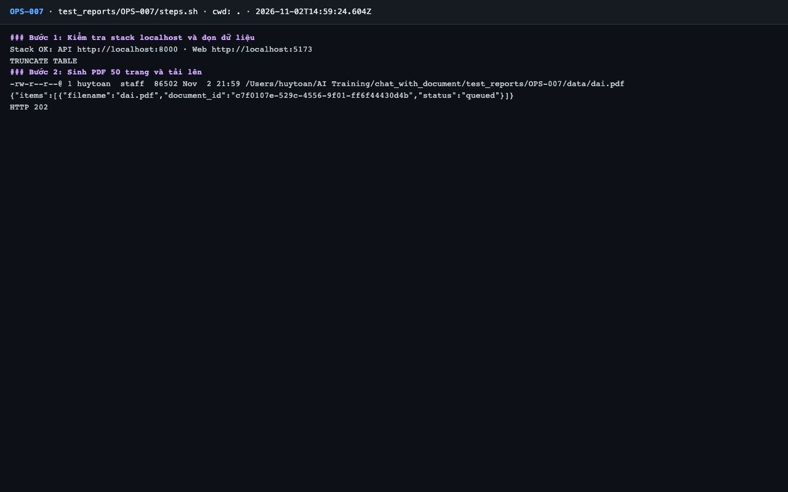
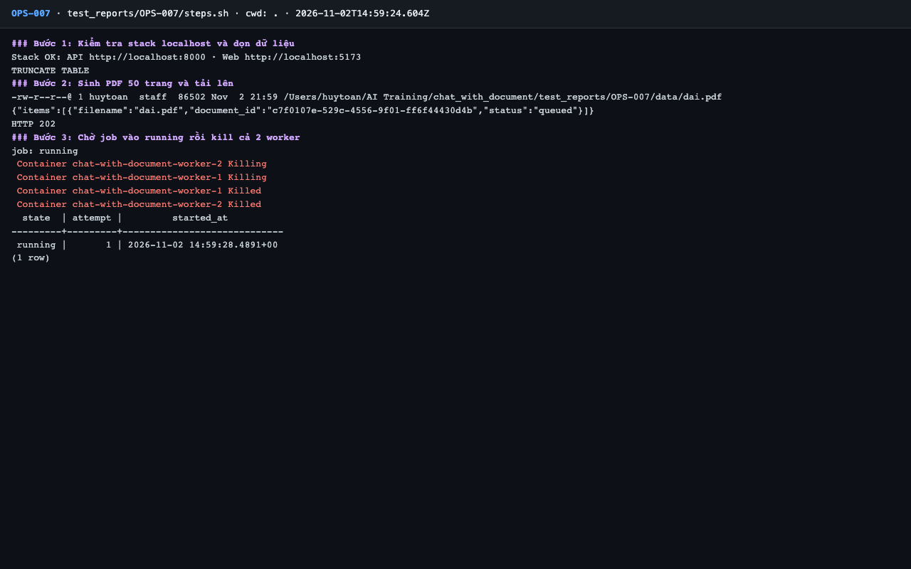
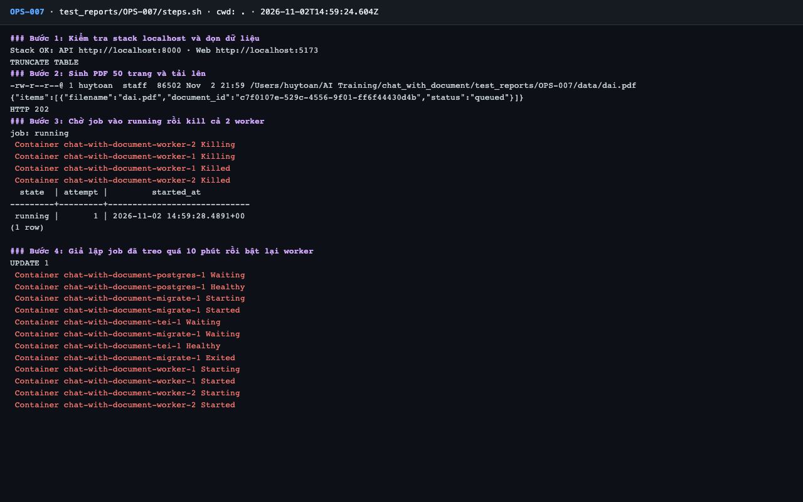
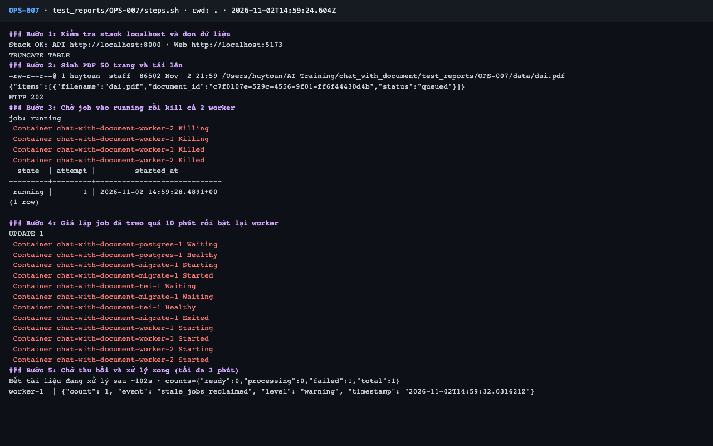
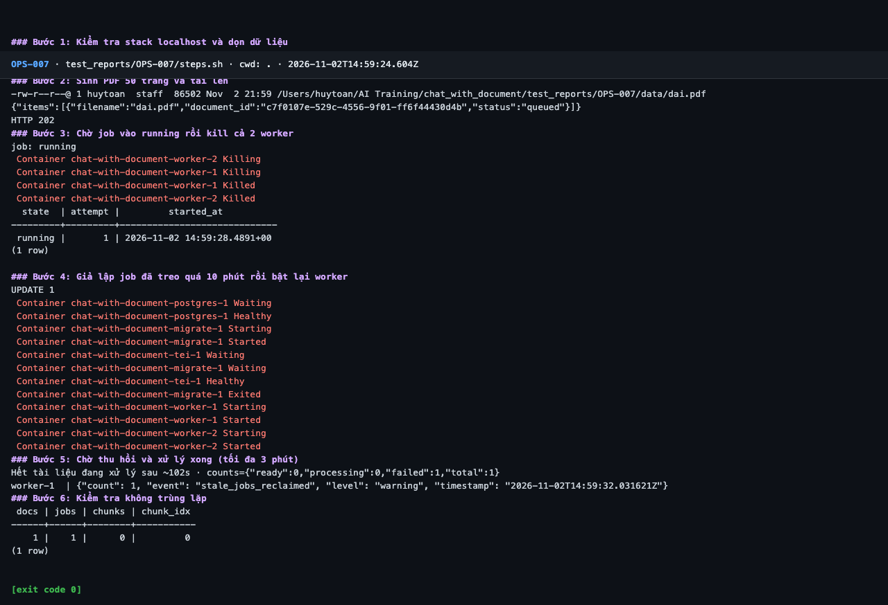

# Báo cáo kiểm thử — OPS-007: Khởi động lại worker khi đang xử lý: job được thu hồi

| Mục | Giá trị |
|---|---|
| Test case | [OPS-007](../../docs/07-verification/test_cases/OPS-007.md) |
| Kết luận | **❌ Không đạt** |
| Thời gian chạy | 2026-11-02 21:59:23 → 22:01:50 (UTC+7) |
| Người / agent thực hiện | Claude Code (agent), `frontend/e2e/run-cli.mjs` + `steps.sh` |
| Commit | `c02cc72 (có thay đổi chưa commit)` |
| Môi trường | localhost · web http://localhost:5173 · API http://localhost:8000 · Darwin 27.0.0 arm64 · Docker 29.6.2 · ANTHROPIC_API_KEY: không |
| Script | [steps.sh](steps.sh) |

## Kết quả từng bước

| # | Thao tác | Kết quả mong đợi | Kết quả thực tế | Đạt? | Bằng chứng |
|---|---|---|---|---|---|
| 1 | Kiểm tra stack localhost và dọn dữ liệu | `Stack OK`; lệnh TRUNCATE thành công | Stack OK; TRUNCATE TABLE | ✅ | [ảnh](screenshots/01-buoc-1-kiem-tra-stack-localhost-va-don-du-lieu.png) |
| 2 | Sinh PDF 50 trang và tải lên | HTTP 202 | HTTP 202; 1 item `queued` | ✅ | [ảnh](screenshots/02-buoc-2-sinh-pdf-50-trang-va-tai-len.png) |
| 3 | Chờ job vào `running` rồi kill cả 2 worker | Job `running`; worker bị kill | Job running; 2 worker bị kill | ✅ | [ảnh](screenshots/03-buoc-3-cho-job-vao-running-roi-kill-ca-2-worker.png) |
| 4 | Giả lập job đã treo quá 10 phút rồi bật lại worker | `UPDATE 1`; worker chạy lại | `UPDATE 1` | ✅ | [ảnh](screenshots/04-buoc-4-gia-lap-job-da-treo-qua-10-phut-roi-bat-lai-worker.png) |
| 5 | Chờ thu hồi và xử lý xong (tối đa 3 phút) | Log worker có `stale_jobs_reclaimed`; tài liệu `ready` | KHÔNG khớp `"ready":1\|counts=\{"ready":1`. Output cuối: Hết tài liệu đang xử lý sau ~102s · counts={"ready":0,"processing":0,"failed":1,"total":1} / worker-1  \| {"count": 1, "event": "stale_jobs_reclaimed", "level": "warning", "timestamp": "2026-11-02T14:59:32.031621Z"} | ❌ | [ảnh](screenshots/05-buoc-5-cho-thu-hoi-va-xu-ly-xong-toi-da-3-phut.png) |
| 6 | Kiểm tra không trùng lặp | 1 tài liệu, 1 job, `chunks = chunk_idx` | docs=1 jobs=1 chunks=0 chunk_idx=0 | ✅ | [ảnh](screenshots/06-buoc-6-kiem-tra-khong-trung-lap-ket-thuc.png) |

## Bằng chứng

- Video: [video.webm](video.webm)
- Log: [logs/cleanup.log](logs/cleanup.log), [logs/run-meta.json](logs/run-meta.json), [logs/run1-invalid-steps.log](logs/run1-invalid-steps.log), [logs/run1-worker-all.log](logs/run1-worker-all.log), [logs/steps.log](logs/steps.log), [logs/worker-job-timeline.log](logs/worker-job-timeline.log)
- Ảnh:

  

  

  

  

  

  

## Lỗi phát hiện

| # | Mô tả | Mức độ (Blocker / Critical / Major / Minor) | Bước | Bằng chứng |
|---|---|---|---|---|
| 1 | Thu hồi job đúng nhưng PDF 50 trang vẫn thất bại `transient_exhausted` vì embed vượt timeout 30 s của worker (cùng nguyên nhân PERF-001). Caveat: TEI giả lập x86 | Major | 5 | [logs/worker-job-timeline.log](logs/worker-job-timeline.log) |

## Ghi chú và sai lệch so với test case

- Cơ chế thu hồi **hoạt động**: log `stale_jobs_reclaimed count=1`, job chạy lại, không trùng tài liệu / job / chunk. Nhưng tài liệu kết thúc `failed` / `transient_exhausted`, không `ready`, nên **không đạt** tiêu chí.
- Nguyên nhân: PDF 50 trang gọi TEI quá timeout 30 giây (`EmbeddingUnavailable('')`) ở cả các lần thử, [logs/worker-job-timeline.log](logs/worker-job-timeline.log). **Lưu ý môi trường:** TEI chạy giả lập x86 trên Apple Silicon; chưa xác định trên AWS có lặp lại không. Xem PERF-001.
- **Lần chạy đầu không hợp lệ, đã chạy lại:** chạy ngay sau INT-020 theo thứ tự README §8, cả 2 worker đã chết nên job nằm `queued` 60 giây, `kill` báo "No container to kill". Lưu ở [logs/run1-invalid-steps.log](logs/run1-invalid-steps.log). **Lỗi thứ tự test case (TC-05):** §8 đặt OPS-007 ngay sau INT-020 mà không khôi phục worker.
