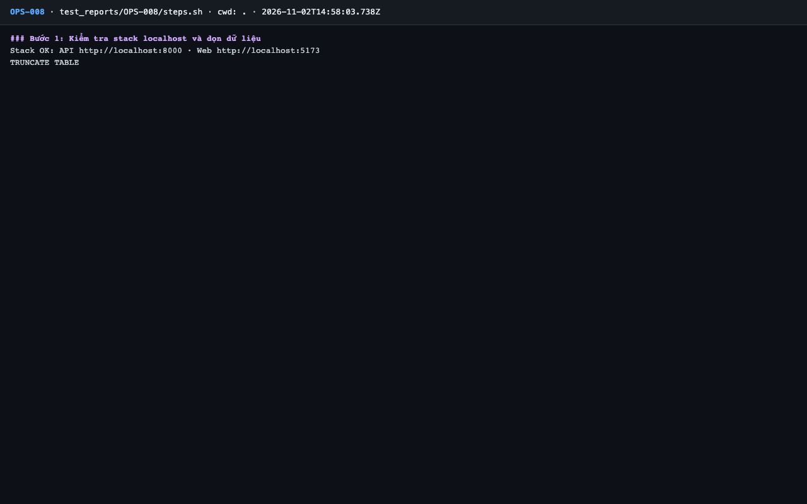
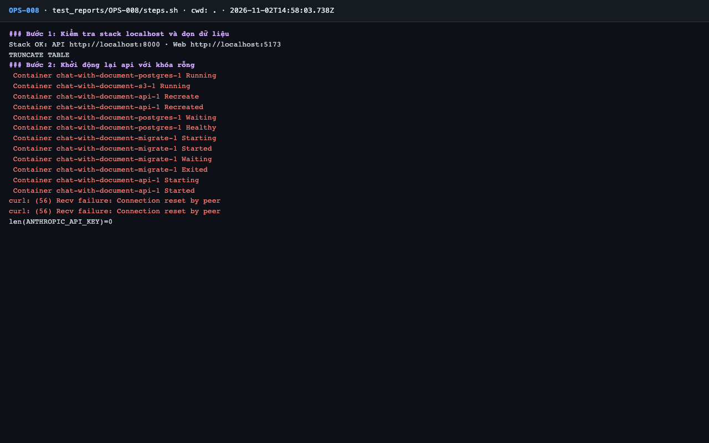
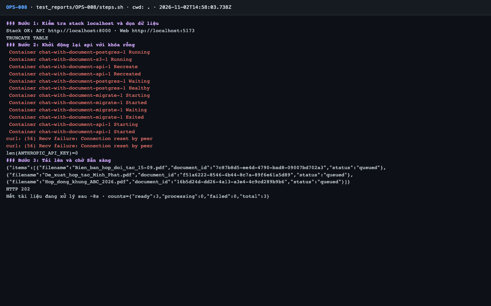
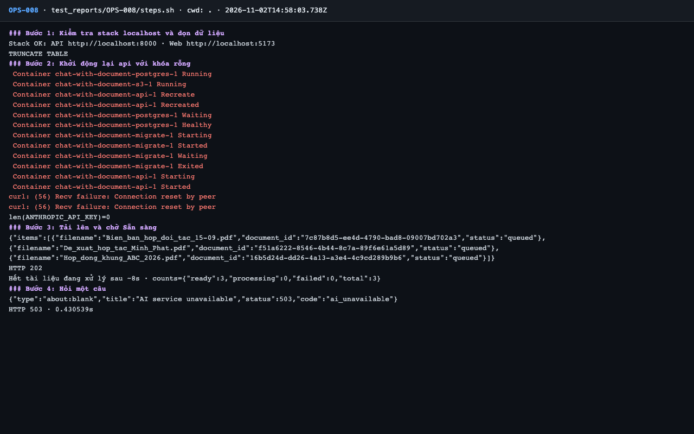
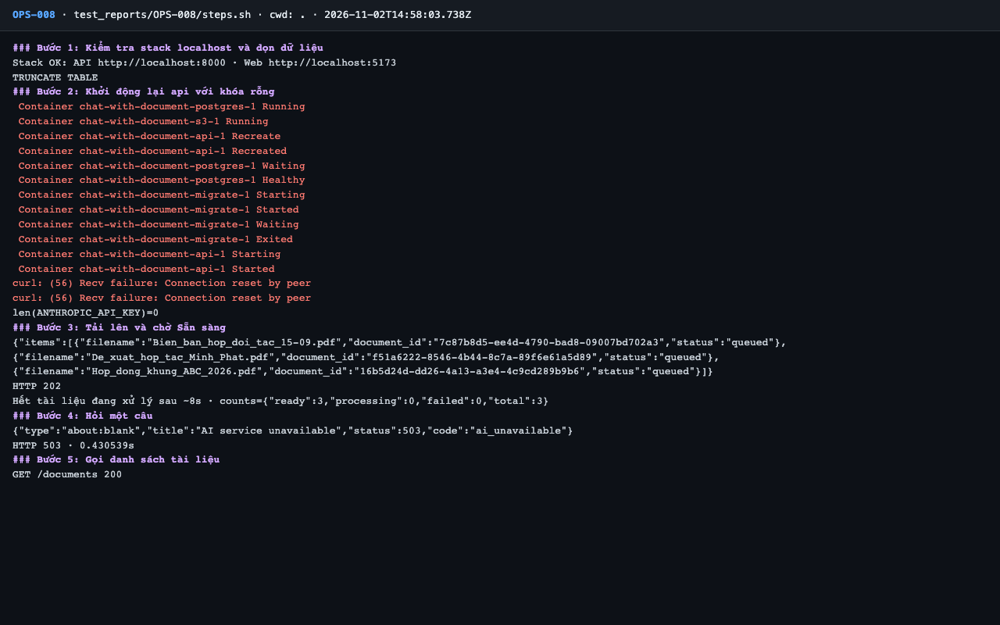
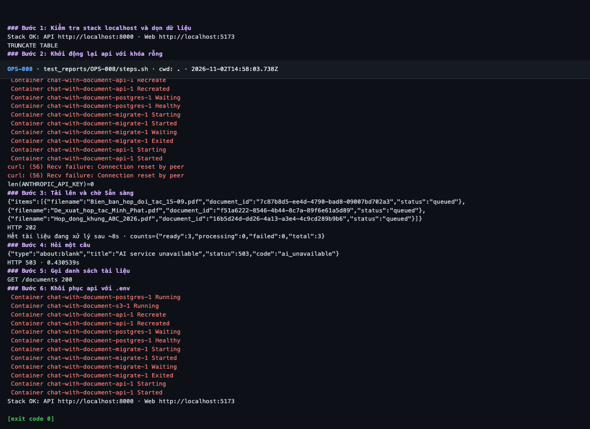

# Báo cáo kiểm thử — OPS-008: Thiếu ANTHROPIC_API_KEY: /ask 503, phần còn lại vẫn chạy

| Mục | Giá trị |
|---|---|
| Test case | [OPS-008](../../docs/07-verification/test_cases/OPS-008.md) |
| Kết luận | **✅ Đạt** |
| Thời gian chạy | 2026-11-02 21:58:03 → 21:58:30 (UTC+7) |
| Người / agent thực hiện | Claude Code (agent), `frontend/e2e/run-cli.mjs` + `steps.sh` |
| Commit | `c02cc72 (có thay đổi chưa commit)` |
| Môi trường | localhost · web http://localhost:5173 · API http://localhost:8000 · Darwin 27.0.0 arm64 · Docker 29.6.2 · ANTHROPIC_API_KEY: không |
| Script | [steps.sh](steps.sh) |

## Kết quả từng bước

| # | Thao tác | Kết quả mong đợi | Kết quả thực tế | Đạt? | Bằng chứng |
|---|---|---|---|---|---|
| 1 | Kiểm tra stack localhost và dọn dữ liệu | `Stack OK`; lệnh TRUNCATE thành công | Stack OK; TRUNCATE TABLE | ✅ | [ảnh](screenshots/01-buoc-1-kiem-tra-stack-localhost-va-don-du-lieu.png) |
| 2 | Khởi động lại api với khóa rỗng | api chạy lại; biến `ANTHROPIC_API_KEY` rỗng | `len(ANTHROPIC_API_KEY)=0` | ✅ | [ảnh](screenshots/02-buoc-2-khoi-dong-lai-api-voi-khoa-rong.png) |
| 3 | Tải lên và chờ Sẵn sàng | 202 rồi `ready: 3` | HTTP 202; ready: 3 | ✅ | [ảnh](screenshots/03-buoc-3-tai-len-va-cho-san-sang.png) |
| 4 | Hỏi một câu | HTTP 503, `code: ai_unavailable` | `HTTP 503`; `"code":"ai_unavailable"` | ✅ | [ảnh](screenshots/04-buoc-4-hoi-mot-cau.png) |
| 5 | Gọi danh sách tài liệu | HTTP 200 | `GET /documents 200` | ✅ | [ảnh](screenshots/05-buoc-5-goi-danh-sach-tai-lieu.png) |
| 6 | Khôi phục api với `.env` | api chạy lại | `Stack OK` | ✅ | [ảnh](screenshots/06-buoc-6-khoi-phuc-api-voi-env-ket-thuc.png) |

## Bằng chứng

- Video: [video.webm](video.webm)
- Log: [logs/cleanup.log](logs/cleanup.log), [logs/run-meta.json](logs/run-meta.json), [logs/steps.log](logs/steps.log)
- Ảnh:

  

  

  

  

  

  

## Lỗi phát hiện

Không có.

## Ghi chú và sai lệch so với test case

- Bước 2 có 2 dòng `curl: (56)` trong vòng chờ api khởi động; sau đó `/healthz` OK.
- Máy không có `.env`, nên "khôi phục với `.env`" ở bước 6 là khôi phục về cấu hình mặc định, khóa rỗng.
