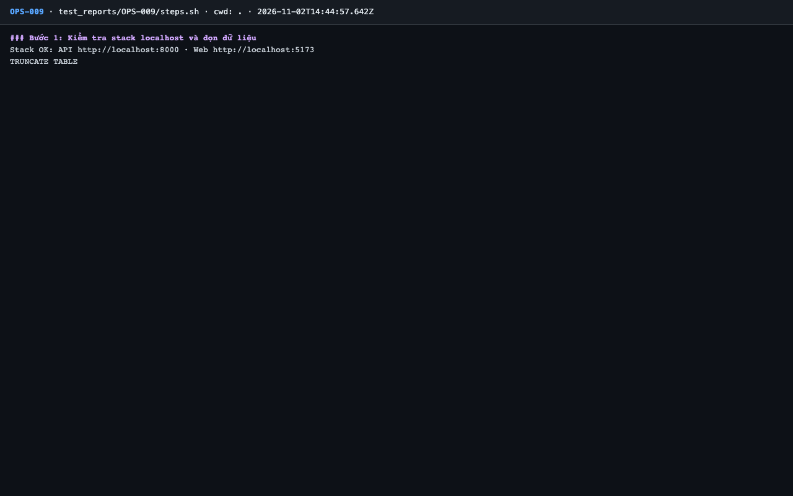
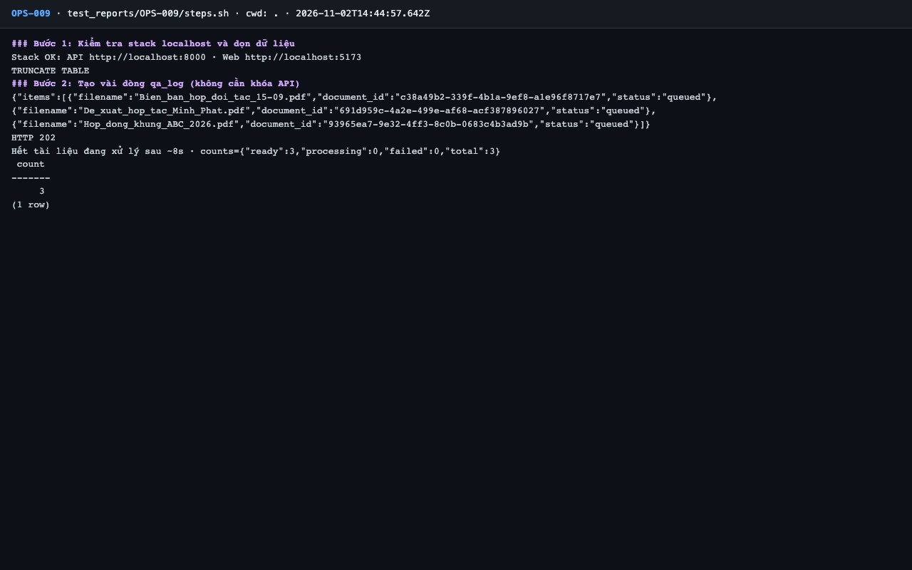
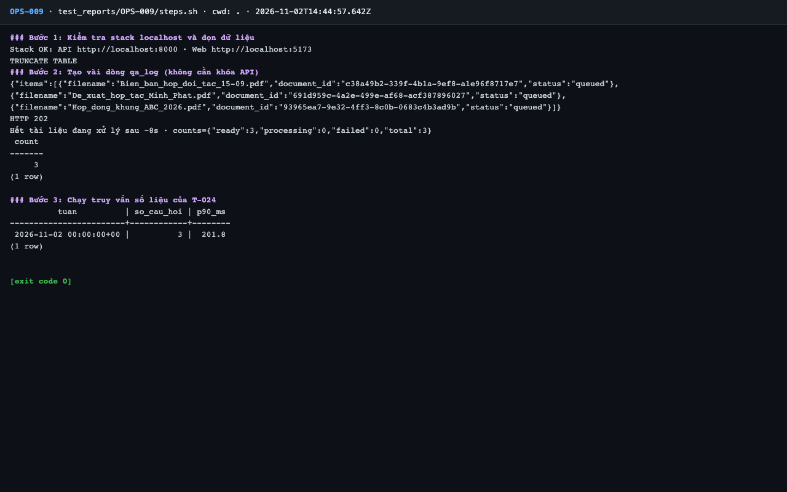

# Báo cáo kiểm thử — OPS-009: Truy vấn số liệu pilot chạy được

| Mục | Giá trị |
|---|---|
| Test case | [OPS-009](../../docs/07-verification/test_cases/OPS-009.md) |
| Kết luận | **✅ Đạt** |
| Thời gian chạy | 2026-11-02 21:44:57 → 21:45:08 (UTC+7) |
| Người / agent thực hiện | Claude Code (agent), `frontend/e2e/run-cli.mjs` + `steps.sh` |
| Commit | `c02cc72 (có thay đổi chưa commit)` |
| Môi trường | localhost · web http://localhost:5173 · API http://localhost:8000 · Darwin 27.0.0 arm64 · Docker 29.6.2 · ANTHROPIC_API_KEY: không |
| Script | [steps.sh](steps.sh) |

## Kết quả từng bước

| # | Thao tác | Kết quả mong đợi | Kết quả thực tế | Đạt? | Bằng chứng |
|---|---|---|---|---|---|
| 1 | Kiểm tra stack localhost và dọn dữ liệu | `Stack OK`; lệnh TRUNCATE thành công | Stack OK; TRUNCATE TABLE | ✅ | [ảnh](screenshots/01-buoc-1-kiem-tra-stack-localhost-va-don-du-lieu.png) |
| 2 | Tạo vài dòng `qa_log` (không cần khóa API) | 409 / 503 / 200 tùy dữ liệu | qa_log có dòng | ✅ | [ảnh](screenshots/02-buoc-2-tao-vai-dong-qa-log-khong-can-khoa-api.png) |
| 3 | Chạy truy vấn số liệu của T-024 | Một dòng theo tuần với `count` và `percentile_cont` | `2026-11-02 00:00:00+00 \|          3 \|  201.8` | ✅ | [ảnh](screenshots/03-buoc-3-chay-truy-van-so-lieu-cua-t-024-ket-thuc.png) |

## Bằng chứng

- Video: [video.webm](video.webm)
- Log: [logs/cleanup.log](logs/cleanup.log), [logs/run-meta.json](logs/run-meta.json), [logs/steps.log](logs/steps.log)
- Ảnh:

  

  

  

## Lỗi phát hiện

Không có.

## Ghi chú và sai lệch so với test case

- 3 dòng `qa_log` đều `status = error` (không có khóa). Truy vấn chạy đúng; `p90_ms` chỉ phản ánh đường lỗi, không phải độ trễ trả lời thật.
