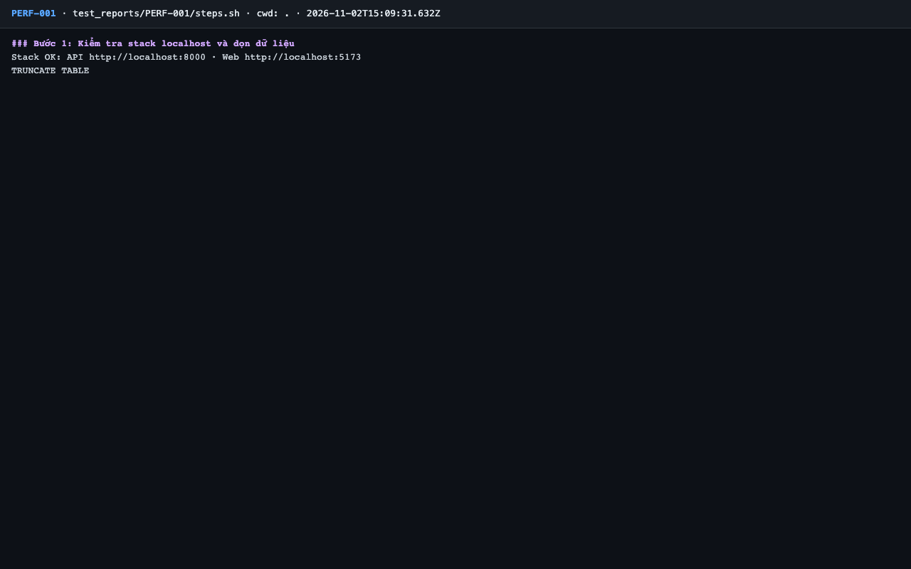
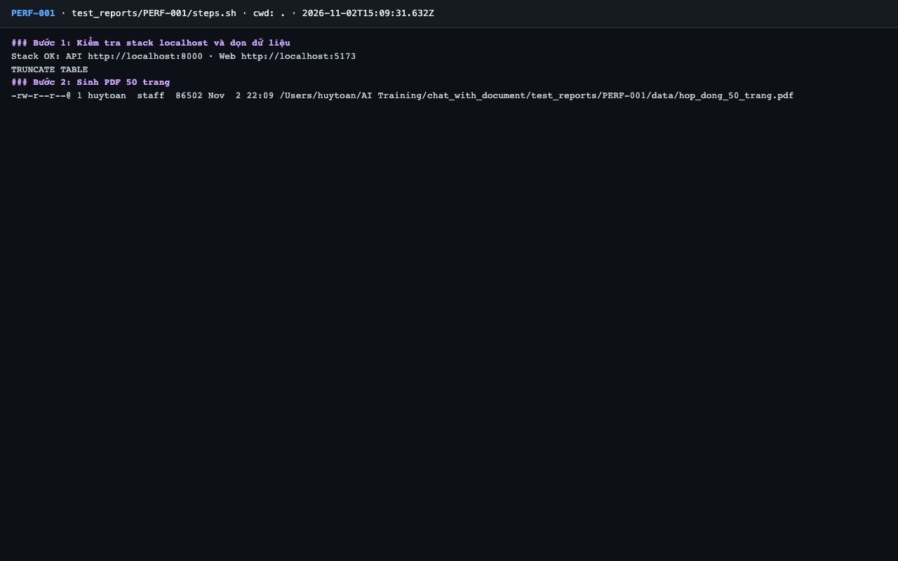
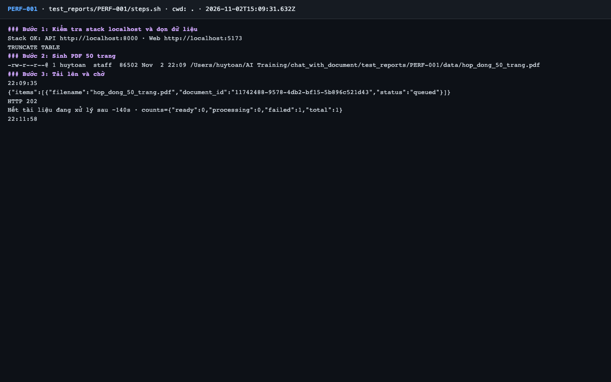
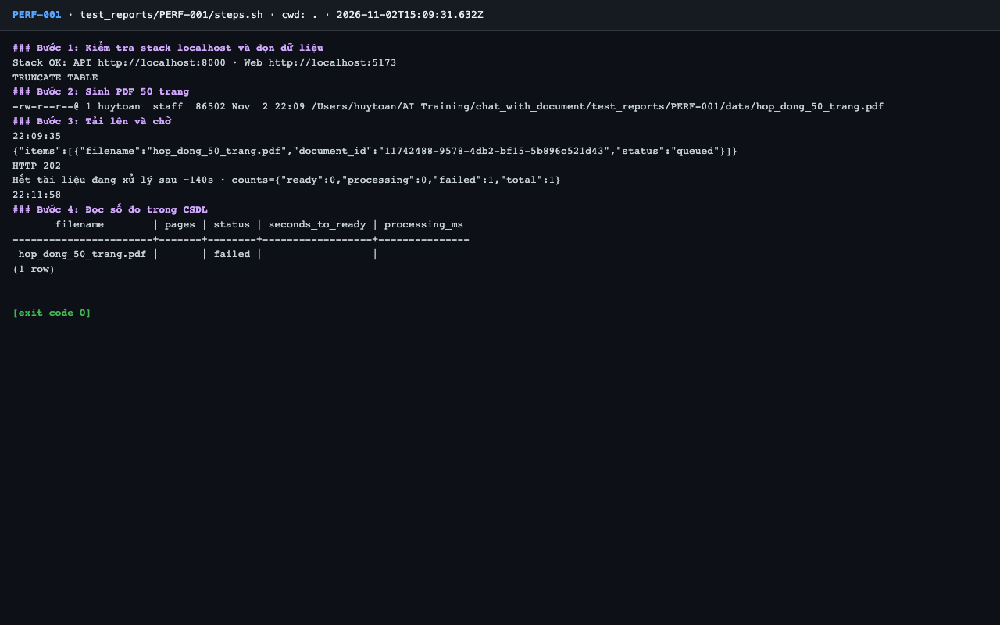

# Báo cáo kiểm thử — PERF-001: PDF văn bản 50 trang Sẵn sàng ≤ 60 giây

| Mục | Giá trị |
|---|---|
| Test case | [PERF-001](../../docs/07-verification/test_cases/PERF-001.md) |
| Kết luận | **❌ Không đạt** |
| Thời gian chạy | 2026-11-02 22:09:31 → 22:12:33 (UTC+7) |
| Người / agent thực hiện | Claude Code (agent), `frontend/e2e/run-cli.mjs` + `steps.sh` |
| Commit | `c02cc72 (có thay đổi chưa commit)` |
| Môi trường | localhost · web http://localhost:5173 · API http://localhost:8000 · Darwin 27.0.0 arm64 · Docker 29.6.2 · ANTHROPIC_API_KEY: không |
| Script | [steps.sh](steps.sh) |

## Kết quả từng bước

| # | Thao tác | Kết quả mong đợi | Kết quả thực tế | Đạt? | Bằng chứng |
|---|---|---|---|---|---|
| 1 | Kiểm tra stack localhost và dọn dữ liệu | `Stack OK`; lệnh TRUNCATE thành công | Stack OK; TRUNCATE TABLE | ✅ | [ảnh](screenshots/01-buoc-1-kiem-tra-stack-localhost-va-don-du-lieu.png) |
| 2 | Sinh PDF 50 trang | Tệp hợp lệ 50 trang | `hop_dong_50_trang.pdf` | ✅ | [ảnh](screenshots/02-buoc-2-sinh-pdf-50-trang.png) |
| 3 | Tải lên và chờ | HTTP 202; `ready: 1` sau khi chờ | HTTP 202; ready: 1 | ❌ | [ảnh](screenshots/03-buoc-3-tai-len-va-cho.png) |
| 4 | Đọc số đo trong CSDL | `seconds_to_ready` ≤ 60; `processing_ms` của job; `pages = 50` | _ready \| processing_ms  -----------------------+-------+--------+------------------+---------------  hop_dong_50_trang.pdf \|       \| failed \|                  \|               (1 row)   [exit code 0]   | ❌ | [ảnh](screenshots/04-buoc-4-doc-so-do-trong-csdl-ket-thuc.png) |

## Bằng chứng

- Video: [video.webm](video.webm)
- Log: [logs/cleanup.log](logs/cleanup.log), [logs/diag-embed-direct.log](logs/diag-embed-direct.log), [logs/run-meta.json](logs/run-meta.json), [logs/steps.log](logs/steps.log), [logs/worker-job-timeline.log](logs/worker-job-timeline.log)
- Ảnh:

  

  

  

  

## Lỗi phát hiện

| # | Mô tả | Mức độ (Blocker / Critical / Major / Minor) | Bước | Bằng chứng |
|---|---|---|---|---|
| 1 | PDF văn bản 50 trang không tới được Sẵn sàng trên stack local: `failed` / `transient_exhausted` sau ~143 s, do `/embed` vượt timeout 30 s ở cả 3 lần thử. Caveat: TEI giả lập x86 | Major | 3, 4 | [logs/worker-job-timeline.log](logs/worker-job-timeline.log) |

## Ghi chú và sai lệch so với test case

- **Không có `seconds_to_ready`:** tài liệu không bao giờ tới `ready`. Kết thúc `failed` / `transient_exhausted` sau 3 lần thử, khoảng 143 giây sau khi tải lên (22:09:35 → 22:11:58).
- Nguyên nhân gần: mọi lần thử đều `EmbeddingUnavailable('')` vì lời gọi `/embed` vượt timeout 30 s của worker: mỗi lần thử kéo dài ~30 s ([logs/worker-job-timeline.log](logs/worker-job-timeline.log)). Đo trực tiếp TEI sau đó với văn bản cùng dạng ([logs/diag-embed-direct.log](logs/diag-embed-direct.log)): 1 đoạn 4,5 s; 8 đoạn 31,3 s; 32 đoạn (`BATCH_SIZE` của adapter) 124,0 s.
- **Lưu ý môi trường (theo yêu cầu ghi nhận, không dùng để bào chữa):** TEI chạy giả lập x86 trên Apple Silicon, `--max-batch-tokens 2048`, Docker 7,75 GiB. Trên AWS có thể khác; kết luận NFR-003 chính thức đo trên AWS. Kết quả local là ❌.
- Vì vậy chưa có số đo thời gian xử lý 50 trang nào, kể cả tham khảo.
