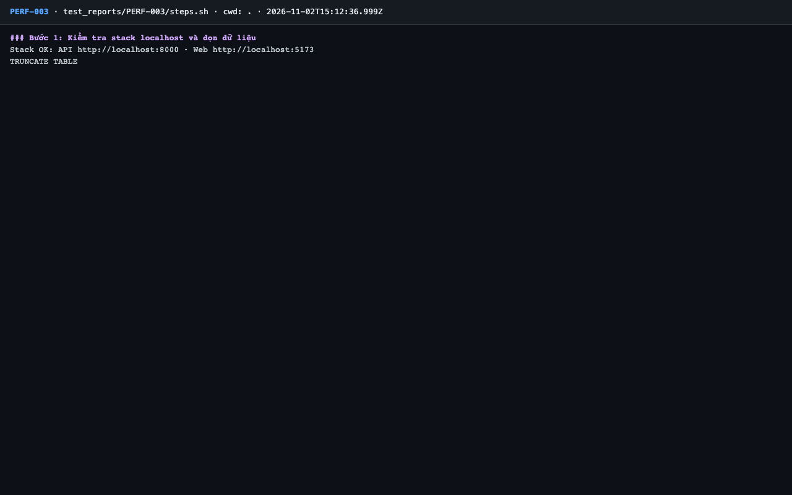
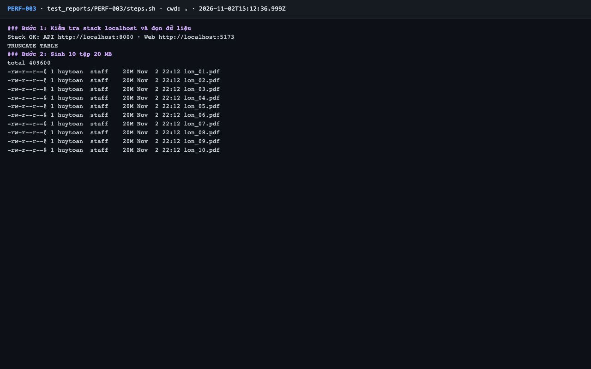
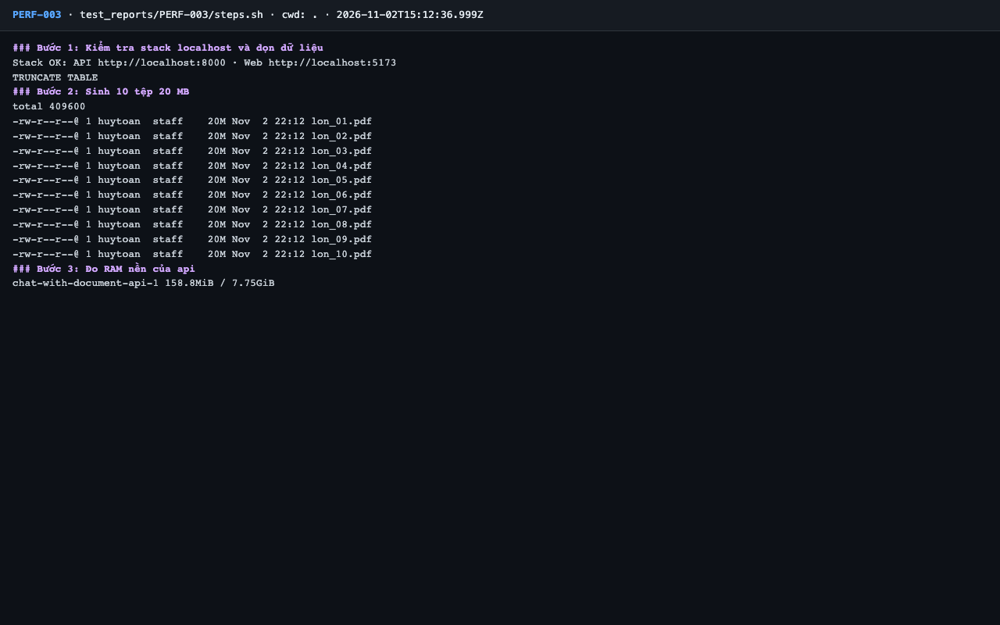
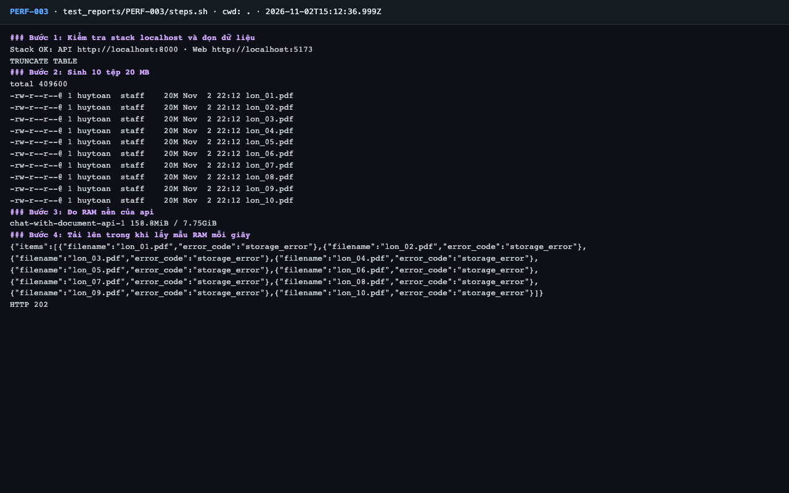
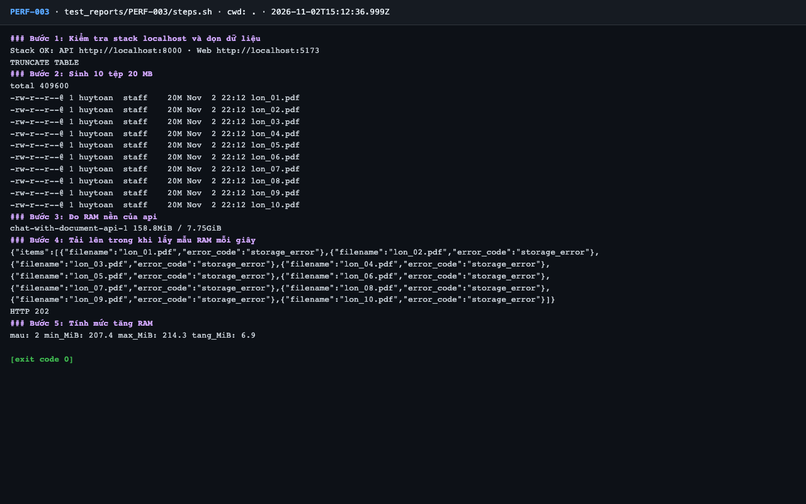

# Báo cáo kiểm thử — PERF-003: Tải lô 10 × 20 MB: RAM api tăng ≤ 100 MB

| Mục | Giá trị |
|---|---|
| Test case | [PERF-003](../../docs/07-verification/test_cases/PERF-003.md) |
| Kết luận | **❌ Không đạt** |
| Thời gian chạy | 2026-11-02 22:12:36 → 22:12:46 (UTC+7) |
| Người / agent thực hiện | Claude Code (agent), `frontend/e2e/run-cli.mjs` + `steps.sh` |
| Commit | `c02cc72 (có thay đổi chưa commit)` |
| Môi trường | localhost · web http://localhost:5173 · API http://localhost:8000 · Darwin 27.0.0 arm64 · Docker 29.6.2 · ANTHROPIC_API_KEY: không |
| Script | [steps.sh](steps.sh) |

## Kết quả từng bước

| # | Thao tác | Kết quả mong đợi | Kết quả thực tế | Đạt? | Bằng chứng |
|---|---|---|---|---|---|
| 1 | Kiểm tra stack localhost và dọn dữ liệu | `Stack OK`; lệnh TRUNCATE thành công | Stack OK; TRUNCATE TABLE | ✅ | [ảnh](screenshots/01-buoc-1-kiem-tra-stack-localhost-va-don-du-lieu.png) |
| 2 | Sinh 10 tệp 20 MB | 10 tệp trong `data/` | `lon_10.pdf` | ✅ | [ảnh](screenshots/02-buoc-2-sinh-10-tep-20-mb.png) |
| 3 | Đo RAM nền của api | Một giá trị `MemUsage` | `chat-with-document-api-1 158.8MiB` | ✅ | [ảnh](screenshots/03-buoc-3-do-ram-nen-cua-api.png) |
| 4 | Tải lên trong khi lấy mẫu RAM mỗi giây | HTTP 202, 10 item `queued` | HTTP 202; 0 item `queued` | ❌ | [ảnh](screenshots/04-buoc-4-tai-len-trong-khi-lay-mau-ram-moi-giay.png) |
| 5 | Tính mức tăng RAM | `tang_MiB` ≤ 100 | tang_MiB: 6.9 — không có giá trị kết luận: 2 mẫu lúc tính, cả 10 tệp bị từ chối ở bước 4 | — | [ảnh](screenshots/05-buoc-5-tinh-muc-tang-ram-ket-thuc.png) |

## Bằng chứng

- Video: [video.webm](video.webm)
- Log: [logs/cleanup.log](logs/cleanup.log), [logs/diag-s3-multipart.log](logs/diag-s3-multipart.log), [logs/mem-samples.txt](logs/mem-samples.txt), [logs/run-meta.json](logs/run-meta.json), [logs/steps.log](logs/steps.log)
- Ảnh:

  

  

  

  

  

## Lỗi phát hiện

| # | Mô tả | Mức độ (Blocker / Critical / Major / Minor) | Bước | Bằng chứng |
|---|---|---|---|---|
| 1 | Tải lên tệp > 8 MB (dưới giới hạn 20 MB) đều trả item `storage_error` trên stack local: multipart của boto3 bị S3Mock từ chối (`CompleteMultipartUpload` thiếu checksum từng phần). Chưa kiểm chứng trên S3 thật; nếu lặp lại trên AWS thì vi phạm US-005 / FR-007 | Critical (đề xuất, chờ kiểm chứng trên S3 thật) | 4 | [logs/diag-s3-multipart.log](logs/diag-s3-multipart.log) |

## Ghi chú và sai lệch so với test case

- **Phép đo RAM không có giá trị kết luận:** chỉ có 2 mẫu lúc tính (`docker stats` chậm, request kết thúc sau 2,8 s), `tang_MiB: 6.9`. Cả 10 tệp bị từ chối nên không có luồng lưu S3 trọn vẹn. Mẫu thô (3 dòng, dòng cuối ghi sau khi tính): [logs/mem-samples.txt](logs/mem-samples.txt).
- Chẩn đoán thêm (ngoài test case, trong container api, không sửa mã): `upload_fileobj` tới S3Mock **thành công với 1 MB và 7 MB, thất bại với 9 MB và 20 MB** — `CompleteMultipartUpload: BadRequest ... created using a crc32 checksum ... missing for part 1`. Xem [logs/diag-s3-multipart.log](logs/diag-s3-multipart.log). boto3 chuyển sang multipart từ 8 MB; `boto3 1.43.123` với image S3Mock đang ghim.
- **Chưa kiểm chứng trên S3 thật:** có thể chỉ xảy ra với S3Mock; cần kiểm tra trên AWS (ngoài phạm vi localhost). Comment `make_pdf big20mb` trong `lib.sh` và dữ liệu test case giả định tệp 20 MB được chấp nhận.
