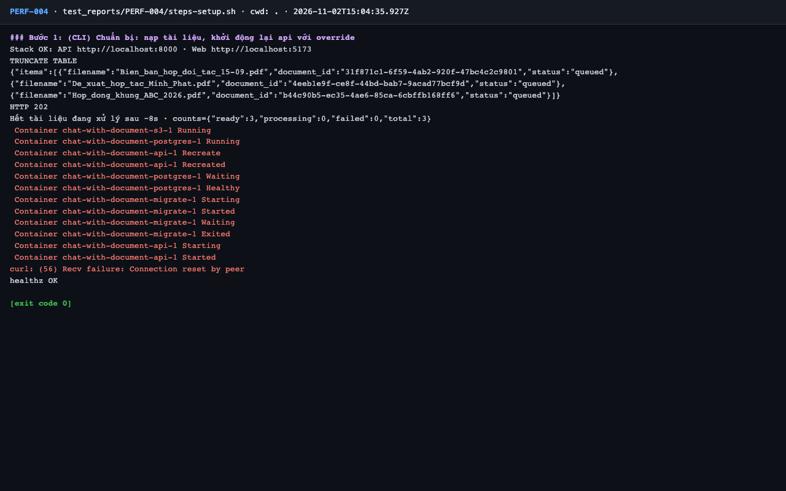
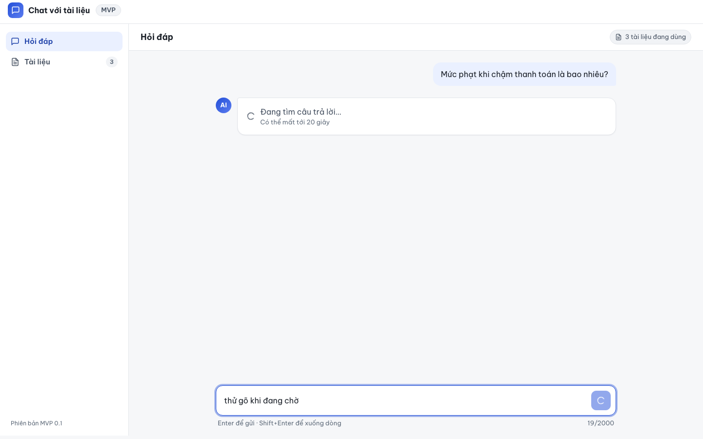
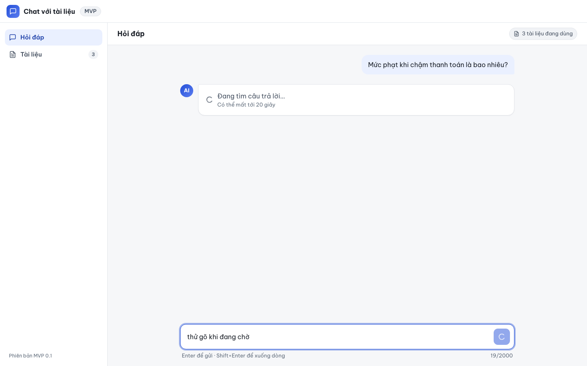
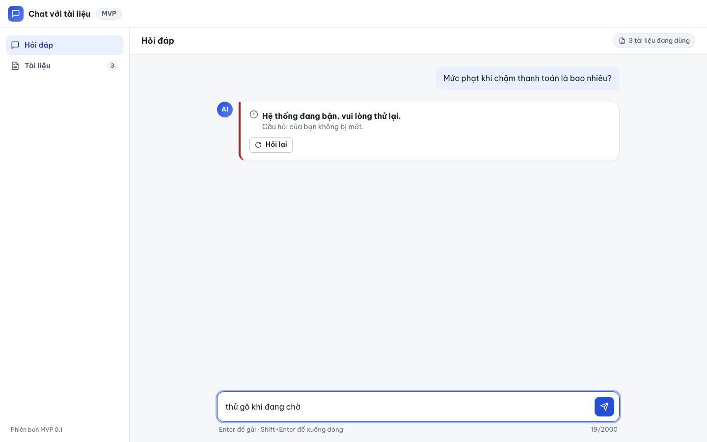
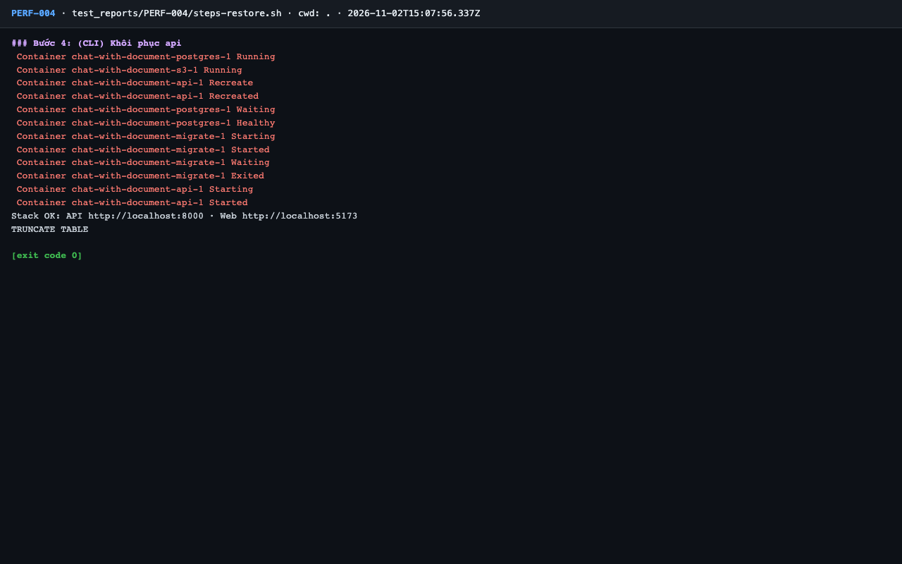

# Báo cáo kiểm thử — PERF-004: AI không phản hồi: báo lỗi trong ≤ 30 giây

| Mục | Giá trị |
|---|---|
| Test case | [PERF-004](../../docs/07-verification/test_cases/PERF-004.md) |
| Kết luận | **❌ Không đạt** |
| Thời gian chạy | 2026-11-02 22:04:35 → 22:08:05 (UTC+7) |
| Người / agent thực hiện | Claude Code (agent), `frontend/e2e/run-cli.mjs` + `steps.sh` |
| Commit | `c02cc72 (có thay đổi chưa commit)` |
| Môi trường | localhost · web http://localhost:5173 · API http://localhost:8000 · Darwin 27.0.0 arm64 · Docker 29.6.2 · ANTHROPIC_API_KEY: không |
| Script | [PERF-004.mjs](PERF-004.mjs), [steps-restore.sh](steps-restore.sh), [steps-setup.sh](steps-setup.sh) |

## Kết quả từng bước

| # | Thao tác | Kết quả mong đợi | Kết quả thực tế | Đạt? | Bằng chứng |
|---|---|---|---|---|---|
| 1 | (CLI) Chuẩn bị: nạp tài liệu, khởi động lại api với override | api chạy lại; `/healthz` 200 | `healthz OK`; `"ready":3` | ✅ | [ảnh](screenshots/01-buoc-1-cli-chuan-bi-nap-tai-lieu-khoi-dong-lai-api-voi-overr.png) |
| 2 | (UI) Mở `/ask`, gửi "Mức phạt khi chậm thanh toán là bao nhiêu?", bấm giờ từ lúc gửi | Spinner "Đang tìm câu trả lời…"; giao diện vẫn thao tác được (cuộn, gõ) | Spinner "Đang tìm câu trả lời…"; ô nhập gõ được ("thử gõ khi đang chờ"); cuộn thực hiện không lỗi | ✅ | [ảnh](screenshots/02-buoc-2-dang-cho.png) |
| 3 | (UI) Chờ tối đa 200 s tới khi xuất hiện thông báo lỗi; chụp ảnh lúc 30 s và lúc thông báo xuất hiện | "Hệ thống đang bận, vui lòng thử lại." + nút "Hỏi lại" xuất hiện trong **≤ 30 s**. Ghi số giây thực tế vào báo cáo | Thông báo xuất hiện sau 182.5 s (mục tiêu ≤ 30 s). Nội dung: "Hệ thống đang bận, vui lòng thử lại. Câu hỏi của bạn không bị mất. Hỏi lại"; nút Hỏi lại: 1 | ❌ | [ảnh](screenshots/03-buoc-3-moc-30s.png) |
| 4 | (CLI) Khôi phục api | api chạy lại với cấu hình gốc | `Stack OK` | ✅ | [ảnh](screenshots/05-buoc-4-cli-khoi-phuc-api-ket-thuc.png) |

## Bằng chứng

- Video: [video-02.webm](video-02.webm), [video-03.webm](video-03.webm), [video.webm](video.webm)
- Log: [logs/api-during-test.log](logs/api-during-test.log), [logs/browser-console.log](logs/browser-console.log), [logs/checks-ui.json](logs/checks-ui.json), [logs/run-meta.json](logs/run-meta.json), [logs/steps-restore.log](logs/steps-restore.log), [logs/steps-setup.log](logs/steps-setup.log)
- Ảnh:

  

  

  

  

  

## Lỗi phát hiện

| # | Mô tả | Mức độ (Blocker / Critical / Major / Minor) | Bước | Bằng chứng |
|---|---|---|---|---|
| 1 | AI không phản hồi: thông báo lỗi xuất hiện sau **182,5 s** so với mục tiêu ≤ 30 s (NFR-020). Đúng dự báo RISK-008: `llm_timeout_s = 60`, `max_retries = 2`. Thông điệp và nút Hỏi lại đúng. Cần Tech lead / PO quyết định | Major | 3 | [04-buoc-3-thong-bao-loi.png](screenshots/04-buoc-3-thong-bao-loi.png) |

## Ghi chú và sai lệch so với test case

- Local không có Nginx nên chưa thấy hành vi cắt ở 90 s (`proxy_read_timeout`). Theo log api, `/api/v1/ask` trả 503 sau `latency_ms = 182283` ([logs/api-during-test.log](logs/api-during-test.log)).
- Đo ở phía giao diện từ lúc gửi tới khi thông báo hiện. Số đo chủ yếu từ timeout LLM, gần như không phụ thuộc TEI giả lập.
- Khóa `sk-ant-dummy` và `ANTHROPIC_BASE_URL` không định tuyến theo đúng test case, không có lời gọi nào tới Anthropic. Sau bước 4: `ANTHROPIC_API_KEY` rỗng và không có base URL trong api.
