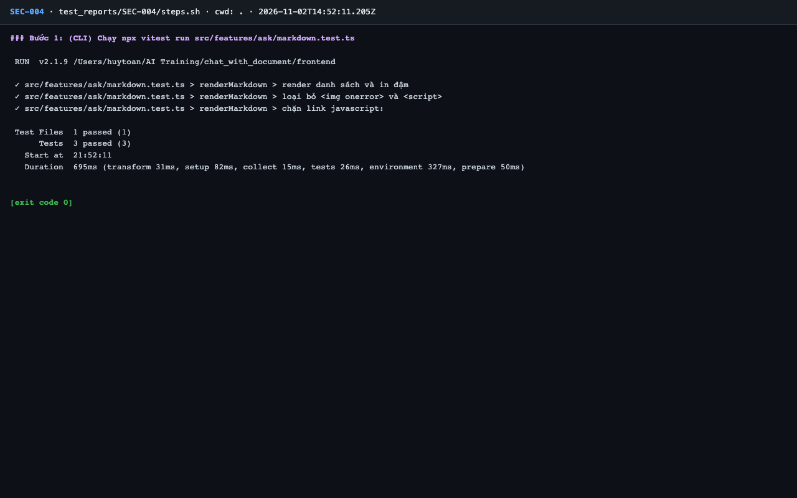
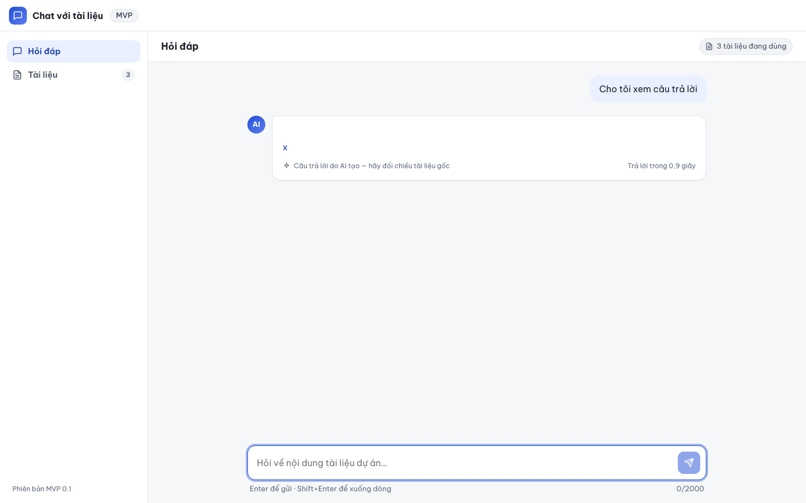

# Báo cáo kiểm thử — SEC-004: Chống XSS trong câu trả lời

| Mục | Giá trị |
|---|---|
| Test case | [SEC-004](../../docs/07-verification/test_cases/SEC-004.md) |
| Kết luận | **✅ Đạt** |
| Thời gian chạy | 2026-11-02 21:52:10 → 21:52:27 (UTC+7) |
| Người / agent thực hiện | Claude Code (agent), `frontend/e2e/run-cli.mjs` + `steps.sh` |
| Commit | `c02cc72 (có thay đổi chưa commit)` |
| Môi trường | localhost · web http://localhost:5173 · API http://localhost:8000 · Darwin 27.0.0 arm64 · Docker 29.6.2 · ANTHROPIC_API_KEY: không |
| Script | [SEC-004.mjs](SEC-004.mjs), [steps.sh](steps.sh) |

## Kết quả từng bước

| # | Thao tác | Kết quả mong đợi | Kết quả thực tế | Đạt? | Bằng chứng |
|---|---|---|---|---|---|
| 1 | (CLI) Chạy `npx vitest run src/features/ask/markdown.test.ts` | 3 passed | vitest: `Tests 3 passed (3)` | ✅ | [ảnh](screenshots/01-buoc-1-cli-chay-npx-vitest-run-src-features-ask-markdown-tes.png) |
| 2 | (UI) Giả lập `/api/v1/ask` trả payload: ``, `<svg onload=alert(2)>`, `<iframe src="javascript:alert(3)"></iframe>`, `<a href="javascript:alert(4)">x</a>`, ``; gửi 1 câu hỏi | Câu trả lời hiển thị dạng văn bản / HTML đã làm sạch | Câu trả lời hiển thị, innerText: "x" | ✅ | [ảnh](screenshots/02-buoc-2-cau-tra-loi.png) |
| 3 | (UI) Kiểm tra dialog và DOM | 0 dialog; không có `script`, `iframe`, thuộc tính `on*`, `href` dạng `javascript:` trong vùng câu trả lời (lưu `outerHTML` vào `logs/answer-dom.html`) | dialog: 0; script: 0; iframe: 0; on*: 0; javascript: 0. outerHTML ở logs/answer-dom.html | ✅ | [ảnh](screenshots/03-buoc-3-dom.png) |

## Bằng chứng

- Video: [video-02.webm](video-02.webm), [video.webm](video.webm)
- Log: [logs/answer-dom.html](logs/answer-dom.html), [logs/browser-console.log](logs/browser-console.log), [logs/checks-ui.json](logs/checks-ui.json), [logs/cleanup.log](logs/cleanup.log), [logs/run-meta.json](logs/run-meta.json), [logs/steps.log](logs/steps.log)
- Ảnh:

  

  

  

## Lỗi phát hiện

Không có.

## Ghi chú và sai lệch so với test case

- `/api/v1/ask` được giả lập theo đúng bước 2 của test case. DOM sau làm sạch: `` không còn `src`/`onerror`, `<a>x</a>` không còn `href`; không có `script`, `iframe`, `svg onload`. Xem [logs/answer-dom.html](logs/answer-dom.html).
