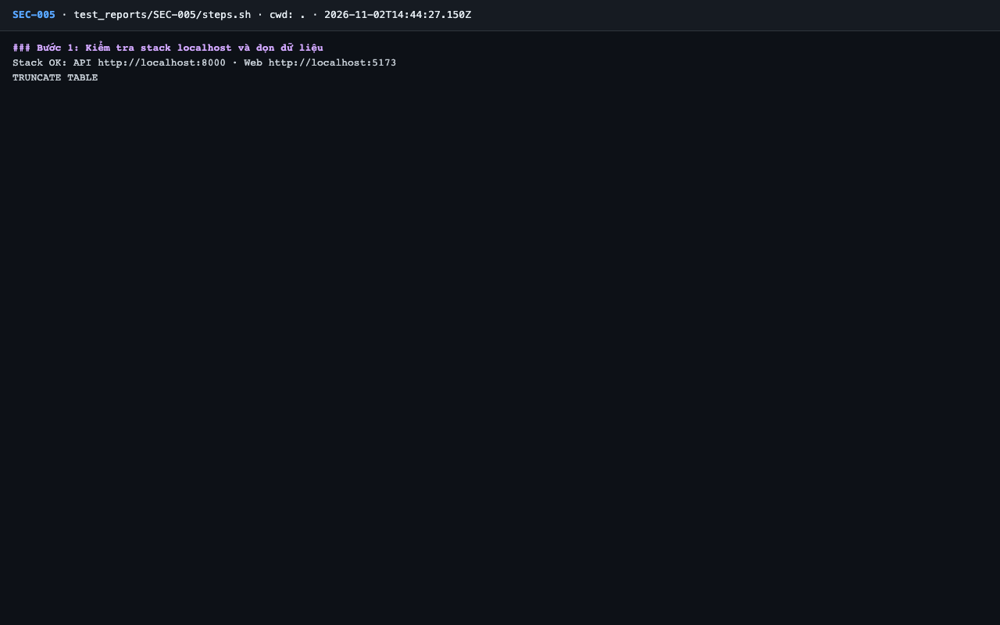
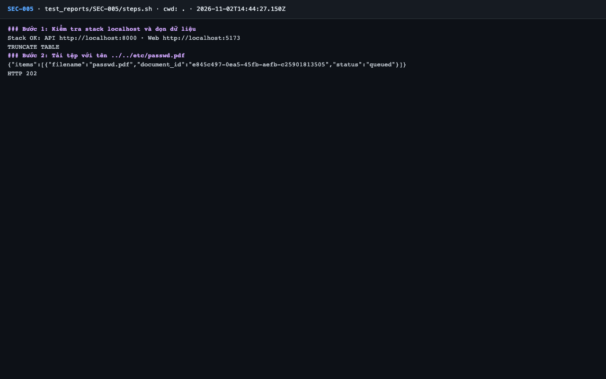
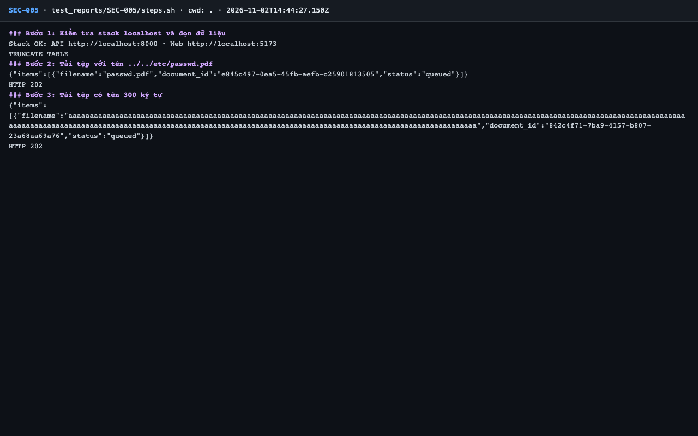
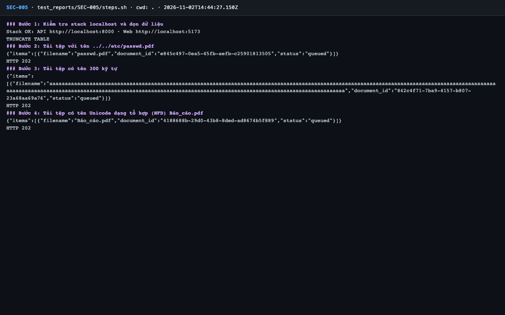
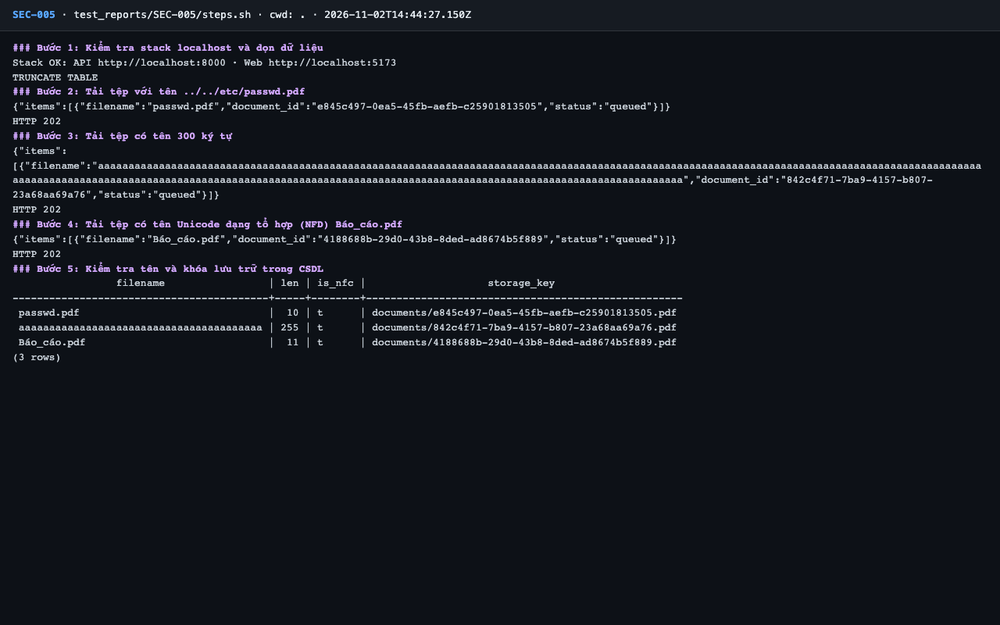
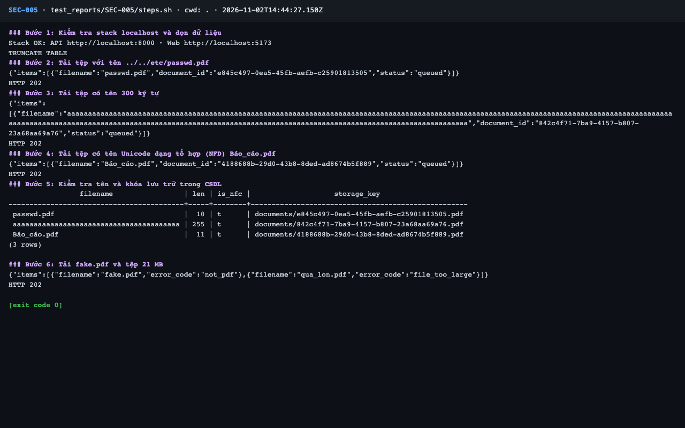

# Báo cáo kiểm thử — SEC-005: An toàn khi tải tệp (tên tệp, loại tệp, kích thước)

| Mục | Giá trị |
|---|---|
| Test case | [SEC-005](../../docs/07-verification/test_cases/SEC-005.md) |
| Kết luận | **✅ Đạt** |
| Thời gian chạy | 2026-11-02 21:44:26 → 21:44:29 (UTC+7) |
| Người / agent thực hiện | Claude Code (agent), `frontend/e2e/run-cli.mjs` + `steps.sh` |
| Commit | `c02cc72 (có thay đổi chưa commit)` |
| Môi trường | localhost · web http://localhost:5173 · API http://localhost:8000 · Darwin 27.0.0 arm64 · Docker 29.6.2 · ANTHROPIC_API_KEY: không |
| Script | [steps.sh](steps.sh) |

## Kết quả từng bước

| # | Thao tác | Kết quả mong đợi | Kết quả thực tế | Đạt? | Bằng chứng |
|---|---|---|---|---|---|
| 1 | Kiểm tra stack localhost và dọn dữ liệu | `Stack OK`; lệnh TRUNCATE thành công | Stack OK; TRUNCATE TABLE | ✅ | [ảnh](screenshots/01-buoc-1-kiem-tra-stack-localhost-va-don-du-lieu.png) |
| 2 | Tải tệp với tên `../../etc/passwd.pdf` | 202; tên lưu là `passwd.pdf` (không còn `../`) | `HTTP 202`; `"filename":"passwd.pdf"` | ✅ | [ảnh](screenshots/02-buoc-2-tai-tep-voi-ten-etc-passwd-pdf.png) |
| 3 | Tải tệp có tên 300 ký tự | 202; tên lưu ≤ 255 ký tự | HTTP 202; độ dài tên lưu = 255 | ✅ | [ảnh](screenshots/03-buoc-3-tai-tep-co-ten-300-ky-tu.png) |
| 4 | Tải tệp có tên Unicode dạng tổ hợp (NFD) `Báo_cáo.pdf` | 202; tên lưu ở dạng NFC | HTTP 202; tên lưu "Báo_cáo.pdf", NFC: True | ✅ | [ảnh](screenshots/04-buoc-4-tai-tep-co-ten-unicode-dang-to-hop-nfd-bao-cao-pdf.png) |
| 5 | Kiểm tra tên và khóa lưu trữ trong CSDL | Không tên nào chứa `/` hay `..`; `len` ≤ 255; `is_nfc = t`; `storage_key` dạng `documents/<uuid>.pdf` | 3 dòng: passwd.pdf len=10 nfc=t key=documents/e845c497…; aaaaaaaaaaaaaaaaaaaa len=255 nfc=t key=documents/842c4f71…; Báo_cáo.pdf len=11 nfc=t key=documents/4188688b… | ✅ | [ảnh](screenshots/05-buoc-5-kiem-tra-ten-va-khoa-luu-tru-trong-csdl.png) |
| 6 | Tải `fake.pdf` và tệp 21 MB | Item `not_pdf` và `file_too_large` | `"error_code":"not_pdf"`; `"error_code":"file_too_large"` | ✅ | [ảnh](screenshots/06-buoc-6-tai-fake-pdf-va-tep-21-mb-ket-thuc.png) |

## Bằng chứng

- Video: [video.webm](video.webm)
- Log: [logs/cleanup.log](logs/cleanup.log), [logs/run-meta.json](logs/run-meta.json), [logs/steps.log](logs/steps.log)
- Ảnh:

  

  

  

  

  

  

## Lỗi phát hiện

Không có.

## Ghi chú và sai lệch so với test case

- Tên 300 ký tự được cắt còn 255 ký tự. Tên NFD được lưu ở dạng NFC. Giới hạn kích thước request qua Nginx chỉ kiểm được trên AWS.
