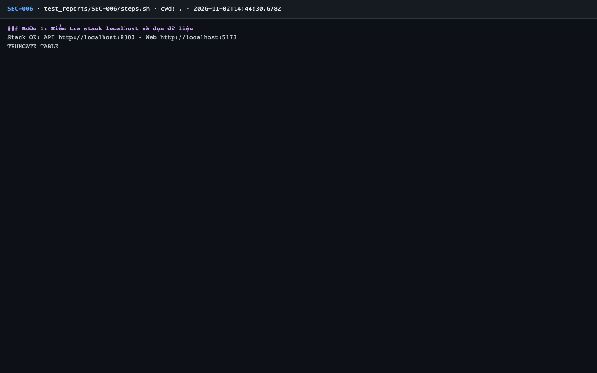
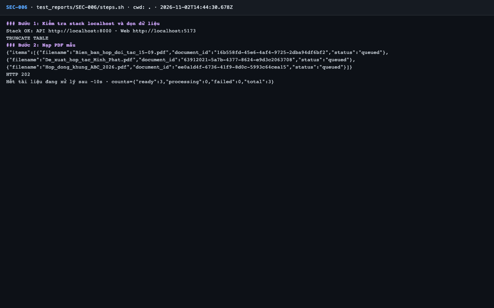
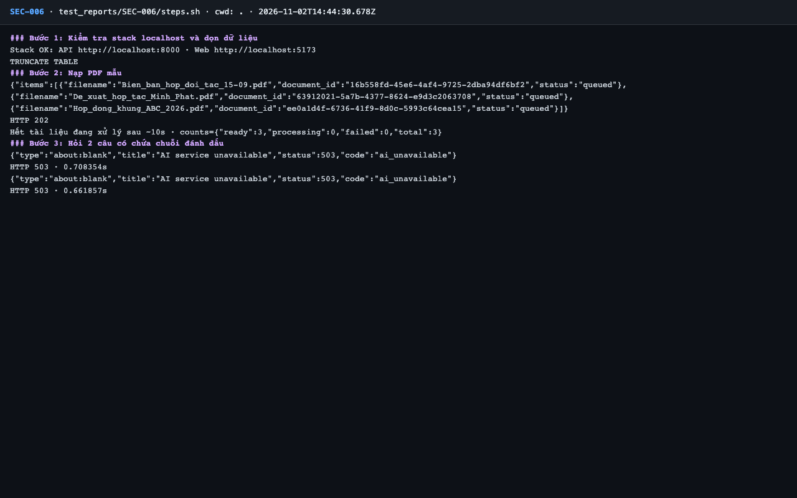
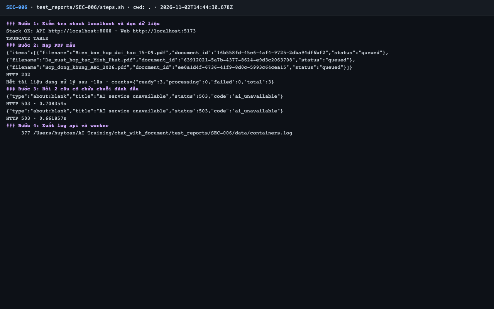
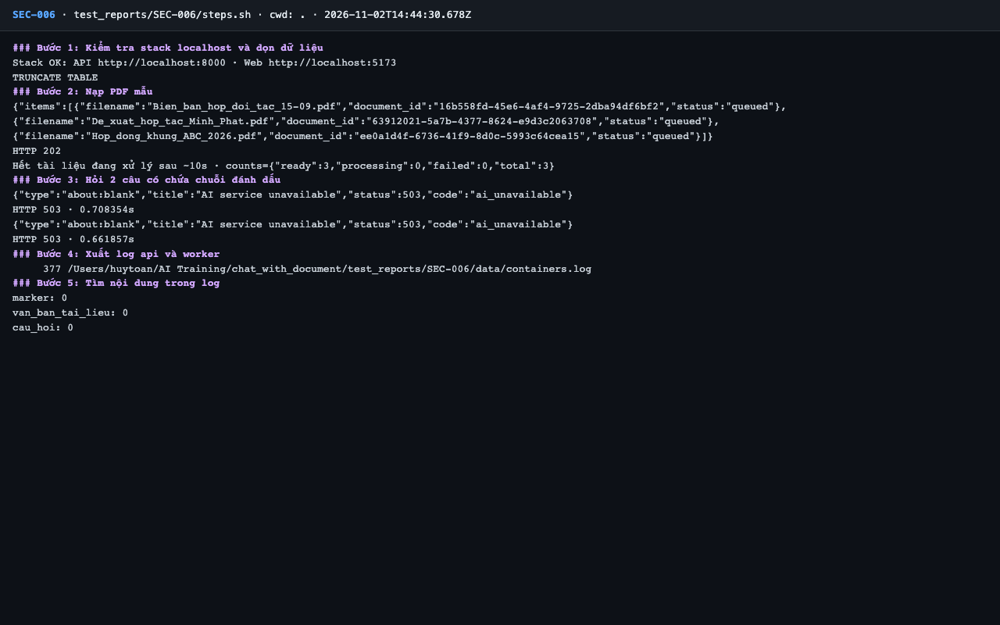
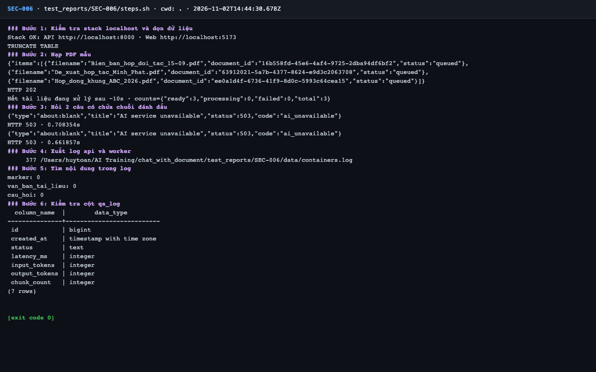

# Báo cáo kiểm thử — SEC-006: Không log nội dung câu hỏi, câu trả lời, tài liệu

| Mục | Giá trị |
|---|---|
| Test case | [SEC-006](../../docs/07-verification/test_cases/SEC-006.md) |
| Kết luận | **✅ Đạt** |
| Thời gian chạy | 2026-11-02 21:44:30 → 21:44:45 (UTC+7) |
| Người / agent thực hiện | Claude Code (agent), `frontend/e2e/run-cli.mjs` + `steps.sh` |
| Commit | `c02cc72 (có thay đổi chưa commit)` |
| Môi trường | localhost · web http://localhost:5173 · API http://localhost:8000 · Darwin 27.0.0 arm64 · Docker 29.6.2 · ANTHROPIC_API_KEY: không |
| Script | [steps.sh](steps.sh) |

## Kết quả từng bước

| # | Thao tác | Kết quả mong đợi | Kết quả thực tế | Đạt? | Bằng chứng |
|---|---|---|---|---|---|
| 1 | Kiểm tra stack localhost và dọn dữ liệu | `Stack OK`; lệnh TRUNCATE thành công | Stack OK; TRUNCATE TABLE | ✅ | [ảnh](screenshots/01-buoc-1-kiem-tra-stack-localhost-va-don-du-lieu.png) |
| 2 | Nạp PDF mẫu | `ready: 3` | ready: 3 | ✅ | [ảnh](screenshots/02-buoc-2-nap-pdf-mau.png) |
| 3 | Hỏi 2 câu có chứa chuỗi đánh dấu | 200 hoặc 503 (tùy có khóa API) | 2 câu → ['HTTP 503', 'HTTP 503'] (không có khóa → đường lỗi) | ✅ | [ảnh](screenshots/03-buoc-3-hoi-2-cau-co-chua-chuoi-danh-dau.png) |
| 4 | Xuất log api và worker | File `data/containers.log` | `containers.log` | ✅ | [ảnh](screenshots/04-buoc-4-xuat-log-api-va-worker.png) |
| 5 | Tìm nội dung trong log | Cả 3 số đếm đều `0` | `marker: 0`; `van_ban_tai_lieu: 0`; `cau_hoi: 0` | ✅ | [ảnh](screenshots/05-buoc-5-tim-noi-dung-trong-log.png) |
| 6 | Kiểm tra cột `qa_log` | Chỉ có `id, created_at, status, latency_ms, input_tokens, output_tokens, chunk_count` | Cột: id, created_at, status, latency_ms, input_tokens, output_tokens, chunk_count | ✅ | [ảnh](screenshots/06-buoc-6-kiem-tra-cot-qa-log-ket-thuc.png) |

## Bằng chứng

- Video: [video.webm](video.webm)
- Log: [logs/cleanup.log](logs/cleanup.log), [logs/run-meta.json](logs/run-meta.json), [logs/steps.log](logs/steps.log)
- Ảnh:

  

  

  

  

  

  

## Lỗi phát hiện

Không có.

## Ghi chú và sai lệch so với test case

- **Chỉ kiểm được đường lỗi** (test case cho phép): không có khóa nên cả 2 câu trả 503, đường trả lời thành công chưa được kiểm. Cần chạy lại khi có `ANTHROPIC_API_KEY`.
- **Lỗi văn bản test case (TC-04):** "Tiêu chí đạt" ghi "bước 6" cho 3 số đếm, thực tế là bước 5.
- Log `ingest_retry` có chuỗi lỗi SQLAlchemy nhưng chỉ gồm tên ràng buộc, không có tham số SQL (`grep -c "parameters:"` = 0).
