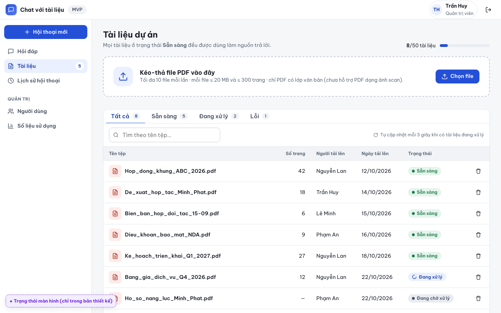
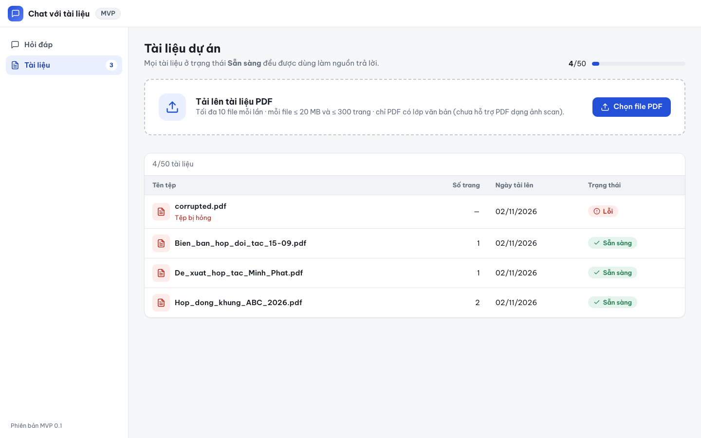
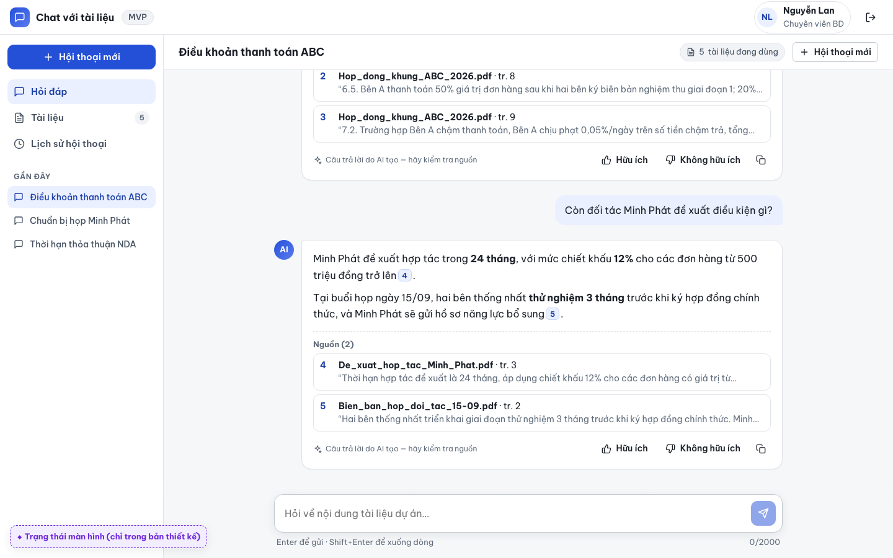
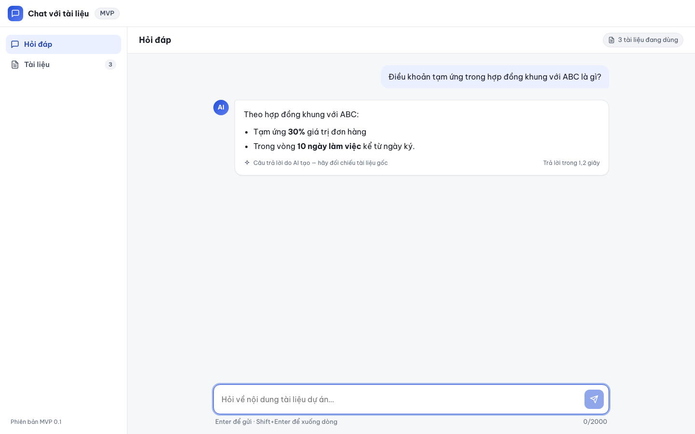

# Báo cáo kiểm thử — UI-001: Giao diện khớp thiết kế HTML (bản tối giản)

| Mục | Giá trị |
|---|---|
| Test case | [UI-001](../../docs/07-verification/test_cases/UI-001.md) |
| Kết luận | **⛔ Bị chặn** (một phần: phần kiểm được tự động đạt; kết luận "không có khác biệt Major" cần người xác nhận) |
| Thời gian chạy | 2026-11-02 21:45:53 → 21:46:07 (UTC+7) |
| Người / agent thực hiện | Claude Code (agent), script Playwright tự động |
| Commit | `c02cc72 (có thay đổi chưa commit)` |
| Môi trường | localhost · web http://localhost:5173 · API http://localhost:8000 · Darwin 27.0.0 arm64 · Docker 29.6.2 · ANTHROPIC_API_KEY: không |
| Script | [UI-001.mjs](UI-001.mjs) |

## Kết quả từng bước

| # | Thao tác | Kết quả mong đợi | Kết quả thực tế | Đạt? | Bằng chứng |
|---|---|---|---|---|---|
| 1 | Chụp 03-documents.html và /documents cùng kích thước 1440×900 | 2 ảnh để so sánh | Đã chụp 2 ảnh 1440×900 | ✅ | [ảnh](screenshots/03-buoc-1-chup-03-documents-html-va-documents-cung-kich-thuoc-1.png) |
| 2 | Chụp 04-chat.html và /ask (sau khi hỏi 1 câu, API giả lập) | 2 ảnh để so sánh | Đã chụp 2 ảnh 1440×900 | ✅ | [ảnh](screenshots/06-buoc-2-chup-04-chat-html-va-ask-sau-khi-hoi-1-cau-api-gia-la.png) |
| 3 | So sánh và lập bảng khác biệt trong báo cáo | Bố cục, màu, nhãn tương đương; không có thành phần đã bỏ (Tài liệu: kéo-thả, thanh tiến trình, tab, tìm kiếm, nút gỡ; Hỏi đáp: trích dẫn, Nguồn, panel PDF, đánh giá, nút Dừng, Gần đây) | Thành phần đã bỏ — Tài liệu: {"dragText":false,"rowProgress":0,"tabs":0,"search":0,"removeBtn":0,"h1":"Tài liệu dự án","cols":["Tên tệp","Số trang","Ngày tải lên","Trạng thái"]}; Hỏi đáp: {"cite":0,"sources":0,"panel":0,"feedback":0,"stop":false,"recent":false}. (Chỉ phần này được assert tự động; so sánh bố cục xem ghi chú.) | ✅ | [ảnh](screenshots/07-buoc-3-so-sanh-va-lap-bang-khac-biet-trong-bao-cao.png) |

## So sánh thiết kế và ứng dụng (bước 3)

**Đã kiểm tự động (khách quan):**

- Thành phần đã lược bỏ: không xuất hiện trên /documents (kéo-thả, thanh tiến trình theo dòng, tab, tìm kiếm, nút gỡ) và /ask (trích dẫn, mục Nguồn, panel PDF, đánh giá, nút Dừng, Gần đây). Số liệu: [logs/removed-components.json](logs/removed-components.json).
- Computed style (font, cỡ chữ, màu, nền, bo góc) của 18 selector chung trùng với thiết kế, trừ `textarea` (`border-radius` 0 → 6 px, không nhìn thấy vì nằm trong `.composer`). Topbar, sidebar, composer và h1 trang Tài liệu trùng cả vị trí và kích thước. Số liệu: [logs/style-compare.json](logs/style-compare.json).

**Agent quan sát bằng mắt trên ảnh 1440×900 (chưa có người xác nhận):**

| Màn hình | Khác biệt | Thiết kế | Ứng dụng | Đánh giá của agent | Ảnh |
|---|---|---|---|---|---|
| Chung | Topbar | Có avatar, tên, vai trò, nút đăng xuất | Không có | Đúng phạm vi: MVP không có đăng nhập | [thiết kế](screenshots/01-thiet-ke-03-documents.png) · [app](screenshots/02-app-documents.png) |
| Chung | Sidebar | Có "Hội thoại mới", "Lịch sử hội thoại", nhóm "Quản trị" | Chỉ "Hỏi đáp", "Tài liệu"; thêm "Phiên bản MVP 0.1" ở đáy | Đúng phạm vi v0.4; dòng phiên bản là chi tiết thêm | như trên |
| Tài liệu | Ô đếm dung lượng | "8/50 tài liệu" | "4/50" ở đầu trang, "4/50 tài liệu" trên thanh công cụ bảng | Khác nhỏ, nghi là Minor | như trên |
| Tài liệu | Khung tải lên | "Kéo-thả file PDF vào đây", nút "Chọn file" | "Tải lên tài liệu PDF", nút "Chọn file PDF"; **vẫn giữ viền nét đứt** | Đúng phạm vi; viền nét đứt gợi kéo-thả dù đã bỏ, cần BD xem | như trên |
| Tài liệu | Cột bảng | Có "Người tải lên", cột nút xóa | Không có | Đúng phạm vi | như trên |
| Tài liệu | Badge "Sẵn sàng" | Chấm tròn | Dấu tích (icon, theo UI-003) | Khác nhỏ, phù hợp yêu cầu có icon | như trên |
| Hỏi đáp | Thanh tiêu đề | Tiêu đề hội thoại, nút "Hội thoại mới" | "Hỏi đáp", chỉ còn nhãn số tài liệu | Đúng phạm vi | [thiết kế](screenshots/04-thiet-ke-04-chat.png) · [app](screenshots/05-app-ask.png) |
| Hỏi đáp | Chân câu trả lời | Nút Hữu ích / Không hữu ích / Sao chép; "hãy kiểm tra nguồn" | "hãy đối chiếu tài liệu gốc" + "Trả lời trong N giây" | Đúng phạm vi | như trên |

**Chưa kiểm được:** phán đoán chủ quan "bố cục tương đương / không có khác biệt Major" (BD hoặc thiết kế cần xác nhận); các trạng thái khác (rỗng, lỗi, đang tải) và bề rộng hẹp không nằm trong test case này. Thiết kế có dữ liệu mẫu khác ứng dụng nên không so khớp pixel. Câu trả lời ở /ask dùng API giả lập.

## Bằng chứng

- Video: [video.webm](video.webm)
- Log: [logs/checks.json](logs/checks.json), [logs/browser-console.log](logs/browser-console.log), [logs/setup.log](logs/setup.log)
- Ảnh:

  

  

  

  

  

  

  

## Lỗi phát hiện

Không có.

## Ghi chú và sai lệch so với test case

- Kết luận ⛔ vì tiêu chí đạt cần phán đoán chủ quan; agent không tự kết luận ✅. Không phát hiện khác biệt mà agent coi là Major, không có thành phần đã lược bỏ.
- `/api/v1/ask` được giả lập ở bước 2 (test case cho phép "có thể giả lập API"): trả câu trả lời mẫu không có trích dẫn.
