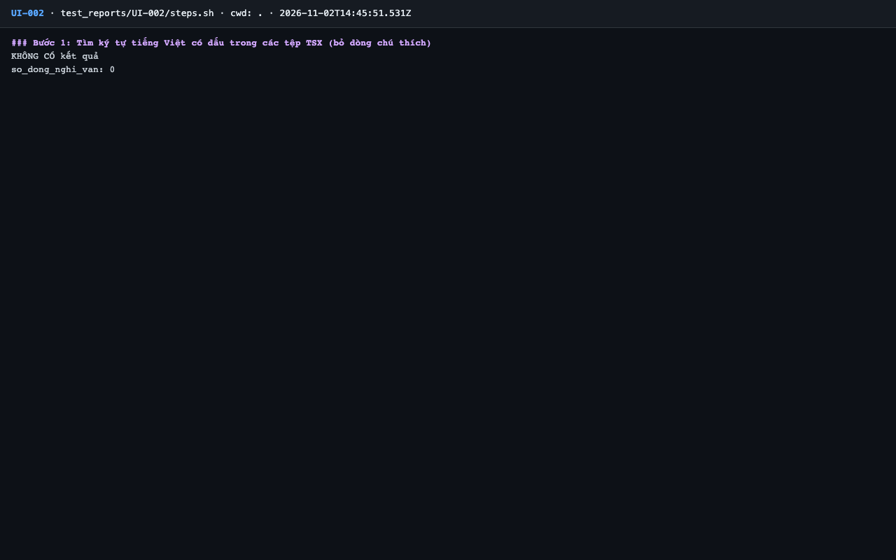
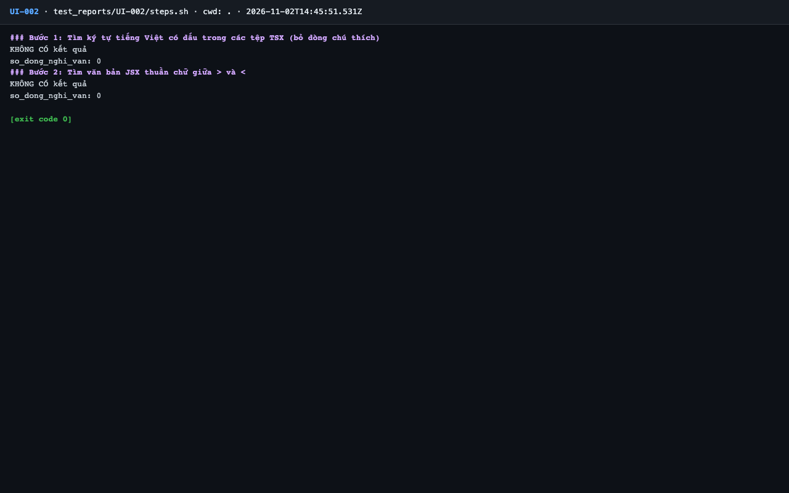

# Báo cáo kiểm thử — UI-002: Không có chuỗi giao diện viết cứng trong TSX

| Mục | Giá trị |
|---|---|
| Test case | [UI-002](../../docs/07-verification/test_cases/UI-002.md) |
| Kết luận | **✅ Đạt** |
| Thời gian chạy | 2026-11-02 21:45:51 → 21:45:53 (UTC+7) |
| Người / agent thực hiện | Claude Code (agent), `frontend/e2e/run-cli.mjs` + `steps.sh` |
| Commit | `c02cc72 (có thay đổi chưa commit)` |
| Môi trường | localhost · web http://localhost:5173 · API http://localhost:8000 · Darwin 27.0.0 arm64 · Docker 29.6.2 · ANTHROPIC_API_KEY: không |
| Script | [steps.sh](steps.sh) |

## Kết quả từng bước

| # | Thao tác | Kết quả mong đợi | Kết quả thực tế | Đạt? | Bằng chứng |
|---|---|---|---|---|---|
| 1 | Tìm ký tự tiếng Việt có dấu trong các tệp TSX (bỏ dòng chú thích) | `so_dong_nghi_van: 0` (hoặc agent xác nhận từng dòng không phải chuỗi hiển thị) | so_dong_nghi_van: 0 | ✅ | [ảnh](screenshots/01-buoc-1-tim-ky-tu-tieng-viet-co-dau-trong-cac-tep-tsx-bo-dong.png) |
| 2 | Tìm văn bản JSX thuần chữ giữa `>` và `<` | `so_dong_nghi_van: 0` (hoặc agent xác nhận từng dòng không phải chuỗi hiển thị) | so_dong_nghi_van: 0 | ✅ | [ảnh](screenshots/02-buoc-2-tim-van-ban-jsx-thuan-chu-giua-va-ket-thuc.png) |

## Bằng chứng

- Video: [video.webm](video.webm)
- Log: [logs/run-meta.json](logs/run-meta.json), [logs/steps.log](logs/steps.log)
- Ảnh:

  

  

## Lỗi phát hiện

Không có.

## Ghi chú và sai lệch so với test case

Không có.
