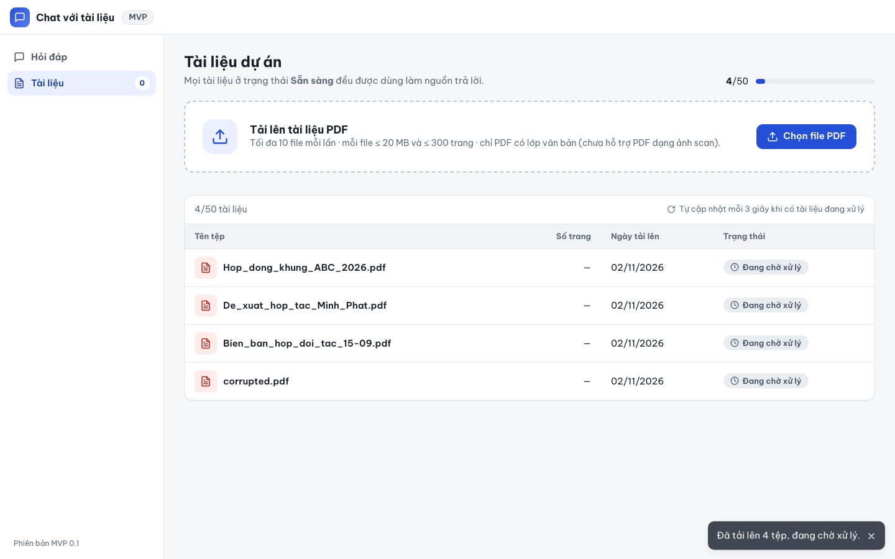
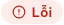
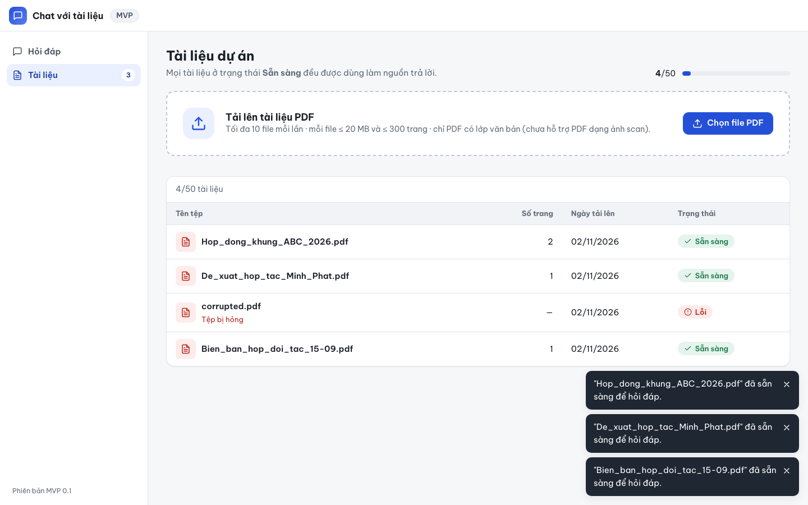

# Báo cáo kiểm thử — UI-003: Badge trạng thái có icon và chữ

| Mục | Giá trị |
|---|---|
| Test case | [UI-003](../../docs/07-verification/test_cases/UI-003.md) |
| Kết luận | **✅ Đạt** |
| Thời gian chạy | 2026-11-02 21:52:45 → 21:53:03 (UTC+7) |
| Người / agent thực hiện | Claude Code (agent), script Playwright tự động |
| Commit | `c02cc72 (có thay đổi chưa commit)` |
| Môi trường | localhost · web http://localhost:5173 · API http://localhost:8000 · Darwin 27.0.0 arm64 · Docker 29.6.2 · ANTHROPIC_API_KEY: không |
| Script | [UI-003.mjs](UI-003.mjs) |

## Kết quả từng bước

| # | Thao tác | Kết quả mong đợi | Kết quả thực tế | Đạt? | Bằng chứng |
|---|---|---|---|---|---|
| 1 | Mở /documents, tải lên 3 PDF mẫu và corrupted.pdf; chụp ngay sau khi tải | Thấy badge "Đang chờ xử lý" và/hoặc "Đang xử lý" | 4 badge "Đang chờ xử lý" (worker đang dừng) | ✅ | [ảnh](screenshots/02-buoc-1-mo-documents-tai-len-3-pdf-mau-va-corrupted-pdf-chup-.png) |
| 2 | Chờ hết xử lý, chụp bảng | Badge "Sẵn sàng" và "Lỗi" (kèm "Tệp bị hỏng") | 3 "Sẵn sàng"; 1 "Lỗi" kèm "Tệp bị hỏng"; bắt được "Đang xử lý": có | ✅ | [ảnh](screenshots/06-buoc-2-cho-het-xu-ly-chup-bang.png) |
| 3 | Kiểm tra DOM từng badge (chụp cận cảnh từng loại) | Mỗi badge có phần tử icon (svg) và chữ; ghi outerHTML của mỗi loại vào logs/badges.html | queued: svg=1, chữ="Đang chờ xử lý"; processing: svg=1, chữ="Đang xử lý"; ready: svg=1, chữ="Sẵn sàng"; failed: svg=1, chữ="Lỗi" | ✅ | [ảnh](screenshots/07-buoc-3-kiem-tra-dom-tung-badge-chup-can-canh-tung-loai.png) |

## Bằng chứng

- Video: [video.webm](video.webm)
- Log: [logs/checks.json](logs/checks.json), [logs/browser-console.log](logs/browser-console.log), [logs/setup.log](logs/setup.log)
- Ảnh:

  

  

  

  

  

  

  

## Lỗi phát hiện

Không có.

## Ghi chú và sai lệch so với test case

- Theo ghi chú của test case: dừng `worker` trước khi tải lên để chụp "Đang chờ xử lý", rồi bật lại để bắt "Đang xử lý" (lấy mẫu DOM mỗi 100 ms).
