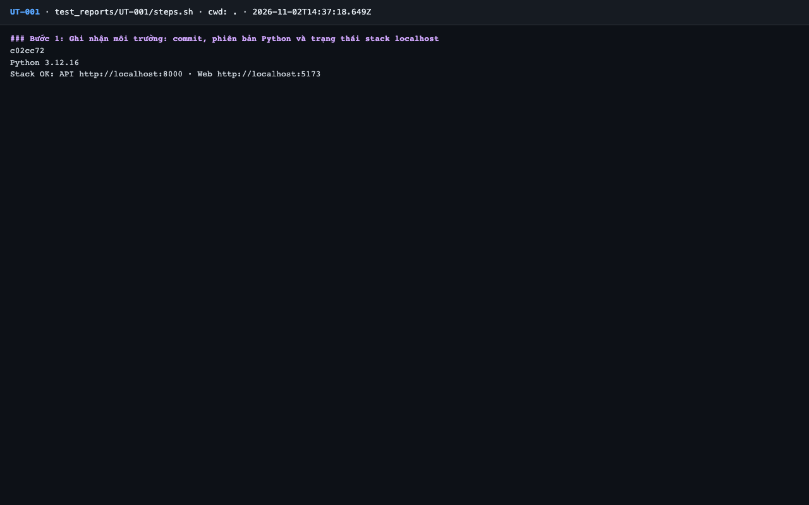
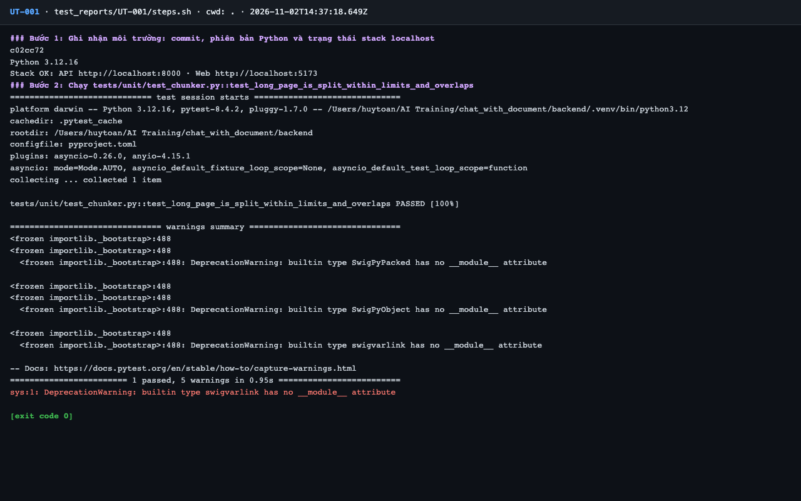

# Báo cáo kiểm thử — UT-001: Chunker: trang dài được chia trong giới hạn và có chồng lấp

| Mục | Giá trị |
|---|---|
| Test case | [UT-001](../../docs/07-verification/test_cases/UT-001.md) |
| Kết luận | **✅ Đạt** |
| Thời gian chạy | 2026-11-02 21:37:18 → 21:37:22 (UTC+7) |
| Người / agent thực hiện | Claude Code (agent), `frontend/e2e/run-cli.mjs` + `steps.sh` |
| Commit | `c02cc72 (có thay đổi chưa commit)` |
| Môi trường | localhost · web http://localhost:5173 · API http://localhost:8000 · Darwin 27.0.0 arm64 · Docker 29.6.2 · ANTHROPIC_API_KEY: không |
| Script | [steps.sh](steps.sh) |

## Kết quả từng bước

| # | Thao tác | Kết quả mong đợi | Kết quả thực tế | Đạt? | Bằng chứng |
|---|---|---|---|---|---|
| 1 | Ghi nhận môi trường: commit, phiên bản Python và trạng thái stack localhost | In ra commit hiện tại, Python 3.12 và trạng thái stack | commit `c02cc72`; Python 3.12.16; Stack OK | ✅ | [ảnh](screenshots/01-buoc-1-ghi-nhan-moi-truong-commit-phien-ban-python-va-trang-.png) |
| 2 | Chạy `tests/unit/test_chunker.py::test_long_page_is_split_within_limits_and_overlaps` | `1 passed` (hoặc mọi biến thể tham số đều passed), exit code 0 | pytest: `1 passed, 5 warnings in 0.95s` | ✅ | [ảnh](screenshots/02-buoc-2-chay-tests-unit-test-chunker-py-test-long-page-is-spl.png) |

## Bằng chứng

- Video: [video.webm](video.webm)
- Log: [logs/run-meta.json](logs/run-meta.json), [logs/steps.log](logs/steps.log)
- Ảnh:

  

  

## Lỗi phát hiện

Không có.

## Ghi chú và sai lệch so với test case

Không có.
