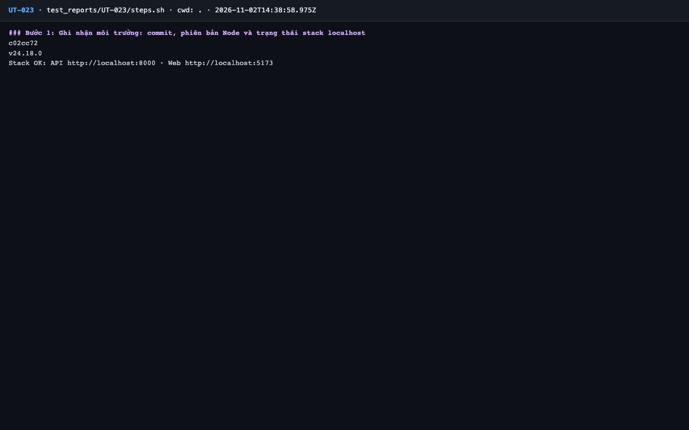
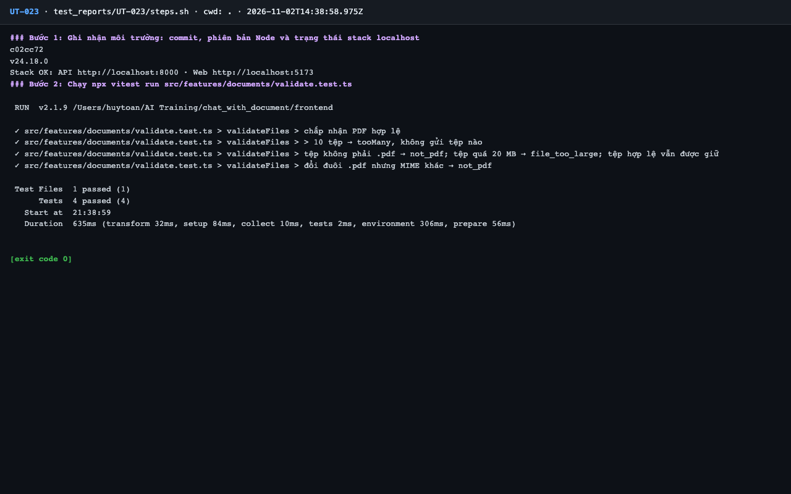

# Báo cáo kiểm thử — UT-023: Kiểm tra tệp phía client (số lượng, loại, dung lượng)

| Mục | Giá trị |
|---|---|
| Test case | [UT-023](../../docs/07-verification/test_cases/UT-023.md) |
| Kết luận | **✅ Đạt** |
| Thời gian chạy | 2026-11-02 21:38:58 → 21:39:02 (UTC+7) |
| Người / agent thực hiện | Claude Code (agent), `frontend/e2e/run-cli.mjs` + `steps.sh` |
| Commit | `c02cc72 (có thay đổi chưa commit)` |
| Môi trường | localhost · web http://localhost:5173 · API http://localhost:8000 · Darwin 27.0.0 arm64 · Docker 29.6.2 · ANTHROPIC_API_KEY: không |
| Script | [steps.sh](steps.sh) |

## Kết quả từng bước

| # | Thao tác | Kết quả mong đợi | Kết quả thực tế | Đạt? | Bằng chứng |
|---|---|---|---|---|---|
| 1 | Ghi nhận môi trường: commit, phiên bản Node và trạng thái stack localhost | In ra commit, Node ≥ 20 và trạng thái stack | commit `c02cc72`; Node `v24.18.0`; Stack OK | ✅ | [ảnh](screenshots/01-buoc-1-ghi-nhan-moi-truong-commit-phien-ban-node-va-trang-th.png) |
| 2 | Chạy `npx vitest run src/features/documents/validate.test.ts` | `Tests  4 passed (4)`, exit code 0 | vitest: `Tests 4 passed (4)` | ✅ | [ảnh](screenshots/02-buoc-2-chay-npx-vitest-run-src-features-documents-validate-t.png) |

## Bằng chứng

- Video: [video.webm](video.webm)
- Log: [logs/run-meta.json](logs/run-meta.json), [logs/steps.log](logs/steps.log)
- Ảnh:

  

  

## Lỗi phát hiện

Không có.

## Ghi chú và sai lệch so với test case

Không có.
